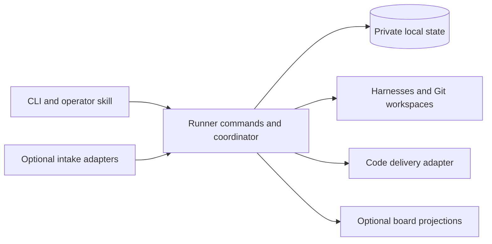

# Runner core redesign plan

Status: Phases 1 and 2 and the first phase 3 draft-publication bundle are implemented in `codex/runner-local-core`. Qualification is recorded below. Stop at durable draft publication: current-base verification, CI/integration and release qualification remain pending. Current store format is 5; earlier bundle notes below describe their historical formats.

Runner should own its work, approvals, execution and recovery state locally.
GitHub Projects should become an optional view. External tools should connect
through small integration contracts for intake, progress publication or code
delivery.

The first priority is a reliable, understandable core process. A user should
always be able to see what Runner is doing, why work is waiting, what needs a
decision, and what will happen next. Configuring models, reasoning, escalation,
retry limits and parallelism should not require understanding the workflow
implementation or a board's field schema.

The direction is recorded in [ADR 0005](decisions/0005-local-runner-core.md).
This is the designated replacement specification and build sequence, under
[AGENTS.md](../AGENTS.md). The [architecture](architecture.md) and existing
operator guides describe the Project-backed runtime. `cmd/runner-next` now
implements the first-slice commands, four phase 2 bundles and the first phase 3
draft-publication bundle below. Other release
capabilities remain build contracts and require a separate implementation instruction.

Start with [release scope](#first-release-scope), [core contracts](#core-contracts),
and the [first implementation slice](#first-implementation-slice).
The [coverage map](#requirement-coverage-map) connects important requirements to
their implementation phase and proof. Keep work status and evidence there as
slices land; do not create another plan or task registry.

## Accepted direction

1. Build a fresh core around one durable local source of truth and Runner-owned task IDs.
2. Preserve the event-and-action coordinator, the three execution contracts,
   dependency-aware concurrency, independent review and serialized integration.
3. Make the default journey complete and understandable before adding integrations.
4. Expose one execution policy with explicit retry and escalation semantics.
5. Introduce GitHub Projects as an optional projection, then prove the integration
   boundary with a second board provider. Defer externally loaded plugins.
6. Define test scope and strategy before implementation, and review test quality
   and consolidation as part of accepting every change.

Success means a user can set up Runner, submit and approve work, follow its
progress, resolve an interruption and reach a reviewed candidate without a
GitHub Project. GitHub code delivery can still require GitHub. The first
connected delivery milestone remains an accepted pull request and confirmed merge.

## First release scope

The first replacement release includes the complete local Plan/Ready process,
one repository/base per configured Runner instance, exact approval, independent
review, persisted recovery, configurable models/reasoning/escalation and
parallelism, an optional per-task harness-invocation ceiling, and readable local
status. It also includes GitHub PR/check/merge delivery, human merge by default,
explicit opt-in auto-merge, backup/restore, and a documented breaking cutover.
The existing [macOS/Linux amd64/arm64 builds](../scripts/build-release.sh)
remain the packaging target.

Use sandboxed Codex CLI as the first qualified harness. This selects a bounded
delivery scope, not a preferred model. The execution boundary remains capable
of other native harnesses; Claude and Pi qualification follow separately. Setup
must reject unqualified harness choices rather than silently substitute Codex.

Defer board views until after the core release. Also defer autonomous issue
intake, additional repository references, user-authored workflow composition,
time/token/cost admission ceilings, multi-host execution, a web dashboard and
externally loaded plugins. Preserve usage reporting, with unavailable usage
shown as unknown. These omissions are explicit release limits, not features
that agents may approximate. Add a deferred capability only with its own scoped
brief and acceptance evidence.

## Rebuild the core without inheriting its constraints

A fresh core is the recommended construction approach. The change in authority
from GitHub Projects to local state affects work identity, approval, scheduling,
recovery, configuration and tests. Extracting abstractions from the old design
first risks preserving those assumptions behind new interfaces. Build from the
accepted process and contracts, consulting the current code when a concrete
behavior, failure case or boundary needs investigation.

The old implementation remains valuable evidence. Carry forward required
invariants and known failure scenarios, then express them against the new
boundaries. Do not copy whole packages or the test suite merely to preserve
behavior parity. Evaluate a self-contained low-level component for reuse only
when its responsibility and contract fit directly and its complexity is justified.
Rewriting a sound subprocess or filesystem primitive brings no automatic benefit;
retaining one must not force the old work model into the new core.

Keep the rebuild incremental and runnable. Establish a complete local journey
early, then add the remaining required policies and integrations. A fresh start
does not require recreating every existing feature before anything works. It
does require maintaining authority, integrity and recovery boundaries in every
slice that can execute real work. Select the first release's capabilities
explicitly; omitted advanced features are documented, not silently approximated.

Backward compatibility is not a design requirement. New configuration, IDs,
state, commands and integration contracts may break compatibility. Provide an
upgrade utility only where conversion is small, deterministic and verifiable.
Otherwise publish a clearly breaking release with fresh setup and explicit
resubmission of remaining work. Do not build a compatibility layer, maintain two
active backends, or port historical approvals and recovery journals to avoid
that break. Retain old artifacts safely for inspection; breaking compatibility
does not authorize deleting existing work.

## Lessons and their disposition

The two assessments are [Assess source control article](codex://threads/01a13967-44ab-71f1-b689-ee91f0ea967d)
and [Review software-factory lessons](codex://threads/01a11fb1-f1c6-7a52-b8a2-f35fe00ece4f).
They provide design input, not evidence that either alternative has better
operational reliability than Runner. The software-factory references below use
the revision assessed in those chats.

| Learning and source | Decision for Runner |
| --- | --- |
| software-factory keeps its work locally and makes GitHub delivery optional. [Overview][factory] | Own work independently of external boards. Keep work management and code delivery separate. |
| Its quick start follows setup, specification, approval, execution and delivery. [Overview][factory] | Offer one recommended first-change journey. Preview and apply setup in one session. |
| Repository preparation establishes quality requirements and verification prerequisites. [Setup skill][factory-setup] | Agree authoritative checks and explicit baseline exceptions at setup; distinguish Runner readiness, repository readiness and integration availability. |
| Conversational operation explains running work, waits and escalations. [Dispatch skill][factory-dispatch-skill] | Add an operator skill over the same deterministic commands and local status. |
| Its status operation can also enforce worker limits. [Dispatcher][factory-dispatch] | Keep Runner inspection read-only; scheduling and recovery belong to explicit actions and the coordinator. |
| Plan review presents consequential decisions together. [Plan review][factory-plan] | Show outcome, scope, dependencies, assumptions and authorization in one approval preview. |
| The floor guard detects weakened checks, while behavioral cases test pressure to take shortcuts. [Guard][factory-guard], [cases][factory-cases] | First add paired evaluations for weakened tests and legitimate test refactors. Add narrow enforcement only if a demonstrated gap remains. |
| Visual QA produces evidence a fresh reviewer can inspect. [QA skill][factory-qa] | Retain suitable screenshots or recordings for interaction claims, bound to the candidate and checked for relevance. Avoid recording every task by default. |
| Carrying review through rebase based on an unchanged patch can miss interactions with the new base. [Dispatcher][factory-dispatch] | Preserve explicit base and candidate validation. An unchanged patch is insufficient authority to reuse acceptance. |
| Missing executable checks can remain gaps in the external check runner. [Check runner][factory-check] | Required missing proof blocks acceptance; process exit success alone does not establish completion. |
| Anthropic reports delivery infrastructure becoming the bottleneck as code production accelerates. [Article][anthropic] | Measure the complete Ready-to-merged path, integration waits and repeated review before changing scheduling. |
| Anthropic exposes metadata queries without requiring workspaces. [Article][anthropic] | Keep observation cheap; create a workspace only when an action needs files. Retain Git for Runner's workload. |
| Anthropic describes both excessive defensive agent review and useful simulations and fuzzing. [Article][anthropic] | Require concrete, reachable review findings. Invest in interruption, concurrency and publication tests instead of speculative machinery. |
| The earlier Runner assessment found competing recovery advice for moving a card to Ready and retrying its recorded stage. [Status rendering](../cmd/cortexium-runner/status.go) | Present the appropriate recovery first, including preserved work and the stage that repeats. |
| Runner already has candidate-bound evidence, focused follow-up review and private recurring-failure drafts. [Architecture](architecture.md), [evaluation guidance](model-profile-evaluation.md) | Preserve these contracts. Improve visibility and measure their effects rather than adding another review hierarchy or learning store. |

Keep Runner's continuous reconciliation, interchangeable harness boundary and
typed internal actions. Do not adopt file-overlap locks as a substitute for actual
resource conflicts, mandatory extra reviewer roles, or weaker pre-merge proof. Anthropic's
post-merge emphasis reflects its unusual scale and does not justify relaxing
Runner's integration contract. Worktrees also do not isolate ports, databases
or test fixtures: declare or allocate those resources when a repository needs them.

## Current constraints to replace

The [engine](../internal/engine/engine.go) owns a concrete `github.Project`;
work items, authorization and several process locks also belong to the GitHub
package. Each observation cycle loads Project lifecycle items. The
[configuration validator](../internal/config/project.go) requires a Project and
its lifecycle fields, while repository and merge settings sit under
`github_project`. This is deeper than an interchangeable board client.

The current design has useful protections for exact-content approval, complete
plan release, retained workspaces and interrupted publication. Some recovery
complexity compensates for multi-step remote writes. Local transactions can
remove those particular partial-write states. They cannot make Git operations,
model calls and remote publication atomic with a database transaction.

Configuration already supports role profiles, reasoning, an implementer ladder,
parallelism and budgets. However, QA limits live in workflow actions, the ladder
advances from Project QA failures, and provider retries use a fixed schedule
with in-memory state. [Roles](../internal/config/roles.go),
[workflow](../internal/config/workflow.go), [automatic retries](../internal/engine/automatic_retry.go).
The redesign should expose their meaning coherently and preserve limits across
restarts.

## The complete user journey

### Set up and prove readiness

Start with a local repository and one supported, authenticated harness. Guided
setup selects the repository and base, role profiles, parallelism, recovery
limits and delivery policy. It previews the resolved configuration once, then
applies it. External boards are optional subsequent connections.

Readiness has three separate results:

- Runner can invoke its configured profiles and protect the intended boundaries.
- The repository has known verification commands and the tools, services and
  inputs needed for the requested work.
- Each configured integration is available, unavailable or not configured.

Use existing repository commands and instructions. Missing requirements should
produce a concrete action; setup must not invent production credentials or
silently change the repository's quality requirements. Static inspection remains
non-billable. Live harness checks and repository commands have explicit scope.
One unavailable optional board does not make the whole setup unusable.

The guide ends with a small authorized change, its review evidence and, when
delivery is connected, its PR. It should not end at a successful configuration check.

### Repository quality agreement

Setup records the repository owner's definition of done and the instructions
and commands that establish it. Reuse existing repository policy; do not create
mandatory duplicate `DONE.md`, constraints files or a new testing framework.
Keep a versioned resolved agreement in private Runner state with references to
its authoritative repository sources. A task records the agreement revision
used for its verification brief.

For each required check, record its command, working directory, prerequisites
and permitted environment, plus the observed baseline revision and result.
Distinguish a passing check, a specific pre-existing failure and a check that
could not run. A missing tool or credential is a prerequisite gap, not a pass.
Static setup does not run arbitrary repository commands; preview the commands
and obtain authorization as part of setup before running the baseline.

The default is that required checks must pass. The owner may explicitly accept
a bounded, identified baseline exception with its scope and rationale. It cannot
cover a new or changed failure, excuse missing proof of the requested outcome,
or permit editing assertions until a gate turns green. Agents cannot grant or
broaden exceptions. Setup reports unresolved required gaps as blockers for work
that needs them, while unrelated inspection remains available.

Changes to authoritative commands, requirements or exceptions require an explicit
owner-applied agreement revision. Merely observing edited policy files cannot
relax a running task's contract. New tasks use the applied revision; existing
tasks keep their pinned agreement unless the owner explicitly selects them for
adoption. Adoption creates a new unapproved task version and revokes further
old-version actions. A weaker agreement cannot retroactively authorize a pass.
Test consolidation remains permitted when the same required guarantee is still
established.

### Submit and clarify work

Keep the two entry points:

- **Plan:** “I know the outcome; help me define the work.”
- **Ready:** “The task is sufficiently specified; implement it.”

A local Ready command is explicit authorization of the displayed task version.
Imported requests are untrusted input until an operator or configured trust
policy authorizes them. An external label or column name alone is not authority.
Retain the existing trusted issue-intake policy as an optional GitHub intake
capability; do not generalize private-repository trust to every external service.

The planner remains the ambiguity and decomposition boundary. It proposes
cohesive cards with acceptance criteria, proof obligations, non-goals and real
dependencies. No target number of cards, fixed file count or separate triage
agent is required. Open decisions remain questions on the request and prevent
release of an executable plan. Distinguish planning immediately from submitting
a planning request to the running coordinator.

### Approve the exact work

The preview leads with the intended outcome, proposed cards and dependencies,
material assumptions, expected verification and what approval permits. Full
task content remains inspectable. A complete batch is released atomically in
local state after its displayed version is revalidated.

Changing execution-defining requirements or dependencies invalidates the
affected authority and evidence. Presentation changes do not. A changed task
version must be approved before new execution; it cannot silently alter an
already running assignment. Revocation prevents subsequent privileged actions
and requests cancellation of affected active work while preserving its artifacts.
External completion already in progress is reconciled rather than assumed undone.

### Admit and execute safe actions

Keep one coordinator that observes state, derives safe actions and admits as
many as configuration allows. A poll is an observation boundary, not a batch.
Dependency outcomes and resource ownership determine safety; capacity and
budgets determine admission. Deterministic reconciliation does not consume
agent capacity or wait for unrelated agents.

Status and dispatch use the same eligibility calculation. A waiting task names
the dependency, occupied resource, capacity limit, budget, provider or decision
that prevents it from starting. Reserve capacity and record an attempt before
dispatch. Multiple CLI operations and the service share these bounds.

Implementation uses an isolated workspace and the exact authorized task.
Preserve useful work, feedback and valid saved results on recovery. Reports
identify commands, settings, outcomes and material limits; a model's claim that
a check passed is not independent proof that it did. The user sees the actual
role, model, reasoning, current stage, elapsed time and remaining recovery allowance.

### Review with sufficient evidence

Keep the independent reviewer and its existing evidence audit followed by
focused dynamic verification when necessary. Assess the approved outcome and
affected contracts as well as listed proof obligations. Review findings must
describe a concrete failure, its evidence and the relevant requirement.
Hypothetical improvements do not automatically become rejection criteria.

Distinguish accepted work, confirmed defects, a missing human decision and
incomplete evidence. A decision request takes priority over automatic repair.
An unavailable test environment is not a code defect. Preserve valid prior
findings and evidence; rerun checks for concrete gaps or invalidating changes.
Candidate bindings establish provenance, not the truth of every reported result.

Changing a base or candidate requires reassessing affected proof. Reuse exact
accepted results for interrupted deterministic publication only under the
existing integrity conditions. A missing required check cannot become a pass
because a review budget is exhausted.

### Publish and integrate

Store the reviewed candidate and evidence before remote publication. Publication
and integration use the code-host adapter, independently of any board adapter.
After a timeout or restart, inspect remote identity and outcome before repeating
a write. Recover an existing PR instead of creating a duplicate.

Serialize integration per repository and base. Refresh against the latest base,
resolve conflicts through bounded repair, and obtain the required verification
and review before merge. Preserve protection against base movement between
verification and the merge request. Human merge is the default; automatic merge
requires explicit policy and all the same correctness conditions.

Publication, CI, human review and integration waits remain distinguishable.
Missing remote observations never establish success. Closed-without-merge PRs
do not satisfy dependencies. A reviewed local candidate awaiting delivery is
useful progress, but it is not a merged implementation.

### Finish, stop and recover

A code task succeeds when its intended integration is confirmed. A planning
operation can finish while the original request remains incomplete; the request
finishes only after all required children succeed. Board updates, issue closure
and other housekeeping can retry independently of that recorded outcome.

Keep graceful drain: stop new admission and let admitted actions finish.
Immediate cancellation is a separate explicit operation. Restart reconciles
unfinished attempts and retained artifacts before admitting conflicting work;
it does not blindly rerun every stage marked active. Loss of the coordinator's
ownership must not allow a replacement to race surviving harness processes.

Every actionable failure presents its cause, preserved work, required action,
resume stage, expected repeated work and private evidence location. Recovery
does not require manually arranging board columns. The recommended action is
specific; alternatives explain their different effects.

## State and progress that users can understand

Separate the task's lifecycle stage from its waiting reason and current attempt.
“Waiting for provider” is not another workflow lane. “Needs your decision” is
different from “retry limit reached.” Board column names are display mappings.
The default display vocabulary is:

| Stage | Meaning |
| --- | --- |
| Draft | A request is captured but its planning or implementation is not yet authorized. |
| Planning | Runner is clarifying or decomposing the request. |
| Awaiting approval | A complete proposal needs authorization. |
| Ready | Work is authorized; a stated dependency or admission limit may still prevent starting. |
| Implementing | An implementation or repair attempt is active. |
| Reviewing | Independent assessment or required verification is active. |
| Awaiting delivery | A reviewed candidate needs publication, checks, human review or integration. |
| Completed | The intended successful outcome is confirmed. |
| Stopped | Work was cancelled or abandoned; this does not satisfy dependencies. |

Attention and wait reasons decorate those stages instead of creating a second
workflow graph. For example, an interrupted review remains Reviewing with a
specific recovery reason. Later user-authored workflows may name additional
states, but must provide the same stage, wait and next-action explanations.

The local status view leads with decisions and recovery actions, then active
work, ordinary waits and recent completions. Inspection is read-only. A
continuous display refreshes observations without granting execution authority.
Machine-readable status supports the operator skill and any future local UI.
Remote views show their last successful synchronization time and stale state.

Illustrative output, not an implemented CLI contract:

```text
Needs you
  R-42  Reviewing — browser capability unavailable
        Candidate and implementation evidence retained; no code rejection.
        Next: repair the browser capability, then resume review.

Working
  R-43  Implementing — repair 1 of 2
        Profile: implementer-careful; reasoning: high
        Reason: confirmed review defect; next: independent review

Waiting
  R-44  Ready — dependency R-43 has not merged
  R-45  Awaiting delivery — GitHub unavailable; reviewed candidate retained

Integrations
  GitHub Projects — stale; local work continues
```

The operator skill should answer “what needs me?”, explain a wait, preview a
policy change and perform an authorized recovery through these same commands.
It adds no alternative approval rules, direct database editing or scheduler.

## Core contracts

These are semantic contracts, not a requirement for one table or interface per
row. The engine decides transitions; the store atomically checks their expected
revisions and writes the resulting state. No transaction spans a model call,
Git operation or network request.

| Record | Required identity and meaning |
| --- | --- |
| Repository | Runner-owned identity bound to the validated local Git repository and configured base ref. A display path or remote board ID is not identity. |
| Task version | Stable local task ID plus monotonically increasing version and digest of execution-defining content: outcome, scope, constraints, acceptance/proof brief, dependencies, repository/base policy and quality-agreement revision. Store immutable versions; changing the title alone need not invalidate authority unless it changes the task's meaning. |
| Approval | Exact task ID/version/digest, authorization scope and recorded operator or explicit trusted-intake decision. Approval and revocation have a generation checked by every privileged action. A digest identifies content; possessing it is not authorization. |
| Attempt | Unique ID, task/version, approval generation, stage, pinned policy/profile, resolved base, owned resources, reserved allowances and invocation/result state. Preserve prior attempts; a retry is not an overwrite. |
| Candidate and review | Repository, task/version, base commit, candidate commit/tree, workspace identity, quality revision and evidence references. Review acceptance is valid only for this binding, after Runner validates the structured result and integrity checks. |
| External effect | Stable operation/object identity, authorized intent and observed outcome. Written before publication; ambiguous outcomes are reconciled, never assumed absent. This is needed from phase 3, not an empty framework in phase 1. |

Approval and admission use compare-and-set checks in short transactions. Repeating
approval of the same still-current version returns the existing approval; it does
not reset attempts or create another execution. A stale preview is rejected.
Requirements edits create an unapproved version and revoke future actions under
the old one. Display-only edits must not change the version's delegated content.

At admission, recheck authority, required dependencies, readiness, capacity and
resource ownership, then reserve the attempt and its allowances together. At
result commit, recheck the attempt, approval generation and candidate binding.
Results arriving after revocation are retained as historical evidence but cannot
advance work. A single task may have only one unfinished execution owner; a
resource cannot be released merely because a wall-clock lease expired.

| Transition | Guard and committed effect |
| --- | --- |
| Draft to Ready | Approve the exact complete task version. No harness is launched by approval itself. |
| Ready to Implementing | Reserve one eligible implementation attempt and its resources before launch. |
| Implementing to Reviewing | Validate and durably record the completed result, construct/validate its candidate, then make independent review eligible. A model's success string is insufficient. |
| Reviewing to Awaiting delivery | Required proof is sufficient, independent review accepts, and candidate/authority checks still match. No dependency is satisfied yet. |
| Reviewing to repair | A confirmed defect and remaining repair allowance permit another implementation attempt. Missing proof or a decision stays Reviewing with its own attention reason. |
| Awaiting delivery to Completed | Confirm the authorized integration outcome. Local acceptance or PR creation alone cannot complete a code task. |
| Any nonterminal stage to Stopped | Record revocation, prevent new actions, request cancellation and retain artifacts. Show cancellation pending until owned processes are known to have stopped. |

Plan adds a planning operation and an awaiting-approval proposal in phase 2.
Release all approved children and dependency edges in one transaction; reject
cycles, missing targets and stale proposal content. Planning success alone does
not complete the request. Failed, stopped or closed-unmerged dependencies do not
count as success.

Stage, waiting reason and attempt state remain separate. Recovery clears a
specific wait only after its prerequisite is satisfied; it cannot manufacture
approval, a passing review or unused allowance. Configured repository/base
identity changes require explicit setup and new task authority, not a hot switch
for retained work.

## Configuration and bounded recovery

### One visible execution policy

Keep named role profiles for harness, model, reasoning, timeout and supported
capabilities. An escalation step references a complete implementer profile; it
can change the model, reasoning, or both. Runner never infers capability or
price order from a model name. Offer supported choices for the installed harness
and reject unsupported combinations instead of silently substituting them.

The default workflow should be generated from one documented policy. Later
user-authored typed workflows must compile into the same coordinator and obey
the same limits. A setting must have one owner: do not retain competing
QA limits in workflow actions and recovery settings.

These are the first-release controls and pilot defaults. The first slice supports
the smaller explicit subset below; unsupported settings must fail validation.
Tune later revisions against observed rework, waiting and operator intervention:

| Control | Pilot default and meaning |
| --- | --- |
| Planner, implementer and reviewer profiles | Explicit profiles selected during setup; no new universal model default. Show resolved model, reasoning, timeout and access. |
| Implementer escalation | Disabled initially. An ordered list of approved profiles advances after a confirmed reviewer rejection, before the next permitted repair. |
| Automatic repair limit | Two additional implementation passes per approved task version. Includes QA repair, candidate correction, CI rework and conflict repair. Initial implementation is not a repair. |
| Transient retry limit | Three additional attempts for a recognized transient failure in the same stage recovery episode: 30 seconds before retry 1, two minutes before retry 2, then five minutes before each later retry up to the configured limit. Zero disables automatic retry. |
| Parallelism | One concurrent harness invocation initially; configurable from 1 to 16 in phase 2. Includes planning, implementation and review across service and CLI. |
| Role timeouts | Explicit per-profile values; use current generated values as initial tuning references and record setup choices. |
| Admission budget | Optional harness-invocation ceiling per approved task version; absent means no such ceiling. Reserve before launch and count planning preparation, audit, focused review, retries and repairs. A definitely unlaunched reservation may be released; uncertain launch counts until reconciled. Report time/tokens/cost where available; their admission ceilings are deferred. |
| Delivery | Human merge by default. Auto-merge is an explicit setting independent of board configuration. |
| Base freshness | Refresh before implementation by default. Optional use of an available recorded base during a code-host outage; latest-base verification remains mandatory for integration. |
| External views | None required. Each connection has its own destination and publication scope. |

Two repair passes preserve the default allowance of initial implementation plus
two QA-driven corrections, but deliberately also bound automatic paths that
currently do not count as QA rejections. Keep QA rejection counts as quality
evidence and the escalation trigger; stop using that count as the only general
repair bound. A candidate-correction call consumes a repair even when made inside
the same engine action. This prevents hidden extra model work.

A transient retry of a repair resumes that reserved repair pass; it does not
consume another repair allowance. All harness invocations still count toward
admission budgets and usage. Both repair and transient counters are reserved
before dispatch, so interruption cannot manufacture an extra attempt. A repair
limit of zero permits initial implementation and review but no automatic repair.

Example: profiles `implementer` and `implementer-careful`, with two repairs,
start on `implementer`. A confirmed rejected review permits repair 1 on
`implementer-careful`. A second rejection permits repair 2 on that final profile.
Another rejection stops for an operator decision. A provider outage repeats the
same stage/profile within its transient allowance and does not advance the ladder.
CI rework and conflicts consume repairs but do not imply a stronger model is needed.
Planner-selected starting profiles must come from the configured allowlist; show
the resulting reachable escalation sequence before release.

### Failure and retry rules

| Event | Automatic behavior | What the user sees |
| --- | --- | --- |
| Recognized transient provider or browser-startup failure | Retry the same stage/profile within its transient limit. | Cause, attempt count, next retry time and remaining allowance. |
| Confirmed reviewer defect | Repair within the task's repair allowance; advance the configured ladder. | Findings, selected next profile and repair count. |
| Candidate correction, terminal CI failure or integration conflict | Bounded repair with retained context; no automatic model escalation. | Concrete reason, retained branch/candidate and remaining repairs. |
| Required evidence unavailable, missing decision, invalid configuration or unknown harness failure | Stop for the specific operator action. | Exact missing input or capability and the stage that can resume. |
| Authority or integrity mismatch | Prevent further privileged work and retain evidence. | The changed binding and explicit recovery requirements. |
| Interrupted deterministic post-processing | Reconcile the existing effect; reuse an exact valid saved result. | Which operation resumes and whether any new harness call is needed. |
| Optional board unavailable | Retain pending synchronization and continue unrelated work. | Integration health and synchronization age, separate from task failure. |
| Admission limit reached | Wait without cancelling admitted work or weakening QA. | The limiting capacity or budget and when it can be reevaluated. |

Persist counters, reasons and retry deadlines. Restart and ordinary inspection
do not reset them. A successful stage ends its transient recovery episode;
changing error text does not. An explicit manual retry does not silently grant
a fresh repair budget. Additional allowance requires a visible operator choice
and records its scope. Changed requirements create a newly approved task version
while preserving prior attempts and outcomes.

Clean base refreshes can still cause repeated review without implementation.
Bound automatic refresh-and-review cycles separately, initially to two per
approved task version, then request operator intervention. Ordinary initial QA
does not consume this allowance; each base movement that requires another review
does. Returning through repair or restarting does not reset it. This advanced
integration limit prevents endless verification when the base keeps moving. Existing
bounded transport retries remain internal adapter behavior, with their total
calls visible; they must not multiply into independent unbounded retry loops.

### Make policy changes predictable

Provide an interactive editor, a non-interactive equivalent, validation and a
resolved-policy explanation. The preview says, for example, “two repairs remain;
the next confirmed rejection selects this model and reasoning.” Include warnings
for unreachable escalation steps and budgets that cannot admit the selected work.
Routine changes should not require editing nested workflow JSON.

Validate and atomically apply the whole change. Pin the effective configuration
revision to every attempt. Model, reasoning and recovery-policy edits affect the
next admitted attempt after operator application; active attempts retain their
recorded configuration. A pending transient retry retains its recorded profile
unless the change preview explicitly selects it for a profile change. Counters
carry forward. Lowering parallelism stops new
admission until active work fits; it does not cancel active agents. Lowering a
limit below consumed allowance stops the next automatic action.

Permission expansion, changed delivery authority and changed task scope require
their own explicit authorization. Escalation alone must not widen filesystem,
network or tool access. Switching reviewer profiles does not carry acceptance
across a changed candidate or base. Keep a compact history of applied policy
revisions so recovery and metrics can explain which settings governed each action.

### First slice configuration contract

Keep JSON and strict decoding. This is the minimal new configuration shape;
`SELECT_SUPPORTED_MODEL` and absolute paths are setup inputs, not working
defaults. The format marker deliberately distinguishes it from legacy v5.
There is no Project, workflow-lane or credential field.

```json
{
  "format": "runner-local-v1",
  "repository": {
    "path": "/absolute/repository",
    "base_ref": "refs/heads/main",
    "base_freshness": "recorded"
  },
  "state_dir": "/absolute/private-runner-state",
  "worktree_dir": "/absolute/runner-worktrees",
  "profiles": {
    "build": {
      "harness": "codex",
      "model": "SELECT_SUPPORTED_MODEL",
      "reasoning": "high",
      "timeout": "20m"
    },
    "review": {
      "harness": "codex",
      "model": "SELECT_SUPPORTED_MODEL",
      "reasoning": "high",
      "timeout": "20m"
    }
  },
  "roles": {"implementer": "build", "reviewer": "review"},
  "policy": {
    "max_parallelism": 1,
    "max_repairs": 0,
    "max_transient_retries": 0,
    "max_base_refreshes": 0,
    "implementation_ladder": []
  },
  "delivery": {"mode": "local"}
}
```

Validate unknown keys, missing role/profile references, unsupported harness or
model/reasoning combinations, nonpositive timeouts, unresolvable base refs and
unsafe/overlapping paths. State must be outside the repository and workspaces;
use canonical paths without symlink components and preserve configuration
provenance protections.
Profiles do not grant access: the native sandbox and role permission ceilings
remain Runner-owned. The two profiles may use the same model; review still uses
a separate invocation and context.

Phase 1 accepts only the displayed policy values, local delivery and recorded
base mode. Its zero automatic allowances make unsupported repair/retry behavior
explicit. At approval, pin an available local base commit; that milestone never
fetches, pushes or merges. A later base movement does not alter that candidate's
recorded starting base or turn local review into current-base delivery proof.

Phase 2 enables the documented limits, a planner profile and
`max_invocations_per_task` (absent or positive integer). The implementation ladder
lists successor profile names after the configured starting implementer; empty
disables escalation. Exhausting the list keeps the last profile while repairs
remain. The same profile cannot recur in the ladder. Phase 3 adds GitHub delivery
configuration and requires refresh before implementation by default; `recorded`
remains explicit opt-in. All code delivery must verify the latest base.

Setup previews a complete resolved policy, then atomically applies it with a
revision. Phase 1 requires a drained coordinator before replacement of that
policy; phase 2 adds the live-change semantics above. No unsupported setting is
silently ignored. Model IDs and reasoning choices are validated against the
installed harness during implementation, not frozen to article examples.

## Architecture and ownership



### Package boundaries

Start with these responsibilities. Package names are illustrative; create a
separate package only where it owns a cohesive contract and has a clear reason
to change. Avoid generic `manager`, `service`, `common` or `utils` layers that
only forward calls.

| Boundary | Owns | Must not own |
| --- | --- | --- |
| `cmd` | CLI parsing, composition and presentation of application results. | Scheduling rules, provider-specific workflow or direct state edits. |
| `config` | Configuration decoding, validation and resolved execution policy. | Provider calls or duplicate workflow decisions. |
| `core` | Task/version identities, approvals, dependencies, outcomes and small invariant functions. | I/O, provider fields, database rows or a generic plugin framework. |
| `engine` | Application commands, transitions, admission, recovery and the one coordinator. Consumer-defined interfaces for required effects. | GitHub/Trello transport, SQL or harness command syntax. |
| `store` | Transactions, durable reservations, queries, history and local recovery records. | Deciding whether work is authorized or which action should run next. |
| `execution` | Role assignments, native harness adapters, structured results and invocation boundaries. | Work queue ownership, approval or merge policy. |
| `workspace` | Git workspaces, candidate construction and validated artifact handling. | Task lifecycle or external board state. |
| Integration adapters | Provider-specific intake, view or code-delivery operations. | Core scheduling, approvals or alternate completion semantics. |

The composition root wires concrete dependencies. Core types do not import the
engine or adapters; the engine depends on narrow contracts rather than concrete
integrations. Adapters can share core value types without importing each other.
Keep interfaces at actual substitution boundaries, defined by their consumer;
do not create an interface for every struct or a generic repository API that
leaks storage operations into workflow code. Telemetry, process execution and
filesystem protection remain focused support responsibilities where needed.

Design a board-view contract around publishing Runner progress. GitHub Projects
and Trello each translate that contract into their own representation. Separate
intake and code delivery are additional capabilities, not mandatory methods on
one universal plugin interface. Built-in adapters are enough to establish
interchangeability. A public plugin loader, SDK and permission system require
their own demonstrated need.

The practical architecture check is whether a core eligibility or retry test
can run without constructing a GitHub payload, launching Git or pretending to
be a harness process. Conversely, provider transport and workspace tests should
exercise their actual boundaries. If a small rule needs a simulation of the
whole application, revisit the production boundary before adding more helpers.

### Local authority

Use one transactional local SQLite store. Qualify the selected driver against
the existing no-CGO packaging targets in the first slice. Store task versions,
dependencies, approvals, plan releases, attempt reservations, recovery counters, integration
ownership and external-object mappings there. Keep evidence files and Git objects
outside the database when appropriate, with validated references and identities.

The store is private Runner state outside agent-writable workspaces. Editable
requirements and exported plans are inputs; importing them does not import
execution authority. Existing sandbox and trusted-host limitations still apply:
local file permissions do not contain deliberately unrestricted host execution.

Use the existing single-coordinator ownership model and short transactions for
CLI mutations and admission. Do not add a second scheduler, distributed queue or
full event-sourcing platform. Minimal transition history belongs alongside the
canonical state; telemetry remains diagnostic and is not reconstructed as authority.
Budget admission must continue to account for durable unfinished reservations.

Transactions cover local changes only. Record the stable identity and intent of
an external effect before issuing it, then reconcile the result. Where a provider
cannot establish whether creation succeeded, stop ambiguous replay rather than
promise exactly-once behavior. Missing or corrupt authoritative state stops new
work; a remote board cannot silently recreate approvals.

Provide consistent backup/export and tested restore. Restoring onto a host
requires exclusive ownership, reconciliation of external effects and validation
of retained workspace identities before execution. A copied database is not
permission to run a second coordinator. Several independently active Runner
hosts sharing work are outside the first release.

### Integration boundaries

Define work identity, task versions, authority, outcomes and resource keys in
the new provider-neutral core contract. The engine owns
process decisions; the store owns durable changes; GitHub transport owns API
requests. Repository/base/merge policy is independent of Project configuration.
Use the current execution, workspace and subprocess code as reference for
necessary guarantees; assess any reuse against the new boundaries.

Define integrations by the capability they actually supply:

- **Intake:** discover a request, provide its source identity and observed version,
  and return acknowledgement or questions. Core policy decides authorization.
- **View:** publish a bounded task summary, progress, attention reason and links.
  It has no permission to approve work or set successful outcomes.
- **Code delivery:** publish/inspect a candidate and PR, observe checks and merges,
  and perform an authorized merge under the core integration contract.

Start with built-in adapters. Each declares required credentials, operations,
stable identity, retry behavior and supported capabilities. A Trello view does
not implement GitHub merge methods. No adapter receives arbitrary authority to
change workflow rules or private approval records.

Initial views are one-way projections. Reconcile the newest committed task
version using durable external mappings; coalesce superseded presentation
updates. Prevent out-of-order writes from reverting a newer projection. Retry
only affected connections. Do not publish raw transcripts, private diagnostics,
credentials or unrestricted evidence merely because a board is connected.

Later editable integrations may submit versioned commands through the core.
Runner validates source authorization, rejects stale/conflicting edits and
acknowledges acceptance. An offline board edit is pending, including a requested
stop; it cannot promise immediate cancellation. Do not add bidirectional field
merging or infer completion from a moved card.

Externally loaded plugins, arbitrary scripts, workflow expressions, additional
role contracts and a full web dashboard remain deferred. A second actual
provider should validate the adapter boundary before a public plugin API is frozen.

## Outages and recovery boundaries

| Unavailable component | Work that can continue | Work that waits |
| --- | --- | --- |
| GitHub Projects or another board | Local intake, planning, implementation, review and available code delivery. | That board's synchronization and incoming requests. |
| GitHub code hosting | Local status and work with available repository objects under the selected base-freshness policy. | Remote fetches, publication, hosted checks and confirmed integration. |
| A harness provider | Other admissible profiles and deterministic reconciliation. | Affected model calls within the configured retry policy; no implicit cross-provider fallback. |
| Repository test service | Unrelated tasks and evidence checks that do not need it. | Acceptance requiring that service's proof. |
| Authoritative local store | Diagnostic access and preservation of retained artifacts where possible. | New claims, approval changes and privileged publication until state is safely restored. |

Removing Projects alone does not create code-host independence. The current
implementation [fetches the base before implementation](../internal/engine/engine.go).
The new core must make that dependency explicit and exercise the optional
recorded-base policy. Missing local objects remain a real blocker. A locally
reviewed candidate must refresh and regain required evidence before remote
integration; offline progress never means offline confirmation of a merge.

## Construction and release plan

Implement these slices only after an explicit instruction to begin implementation.
Build the new core directly; the existing application stays available as reference
and as the last supported release until replacement. There is no requirement to
refactor it into a transitional backend. Keep the new code isolated during work
and preserve unrelated local changes.

| Phase and dependency | Concrete scope | Completion evidence |
| --- | --- | --- |
| 0. Record the process and proof before construction | Accepted decision, release scope, contracts, quality agreement and first-slice brief. Extract essential invariants from current contracts and incidents. | This plan and ADR 0005 establish the build direction. Detail later slice briefs here before their implementation, using what preceding slices establish. |
| 1. Build one complete local journey after 0 | New core identities, private store, commands, coordinator and one harness path. Support local Ready intake, exact authorization, isolated implementation, independent review, retained results and local status. | One reviewed candidate without Projects; small core tests and actual store/workspace boundary tests establish the required safety. A controlled restart preserves authority and work. |
| 2. Complete the core process after 1 | Add Plan and atomic release, dependencies, bounded repairs/retries, configured escalation and reasoning, capacity, invocation budgets, configuration editing, full quality-agreement changes, attention-first progress and stage-specific recovery. | Both entry paths reach reviewed candidates for eligible work; dependencies wait honestly for integration. Core fixtures prove success/release rules; phase 3 proves the merged dependency journey. Policy previews, restart limits and test reuse hold without a board. |
| 3. Connect delivery after 2 | GitHub PR/check/merge adapter, serialized current-base integration, bounded refresh and ambiguous-write recovery. | A complete authorized change reaches confirmed merge. Outages, base movement, conflicts, closed PRs and interrupted publication have correct bounded outcomes. |
| 4. Qualify and release after 3 | Run selected live and operator journeys, backup/restore and package/platform checks. Decide whether a small upgrade utility is justified; otherwise document fresh setup for a breaking release. | Core reliability and usability gates pass. A selected installation can switch safely without dual ownership; difficult historical-state conversion is not a release prerequisite. |
| 5. Add optional board views after 4 | GitHub Projects projection, then Trello against the same capability contract. Include synchronization health, stable mapping and bounded publication. | Disconnect/reconnect and reordered updates do not affect work authority. The second provider needs no changes to core scheduling or approval. |

Phases 1 and 2 must produce useful complete journeys, not a collection of
unconnected packages. Configuration and user-facing progress are core work.
Do not postpone test design until a final testing phase. Optional integrations
must wait when core scenarios, test quality or the operator journey remain weak.

### First implementation slice

**Outcome:** on a local repository, a user configures Runner, supplies and
approves a Ready task, follows its implementation and independent review, and
inspects a retained reviewed candidate after restart. The final stage is
**Awaiting delivery — local review complete; delivery is not configured**.
This is a useful internal milestone, not the first public release or successful
integration. It must make no GitHub/board calls and require no `gh` installation.

The prerequisite is this accepted plan. The slice owns the new local command
path, minimal config/setup, identities, store, coordinator, one Codex harness
path, isolated Git workspaces, replacement implementer/reviewer instructions and
the evidence below. Use one invocation at a time, no automatic repairs/retries,
no planner, no dependencies and no remote delivery. Reject unsupported controls.
Require a supplied verification brief and a passing repository baseline; baseline
exceptions and changes to the quality agreement are phase 2 work.

#### Construction boundaries

Use a dedicated rebuild branch/worktree when implementation begins; preserve
the current checkout's unrelated work. Build an isolated `cmd/runner-next`
entry point with new responsibilities under `internal/runner/` following the
package map above. Keep the existing binary available until cutover. This is
build-time separation, not a runtime backend switch or compatibility layer.
At phase 4, retire the old entry point and promote the replacement to
`cortexium-runner`; do not retain a `next` alias or duplicate runtime.

Create only packages the working journey uses. In particular, do not scaffold
board adapters, a generic event bus, an empty plugin registry or every later
database table. Existing workspace/subprocess primitives may be reused after
checking their contracts. Do not import `internal/github` or the old coordinator
into the new core. Own replacement instructions separately from the currently
shipped `skills/runner-*` prompts until the old binary is retired.

Choose the SQLite Go driver as an ordinary implementation decision. First prove
transactions and reopen behavior with a real temporary database and compile the
new entry point with `CGO_ENABLED=0` for the four existing release targets. If
that fails, resolve the driver or packaging decision before building more on it;
do not quietly substitute a JSON journal. This is a bounded step inside the
slice, not a separate research project.

#### Command and task contract

The new `runner-next` entry point uses the explicit `--config PATH` selection.
Commands below are implemented there; the shipped `cortexium-runner` binary
continues to use its existing commands.

| Command | Required behavior |
| --- | --- |
| `init` | Guide or consume the new configuration, preview paths/profiles/quality checks, then apply setup on explicit confirmation. Preserve unrelated files and prior applied revisions. Reconfigure a compatible setup only while drained; reject incompatible state rather than migrate it. Run only authorized, needed baseline checks. |
| `config explain` | Read and explain the applied revision, actual profiles, local base policy and zero automatic allowances. No writes or model calls. |
| `task add --file TASK.md` | Capture an unapproved draft. Require Outcome, Scope, Acceptance and Verification sections; Verification contains the behavior, expected results, boundary and reuse choice. No dependencies in this slice. Structural validation does not replace the author's responsibility for a complete task. |
| `task show ID [--json]` | Show exact content/version/digest, quality revision, observed local base, authority, attempts and evidence. Supply a separate approval-preview digest. |
| `task approve ID --version N --preview DIGEST` | Revalidate and approve only the displayed version and preview binding. Pin the local base commit. Return the existing still-valid approval for an exact repeat, without a new attempt. A changed preview requires inspection again. |
| `task replace ID --version N --file TASK.md` | Compare the expected version, create an unapproved replacement and revoke subsequent old-version actions. Request cancellation of old active work; retain its artifacts and pending cancellation status. |
| `run` / `drain` | Acquire exclusive coordinator ownership and reconcile/start eligible work; drain records a durable admission stop and waits for active work to settle before the owner exits. A later explicit `run` clears drain after recovery. |
| `status [--json]` | Read-only view of attention, active work, waits and retained results, including whether the coordinator is running or drained. Show actual model/reasoning, stage, cause and next action. Never launch, retry, migrate or repair state. |
| `task stop ID` | Revoke authority before requesting cancellation. Return promptly with cancellation pending if work has not stopped. Never delete retained branches or evidence. |
| `task resume ID --attempt ATTEMPT [--allow-new-invocation]` | Target the displayed interrupted attempt and preview its stage, preserved artifacts and repeated work. Request reconciliation of valid saved results without another model call. A new call requires the explicit flag and valid authority, profile and prerequisites; it cannot repair a rejected candidate in this slice. Repeating a request for the same attempt cannot queue another invocation. |

Keep the immutable task content digest distinct from the approval-preview digest.
The latter binds task ID/version/content digest, repository/base-policy identity,
displayed quality revision and observed base commit. An unchanged requirements
file is not enough when those inputs changed. An already committed exact preview
can return its approval while that authority remains valid; it grants nothing
new. Capture imported text once. Editing its source file later has no effect
until an explicit replacement. Init applies only the supported configuration
contract; it cannot install new tools or invent credentials.

Task commands commit state or recovery intent. Only the owning `run` process
performs mutating task Git operations and task harness calls; a CLI must not bypass admission
rules. If the coordinator is absent, show that the request is pending and give
the command to start it. Setup's separately authorized baseline checks run in a
disposable copy of the observed base, preserving the user's checkout. Preview
that uncommitted checkout changes are not part of the pinned base.

JSON status/show expose the same facts as human output: task ID/version, stage,
wait/attention reason, active attempt/profile, base/candidate identities,
preserved evidence, cancellation state and allowed next action. Report missing
values as absent/unknown, never as successful zero values. Inspection can explain
a damaged or missing store but must not create a replacement authoritative store.

#### Execution and recovery

1. Setup validates repository, private state and workspace locations, native
   harness capabilities and the quality agreement. Use safe native sandbox
   profiles; unrestricted host execution is not part of this slice.
2. Approval and admission follow the core contracts. Record the attempt and
   resources before launch. Keep subprocess work outside transactions and off
   the coordinator's reconciliation path. A second owner cannot run, and a
   second reservation cannot claim the same task/workspace.
3. The implementer receives the approved task, verification brief, quality
   revision and pinned base. Preserve the user's checkout. Runner records a
   validated completed harness result durably before candidate post-processing,
   with the workspace/content binding needed for safe reuse.
4. Construct an immutable candidate and launch independent evidence audit.
   When a concrete proof gap requires dynamic verification, use the existing
   focused-verification contract in a disposable candidate copy. The reviewer
   cannot edit canonical source or weaken the task's checks. Both calls use
   ordinary capacity and record their actual profile and result.
5. Commit acceptance only after required proof and authority/integrity checks
   pass. Confirmed defects, missing proof and missing decisions remain distinct
   attention reasons. With zero repairs, a confirmed defect waits for an
   operator decision; `resume` cannot secretly rerun implementation as repair.
6. Drain and restart reconcile reserved/running attempts before admitting more
   work. The following boundaries determine whether a model call may repeat.

| Interrupted boundary | Required recovery |
| --- | --- |
| Approval/admission transaction | Either the whole local change exists or none does. Repeated approval/admission cannot create duplicate ownership. |
| Reserved or launched attempt without a durable completed result | Reconcile the owned process group and process identity, not a PID or elapsed timeout alone. Do not release resources while a surviving process may mutate them. If launch/completion remains uncertain, retain the attempt and request explicit recovery; no automatic replay. |
| Valid completed result before candidate or transition commit | Verify task, authority, base and workspace/content binding; resume deterministic post-processing without another implementation call. |
| Valid review acceptance before transition commit | Revalidate the exact candidate/quality/authority binding and finish the transition without another reviewer call. A mismatch blocks reuse. |

If the runner cannot prove an orphan is stopped, it reports the unresolved
ownership instead of killing an unrelated process or reclaiming its workspace.
Stopped or superseded attempts may retain late output, but that output cannot
advance the task. Manual recovery is explicit and recorded; it is not a reset
of authority or attempt history.

#### Verification brief

The task author owns these expectations. The implementer selects local test
syntax; the independent reviewer checks sensitivity, missing coverage and setup
complexity. Use ordinary Go tests, actual temporary SQLite databases and Git
repositories, and small execution-adapter doubles controlled by explicit
signals. Do not simulate GitHub payloads or reproduce the engine in a fake.

| Case | Expected result and proof boundary |
| --- | --- |
| S1 Setup and happy journey | Through real commands, create/approve one task, implement, independently review and reach Awaiting delivery. Verify durable candidate/evidence after reopen, untouched original checkout, and no fetch/push/merge/board calls. Use controlled harness output here; qualify the real adapter separately. |
| S2 Stale approval and competing claims | Change version or base observation after preview: approval fails without a launch. Exact repeat returns the same approval. A default quality change preserves existing task pins; explicit adoption invalidates the old version. Competing store connections cannot reserve two owners. Exercise real transactions, not only mocked return values. |
| S3 Responsive coordinator | Hold an implementation on a signal while status, stop/drain and unrelated deterministic reconciliation remain responsive. A second coordinator is rejected. No arbitrary sleeps or global harness lock around the loop. |
| S4 Interruption and saved results | Fault at each recovery-table boundary; reopen state. Valid implementation/review results avoid another call. Unknown or surviving execution blocks conflicting claims. Counters/history are not discarded. |
| S5 Authority and candidate integrity | Revoke or replace while a call is active; late output cannot advance. Change candidate bytes, base binding or repository/workspace identity; saved acceptance cannot be reused. Use real Git/filesystem fixtures for the integrity claims. |
| S6 Review sufficiency and isolation | Accepted complete evidence progresses; confirmed defect, missing proof, human decision and malformed result do not. Generated verification output is allowed only in the disposable copy; source/test/lockfile changes invalidate the result. Exercise core classification and actual copy boundaries separately. |
| S7 Honest configuration and recovery | Invalid paths/profiles, unknown keys and unsupported nonzero limits fail before launch. Missing/corrupt state blocks execution instead of creating a new store. Status/show leave control state unchanged. Resume explains reused versus repeated work, requires explicit authorization for a new invocation and cannot replay the same recovery request twice. Rejected review cannot obtain a hidden repair. |

Reuse knowledge from the following inspected tests. These are references, not
an instruction to port their Project scaffolding:

- [Engine recovery tests](../internal/engine/engine_test.go):
  `TestImplementationResumesCompletedHarnessAfterPostProcessingFailure` and
  `TestAgentQAResumesExactAcceptanceWithoutAnotherReviewerRun` establish S4's
  no-repeat requirement. Express it against the new store/engine boundary.
- [Continuous coordinator](../internal/engine/continuous_coordinator_test.go):
  `TestRunLoopReconcilesIndependentPullRequestWhileHarnessActionIsRunning`
  supplies the signal-based interleaving pattern for S3; substitute a local
  deterministic action, not a fake PR service.
- [Resource tests](../internal/engine/resources_test.go) establish task/workspace
  conflicts. Replace provider identities with core values for S2/S3.
- [Workspace publication tests](../internal/workspace/publication_test.go) and
  [reviewer verification tests](../internal/execution/reviewer_verification_test.go)
  establish candidate-bound acceptance and disposable-copy isolation. If the
  owning primitive is reused unchanged, reuse its coverage; extend it only for
  a distinct uncovered case. Otherwise replace the obsolete representation's
  tests with equivalent guarantees at the new owning boundary.

There is no new store suite to extend yet: create one focused owning suite for
transactions/reopen behavior. Keep command smoke tests few and reserve exhaustive
variations for their owning core/store/adapter tests. A test must name the
incorrect behavior it distinguishes; duplicate journey tests are not extra proof.

#### Completion and implementation order

Build in this order within the slice: storage/package feasibility and
version-bound commands; isolated implementation with durable result capture;
independent review; recovery/status; then the complete acceptance journey.
These are construction steps, not separately complete deliverables. Keep the
working path runnable as it grows; do not report a package skeleton as the slice.

Completion requires S1–S7, the configuration example validated by the new parser
with setup-selected paths/model inputs, `go test -race ./...`, `go vet ./...`, and the new entry point's four
no-CGO target builds. Then run one scoped live Codex journey on a disposable
repository with operator-selected model/reasoning, including drain/restart and
inspection of the reviewed result. Record actual calls and candidate-bound
evidence; unavailable credentials or capabilities leave that qualification open.
No remote publication or production data is part of this proof.

Review the complete diff for coupling to old Project types, unsupported settings,
hidden retries, generic infrastructure, duplicated tests and unrelated changes.
Update this slice with evidence and actual remaining limits. Before starting
phase 2, write its bounded brief here using the contracts and suites that now
exist; do not create a second test framework or parallel work plan.

#### Using the implemented local slice

Build the internal milestone with `go build -o /tmp/runner-next ./cmd/runner-next`.
Create a configuration using the [first-slice example](#first-slice-configuration-contract),
select installed Codex model/reasoning values, and use three separate canonical
absolute paths. There is no tool installation or credential setup inside Runner.

Preview setup before applying it. Replace the check placeholder with the
repository's existing validation command, and name quality documents that exist
at the committed base. Repeat `--check` and `--quality-source` as needed:

```sh
/tmp/runner-next --config /absolute/runner.json init \
  --check 'REPOSITORY_CHECK_COMMAND' --quality-source AGENTS.md
/tmp/runner-next --config /absolute/runner.json init \
  --check 'REPOSITORY_CHECK_COMMAND' --quality-source AGENTS.md --apply
/tmp/runner-next --config /absolute/runner.json task add --file /absolute/task.md
/tmp/runner-next --config /absolute/runner.json task show TASK_ID
/tmp/runner-next --config /absolute/runner.json task approve TASK_ID \
  --version 1 --preview DISPLAYED_APPROVAL_PREVIEW
/tmp/runner-next --config /absolute/runner.json run
```

Use `status`, `task show TASK_ID --json` and `config explain` from another
terminal. `drain` records the admission stop and waits for the owning coordinator
to settle; the next explicit `run` recovers reservations and clears drain.
For profile, timeout and recovery-limit edits, edit the same configuration file,
run `config explain`, inspect the task effects and active pinned attempts, then
run `config apply --preview DISPLAYED_APPLY_PREVIEW`. Application is atomic and
can happen while the coordinator runs. Already admitted attempts retain their
actual settings; queued actions use the applied policy. Pending transient retries
and explicit interrupted resumes retain their original profile, including after
that named profile is edited or removed. This bundle does not offer a retry-profile
override. The [operator bundle](#using-the-operator-interface) adds interactive and
named-setting editing over the same preview/apply boundary. `init` handles initial setup only.
Changing repository identity or roots requires fresh setup. Use the
[quality workflow](#using-quality-agreements) to revise the default agreement and
explicitly adopt it on existing work. Editing a task file has no effect until
`task replace`; replacement preserves that task's pinned quality revision.

The runtime consists of [core values](../internal/runner/core/types.go),
[strict configuration](../internal/runner/config/config.go),
[SQLite transactions](../internal/runner/store/store.go),
[application commands and coordinator](../internal/runner/engine/),
[Codex/process execution](../internal/runner/execution/),
[Git and disposable-copy operations](../internal/runner/workspace/) and
[CLI/setup presentation](../internal/runner/cli/). The coordinator consumes one
model execution interface and a small native-check interface. Git protection reuses the existing workspace and subprocess
primitives; the replacement imports no old engine, execution or GitHub package.
The schema contains settings/history, task versions, attempt reservations and
immutable quality agreements/baseline reports.

#### Phase 1 evidence

Implementation commit: `d6d0ddb`. Verification date: 2026-10-14. The accepted
planning documents were carried into the dedicated worktree with this change;
unrelated edits in the original checkout were preserved.

| Proof | Owning evidence and observed result |
| --- | --- |
| S1 | [CLI journey](../internal/runner/cli/cli_test.go) exercises setup preview/apply, a committed-base baseline despite an uncommitted checkout edit, add/show/approve/run, active status, drain, retained acceptance and read-only reopen. Real SQLite and Git; one small controlled harness. |
| S2 | [Store transactions](../internal/runner/store/store_test.go) reject competing connections and roll back the losing claim. [Core/engine tests](../internal/runner/engine/engine_test.go) reject changed base/version previews and preserve exact repeated approval. The third phase 2 bundle replaces the original global quality invalidation with explicit adoption and immutable task pins. |
| S3 | The engine suite holds execution on a signal while status, unrelated draft creation and stop remain responsive. A second coordinator is rejected; cancellation and drain settle without sleep-based synchronization. |
| S4 | The engine suite reopens saved implementation results before and after candidate construction, and saved audit results before acceptance; exactly two attempts remain. Reserved work requires explicit recovery; surviving/unknown process groups keep ownership. [Process tests](../internal/runner/execution/process_test.go) prove a failed durable launch callback cannot execute the command and cancellation targets the owned group. |
| S5 | Engine tests reject modified candidate bytes and discard stopped/replaced authority while retaining late evidence. Existing workspace identity/candidate tests continue to cover the reused Git boundary. |
| S6 | Core/engine suites distinguish complete evidence, a focused gap, confirmed defect, missing decision and malformed output. Focused verification receives only unresolved proof and cannot alter source. [Copy tests](../internal/runner/workspace/workspace_test.go) permit generated output and reject source changes/external links; existing verification-index protection is reused. |
| S7 | [Config tests](../internal/runner/config/config_test.go) parse this document's actual example and reject unsupported controls, unknown keys and unsafe paths. Store tests preserve missing/corrupt authority. CLI inspection leaves database bytes unchanged. Engine recovery requires explicit new-call authorization, preserves its parent attempt and cannot queue a duplicate invocation from a recovery request or repair a rejected candidate. |
| Repository gates | `go test -race ./...` and `go vet ./...` passed with Go 1.27.1. |
| Packaging | `modernc.org/sqlite v1.60.1` passed real transaction/reopen tests and `CGO_ENABLED=0` builds of `cmd/runner-next` for macOS/Linux, amd64/arm64. |

The final disposable live journey used Codex CLI 0.162.1 with the operator-selected
`gpt-6.1-sol` / `high` for both roles. Task `ec4bb865e3139495377522319a0ea3f8`
approved base `708b8476c93b031179d41c318848d40f6eb9321f` and produced candidate
`88454b6a033e204fcff76d0490c62b6fb7eef823`, tree
`d3c4dc1515aa5f63b2416a7fbe413652832f76ed`.

- Implementation attempt `4bc502da92124193345c1cc5f124c153` changed one Python
  function and extended its existing unittest suite with three distinct cases.
  All four tests passed. No dependencies or test framework were added.
- Runner drained during implementation, retained the completed candidate, exited,
  and admitted audit only after an explicit restart.
- Audit attempt `8880a42b0e52d465e13381b11a0cadb7` independently inspected the exact
  candidate, test adequacy/scope and the retained implementation event log's
  actual test result. Both proofs passed without another test run or focused call.
- The task reached **Awaiting delivery**. Subsequent drain/restart preserved the
  exact task and two attempts. The final platform binary also passed fresh native
  baseline setup and this restart check. The original checkout remained clean.

An earlier qualification task retained three attempts: one launcher-startup
failure before a model session, followed by explicit recovery and two successful
calls. That exposed and fixed the installed Codex package's sandbox read paths;
it was not an automatic retry or a code rejection. Across both tasks there were
five harness launches and four completed model calls. No fetch, push, merge,
board call or `gh` dependency was involved.

Local disposable evidence is retained at
`/private/var/folders/q8/ctsgn2bx3t11cyfdts0q_8h80000gn/T/runner-s1-live-7cz16ttl`:
`final-status.json`, private `state/attempts/` prompts/events/results and the
candidate worktrees. These are temporary qualification artifacts, not a portable
backup or a release retention guarantee.

At the phase 1 checkpoint, the deliberate limits were one invocation, local Ready only, zero automatic
allowances, no delivery, no quality exceptions, and no board/plugin scaffolding.
Native tools have no network access; unavailable dependencies or toolchain access
remain explicit blockers. Baselines use bounded committed-base archives and
reject link/special-file entries. Verification copies have source inventory but
no Git history/remotes; `.runner-output/` is available for generated reports and
caches. Completed candidates/evidence and disposable diagnostic copies are
retained; automated cleanup/backup/restore remain release work. Native execution
was qualified on macOS arm64; the other three targets were compile-qualified.

### First phase 2 bundle — Ready admission and recovery

The authorized first phase 2 bundle makes the existing **Ready** journey
honor configurable capacity and persisted recovery policy. Its required outcome
is two independent Ready tasks progressing under configured limits, with every repeated
call explainable from a durable allowance and actual profile. Keep Plan,
dependency release, quality-agreement revisions, delivery and views outside this
first phase 2 bundle; write their next bounded briefs here before implementing
them. Phase 2 is complete only when the full phase-table scope is established.

Extend the current core/config/store/engine and owning tests:

1. Replace the single-slot index with explicit task/workspace claims and global
   admission accounting. Keep one coordinator. Prove capacity changes and
   cancellation with signal-controlled adapters and real competing transactions.
2. Add typed transient, proof-gap, defect and decision outcomes. Persist retry
   and repair consumption before each launch; preserve it across crash, stop,
   replacement and policy edits according to the existing contracts. A transport
   error cannot become a code defect or trigger escalation.
3. Enable configured model/reasoning profiles, a successor implementation ladder
   and the optional invocation ceiling. Only an authorized repair following a
   confirmed defect advances the ladder. A proof gap remains reviewer work.
4. Preview effective policy changes and their effect on queued versus active
   attempts. Pin active profiles. Show remaining allowances, next eligible
   action and the specific limiting resource in the existing status/show views.
5. Extend S2–S7 at their owning boundaries. Include paired behavioral cases for
   weakened assertions versus legitimate test consolidation, fabricated evidence
   versus valid supplied evidence, and useful findings versus speculative review.
   Use a small selected live evaluation only after deterministic proofs pass.

This bundle uses **store format 2 and fresh state**. The configuration marker stays
`runner-local-v1`; its supported policy values are expanded below. Format-1 stores
are rejected with recovery guidance and left untouched. Drain and stop the previous
coordinator, preserve its state and evidence, then initialize a new private state
and worktree directory and resubmit work for approval. There is no historical
workflow conversion, second scheduler, new test framework, plugin registry or
remote integration. Zero repair/retry allowances remain supported and tested.

#### Using the Ready policy

Keep the same explicit implementer/reviewer profiles and local recorded-base
configuration. `max_parallelism` accepts 1–16, repair/retry limits are nonnegative,
and `max_invocations_per_task` is absent or a positive integer. Base refresh stays
zero. The ladder lists distinct named successor profiles after the starting
implementer; the starting name cannot recur. An empty ladder disables escalation.
For example, after defining a complete `careful` profile:

```json
{
  "max_parallelism": 2,
  "max_repairs": 2,
  "max_transient_retries": 3,
  "max_base_refreshes": 0,
  "implementation_ladder": ["careful"],
  "max_invocations_per_task": 8
}
```

Use that object for `policy`, then preview/apply the complete configuration. Profile
selection never expands role permissions. The preview shows consumed allowances,
before/after eligibility, active pinned settings, and warnings for unreachable
ladder steps or a ceiling below initial implementation plus audit. The preview
digest binds the old and proposed policy revisions; task effects are observations
at preview time, not a lock on tasks while the user reads them.

Each attempt reserves an invocation, its task/workspace ownership and any new
repair/retry allowance in the same SQLite transaction. Independent tasks share
capacity. Lowering parallelism prevents new admission while occupancy meets or
exceeds the new limit; it does not cancel active work. Unknown surviving processes
retain both their resource and capacity claims. Deterministic candidate/result
reconciliation continues while unrelated harness invocations are active.

A confirmed independent review defect schedules repair; the next admitted repair
consumes one pass and advances the configured ladder, retaining the last profile
when it is exhausted. Its findings and working branch are retained. A transient
retry repeats the stage and reserved repair pass without another repair or ladder
advance. Retry deadlines are durable: 30 seconds, two minutes, then five minutes.
Success ends the stage's transient episode. A missing decision outranks a defect;
a proof gap stays in review and can never become repair or acceptance because a
budget is exhausted.

The native adapter recognizes terminal Codex `turn.failed` messages with the
anchored HTTP status form for 429, 500, 502, 503 or 504. Codex's
[exec event definitions](https://github.com/openai/codex/blob/main/codex-rs/exec/src/exec_events.rs)
expose an error message rather than a structured provider code. Other failures,
timeouts, missing prerequisites and malformed proof stop for inspection; arbitrary
stderr, tool output and model text never trigger retries or escalation. This bundle
has no browser capability. Native transport attempts remain visible in retained
`events.jsonl`; the ceiling counts harness invocations, not HTTP requests.

Restart, stop and policy edits retain consumption. Raising a limit is an explicit
operator policy change; lowering it below consumption blocks the next automatic
action. `task resume --attempt ID --allow-new-invocation` explicitly repeats one
interrupted invocation with its recorded profile and repair pass. It neither resets
counters nor bypasses the invocation ceiling. Lowering the repair limit below
already consumed passes blocks subsequent automatic invocations, including a
pending retry; explicit interrupted resume can repeat its already reserved pass.
A reserved but interrupted attempt continues to count; this bundle conservatively performs no reservation refunds.
Replacing requirements creates an unapproved version with new per-version
allowances; prior attempts retain their original numbers and evidence. Saved valid
results still resume deterministically without a model call.

`status` and `task show` use the dispatch eligibility calculation. They show actual
profiles, elapsed time, reserved invocation/repair/retry numbers, remaining
allowances, retry deadlines and the specific ownership, capacity, budget or
operator action preventing admission. Candidate acceptance still ends at
**Awaiting delivery**.

#### First phase 2 qualification

Verification date: 2026-10-15. The existing owning suites were extended:

| Boundary | Evidence and credible failure detected |
| --- | --- |
| S2 store | Real independent connections compete for the final capacity slot, task and workspace; failed transactions leave no task/counter change. Reopen preserves the winner. Previous-format and corrupt stores are not modified. |
| S3 coordinator | Signal-controlled invocations exercise capacity 1 → 2 → 1, pinned active settings, cancellation of one task, continued reconciliation of another, new reviewer settings and graceful drain. |
| S4/S5 recovery | Real Git/SQLite journeys exercise reserved repairs, restart, manual repetition, durable 30s/2m/5m backoff, changing transient messages, budget exhaustion, policy edits and new-version authority. No hidden extra repair or ladder advance. |
| S6 review | Existing proof-gap, decision, malformed-result and candidate-integrity cases remain. Zero repair is still enforced. Replacement role instructions distinguish sensitive assertions, equivalent consolidation, supplied evidence and concrete findings. |
| S7 configuration/CLI | Strict limits/ladder validation, live policy preview/apply with a stale-preview rejection, actual pinned profile reporting and read-only inspection. |

Required gates: `go test -race ./...` and `go vet ./...` passed. The selected native
review evaluation used **Codex 0.162.1, gpt-6.1-sol / high** on macOS arm64:

| Live pair | Observed outcomes |
| --- | --- |
| Weakened assertions / equivalent subtest consolidation | Defect / accepted |
| Unsupported claim of a passing check / actual supplied command evidence | Proof gap / accepted |
| Demonstrated whitespace-normalization defect / speculative feature suggestion | Defect / accepted |

All six native audit calls completed once, in 154 seconds overall; no evaluation
retry was needed and the source fixtures remained unchanged. These small cases
qualify the selected Ready reviewer behavior, not general model reliability or
other platforms. Private prompts, events, results, process identities and outcome
summaries are retained locally under
`/private/var/folders/q8/ctsgn2bx3t11cyfdts0q_8h80000gn/T/runner-ready-eval-358039781`.
Reproduce deliberately with:

```sh
RUNNER_LOCAL_LIVE_MODEL=gpt-6.1-sol RUNNER_LOCAL_LIVE_REASONING=high \
  go test ./internal/runner/execution -run '^TestLiveReadyReviewBehavior$' \
  -count=1 -v -timeout=22m
```

It is opt-in in the owning execution suite, with no new evaluator service or
legacy Project test fixtures. The required gates skip these paid calls unless
explicit model/reasoning inputs are provided.

### Second phase 2 bundle — Plan and verification preparation

Authorized continuation: 2026-10-15. Build one complete Plan-to-approved-children
journey and the missing-verification path for Ready. Continue using the same
coordinator, transactional store, profiles, invocation ceiling and recovery rules.
Quality-agreement changes, delivery, external views and the interactive policy
editor remain outside this bundle.

Commands and authority:

1. Configure an explicit optional `roles.planner` profile through the existing
   policy preview/apply commands. Complete Ready tasks still need only the
   implementer/reviewer roles.
2. `task add --plan --file REQUEST.md` creates a draft planning request. A nonempty
   request can describe an outcome without already defining executable cards.
   `task approve ID --version N --preview DIGEST` authorizes planning only.
3. The planner reads a disposable copy of the approved base and the pinned quality
   agreement. It proposes cards with local keys, complete Outcome/Scope/Acceptance/
   Verification sections, and explicit dependency keys within that proposal.
   There is no target card count. Questions remain visible and prevent release.
4. `task show ID` displays the complete proposal and a separate release preview.
   `task release ID --version N --preview RELEASE_DIGEST` approves the exact full
   proposal. All children, their pinned dependency versions, approvals and the
   parent's release receipt are committed together. Repeated release returns the
   same children; stale versions, moved bases, missing targets, cycles, incomplete
   briefs or open decisions cannot release any subset.
5. Independent children can start; dependents require confirmed completion of the
   exact prerequisite version. Awaiting delivery, stopped and replaced prerequisites
   never satisfy an edge. This bundle provides no command to claim integration.
   A released request stays incomplete while its children await delivery/integration.
6. `task stop PLAN_ID` atomically revokes the released children and requests ordinary
   coordinator cancellation. A released proposal is otherwise immutable: create a
   new planning request to change the batch. Individual child replacements retain
   their prerequisite bindings; a changed prerequisite requires a new plan.

Ready preparation uses the same configured planner. A Ready brief still requires
Outcome, Scope and Acceptance; a missing Verification section schedules a visible
`prepare` attempt after approval. Its output can add only a verification brief,
not rewrite requirements or decompose the task. Store that supplement separately
from the immutable approved version, bind it to its preparation attempt and use it
for implementation/review. It requires no second approval. Questions stop work.
Preparation consumes the Ready task's invocation allowance; a ceiling of one can
permit preparation while leaving implementation visibly waiting for allowance.

Plan proposals, release receipts and dependency bindings extend the existing task
records; no planning service or second scheduler is needed. Store format 3 prevents
an older coordinator from ignoring the new authority/dependency fields. Preserve
and drain old state, then use fresh state/worktree roots. No historical conversion.

Verification brief before coding: extend core tests for malformed/incomplete plans,
cycles, missing targets and exact-version dependency success; store tests for real
competing releases, rollback and atomic revocation; engine tests for saved planner
results after restart, stale/revoked approval, shared admission, dependent waits,
Ready preparation with unchanged scope and bounded calls. Exercise the new CLI
commands and read-only proposal display. Use the existing opt-in native evaluation
pattern for one concrete plan and one Ready preparation with `gpt-6.1-sol / high`
after deterministic tests pass. Run `go test -race ./...` and `go vet ./...`.

#### Using Plan and Ready preparation

Use fresh state and worktree roots with this version. Formats 1 and 2 are rejected
unchanged; drain and preserve an older coordinator's state before resubmitting
work. The configuration marker remains `runner-local-v1`. Add `"planner": "build"`
to `roles` to reuse an explicitly selected profile, or define a separate complete
profile and name it there. Apply the change with `config explain` and
`config apply --preview DIGEST`. Setup also displays the configured planner.

```sh
/tmp/runner-next --config /absolute/runner.json task add --plan --file /absolute/request.md
/tmp/runner-next --config /absolute/runner.json task show PLAN_ID
/tmp/runner-next --config /absolute/runner.json task approve PLAN_ID \
  --version 1 --preview DISPLAYED_APPROVAL_PREVIEW
/tmp/runner-next --config /absolute/runner.json run
```

From another terminal, inspect `task show PLAN_ID`. When it reaches **Awaiting
approval**, read the full proposal, scope, verification briefs and prerequisites.
The approval above authorizes only planning. Release is the separate authorization
to execute the exact proposed batch:

```sh
/tmp/runner-next --config /absolute/runner.json task release PLAN_ID \
  --version 1 --preview DISPLAYED_RELEASE_PREVIEW
```

The running coordinator can then admit independent children under the same global
capacity. Each child displays its parent and pinned prerequisites. Repeating the
same release returns the same children. The parent stays **Ready** with its release
receipt; it is not complete. Children needing integration wait visibly because
this milestone stops at **Awaiting delivery** and has no completion command.

Questions require an explicit replacement request and fresh approval. A moved base
requires replanning before release. Released proposals cannot be replaced; use
`task stop PLAN_ID` to revoke the entire batch, then add a new request. Stop retains
evidence and process claims until cancellation settles. Editing one child's body
does not remove its prerequisite bindings or restore a stopped parent's authority.

For a Ready task, `task add --file TASK.md` still requires Outcome, Scope and
Acceptance. Supply Verification directly to avoid a planning call. If it is absent
or empty, approval authorizes one `prepare` action before implementation. Its
verification supplement is displayed separately with its attempt ID; the approved
body/version/preview remain unchanged. Preparation cannot create child tasks and
needs no second approval. A straightforward prepared Ready journey uses three
calls: prepare, implement and audit. The ordinary invocation ceiling, transient
retry rules, pinned profiles and explicit interrupted recovery all apply.

#### Second phase 2 qualification

Verified on 2026-10-15 with Go 1.27.1 on macOS arm64. `go test -race ./...` and
`go vet ./...` passed. The complete diff was reviewed for authority gaps,
accidental legacy coupling and unnecessary test infrastructure. No provider or
platform dependency was added; release/platform qualification remains a later gate.

| Guarantee | Owning evidence |
| --- | --- |
| Complete, reviewable proposal and exact release | Core validates complete briefs and dependency graphs. Engine reopens saved planning output without another call; rejects stale previews, changed bases, questions, invalid graphs and superseded results; exact repeated release preserves child identities. The existing CLI journey covers the new commands and read-only, human-readable proposal inspection. |
| Atomic batch authority | Real SQLite connections compete to release one parent; one wins. A later child-insert failure rolls back earlier children and the receipt. Parent stop revokes all child approvals together while retaining an active claim and late evidence. |
| Dependency safety | Core requires the exact prerequisite version in Completed state. Engine keeps reviewed children at Awaiting delivery and their dependents waiting; replacement invalidates the old edge. Store admission rechecks a prerequisite changed after scheduling and rolls back counters. Confirmed integration and parent completion remain phase 3 work. |
| Ready verification ownership | Engine proves an absent planner cannot approve incomplete work; preparation preserves the approved body, digest and approval, saves provenance, and supplies the brief to both implementation and audit. A one-call ceiling permits preparation but blocks implementation until explicitly raised. |
| Recovery reuse | The existing interruption test now covers both implementation and planning. Saved Plan/preparation results resume deterministically after reopen. The existing coordinator/capacity suites continue to own shared scheduling and cancellation behavior. |
| Fresh-state boundary | Both prior store formats are rejected without modifying their bytes. |

Exactly two opt-in live calls used native Codex CLI 0.162.1 with
`gpt-6.1-sol / high`: one Plan and one Ready preparation. Both succeeded without
retry. The planner chose one cohesive card for greeting normalization, its example
and existing test coverage. Preparation returned only the missing brief and no
cards/questions. Both inspected the existing `greet.py`/`test_greet.py`; saved events
show only listing/reading commands, no repository tests/programs or source changes.
The briefs identify the public function boundary, concrete expected strings and
which existing assertions to reuse or extend. These two small outcomes qualify the
selected role instructions, not general model reliability.

Private prompts, schemas, events, results and process identities remain under
`/private/var/folders/q8/ctsgn2bx3t11cyfdts0q_8h80000gn/T/runner-planning-eval-3235820790`.
Reproduce deliberately with:

```sh
RUNNER_LOCAL_LIVE_MODEL=gpt-6.1-sol RUNNER_LOCAL_LIVE_REASONING=high \
  go test ./internal/runner/execution -run '^TestLivePlanningBehavior$' \
  -count=1 -v -timeout=8m
```

This bundle stopped before quality-agreement and operator-interface changes, now
covered by the third and fourth briefs below. Delivery, confirmed integration and
external views retain their later phase boundaries.

### Third phase 2 bundle — quality revisions and baseline exceptions

Authorized on 2026-10-15. Keep one coordinator and private store. Add an explicit
quality workflow and task adoption; stop before delivery, the interactive policy
editor and broader operator presentation work.

The supported journey and authority are:

1. `quality preview --file QUALITY.json` resolves a definition, repository-relative
   policy sources and named checks against the observed committed base. Each check
   specifies a shell command, relative working directory, executable prerequisites
   and timeout. Checks use a fixed isolated environment: PATH plus private HOME/
   TMPDIR and a fixed locale, no inherited credentials or arbitrary environment
   configuration. The preview shows the exact commands and environment contract.
2. `quality check --file QUALITY.json --preview DIGEST` explicitly authorizes those
   checks in disposable base copies. Record pass, observed failure, or unavailable
   separately, with exit code, exact output digest and private evidence. Capture
   source identity and reject commands that alter source or Git controls. A failed
   baseline is retained as evidence, never silently applied. Initial `init --apply`
   may establish repository state without an agreement; approval/execution waits
   for an applied agreement. Existing concise `init --check` setup uses this same
   check machinery and applies only a completely passing baseline.
3. `quality preview --report ID [--exceptions EXCEPTIONS.json]` displays the proposed
   resolved agreement, blockers and apply digest. An exception names one failed
   check, a nonempty rationale and exact existing source/test paths identifying the
   affected behavior. Runner pins those files and that failure's exit/output digest
   from the baseline. No globs, entire-command ignore switch, unavailable checks,
   missing tools, timeouts or unresolved process ownership can be excepted.
4. `quality apply --report ID [--exceptions EXCEPTIONS.json] --preview DIGEST` saves
   the immutable agreement and makes it the default for new work. Reject changed
   reports/specifications, moved bases and stale previews; recheck the previous
   default transactionally. Do not reset counters, cancel work, or change existing
   task approvals merely because the default changes. Read-only `quality show`
   exposes the active agreement; `--revision DIGEST` inspects retained history.
5. Every task, attempt, planning release, candidate check and reviewer uses its
   pinned agreement from history, including after restart. Source-policy edits
   cannot weaken it. `task adopt-quality ID --version N --preview DIGEST` explicitly
   selects the current default shown by `task show`, creates an unapproved version
   with the same body/dependencies, and revokes old actions. Clear prepared proof,
   proposals and candidate acceptance; retain old versions, attempts and evidence.
   Repeating the exact adoption is harmless. Released plans remain immutable;
   stop and create a new plan to change their batch. Individual children may adopt,
   with the ordinary dependency-version rules still applying.
6. Runner executes pinned quality checks on a disposable implementation copy before
   allowing candidate review. This work runs in the existing worker/reservation,
   with durable process identity and normal cancellation, without a model call or
   extra scheduler. Save results on the attempt and supply them to review. Passing
   checks pass normally; an exception permits only the same failure with all its
   scoped files unchanged. New/changed failures and missing proof block progress.
   Exceptions cannot waive task acceptance or permit weakened assertions. Saved
   complete results can advance after restart without rerunning checks; interrupted
   work uses the existing explicit recovery rule. No check is silently replayed.

Use store format 4 and fresh private roots; no conversion of old approvals or
in-flight state. Add only immutable agreement/report tables and check evidence on
attempts. Keep execution-policy changes separate from agreement changes. Reuse
native containment, disposable-copy integrity, admission and cancellation helpers.

Verification brief before coding: extend the existing real-store suites for
competing agreement applies, immutable history and stale default rejection; core/
config tests for exception bounds and unavailable-versus-failed results; engine
tests for pinned old/new tasks, explicit adoption and late results, saved checked
results after reopen, matching exceptions versus changed failures or scoped files,
and unchanged task-proof requirements. Extend the CLI journey for preview/check/
apply/show and read-only inspection. Qualify the actual native command boundary
with a disposable failed baseline, matching/changed failures and unavailable
prerequisites. If role instructions change, run a small selected live reviewer
pair with `gpt-6.1-sol / high`. Run `go test -race ./...`, `go vet ./...` and build
`cmd/runner-next`; platform/release qualification remains at release.

#### Using quality agreements

Use fresh private state/workspace roots for format 4. Older formats are rejected
without conversion or mutation. `init --apply` without `--check` creates a drained
setup; submitting work waits for an applied quality agreement. The concise
`init --check` route remains available for entirely passing baselines, with checks
named `check-1`, `check-2`, etc. It uses a 20-minute timeout and `sh` prerequisite.
Use a specification for descriptive names, tool prerequisites and per-check limits:

```json
{
  "definition": "Satisfy the approved outcome; preserve existing behavior and reuse the owning test suite.",
  "sources": ["AGENTS.md"],
  "checks": [
    {
      "id": "unit",
      "command": "python3 -B -m unittest",
      "directory": ".",
      "prerequisites": ["python3"],
      "timeout": "2m"
    }
  ]
}
```

Replace this example with the target repository's established checks and policy
files. Source documents come from the committed base, excluding checkout edits.
Runner records PATH at preview and uses it for baseline and candidate commands.
Each command gets a fresh source copy, private HOME/TMPDIR, C locale and no
inherited credentials or network access. Keep generated output under
`.runner-output/`; modifying source or Git controls makes the result unavailable.
Declare required executable names explicitly. A check must use exit 0 for success,
1–124 for observed failures and 125–127 for prerequisites it cannot satisfy;
signals, timeouts, output overflow and unresolved process ownership are unavailable.
Runner cannot infer an undeclared prerequisite failure from arbitrary error text.

```sh
/tmp/runner-next --config /absolute/runner.json quality preview --file /absolute/quality.json
/tmp/runner-next --config /absolute/runner.json quality check \
  --file /absolute/quality.json --preview DISPLAYED_BASELINE_PREVIEW
/tmp/runner-next --config /absolute/runner.json quality preview --report REPORT_ID
/tmp/runner-next --config /absolute/runner.json quality apply \
  --report REPORT_ID --preview DISPLAYED_AGREEMENT_PREVIEW
/tmp/runner-next --config /absolute/runner.json quality show
```

`quality check` returns an immutable report, including logs, even when checks fail;
it does not apply the agreement. To accept a known baseline defect, create an
exception request such as this, after inspecting its actual failure and scope:

```json
[
  {
    "check_id": "unit",
    "rationale": "The existing legacy parser defect is outside this work; retain its failing assertion.",
    "scope": ["legacy/parser.py", "tests/test_legacy_parser.py"]
  }
]
```

Pass `--exceptions /absolute/exceptions.json` to both the report preview and apply.
The preview shows the exact scoped hashes and observed exit/output digest. A later
candidate must pass the check or reproduce that exact failure with every scoped
file unchanged. Output matching is byte-exact: timestamps, timing differences and
changed diagnostics invalidate the exception. Choose focused, stable checks rather
than normalizing away new failures or weakening assertions. Scope and rationale
remain an owner decision; the reviewer still checks task acceptance independently.

Applying changes only the default for new tasks. Existing Ready tasks, Plan
proposals, released children, retries and saved results retain their agreement.
`quality show --revision DIGEST` inspects that history. The revision covers the
whole resolved agreement, including baseline evidence, so recollecting a baseline
can produce a new revision even with unchanged specification text.

To move an existing task to the new default, inspect `task show TASK_ID`, then run
`task adopt-quality TASK_ID --version N --preview DISPLAYED_ADOPTION_PREVIEW`.
This creates the next unapproved version and cancels old authority, retaining its
attempts and logs. Inspect and approve the new version separately. Prepared briefs,
proposals and candidates must be recreated. Released plans cannot adopt; their
children can adopt individually, but dependents still require their exact approved
prerequisite version. Replacing task text alone preserves its quality revision.

Quality checks run after implementation inside its existing reservation, without
another model call. Complete saved observations survive restart without rerunning
commands. A failed/unavailable check blocks review with retained evidence and no
automatic repair or escalation. Correct requirements or explicitly adopt a corrected
agreement and approve the resulting version. Interrupted checks use the existing
explicit recovery command; Runner never silently repeats them.

#### Third phase 2 qualification

Verified on 2026-10-15 with Go 1.27.1 on macOS arm64. `go test -race ./...`,
`go vet ./...` and the `cmd/runner-next` build passed. The complete diff was reviewed
for authority gaps, accidental changes and unnecessary complexity. The dependency
graph still contains no old engine, execution or GitHub package.

The implementation uses two private immutable tables, one native-check interface
and the existing worker, process and disposable-copy boundaries. There is no second
scheduler, test framework or delivery adapter. Platform/release checks remain a
later gate.

| Guarantee | Owning evidence |
| --- | --- |
| Immutable default changes and history | [Store quality tests](../internal/runner/store/quality_test.go) use competing SQLite connections: one apply wins, both retained revisions remain readable and execution policy is preserved. Engine rejects stale default previews and moved bases. |
| Explicit adoption and retained authority | [Engine quality tests](../internal/runner/engine/quality_test.go) cover new-task defaults, stale/repeated adoption and superseded late results. Existing approval/reopen and Plan-release tests now prove that the previous agreement survives a default change. |
| Exact exceptions and unchanged task obligations | [Config tests](../internal/runner/config/quality_test.go) reject invalid scopes and unavailable evidence. The engine's candidate table covers matching and changed output, changed scope, unavailable checks and missing task proof. Only the matching complete case reaches Awaiting delivery. |
| Evidence tied to actual source | The same engine table rejects changes to the canonical workspace while checks run and commands that edit their disposable copy. Saved complete checks advance after reopen with a check runner that fails if called again. Existing process/recovery suites own cancellation and retained reservations. |
| Operator commands and fresh state | The existing [CLI journey](../internal/runner/cli/cli_test.go) covers preview/check/apply/history/adoption and proves inspection does not alter database bytes. Store tests reject formats 1–3 without mutation. |

On 2026-10-15, the native Codex 0.162.1 command qualification passed on macOS arm64:
three actual sandbox commands produced the known failure, matching failure and
changed failure; a missing declared tool produced unavailable without launching a
command. The commands verified that an ambient secret variable was absent.
This used zero model calls. Private evidence remains at
`/private/var/folders/q8/ctsgn2bx3t11cyfdts0q_8h80000gn/T/runner-quality-checks-825654352`.

Exactly two live reviewer calls used `gpt-6.1-sol / high`, with no retries. The
correct candidate with a scoped existing failure was accepted; a candidate with a
task defect was rejected despite the same exception. Both retained their source
unchanged. This qualifies the selected exception instructions, not general model
reliability. Prompts, events and results remain at
`/private/var/folders/q8/ctsgn2bx3t11cyfdts0q_8h80000gn/T/runner-ready-eval-2780415215`.
These temporary local artifacts are not a portable backup. Reproduce deliberately:

```sh
RUNNER_LOCAL_LIVE_CHECKS=1 go test ./internal/runner/execution \
  -run '^TestLiveQualityCheckBoundary$' -count=1 -v -timeout=3m
RUNNER_LOCAL_LIVE_MODEL=gpt-6.1-sol RUNNER_LOCAL_LIVE_REASONING=high \
  go test ./internal/runner/execution \
  -run '^TestLiveReadyReviewBehavior/(known_baseline_exception|exception_cannot_waive_task_defect)$' \
  -count=1 -v -timeout=8m
```

This bundle stopped before operator-interface work, now covered by the fourth
brief below. Delivery/integration, external views, cleanup/backup and
platform/release qualification retain their later boundaries.

### Fourth phase 2 bundle — operator status and configuration

Authorized on 2026-10-15. Complete the local operator interface on the existing
commands and coordinator. Stop at Awaiting delivery; do not add delivery, a web
UI, another scheduler or a new store format.

The supported behavior and expected results are:

1. Human `status` leads with **Needs you**, then **Working**, **Waiting** and
   **Retained**. Show each task once, with its outcome, lifecycle stage, specific
   cause and next action. Draft/proposal approval, decisions, exhausted limits and
   interrupted/uncertain execution need attention. Ordinary dependencies, capacity
   and retry deadlines are waits. Awaiting delivery is a retained reviewed
   candidate, never completed work. An absent coordinator does not imply that a
   surviving reservation is safe to replay.
2. Keep status compact. Show the relevant actual attempt's role, model, reasoning,
   elapsed time and retained evidence, plus remaining allowances. `task show`
   provides full content/history, exact approval/release commands, candidate and
   recovery details. Recovery names the role that repeats, what remains and whether
   another invocation needs authorization. A planning question is answered by
   replacing and approving the clarified request; there is no second conversation
   store. Human and JSON output use the same derived facts and dispatch eligibility.
3. `status --watch DURATION` refreshes read-only observations until interrupted;
   `--json` emits one complete JSON object per line. No inspection creates state,
   reconciles processes, starts work or modifies counters. Refresh current applied
   settings and coordinator state on every observation. Use a minimum one-second
   interval, no terminal dependency or screen-control framework.
4. `config explain` becomes a readable resolved-policy preview; `--json` retains
   machine access. Show role profiles, escalation order, limits, active pinned
   attempts, affected queued work and warnings. Include concrete next actions when
   budgets cannot admit the selected work. No prompt/model changes are required.
5. `config edit` offers a small line-oriented editor over named settings. Repeated
   `--set KEY=VALUE` provides the same noninteractive changes: parallelism, repairs,
   transient retries, invocation ceiling, roles, named model/reasoning/timeout
   profiles and escalation order. Repository paths, quality and delivery authority
   are outside this editor. Validate the complete proposal and installed harness
   capabilities, show its effects, then ask to save. Noninteractive saves require
   `--save --preview DIGEST`; preview alone writes nothing. Cancellation/EOF,
   invalid input and stale previews leave file and store untouched. Reuse secure
   conditional file replacement to reject concurrent edits and preserve provenance.
6. Saving edits only the explicit configuration file. Applying remains the existing
   separate `config apply --preview DIGEST` transaction. This avoids pretending
   that the file and database share one transaction. Explain pending file changes,
   preserve active/retry profiles and all consumption counters, and never start
   the coordinator as a side effect. Keep the existing manual file-edit route.
7. Add a replacement-specific operator skill/reference over these commands, with
   exact setup, approval, quality and recovery boundaries. Do not change or install
   the legacy bundled execution skills. Qualify the local operator journey through
   configuration, Plan/Ready, a decision, a dependency wait, interrupted review,
   live parallelism changes, drain/restart and retained candidate inspection.
   Delivered-result inspection remains phase 3/4 evidence.

Verification brief before coding: extend the existing CLI journey and owning
engine policy tests, reusing real SQLite/Git and controlled harness calls. Add
small table cases only for wrong grouping/recovery advice and editor validation
or lost-update risks. Prove preview/cancel/watch are read-only, JSON and human
views identify the same action, a live policy edit preserves active profiles,
and recovery repeats only the interrupted review. Exercise actual terminal input
and the built binary on disposable state; inspect its output as an operator.
Reuse existing role/live containment evidence since no harness instructions change.
Run `go test -race ./...`, `go vet ./...`, and build `cmd/runner-next`. Record the
walkthrough, remaining release boundaries and any usability limitations here.

#### Using the operator interface

Use the existing format-4 state; this bundle needs no migration or reset.
`runner-next help` lists the local commands without requiring setup. All commands
below use the same `--config /absolute/runner.json` prefix. The repository-local
[operator skill](runner-operator/SKILL.md) explains the authorization boundaries;
it is not installed automatically and is separate from the legacy bundled skills.

`status` groups tasks by what needs attention, rather than printing every attempt.
It shows actual attempt settings, elapsed time, evidence, remaining allowances
and the same next action available in JSON. **Retained** includes stopped work and
reviewed candidates awaiting delivery; neither means integrated success.
`task show ID` retains the complete request, proposal/questions, history, proof
and candidate identities. Copy its exact approval or release command only after
reviewing the content. Recovery explains the affected role, retained work and
what repeats; a saved result does not authorize another model call.

```sh
/tmp/runner-next --config /absolute/runner.json status
/tmp/runner-next --config /absolute/runner.json status --watch 2s
/tmp/runner-next --config /absolute/runner.json status --watch 2s --json
/tmp/runner-next --config /absolute/runner.json task show TASK_ID
```

Watch appends complete timestamped observations; JSON watch emits one object per
line. Ctrl-C stops inspection without stopping work. Missing or unreadable
authority is reported as an error, never initialized by inspection. An unreadable
coordinator lock is unknown ownership, not an absent coordinator. Observations
may span concurrent progress; every mutation still revalidates its own authority.

For routine settings, run `config edit`. It shows the current file proposal and
available setting names. Enter a setting, its value, and repeat; `done` previews
the complete proposal. Confirming saves the file only. `cancel`, EOF, Ctrl-C, a
negative save response or invalid input leaves the proposal unapplied. Input
errors discard that edit session; the original file stays available.

| Setting | Value |
| --- | --- |
| `parallelism` | Integer 1–16. Lowering it does not cancel active work. |
| `repairs`, `transient-retries` | Nonnegative integer; consumed allowances are retained. |
| `invocations` | Positive per-task ceiling or `unlimited`. |
| `implementer`, `reviewer`, `planner` | Existing profile name; `planner=none` removes optional planning configuration. |
| `profile.NAME` | `MODEL REASONING TIMEOUT`, e.g. `gpt-6.1-sol high 30m`; `remove` deletes an unreferenced profile. |
| `escalation` | Comma-separated successor profiles, or `none`. The starting implementer is not repeated. |

The editor starts from a valid configuration file; correct malformed manual edits
before opening it. The whole proposal must validate, including the installed Codex catalogue.
Profiles and their references can change together. Repository identity, roots,
quality agreements and delivery authority are not editor settings. Initial setup
still consumes the strict configuration example above; this editor handles
execution-policy changes to an initialized local setup.

The noninteractive equivalent previews first, then saves the exact proposal:

```sh
/tmp/runner-next --config /absolute/runner.json config edit \
  --set parallelism=2 --set repairs=1 \
  --set 'profile.careful=gpt-6.1-sol high 30m' --set escalation=careful
/tmp/runner-next --config /absolute/runner.json config edit \
  --set parallelism=2 --set repairs=1 \
  --set 'profile.careful=gpt-6.1-sol high 30m' --set escalation=careful \
  --save --preview DISPLAYED_SAVE_PREVIEW
/tmp/runner-next --config /absolute/runner.json config explain
/tmp/runner-next --config /absolute/runner.json config apply --preview DISPLAYED_APPLY_PREVIEW
```

Saving uses conditional replacement: concurrent file edits are never overwritten.
The separate `config apply` transaction changes running policy. `config explain`
shows resolved profiles, escalation order, allowances, pinned attempts and queued
effects; `--json` supplies the structured form. It warns when a missing-brief Ready
journey needs three calls but its budget cannot admit them. Existing manual file
editing remains supported. No setting change starts the coordinator, resets
consumption or changes active/retry profiles.

#### Fourth phase 2 qualification

The complete local operator journey is owned by the extended existing
[CLI journey](../internal/runner/cli/cli_test.go), using real Git and SQLite with
one small controlled harness. It now covers:

- Committed-base setup, Ready approval and actual active-review status.
- Editor preview/save/apply during review, including an escalation profile and
  a parallelism change while the active reviewer retains its original reasoning.
- Drain, interrupted review, a rejected unauthorized repeat, explicit resume and
  restart. Exactly one implementation and two audit attempts retain the same
  candidate; the repeated audit keeps its original profile.
- A Plan question, clarified replacement and approval, complete proposal release
  and an exact-version dependency wait. Human and JSON status give the same
  causes/actions in attention-first order.
- Retained candidate/evidence inspection, plan stop, quality adoption and read-only
  reopen. No board, publication, merge or false completion is involved.

The small [editor/watch suite](../internal/runner/cli/operator_test.go) proves
preview, cancellation, EOF and idle-prompt interruption write nothing; invalid
settings, stale save previews and concurrent file changes cannot replace the
configuration; saving does not apply. Watch observes a policy change on its next
snapshot without writing the store. [Operator advice cases](../internal/runner/engine/operator_test.go)
cover actionable limits versus ordinary waits, active/absent ownership and saved
versus interrupted recovery. Existing process tests now also distinguish an
absent, held, released and unreadable coordinator lock. No new test framework,
store schema or execution role was added.

On 2026-10-15, the built binary was exercised in a real macOS arm64 terminal on a
disposable repository: native baseline setup, interactive profile/escalation and
parallelism editing, separate policy application, task intake, human/JSON status,
watch and Ctrl-C at both watch and an idle edit prompt. The walkthrough removed
an unnecessary second preview digest from editing; apply guidance now belongs to
`config explain`. Final inspection left configuration and database hashes unchanged.
The actual installed Codex catalogue accepted `gpt-6.1-sol / high` and rejected an
unsupported model without changing the file. No model calls
were needed because role prompts and harness execution contracts were unchanged.
Existing live role evidence remains applicable to those contracts.

Local walkthrough files and observations are retained at
`/private/var/folders/q8/ctsgn2bx3t11cyfdts0q_8h80000gn/T/runner-operator-live-lbedxh4q`.
These temporary artifacts are not a portable backup. This is an exercised local
journey, not a study of independent users or evidence of delivered-result usability.
The editor is deliberately line-oriented, without completion or a full-screen UI.

`go test -race ./...`, `go vet ./...` and the `cmd/runner-next` build passed with
Go 1.27.1 on macOS arm64. The complete diff was reviewed for accidental changes,
misleading recovery advice and unnecessary complexity. The replacement still
imports no legacy engine, execution or GitHub package.

This completed the phase 2 local interface boundary. At that boundary, code-host delivery,
confirmed integration and delivered-result inspection remained unimplemented;
release/platform, backup/restore and installation qualification remain phase 4.

### Phase 3, first bundle: durable draft publication

**Implementation brief (2026-10-15).** Publish the exact independently accepted
candidate as one GitHub draft PR, with private durable intent and recoverable
remote identity. This bundle stops before integration. A draft is an inspectable
handoff artifact, not current-base delivery proof or task completion.

Supported behavior and boundary:

- Opt in at initialization with `delivery: {"mode":"github-draft",
  "repository":"OWNER/REPO"}`. Local mode remains available. The destination and
  base are immutable setup authority, displayed before initialization and task
  approval; changing them needs fresh state. No Projects configuration is involved.
- This intermediate mode requires explicit `base_freshness: "recorded"` and
  `max_base_refreshes: 0`. It never fetches or claims freshness. The next integration
  bundle owns default refresh, bounded refresh/review, CI, merge policy and
  confirmed completion. It must replace this intermediate mode when ready.
- The existing coordinator admits a deterministic publication worker after local
  acceptance, under shared parallelism and task ownership. Publication does not
  consume model, repair or escalation allowance. Slow hosting must not block
  local reconciliation. Drain admits nothing new; stop/replacement revokes future
  writes, while already-sent effects and their identities remain inspectable.
- Before remote writes, retain task/version/generation, approved base, candidate,
  quality/review binding, destination and a stable unique branch/operation identity.
  Revalidate local authority and candidate immediately before each write. Push an
  exact commit with an absent-ref lease; never overwrite a conflicting branch.
- Observe before writing. Recover only the exact destination/head/base and Runner
  marker. Persist PR-create intent before sending it. After interruption or any
  uncertain create outcome, observations may recover an existing PR; absence
  cannot authorize another create. Duplicate/mismatched identities stop safely.
- No automatic transport retry loop. One bounded reconciliation reports its
  result; `task delivery ID --reconcile` explicitly requests another safe inspection
  or continuation. Known branch publication is reusable; an uncertain PR create
  is inspection-only thereafter. No new model call is implied.
- Human and JSON inspection show publication state, remote link, last observation
  and specific recovery advice. Inspection itself is offline/read-only. Observed
  closed, merged, missing or externally changed PRs never complete tasks or release
  dependencies. Runner never marks ready, merges, deletes, closes or enables
  auto-merge in this bundle.
- A consumer-defined delivery interface and one built-in GitHub adapter separate
  provider transport from coordinator rules. Reuse config-free Git/subprocess
  protections, not legacy Project workflow. Credentials come from the operator's
  GitHub CLI configuration, outside harness environments. No plugin loader.
- Store format 5 adds private publication records and durable reservations. Older
  formats are rejected untouched; no in-flight migration or compatibility layer.

Verification brief, established before implementation:

| Credible failure | Required evidence and owning boundary |
| --- | --- |
| Publication runs without exact acceptance or after revocation | Extend engine journey coverage: stored review/candidate bindings, stop/replacement, no model calls and no false completion. |
| Restart duplicates a PR or overwrites someone else's branch | Engine recovery cases cover lost create response and absent observation; adapter/Git cases assert exact identity, draft flag and absent-ref lease. |
| Slow remote work blocks local work or exceeds capacity | Existing coordinator/store suites extend shared reservations, drain and concurrent progress using explicit channels. |
| Provider output is missing, malformed or names another object | Small adapter fixtures at the real gh request boundary; no full GitHub simulator. |
| Operator cannot understand the handoff/recovery boundary | Built CLI walkthrough of configuration, retained candidate, delivery status and reconciliation; extend existing presentation tests where necessary. |

Reuse existing candidate integrity, sandbox, native model, quality and dependency
coverage. No new model behavior or role prompts are planned, so another live model
run is unnecessary unless implementation changes those contracts. Run targeted
checks, `go test -race ./...`, `go vet ./...`, build `cmd/runner-next`, and review the
complete diff. Verify native Git/gh transport locally without publishing into an
unapproved repository; report any live GitHub write verification limitation.
GitHub's [PR API](https://docs.github.com/en/rest/pulls/pulls) and
[gh API input contract](https://cli.github.com/manual/gh_api) are transport references,
not workflow authority.

#### Using draft publication

Initialize fresh private state and workspace roots with the existing local config,
changing only delivery to:

```json
"delivery": {"mode": "github-draft", "repository": "OWNER/REPO"}
```

Keep `repository.base_ref` as the intended local `refs/heads/BRANCH`, explicitly
select `base_freshness: "recorded"`, and leave `max_base_refreshes: 0`.
`init` and `config explain` display the destination and boundary. This intermediate
mode authorizes draft publication after task acceptance, not integration. Changing
an initialized destination or base is rejected by execution-policy apply. Local
mode still runs without GitHub. Store formats 1–4 are rejected untouched: preserve
old state/workspaces and initialize fresh roots; no old approvals are imported.

Use an operator-owned `gh auth login --hostname github.com` configuration with
repository contents and pull-request write access. The adapter uses github.com
only, with HTTPS and that same credential configuration for both Git and API
operations. Ambient token, host, proxy and debug overrides are not the credential
contract. Repository remotes, Git hooks and executable Git configuration cannot
redirect publication. A missing login or unavailable host leaves local acceptance
retained and reports the operation needing attention.

After normal Ready approval or Plan release and local acceptance, `run` queues
publication automatically. It pushes the exact accepted commit to the recorded
unique `runner-next/OPERATION_ID` branch and opens one draft PR. The PR includes a
readable task title, task/version identity, candidate/base/quality identities and
an explicit pending-integration statement. Private evidence files stay local.

- `status` and `task show ID` show the current publication and its last successful
  remote observation. `--json` includes all retained publication records. These
  commands never contact GitHub; a retained link is not a live health check.
- `task delivery ID --reconcile` queues one remote inspection and safe continuation.
  If the coordinator is absent or drained, use `run`. This consumes no model call
  or repair allowance. Missing remote observations are never success.
- Once PR creation has been requested, reconciliation can recover that exact PR
  but cannot send another creation request. If GitHub cannot reveal its outcome,
  inspect the displayed branch/operation identity manually. This conservative
  boundary can leave an uncreated PR requiring operator resolution; there is no
  force-create switch in this bundle.
- Stop or replacement prevents subsequent authorized writes. Already-sent effects
  can settle after revocation, and their records remain in `task show`. Runner does
  not close PRs, remove branches or undo another actor's remote changes.

The coordinator shares `max_parallelism` between model attempts and publication
workers, including reservations recovered after restart. Drain waits for admitted
workers. Publication is independent of model invocation/repair counters and does
not add a second scheduler or an integration lane. Tasks and parents cannot reach
Completed in this bundle, even if a human merges the remote draft externally.

#### Draft-publication qualification

The engine suite extends the existing real-store/real-workspace journey rather
than introducing a workflow simulator. It proves durable intent before POST,
recovery after a lost response, inspection-only restart after uncertain creation,
retained identity when a previously known PR disappears, unchanged model counters,
revocation and changed-candidate rejection, honest dependency waits and no completion
from an observed merge. A channel-controlled slow host demonstrates that local
execution continues within shared capacity and drain settles admitted work.

The small GitHub adapter suite checks literal request fields, draft-only creation,
exact head/base/repository/marker identity and unavailable, malformed or duplicate
observations. A native Git test pushes to a disposable bare repository through a
controlled transport substitution; the production Git argument/environment boundary
is retained. It proves exact-object publication, the absent-ref lease, unchanged
conflicting remote branches and rejection of object redirection. Existing privileged
Git, candidate integrity, sandbox and quality suites remain the owners of their
broader guarantees. The subprocess suite checks the restricted gh environment.

On 2026-10-15, a read-only call through the production GitHub adapter and native
`gh` successfully observed the actual repository and absence of a random branch.
No remote writes occurred. The built `runner-next` binary was also exercised against
a disposable accepted task and controlled remote observation: status, JSON, task
inspection, policy explanation, reconciliation and stop. Inspection left the
SQLite file hash unchanged; reconciliation preserved create intent; stop retained
the remote link. Its logs are at
`/private/var/folders/q8/ctsgn2bx3t11cyfdts0q_8h80000gn/T/runner-draft-publication-walkthrough-2859547228`.
The controlled URL in those logs is fixture evidence, not a real PR. Temporary
walkthrough harness files were removed from the repository.

`go test -race ./...`, `go vet ./...` and the `cmd/runner-next` build passed
with Go 1.27.1 on macOS arm64. The final transport-boundary cleanup and operator
advice were checked with targeted race tests; vet and build passed again.
The complete diff was reviewed for authority gaps, accidental changes and
unnecessary complexity. The replacement still imports no legacy engine,
execution or GitHub package. This bundle adds no dependency, model role or board
connection. Stop here; the next bundle must establish current-base integration
proof and its bounded recovery before any merge or task-completion behavior.

Real GitHub branch/PR writes have not been exercised in this bundle. Model roles,
prompts and native harness permissions are unchanged, so existing live Codex
qualification remains applicable and no new model call was required. Platform,
release, backup/restore and the full merge journey remain later work.

### Simple upgrade or deliberate break

An upgrade utility may translate straightforward configuration and import
requirements as unapproved drafts. It must preview its result, validate the
new contract, be safe to repeat and leave original files intact. Unsupported
settings are reported, not guessed. Do not make historical workflow conversion,
retained approval signatures, partial plan release, or arbitrary in-flight
recovery state mandatory migration features.

Use this release procedure whether or not an upgrade utility exists:

1. Preserve a usable copy of the old release, configuration and private evidence.
   Inventory active work, retained branches/worktrees and open PRs.
2. Drain and stop the old service, including automatic restart. Quiesce its
   Runner-owned remote auto-merge requests and confirm their state before the
   new service may target the same repository/base. If this cannot be established,
   defer activation. Never run both authorities against the same work.
3. Finish existing work under the old release before switching, or park it with
   its artifacts retained. The operator explicitly chooses what remaining scope
   to resubmit to the new version. Do not automatically inherit old approval,
   QA acceptance, counters or integration ownership.
4. Run fresh setup or the bounded configuration/draft import. Approve resubmitted
   work under the new contract. An existing PR or candidate is evidence to
   inspect; adopting it requires fresh identity checks and required review, and
   is not a prerequisite for the first release. Avoid creating a competing PR
   for retained work without an explicit disposition of the old one.
5. Validate one real local and connected journey. Clearly mark the old board
   as historical until an optional view connects it. Keep old artifacts for
   inspection rather than deleting them as part of upgrade.

Do not restore the old service from a stale snapshot after the new version has
changed branches or remote state. Stop, reconcile actual effects and decide the
recovery path explicitly. This is an ownership requirement, not backward
compatibility. A breaking release can have a simpler installation transition
without pretending historical runtime state is portable.

### Documentation and retirement

AGENTS.md and ADR 0005 establish the replacement authority, package and testing
contracts. Earlier decisions identify their superseded assumptions. ADR 0003's
pinned-reference guarantees remain relevant when references are supported.
Current role skills remain with the current binary. Phase 1 supplies and
qualifies replacement implementer/reviewer instructions; phase 2 adds planner
and operator instructions under the same ownership and recovery policy.

The new release needs its own accurate architecture, setup guide, examples,
operator reference and help output. Resolve older contribution/intake wording.
Retire obsolete application paths and their tests from the active build; keep
history accessible in version control. Do not preserve Project field schemas,
old command aliases, old config versions or test helpers solely for compatibility.
Each retained behavior and test must earn its place through a current requirement.

## Testing policy and ownership

Testing is part of the process design, including how Runner creates tests in
other repositories. Repository owners define the quality policy; the planner
applies it to the task; the implementer writes the change within that policy;
the independent reviewer assesses both the change and its proof. Moving every
test decision from one agent to another would not itself solve overengineering.
The decisions need an explicit contract and independent review.

The current [planner skill](../skills/runner-planner/SKILL.md) deliberately leaves
verification technique to the implementer, and the
[reviewer skill](../skills/runner-reviewer/SKILL.md) repeats that ownership.
The [implementer skill](../skills/runner-implementer/SKILL.md) already asks for
minimal tests and reuse. The new policy therefore needs more than another
instruction to “write simple tests”: it must change what the assignment defines
and what the reviewer checks.

There is also an architecture cost. Some current
[engine tests](../internal/engine/engine_test.go) intercept GitHub/Git/harness
commands, while their [support code](../internal/engine/github_contract_test.go)
constructs Project fields and approval payloads. These are useful references for
failure scenarios, but should not be the new engine's default testing boundary.
Large files alone do not establish redundant coverage. Keep concrete guarantees,
then test each at the boundary that actually owns it.

### Decide the test scope before coding

Every task's existing verification brief should identify:

- The observable behavior or invariant, its requirement source, and a credible
  incorrect behavior that the evidence must distinguish.
- Representative inputs and expected outcomes derived from that contract.
- The appropriate boundary and evidence method: existing test, new test,
  source inspection, rendered interaction or another justified observation.
- The existing suite or test to extend, the distinct uncovered case, and the
  needed real/fake dependencies. Explain a new suite or shared helper if required.

Keep this in the ordinary task description and proof obligations. Do not add a
separate test-planning service, coverage registry or mandatory tester role.
The planner must inspect relevant tests before naming their reuse; it must not
invent filenames or leave every method as “the implementer will decide.”
Direct Ready work can supply this brief with the task. If it is missing, the
existing planner contract prepares only the verification brief before coding;
it does not decompose or reapprove the task. Existing repository policy and
supplied evidence may already settle the brief without another model call.
Any required planning call uses ordinary capacity and budget and is visible as
preparation. It adds no product requirements or new human approval gate.

The implementer can choose syntax and small local mechanics, and can adapt a
stale placement choice after inspecting the code. It cannot independently replace
the agreed boundary with a large custom harness, weaken expected behavior, or
expand the test scope without a concrete reason. Record material changes to the
brief in the existing result. A missing product decision returns to the human;
a routine change of test location does not.

### Ownership and timing

| Responsibility | Owner and time |
| --- | --- |
| Define supported behavior, quality rules and required gates | Repository owner, before work is delegated; reuse the target repository's established policy. |
| Choose scenarios, expected results, test boundary and existing coverage to extend | Planner during planning, or the task author for Ready work; the same planner fills a missing Ready brief. Approval binds the required behavior. |
| Write or extend tests and implementation | Implementer within the approved task. For a bug, establish the smallest reliable failing reproduction before the fix when practical; for new behavior, settle its cases before implementation. |
| Verify adequacy, independence and economy of tests | Existing independent reviewer before acceptance. Check missing behavior, weakened assertions, redundant scenarios and unjustified fixture complexity. |
| Consolidate or remove superseded tests | Implementer in the same scoped change, with the reviewer checking that each distinct contract remains protected. |
| Run final integration gates | Runner's deterministic verification/delivery path and repository CI according to policy; agents do not waive those gates. |

Tests and production changes should land together. Existing sufficient coverage
can mean no new test. Documentation or a mechanical change does not automatically
need an executable regression test. A reproduction that adds lasting protection
belongs in the existing suite; a temporary diagnostic does not automatically
become permanent infrastructure. Timing a test before implementation helps with
independence, but does not prove its expectation is correct.

### Replacement role instructions

These instructions supplement the preserved isolation, honesty and evidence
contracts. Put them in the replacement assignments before their first model
invocation; do not send a new verification brief with an old prompt saying that
the implementer alone chooses the proof method.

| Instruction owner | Required assignment behavior |
| --- | --- |
| Planner or Ready task author | Inspect the repository's quality agreement and relevant tests. State supported scenarios, expected results, appropriate boundary and inspected coverage to extend. Do not prescribe internal implementation or invent requirements. A missing Ready brief is preparation, not a new task decomposition or approval gate. |
| Implementer | Follow the supplied verification brief. Choose local syntax and mechanics; extend/consolidate the owning suite. Explain a materially different evidence method and its concrete reason. Do not weaken expected results or invent a broad test harness. Return actual commands/observations, failures, reuse rationale and remaining limits. |
| Reviewer | Independently check the requested behavior and whether its proof can detect a credible defect. Inspect coverage reuse, redundant cases and disproportionate helpers. Require a concrete requirement or reachable failure for a rejection; zero findings is valid. Remain read-only and request only missing or invalidated evidence. |
| Operator skill | Explain setup, resolved policy, waits and recovery through the same commands and status. Preview consequential changes; never bypass approval, reset counters or edit the store directly. This is an interface, not a fourth execution role. |

Phase 1 supplies the Ready brief directly and qualifies implementation/review.
Phase 2 qualifies planning, missing-brief preparation and the operator interface.
Pair seeded bad behavior with legitimate controls: a weakened assertion should
fail review; a simpler equivalent test should not. Use the existing behavioral
evaluation approach, not a new evaluator service or mandatory reviewer group.

### What makes a good test

A good test protects a supported behavior or important invariant, fails for a
credible wrong implementation, and makes the cause of failure clear. Its expected
result comes from the contract, not from duplicating the implementation's formula
or recording whatever output the new code currently produces. It exercises enough
real behavior to support its claim and remains valid through internal refactoring
that preserves that behavior.

Use the smallest readable arrangement and representative fixture that establish
the claim. Control time, randomness and synchronization when they are not the
subject of the test. Clean up owned resources. Assertions should identify the
broken guarantee; checking only that a command returned success is insufficient
when the guarantee concerns persisted state or an external effect. Exact command
flags, ordering or private structure are appropriate assertions only when they
are themselves a required adapter, security or protocol contract.

Before accepting a test, the reviewer should be able to answer: what requirement
justifies it, what plausible defect makes it fail, why existing coverage is not
enough, and why its setup is the simplest reliable choice. For a bug fix, the
original defect is usually that demonstration. Targeted mutation can resolve
uncertain test sensitivity; a universal mutation gate is unnecessary. Test count,
line coverage, line count and an elaborate fixture do not establish quality by themselves.

### Extend and consolidate existing tests

Search for the behavior's owning suite before adding a file or helper. Prefer
extending the existing scenario or adding a named case when setup and assertions
are genuinely shared. Use table-driven tests for a coherent invariant with
meaningful input variations; do not combine unrelated behaviors into a table
with many flags and branches merely to reduce the number of functions.

When two tests establish the same outcome through the same boundary, keep the
clearer one or merge their distinct cases. When a refactor replaces a contract,
replace its obsolete tests in the same change. Preserve tests at different
boundaries when they catch different failures: a pure eligibility test and a
store-transaction test are not duplicates merely because both mention approval.
Deleting coverage requires identifying where the still-required guarantee lives.

Helpers may remove repeated mechanical setup. Keep important scenario inputs,
expected results and assertions visible. Do not build a configurable fake of
all Runner behavior or an assertion DSL to hide difficult production boundaries.
A little repeated setup is preferable to a helper that requires understanding
another state machine. Consolidation concerns the touched behavior; it does not
authorize unrelated repository-wide test cleanup on every card.

### Test the correct boundary

| Claim | Preferred evidence for Runner |
| --- | --- |
| Eligibility, retry/escalation rules, dependency outcomes and resource conflicts | Small core tests with explicit inputs and expected decisions. No GitHub JSON or subprocess simulation. |
| Atomic release, counters, restart recovery and competing claims | Integration tests against the real temporary local store. An in-memory fake cannot establish transaction or durability semantics. |
| Provider request mapping, capability handling and ambiguous responses | Adapter tests at the actual protocol/CLI boundary with narrowly controlled responses. |
| Interchangeable board or harness behavior | A small shared contract suite for genuinely common guarantees, plus provider-specific tests. Do not force Trello to mimic GitHub details. |
| Git candidates, workspace isolation and publication integrity | Focused tests with temporary real repositories and the relevant filesystem/process boundaries. |
| Coordinator interleaving and interruption | Explicit completion signals and fault injection at owned operation boundaries, with the real store where state recovery matters. |
| A complete user journey | A small number of scenarios through real application commands, actual store/workspaces and controlled external adapters. |
| Agent judgment, adherence and evidence quality | Separate behavioral evaluations with seeded defects and correct controls; live model runs only when that behavior needs qualification. |

For software Runner builds, apply the same ownership and quality rules using
that repository's stack and conventions. Do not prescribe Go tests, SQLite,
browsers or a particular framework to unrelated projects. Existing test commands
remain the source of execution truth. Run focused tests during development and
repair; run broader gates at their required boundary. The reviewer reuses valid
evidence and does not create a second competing suite.

## Proof that the redesign is ready

Use deterministic scenarios to protect state transitions and failure boundaries,
then selected live harness and operator journeys. Reuse existing fixtures where
they prove the same contract. Test faults at operation boundaries rather than
adding arbitrary waits or broad mock-only coverage.

### Requirement coverage map

Phase 0 is documented. Phase 1 is implemented at commit `d6d0ddb`; its S1–S7
proof and live qualification are recorded in [phase 1 evidence](#phase-1-evidence).
The phase 2 evidence is recorded in the [Ready-policy qualification](#first-phase-2-qualification),
[Plan/preparation qualification](#second-phase-2-qualification) and
[quality-agreement qualification](#third-phase-2-qualification), plus the
[operator qualification](#fourth-phase-2-qualification). Later evidence is
pending; each later brief must cover its assigned
rows or explicitly revise the scope.

| Requirement | Owning phase | Acceptance evidence |
| --- | --- | --- |
| Local Ready authorization and preserved scope | 1 | S1/S2/S5: exact approval, stale preview rejection, idempotent approval, revocation and retained artifacts. |
| Durable admission, candidate binding and no blind replay | 1; extend in 3 | S2/S4/S5: real-store interruption and saved-result tests; the first phase 3 bundle adds durable draft intent, shared reservations and ambiguous publication recovery without repeated PR creation. |
| Readiness and repository quality | 1/2 | Third phase 2 qualification proves explicit agreement changes, immutable task pins and adoption, scoped observed exceptions, unavailable checks, source-bound candidate checks and unchanged task-proof requirements. The live reviewer pair accepts a legitimate exception and rejects a task defect. |
| Plan and dependency success | 2/3 | Second phase 2 bundle proves atomic release, missing/cyclic dependency rejection, stale plan rejection, parent revocation and exact-version waits. Awaiting delivery cannot satisfy dependencies. Confirmed child integration, parent completion and closed-unmerged handling remain phase 3. |
| Continuous reconciliation and resource safety | 1; extend in 2/3 | S2/S3: exclusive ownership and responsive reconciliation; the first phase 2 bundle proves shared capacity and task/workspace claims across CLI/service; future browser/shared-data capabilities must add their resource claims; phase 3 proves serialized integration. |
| Bounded recovery and understandable configuration | 1; extend in 2/3 | S7 validates the limited policy. The first phase 2 bundle proves Ready repair allowance, persistent backoff, rejection-only escalation, invocation budgets and live policy changes without counter resets. Phase 3 proves bounded refresh/review cycles. |
| Independent, sufficient, economical verification | 1; extend in 2 | S6 plus live candidate review. The first phase 2 paired behavioral cases cover fabricated proof, weakened checks, legitimate consolidation and speculative review; no infrastructure error becomes a code rejection. |
| Provider-neutral architecture and optional views | 1/3/5 | S1 runs without `gh`/Projects. Phase 3 delivery requires no board. Phase 5 disconnect/reconnect and reordered updates converge safely; Trello needs no core scheduling/approval change and exposes no private evidence. |
| Current-base delivery and confirmed completion | 3 | Base movement before merge, conflicts, CI failure, interrupted creation, human/automatic merge and closed-unmerged PRs produce correct bounded outcomes. Missing proof or remote observations never produce success. |
| Comprehensible progress and recovery | 1/2/4 | Fourth phase 2 qualification covers attention-first status, actual profiles, waits, retained work, exact recovery guidance, watch and named-setting editing. Its local journey stops at a retained candidate. Delivered-result and release/operator evidence remain phases 3/4. |
| Packaging, restore and breaking cutover | 1/4 | Phase 1 qualifies the driver and new entry point's target builds. Phase 4 proves platform/runtime checks, consistent backup/restore, no old/new ownership overlap and explicit resubmission. No historical-state converter is required. |
| Honest operational learning | 1/2/4 | Phase 1 records all actual calls and results; phase 2 adds the measures below; phase 4 reports observed journeys and unresolved limits. Guidance drafts require human review. No inferred cost or unsupported performance claim. |

Required repository gates for implementation remain `go test -race ./...` and
`go vet ./...`, plus the relevant existing platform/release checks before release.
Paid behavioral and harness tests are selected deliberately; they are separate
from deterministic evidence and must record provider failures separately from
review or implementation failures.

The operator acceptance journey uses a fresh setup: configure one profile and
an escalation option, submit Plan and Ready work, understand a dependency wait,
answer a question, resume a failed review, change parallelism, drain/restart,
and inspect a delivered result without a board. Record where the user needs
undocumented help. Settings are not considered usable merely because JSON validates.

Measure time to the first reviewed candidate and first accepted PR, Ready-to-merged
elapsed time, time waiting for integration, repeated verification and its cause,
manual interventions, recovery success, and all harness attempts including failed
or stopped work. Keep missing cost/usage unknown. Compare with the existing
[evaluation method](model-profile-evaluation.md), holding model/reasoning and
acceptance requirements fixed when evaluating process changes. Do not claim a
throughput or cost improvement from shorter prompts or a different task mix.

Recurring failures should feed the existing private guidance drafts. A person
reviews the actual incidents before changing skills or repository instructions.
Do not automatically turn repeated model text into execution policy.

## Build readiness

[ADR 0005](decisions/0005-local-runner-core.md), the first-release scope and the
first-slice brief settle the product decisions needed to begin. The implementer
still chooses routine code layout, SQLite driver and local test mechanics within
these contracts. Driver/platform feasibility is the first bounded implementation
check; it is not an unrecorded assumption of successful qualification.

The first useful milestone is phase 1's complete Ready journey; phase 2 completes
the local process and configuration. Release requires phase 3's connected delivery
and phase 4's reliability and operator evidence. Optional integrations must not
displace unresolved core reliability, test quality or usability work.

[factory]: https://github.com/imran-sayed-pro/software-factory/blob/d7034f9d17bbad296dc3b3fcea09792551c70173/README.md
[factory-setup]: https://github.com/imran-sayed-pro/software-factory/blob/d7034f9d17bbad296dc3b3fcea09792551c70173/skills/factory-init/SKILL.md
[factory-dispatch-skill]: https://github.com/imran-sayed-pro/software-factory/blob/d7034f9d17bbad296dc3b3fcea09792551c70173/skills/dispatch/SKILL.md
[factory-plan]: https://github.com/imran-sayed-pro/software-factory/blob/d7034f9d17bbad296dc3b3fcea09792551c70173/skills/plan-review/SKILL.md
[factory-guard]: https://github.com/imran-sayed-pro/software-factory/blob/d7034f9d17bbad296dc3b3fcea09792551c70173/scripts/floor-guard.mjs
[factory-cases]: https://github.com/imran-sayed-pro/software-factory/blob/d7034f9d17bbad296dc3b3fcea09792551c70173/evals/cases/build.json
[factory-qa]: https://github.com/imran-sayed-pro/software-factory/blob/d7034f9d17bbad296dc3b3fcea09792551c70173/skills/qa-verify/SKILL.md
[factory-dispatch]: https://github.com/imran-sayed-pro/software-factory/blob/d7034f9d17bbad296dc3b3fcea09792551c70173/scripts/dispatch.mjs
[factory-check]: https://github.com/imran-sayed-pro/software-factory/blob/d7034f9d17bbad296dc3b3fcea09792551c70173/scripts/check.mjs
[anthropic]: https://www.anthropic.com/engineering/redesigning-source-control
