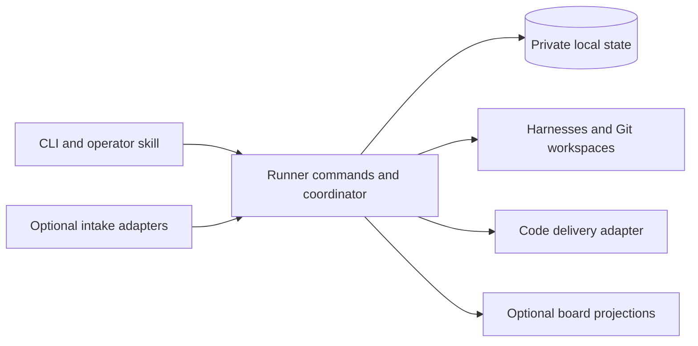

# Runner core redesign plan

Status: Phases 1 and 2 and the first nine phase 3 bundles are implemented in `codex/runner-local-core`: durable draft publication, current-base verification and bounded refresh, remote draft synchronization, CI assessment, bounded CI repair, bounded text conflict repair, confirmation of human integration, explicit guarded merge, and explicit automatic-merge policy. Feature scope is frozen after `aedc8bd`. The [five release bundles and finish line](#frozen-first-release-checklist) govern further work; R1 live delivery qualification, R2 backup/restore and R3 operator qualification are complete; R4 promotion/packaging is complete; R5 remains pending. Ready-state writes, polling, queues, squash/rebase and ruleset-only Runner-owned guards are deferred beyond this release. Current store format is 15; earlier bundle notes below describe their historical formats.

Runner should own its work, approvals, execution and recovery state locally.
GitHub Projects should become an optional view. External tools should connect
through small integration contracts for intake, progress publication or code
delivery.

The first priority is a reliable, understandable core process. A user should
always be able to see what Runner is doing, why work is waiting, what needs a
decision, and what will happen next. Configuring models, reasoning, escalation,
retry limits and parallelism should not require understanding the workflow
implementation or a board's field schema.

The direction is recorded in [ADR 0005](decisions/0005-local-runner-core.md).
This is the designated replacement specification and build sequence, under
[AGENTS.md](../AGENTS.md). The [architecture](architecture.md) and
[operator guide](operator-reference.md) describe the local runtime now promoted
to `cmd/cortexium-runner`. Remaining release work is bounded by the frozen
checklist and requires a separate implementation instruction.

Construction briefs and qualification records below retain their historical
`runner-next` names, store formats and command lines. Links to retired code are
pinned to the pre-promotion commit; they are reference evidence, not current
commands or permission to restore Project coupling.

Start with [release scope](#first-release-scope), [core contracts](#core-contracts),
and the [release checklist](#frozen-first-release-checklist).
The [first implementation slice](#first-implementation-slice) and subsequent
bundle briefs retain the construction history.
The [coverage map](#requirement-coverage-map) connects important requirements to
their implementation phase and proof. Keep work status and evidence there as
slices land; do not create another plan or task registry.

## Accepted direction

1. Build a fresh core around one durable local source of truth and Runner-owned task IDs.
2. Preserve the event-and-action coordinator, the three execution contracts,
   dependency-aware concurrency, independent review and serialized integration.
3. Make the default journey complete and understandable before adding integrations.
4. Expose one execution policy with explicit retry and escalation semantics.
5. Introduce GitHub Projects as an optional projection, then prove the integration
   boundary with a second board provider. Defer externally loaded plugins.
6. Define test scope and strategy before implementation, and review test quality
   and consolidation as part of accepting every change.

Success means a user can set up Runner, submit and approve work, follow its
progress, resolve an interruption and reach a reviewed candidate without a
GitHub Project. GitHub code delivery can still require GitHub. The first
connected delivery milestone remains an accepted pull request and confirmed merge.

## First release scope

The first replacement release includes the complete local Plan/Ready process,
one repository/base per configured Runner instance, exact approval, independent
review, persisted recovery, configurable models/reasoning/escalation and
parallelism, an optional per-task harness-invocation ceiling, and readable local
status. It also includes GitHub PR/check/merge delivery, human merge by default,
explicit opt-in automatic merge policy, backup/restore, and a documented breaking
cutover.
The existing [macOS/Linux amd64/arm64 builds](../scripts/build-release.sh)
remain the packaging target.

Use sandboxed Codex CLI as the first qualified harness. This selects a bounded
delivery scope, not a preferred model. The execution boundary remains capable
of other native harnesses; Claude and Pi qualification follow separately. Setup
must reject unqualified harness choices rather than silently substitute Codex.

Defer board views until after the core release. Also defer autonomous issue
intake, additional repository references, user-authored workflow composition,
time/token/cost admission ceilings, multi-host execution, a web dashboard and
externally loaded plugins. Preserve usage reporting, with unavailable usage
shown as unknown. These omissions are explicit release limits, not features
that agents may approximate. Add a deferred capability only with its own scoped
brief and acceptance evidence.

## Rebuild the core without inheriting its constraints

A fresh core is the recommended construction approach. The change in authority
from GitHub Projects to local state affects work identity, approval, scheduling,
recovery, configuration and tests. Extracting abstractions from the old design
first risks preserving those assumptions behind new interfaces. Build from the
accepted process and contracts, consulting the current code when a concrete
behavior, failure case or boundary needs investigation.

The old implementation remains valuable evidence. Carry forward required
invariants and known failure scenarios, then express them against the new
boundaries. Do not copy whole packages or the test suite merely to preserve
behavior parity. Evaluate a self-contained low-level component for reuse only
when its responsibility and contract fit directly and its complexity is justified.
Rewriting a sound subprocess or filesystem primitive brings no automatic benefit;
retaining one must not force the old work model into the new core.

Keep the rebuild incremental and runnable. Establish a complete local journey
early, then add the remaining required policies and integrations. A fresh start
does not require recreating every existing feature before anything works. It
does require maintaining authority, integrity and recovery boundaries in every
slice that can execute real work. Select the first release's capabilities
explicitly; omitted advanced features are documented, not silently approximated.

Backward compatibility is not a design requirement. New configuration, IDs,
state, commands and integration contracts may break compatibility. Provide an
upgrade utility only where conversion is small, deterministic and verifiable.
Otherwise publish a clearly breaking release with fresh setup and explicit
resubmission of remaining work. Do not build a compatibility layer, maintain two
active backends, or port historical approvals and recovery journals to avoid
that break. Retain old artifacts safely for inspection; breaking compatibility
does not authorize deleting existing work.

## Lessons and their disposition

The two assessments are [Assess source control article](codex://threads/01a13967-44ab-71f1-b689-ee91f0ea967d)
and [Review software-factory lessons](codex://threads/01a11fb1-f1c6-7a52-b8a2-f35fe00ece4f).
They provide design input, not evidence that either alternative has better
operational reliability than Runner. The software-factory references below use
the revision assessed in those chats.

| Learning and source | Decision for Runner |
| --- | --- |
| software-factory keeps its work locally and makes GitHub delivery optional. [Overview][factory] | Own work independently of external boards. Keep work management and code delivery separate. |
| Its quick start follows setup, specification, approval, execution and delivery. [Overview][factory] | Offer one recommended first-change journey. Preview and apply setup in one session. |
| Repository preparation establishes quality requirements and verification prerequisites. [Setup skill][factory-setup] | Agree authoritative checks and explicit baseline exceptions at setup; distinguish Runner readiness, repository readiness and integration availability. |
| Conversational operation explains running work, waits and escalations. [Dispatch skill][factory-dispatch-skill] | Add an operator skill over the same deterministic commands and local status. |
| Its status operation can also enforce worker limits. [Dispatcher][factory-dispatch] | Keep Runner inspection read-only; scheduling and recovery belong to explicit actions and the coordinator. |
| Plan review presents consequential decisions together. [Plan review][factory-plan] | Show outcome, scope, dependencies, assumptions and authorization in one approval preview. |
| The floor guard detects weakened checks, while behavioral cases test pressure to take shortcuts. [Guard][factory-guard], [cases][factory-cases] | First add paired evaluations for weakened tests and legitimate test refactors. Add narrow enforcement only if a demonstrated gap remains. |
| Visual QA produces evidence a fresh reviewer can inspect. [QA skill][factory-qa] | Retain suitable screenshots or recordings for interaction claims, bound to the candidate and checked for relevance. Avoid recording every task by default. |
| Carrying review through rebase based on an unchanged patch can miss interactions with the new base. [Dispatcher][factory-dispatch] | Preserve explicit base and candidate validation. An unchanged patch is insufficient authority to reuse acceptance. |
| Missing executable checks can remain gaps in the external check runner. [Check runner][factory-check] | Required missing proof blocks acceptance; process exit success alone does not establish completion. |
| Anthropic reports delivery infrastructure becoming the bottleneck as code production accelerates. [Article][anthropic] | Measure the complete Ready-to-merged path, integration waits and repeated review before changing scheduling. |
| Anthropic exposes metadata queries without requiring workspaces. [Article][anthropic] | Keep observation cheap; create a workspace only when an action needs files. Retain Git for Runner's workload. |
| Anthropic describes both excessive defensive agent review and useful simulations and fuzzing. [Article][anthropic] | Require concrete, reachable review findings. Invest in interruption, concurrency and publication tests instead of speculative machinery. |
| The earlier Runner assessment found competing recovery advice for moving a card to Ready and retrying its recorded stage. [Status rendering](https://github.com/cortexium-io/runner/blob/5897f4ce2177c23edaaf6fd565d5768a634fc8a7/cmd/cortexium-runner/status.go) | Present the appropriate recovery first, including preserved work and the stage that repeats. |
| Runner already has candidate-bound evidence, focused follow-up review and private recurring-failure drafts. [Architecture](architecture.md), [evaluation guidance](model-profile-evaluation.md) | Preserve these contracts. Improve visibility and measure their effects rather than adding another review hierarchy or learning store. |

Keep Runner's continuous reconciliation, interchangeable harness boundary and
typed internal actions. Do not adopt file-overlap locks as a substitute for actual
resource conflicts, mandatory extra reviewer roles, or weaker pre-merge proof. Anthropic's
post-merge emphasis reflects its unusual scale and does not justify relaxing
Runner's integration contract. Worktrees also do not isolate ports, databases
or test fixtures: declare or allocate those resources when a repository needs them.

## Original constraints to replace (historical assessment)

The [engine](https://github.com/cortexium-io/runner/blob/5897f4ce2177c23edaaf6fd565d5768a634fc8a7/internal/engine/engine.go) owns a concrete `github.Project`;
work items, authorization and several process locks also belong to the GitHub
package. Each observation cycle loads Project lifecycle items. The
[configuration validator](https://github.com/cortexium-io/runner/blob/5897f4ce2177c23edaaf6fd565d5768a634fc8a7/internal/config/project.go) requires a Project and
its lifecycle fields, while repository and merge settings sit under
`github_project`. This is deeper than an interchangeable board client.

The current design has useful protections for exact-content approval, complete
plan release, retained workspaces and interrupted publication. Some recovery
complexity compensates for multi-step remote writes. Local transactions can
remove those particular partial-write states. They cannot make Git operations,
model calls and remote publication atomic with a database transaction.

Configuration already supports role profiles, reasoning, an implementer ladder,
parallelism and budgets. However, QA limits live in workflow actions, the ladder
advances from Project QA failures, and provider retries use a fixed schedule
with in-memory state. [Roles](https://github.com/cortexium-io/runner/blob/5897f4ce2177c23edaaf6fd565d5768a634fc8a7/internal/config/roles.go),
[workflow](https://github.com/cortexium-io/runner/blob/5897f4ce2177c23edaaf6fd565d5768a634fc8a7/internal/config/workflow.go), [automatic retries](https://github.com/cortexium-io/runner/blob/5897f4ce2177c23edaaf6fd565d5768a634fc8a7/internal/engine/automatic_retry.go).
The redesign should expose their meaning coherently and preserve limits across
restarts.

## The complete user journey

### Set up and prove readiness

Start with a local repository and one supported, authenticated harness. Guided
setup selects the repository and base, role profiles, parallelism, recovery
limits and delivery policy. It previews the resolved configuration once, then
applies it. External boards are optional subsequent connections.

Readiness has three separate results:

- Runner can invoke its configured profiles and protect the intended boundaries.
- The repository has known verification commands and the tools, services and
  inputs needed for the requested work.
- Each configured integration is available, unavailable or not configured.

Use existing repository commands and instructions. Missing requirements should
produce a concrete action; setup must not invent production credentials or
silently change the repository's quality requirements. Static inspection remains
non-billable. Live harness checks and repository commands have explicit scope.
One unavailable optional board does not make the whole setup unusable.

The guide ends with a small authorized change, its review evidence and, when
delivery is connected, its PR. It should not end at a successful configuration check.

### Repository quality agreement

Setup records the repository owner's definition of done and the instructions
and commands that establish it. Reuse existing repository policy; do not create
mandatory duplicate `DONE.md`, constraints files or a new testing framework.
Keep a versioned resolved agreement in private Runner state with references to
its authoritative repository sources. A task records the agreement revision
used for its verification brief.

For each required check, record its command, working directory, prerequisites
and permitted environment, plus the observed baseline revision and result.
Distinguish a passing check, a specific pre-existing failure and a check that
could not run. A missing tool or credential is a prerequisite gap, not a pass.
Static setup does not run arbitrary repository commands; preview the commands
and obtain authorization as part of setup before running the baseline.

The default is that required checks must pass. The owner may explicitly accept
a bounded, identified baseline exception with its scope and rationale. It cannot
cover a new or changed failure, excuse missing proof of the requested outcome,
or permit editing assertions until a gate turns green. Agents cannot grant or
broaden exceptions. Setup reports unresolved required gaps as blockers for work
that needs them, while unrelated inspection remains available.

Changes to authoritative commands, requirements or exceptions require an explicit
owner-applied agreement revision. Merely observing edited policy files cannot
relax a running task's contract. New tasks use the applied revision; existing
tasks keep their pinned agreement unless the owner explicitly selects them for
adoption. Adoption creates a new unapproved task version and revokes further
old-version actions. A weaker agreement cannot retroactively authorize a pass.
Test consolidation remains permitted when the same required guarantee is still
established.

### Submit and clarify work

Keep the two entry points:

- **Plan:** “I know the outcome; help me define the work.”
- **Ready:** “The task is sufficiently specified; implement it.”

A local Ready command is explicit authorization of the displayed task version.
Imported requests are untrusted input until an operator or configured trust
policy authorizes them. An external label or column name alone is not authority.
Retain the existing trusted issue-intake policy as an optional GitHub intake
capability; do not generalize private-repository trust to every external service.

The planner remains the ambiguity and decomposition boundary. It proposes
cohesive cards with acceptance criteria, proof obligations, non-goals and real
dependencies. No target number of cards, fixed file count or separate triage
agent is required. Open decisions remain questions on the request and prevent
release of an executable plan. Distinguish planning immediately from submitting
a planning request to the running coordinator.

### Approve the exact work

The preview leads with the intended outcome, proposed cards and dependencies,
material assumptions, expected verification and what approval permits. Full
task content remains inspectable. A complete batch is released atomically in
local state after its displayed version is revalidated.

Changing execution-defining requirements or dependencies invalidates the
affected authority and evidence. Presentation changes do not. A changed task
version must be approved before new execution; it cannot silently alter an
already running assignment. Revocation prevents subsequent privileged actions
and requests cancellation of affected active work while preserving its artifacts.
External completion already in progress is reconciled rather than assumed undone.

### Admit and execute safe actions

Keep one coordinator that observes state, derives safe actions and admits as
many as configuration allows. A poll is an observation boundary, not a batch.
Dependency outcomes and resource ownership determine safety; capacity and
budgets determine admission. Deterministic reconciliation does not consume
agent capacity or wait for unrelated agents.

Status and dispatch use the same eligibility calculation. A waiting task names
the dependency, occupied resource, capacity limit, budget, provider or decision
that prevents it from starting. Reserve capacity and record an attempt before
dispatch. Multiple CLI operations and the service share these bounds.

Implementation uses an isolated workspace and the exact authorized task.
Preserve useful work, feedback and valid saved results on recovery. Reports
identify commands, settings, outcomes and material limits; a model's claim that
a check passed is not independent proof that it did. The user sees the actual
role, model, reasoning, current stage, elapsed time and remaining recovery allowance.

### Review with sufficient evidence

Keep the independent reviewer and its existing evidence audit followed by
focused dynamic verification when necessary. Assess the approved outcome and
affected contracts as well as listed proof obligations. Review findings must
describe a concrete failure, its evidence and the relevant requirement.
Hypothetical improvements do not automatically become rejection criteria.

Distinguish accepted work, confirmed defects, a missing human decision and
incomplete evidence. A decision request takes priority over automatic repair.
An unavailable test environment is not a code defect. Preserve valid prior
findings and evidence; rerun checks for concrete gaps or invalidating changes.
Candidate bindings establish provenance, not the truth of every reported result.

Changing a base or candidate requires reassessing affected proof. Reuse exact
accepted results for interrupted deterministic publication only under the
existing integrity conditions. A missing required check cannot become a pass
because a review budget is exhausted.

### Publish and integrate

Store the reviewed candidate and evidence before remote publication. Publication
and integration use the code-host adapter, independently of any board adapter.
After a timeout or restart, inspect remote identity and outcome before repeating
a write. Recover an existing PR instead of creating a duplicate.

Serialize integration per repository and base. Refresh against the latest base,
resolve conflicts through bounded repair, and obtain the required verification
and review before merge. Preserve protection against base movement between
verification and the merge request. Human merge is the default; automatic merge
requires explicit policy and all the same correctness conditions.

Publication, CI, human review and integration waits remain distinguishable.
Missing remote observations never establish success. Closed-without-merge PRs
do not satisfy dependencies. A reviewed local candidate awaiting delivery is
useful progress, but it is not a merged implementation.

### Finish, stop and recover

A code task succeeds when its intended integration is confirmed. A planning
operation can finish while the original request remains incomplete; the request
finishes only after all required children succeed. Board updates, issue closure
and other housekeeping can retry independently of that recorded outcome.

Keep graceful drain: stop new admission and let admitted actions finish.
Immediate cancellation is a separate explicit operation. Restart reconciles
unfinished attempts and retained artifacts before admitting conflicting work;
it does not blindly rerun every stage marked active. Loss of the coordinator's
ownership must not allow a replacement to race surviving harness processes.

Every actionable failure presents its cause, preserved work, required action,
resume stage, expected repeated work and private evidence location. Recovery
does not require manually arranging board columns. The recommended action is
specific; alternatives explain their different effects.

## State and progress that users can understand

Separate the task's lifecycle stage from its waiting reason and current attempt.
“Waiting for provider” is not another workflow lane. “Needs your decision” is
different from “retry limit reached.” Board column names are display mappings.
The default display vocabulary is:

| Stage | Meaning |
| --- | --- |
| Draft | A request is captured but its planning or implementation is not yet authorized. |
| Planning | Runner is clarifying or decomposing the request. |
| Awaiting approval | A complete proposal needs authorization. |
| Ready | Work is authorized; a stated dependency or admission limit may still prevent starting. |
| Implementing | An implementation or repair attempt is active. |
| Reviewing | Independent assessment or required verification is active. |
| Awaiting delivery | A reviewed candidate needs publication, checks, human review or integration. |
| Completed | The intended successful outcome is confirmed. |
| Stopped | Work was cancelled or abandoned; this does not satisfy dependencies. |

Attention and wait reasons decorate those stages instead of creating a second
workflow graph. For example, an interrupted review remains Reviewing with a
specific recovery reason. Later user-authored workflows may name additional
states, but must provide the same stage, wait and next-action explanations.

The local status view leads with decisions and recovery actions, then active
work, ordinary waits and recent completions. Inspection is read-only. A
continuous display refreshes observations without granting execution authority.
Machine-readable status supports the operator skill and any future local UI.
Remote views show their last successful synchronization time and stale state.

Illustrative output, not an implemented CLI contract:

```text
Needs you
  R-42  Reviewing — browser capability unavailable
        Candidate and implementation evidence retained; no code rejection.
        Next: repair the browser capability, then resume review.

Working
  R-43  Implementing — repair 1 of 2
        Profile: implementer-careful; reasoning: high
        Reason: confirmed review defect; next: independent review

Waiting
  R-44  Ready — dependency R-43 has not merged
  R-45  Awaiting delivery — GitHub unavailable; reviewed candidate retained

Integrations
  GitHub Projects — stale; local work continues
```

The operator skill should answer “what needs me?”, explain a wait, preview a
policy change and perform an authorized recovery through these same commands.
It adds no alternative approval rules, direct database editing or scheduler.

## Core contracts

These are semantic contracts, not a requirement for one table or interface per
row. The engine decides transitions; the store atomically checks their expected
revisions and writes the resulting state. No transaction spans a model call,
Git operation or network request.

| Record | Required identity and meaning |
| --- | --- |
| Repository | Runner-owned identity bound to the validated local Git repository and configured base ref. A display path or remote board ID is not identity. |
| Task version | Stable local task ID plus monotonically increasing version and digest of execution-defining content: outcome, scope, constraints, acceptance/proof brief, dependencies, repository/base policy and quality-agreement revision. Store immutable versions; changing the title alone need not invalidate authority unless it changes the task's meaning. |
| Approval | Exact task ID/version/digest, authorization scope and recorded operator or explicit trusted-intake decision. Approval and revocation have a generation checked by every privileged action. A digest identifies content; possessing it is not authorization. |
| Attempt | Unique ID, task/version, approval generation, stage, pinned policy/profile, resolved base, owned resources, reserved allowances and invocation/result state. Preserve prior attempts; a retry is not an overwrite. |
| Candidate and review | Repository, task/version, base commit, candidate commit/tree, workspace identity, quality revision and evidence references. Review acceptance is valid only for this binding, after Runner validates the structured result and integrity checks. |
| External effect | Stable operation/object identity, authorized intent and observed outcome. Written before publication; ambiguous outcomes are reconciled, never assumed absent. This is needed from phase 3, not an empty framework in phase 1. |

Approval and admission use compare-and-set checks in short transactions. Repeating
approval of the same still-current version returns the existing approval; it does
not reset attempts or create another execution. A stale preview is rejected.
Requirements edits create an unapproved version and revoke future actions under
the old one. Display-only edits must not change the version's delegated content.

At admission, recheck authority, required dependencies, readiness, capacity and
resource ownership, then reserve the attempt and its allowances together. At
result commit, recheck the attempt, approval generation and candidate binding.
Results arriving after revocation are retained as historical evidence but cannot
advance work. A single task may have only one unfinished execution owner; a
resource cannot be released merely because a wall-clock lease expired.

| Transition | Guard and committed effect |
| --- | --- |
| Draft to Ready | Approve the exact complete task version. No harness is launched by approval itself. |
| Ready to Implementing | Reserve one eligible implementation attempt and its resources before launch. |
| Implementing to Reviewing | Validate and durably record the completed result, construct/validate its candidate, then make independent review eligible. A model's success string is insufficient. |
| Reviewing to Awaiting delivery | Required proof is sufficient, independent review accepts, and candidate/authority checks still match. No dependency is satisfied yet. |
| Reviewing to repair | A confirmed defect and remaining repair allowance permit another implementation attempt. Missing proof or a decision stays Reviewing with its own attention reason. |
| Awaiting delivery to Completed | Confirm the authorized integration outcome. Local acceptance or PR creation alone cannot complete a code task. |
| Any nonterminal stage to Stopped | Record revocation, prevent new actions, request cancellation and retain artifacts. Show cancellation pending until owned processes are known to have stopped. |

Plan adds a planning operation and an awaiting-approval proposal in phase 2.
Release all approved children and dependency edges in one transaction; reject
cycles, missing targets and stale proposal content. Planning success alone does
not complete the request. Failed, stopped or closed-unmerged dependencies do not
count as success.

Stage, waiting reason and attempt state remain separate. Recovery clears a
specific wait only after its prerequisite is satisfied; it cannot manufacture
approval, a passing review or unused allowance. Configured repository/base
identity changes require explicit setup and new task authority, not a hot switch
for retained work.

## Configuration and bounded recovery

### One visible execution policy

Keep named role profiles for harness, model, reasoning, timeout and supported
capabilities. An escalation step references a complete implementer profile; it
can change the model, reasoning, or both. Runner never infers capability or
price order from a model name. Offer supported choices for the installed harness
and reject unsupported combinations instead of silently substituting them.

The default workflow should be generated from one documented policy. Later
user-authored typed workflows must compile into the same coordinator and obey
the same limits. A setting must have one owner: do not retain competing
QA limits in workflow actions and recovery settings.

These are the first-release controls and pilot defaults. The first slice supports
the smaller explicit subset below; unsupported settings must fail validation.
Tune later revisions against observed rework, waiting and operator intervention:

| Control | Pilot default and meaning |
| --- | --- |
| Planner, implementer and reviewer profiles | Explicit profiles selected during setup; no new universal model default. Show resolved model, reasoning, timeout and access. |
| Implementer escalation | Disabled initially. An ordered list of approved profiles advances after a confirmed reviewer rejection, before the next permitted repair. |
| Automatic repair limit | Two additional implementation passes per approved task version. Includes QA repair, candidate correction, CI rework and conflict repair. Initial implementation is not a repair. |
| Transient retry limit | Three additional attempts for a recognized transient failure in the same stage recovery episode: 30 seconds before retry 1, two minutes before retry 2, then five minutes before each later retry up to the configured limit. Zero disables automatic retry. |
| Parallelism | One concurrent harness invocation initially; configurable from 1 to 16 in phase 2. Includes planning, implementation and review across service and CLI. |
| Role timeouts | Explicit per-profile values; use current generated values as initial tuning references and record setup choices. |
| Admission budget | Optional harness-invocation ceiling per approved task version; absent means no such ceiling. Reserve before launch and count planning preparation, audit, focused review, retries and repairs. A definitely unlaunched reservation may be released; uncertain launch counts until reconciled. Report time/tokens/cost where available; their admission ceilings are deferred. |
| Delivery | Human merge by default. Auto-merge is an explicit setting independent of board configuration. |
| Base freshness | Refresh before implementation by default. Optional use of an available recorded base during a code-host outage; latest-base verification remains mandatory for integration. |
| External views | None required. Each connection has its own destination and publication scope. |

Two repair passes preserve the default allowance of initial implementation plus
two QA-driven corrections, but deliberately also bound automatic paths that
currently do not count as QA rejections. Keep QA rejection counts as quality
evidence and the escalation trigger; stop using that count as the only general
repair bound. A candidate-correction call consumes a repair even when made inside
the same engine action. This prevents hidden extra model work.

A transient retry of a repair resumes that reserved repair pass; it does not
consume another repair allowance. All harness invocations still count toward
admission budgets and usage. Both repair and transient counters are reserved
before dispatch, so interruption cannot manufacture an extra attempt. A repair
limit of zero permits initial implementation and review but no automatic repair.

Example: profiles `implementer` and `implementer-careful`, with two repairs,
start on `implementer`. A confirmed rejected review permits repair 1 on
`implementer-careful`. A second rejection permits repair 2 on that final profile.
Another rejection stops for an operator decision. A provider outage repeats the
same stage/profile within its transient allowance and does not advance the ladder.
CI rework and conflicts consume repairs but do not imply a stronger model is needed.
Planner-selected starting profiles must come from the configured allowlist; show
the resulting reachable escalation sequence before release.

### Failure and retry rules

| Event | Automatic behavior | What the user sees |
| --- | --- | --- |
| Recognized transient provider or browser-startup failure | Retry the same stage/profile within its transient limit. | Cause, attempt count, next retry time and remaining allowance. |
| Confirmed reviewer defect | Repair within the task's repair allowance; advance the configured ladder. | Findings, selected next profile and repair count. |
| Candidate correction, terminal CI failure or integration conflict | Bounded repair with retained context; no automatic model escalation. | Concrete reason, retained branch/candidate and remaining repairs. |
| Required evidence unavailable, missing decision, invalid configuration or unknown harness failure | Stop for the specific operator action. | Exact missing input or capability and the stage that can resume. |
| Authority or integrity mismatch | Prevent further privileged work and retain evidence. | The changed binding and explicit recovery requirements. |
| Interrupted deterministic post-processing | Reconcile the existing effect; reuse an exact valid saved result. | Which operation resumes and whether any new harness call is needed. |
| Optional board unavailable | Retain pending synchronization and continue unrelated work. | Integration health and synchronization age, separate from task failure. |
| Admission limit reached | Wait without cancelling admitted work or weakening QA. | The limiting capacity or budget and when it can be reevaluated. |

Persist counters, reasons and retry deadlines. Restart and ordinary inspection
do not reset them. A successful stage ends its transient recovery episode;
changing error text does not. An explicit manual retry does not silently grant
a fresh repair budget. Additional allowance requires a visible operator choice
and records its scope. Changed requirements create a newly approved task version
while preserving prior attempts and outcomes.

Clean base refreshes can still cause repeated review without implementation.
Bound automatic refresh-and-review cycles separately, initially to two per
approved task version, then request operator intervention. Ordinary initial QA
does not consume this allowance; each base movement that requires another review
does. Returning through repair or restarting does not reset it. This advanced
integration limit prevents endless verification when the base keeps moving. Existing
bounded transport retries remain internal adapter behavior, with their total
calls visible; they must not multiply into independent unbounded retry loops.

### Make policy changes predictable

Provide an interactive editor, a non-interactive equivalent, validation and a
resolved-policy explanation. The preview says, for example, “two repairs remain;
the next confirmed rejection selects this model and reasoning.” Include warnings
for unreachable escalation steps and budgets that cannot admit the selected work.
Routine changes should not require editing nested workflow JSON.

Validate and atomically apply the whole change. Pin the effective configuration
revision to every attempt. Model, reasoning and recovery-policy edits affect the
next admitted attempt after operator application; active attempts retain their
recorded configuration. A pending transient retry retains its recorded profile
unless the change preview explicitly selects it for a profile change. Counters
carry forward. Lowering parallelism stops new
admission until active work fits; it does not cancel active agents. Lowering a
limit below consumed allowance stops the next automatic action.

Permission expansion, changed delivery authority and changed task scope require
their own explicit authorization. Escalation alone must not widen filesystem,
network or tool access. Switching reviewer profiles does not carry acceptance
across a changed candidate or base. Keep a compact history of applied policy
revisions so recovery and metrics can explain which settings governed each action.
The phase 3 [merge policy](#using-automatic-merge-policy) is live permission:
disabling it prevents unsent automatic merges, including active admission.

### First slice configuration contract

Keep JSON and strict decoding. This is the minimal new configuration shape;
`SELECT_SUPPORTED_MODEL` and absolute paths are setup inputs, not working
defaults. The format marker deliberately distinguishes it from legacy v5.
There is no Project, workflow-lane or credential field.

```json
{
  "format": "runner-local-v1",
  "repository": {
    "path": "/absolute/repository",
    "base_ref": "refs/heads/main",
    "base_freshness": "recorded"
  },
  "state_dir": "/absolute/private-runner-state",
  "worktree_dir": "/absolute/runner-worktrees",
  "profiles": {
    "build": {
      "harness": "codex",
      "model": "SELECT_SUPPORTED_MODEL",
      "reasoning": "high",
      "timeout": "20m"
    },
    "review": {
      "harness": "codex",
      "model": "SELECT_SUPPORTED_MODEL",
      "reasoning": "high",
      "timeout": "20m"
    }
  },
  "roles": {"implementer": "build", "reviewer": "review"},
  "policy": {
    "max_parallelism": 1,
    "max_repairs": 0,
    "max_transient_retries": 0,
    "max_base_refreshes": 2,
    "implementation_ladder": []
  },
  "delivery": {"mode": "local"}
}
```

Validate unknown keys, missing role/profile references, unsupported harness or
model/reasoning combinations, nonpositive timeouts, unresolvable base refs and
unsafe/overlapping paths. State must be outside the repository and workspaces;
use canonical paths without symlink components and preserve configuration
provenance protections.
Profiles do not grant access: the native sandbox and role permission ceilings
remain Runner-owned. The two profiles may use the same model; review still uses
a separate invocation and context.

Phase 1 accepted local delivery and recorded base mode, with all automatic
allowances set to zero. The example now includes the phase 3 refresh allowance. At approval, pin an available local base commit; that milestone never
fetches, pushes or merges. A later base movement does not alter that candidate's
recorded starting base or turn local review into current-base delivery proof.

Phase 2 enables the documented limits, a planner profile and
`max_invocations_per_task` (absent or positive integer). The implementation ladder
lists successor profile names after the configured starting implementer; empty
disables escalation. Exhausting the list keeps the last profile while repairs
remain. The same profile cannot recur in the ladder. Phase 3 adds GitHub delivery
configuration and, when its full delivery journey lands, requires refresh before
implementation by default; `recorded` remains explicit opt-in. The first two
phase 3 bundles retain explicit recorded starting-base mode and verify after
draft publication. All integration must verify the latest base.

Setup previews a complete resolved policy, then atomically applies it with a
revision. Phase 1 requires a drained coordinator before replacement of that
policy; phase 2 adds the live-change semantics above. No unsupported setting is
silently ignored. Model IDs and reasoning choices are validated against the
installed harness during implementation, not frozen to article examples.

## Architecture and ownership



### Package boundaries

Start with these responsibilities. Package names are illustrative; create a
separate package only where it owns a cohesive contract and has a clear reason
to change. Avoid generic `manager`, `service`, `common` or `utils` layers that
only forward calls.

| Boundary | Owns | Must not own |
| --- | --- | --- |
| `cmd` | CLI parsing, composition and presentation of application results. | Scheduling rules, provider-specific workflow or direct state edits. |
| `config` | Configuration decoding, validation and resolved execution policy. | Provider calls or duplicate workflow decisions. |
| `core` | Task/version identities, approvals, dependencies, outcomes and small invariant functions. | I/O, provider fields, database rows or a generic plugin framework. |
| `engine` | Application commands, transitions, admission, recovery and the one coordinator. Consumer-defined interfaces for required effects. | GitHub/Trello transport, SQL or harness command syntax. |
| `store` | Transactions, durable reservations, queries, history and local recovery records. | Deciding whether work is authorized or which action should run next. |
| `execution` | Role assignments, native harness adapters, structured results and invocation boundaries. | Work queue ownership, approval or merge policy. |
| `workspace` | Git workspaces, candidate construction and validated artifact handling. | Task lifecycle or external board state. |
| Integration adapters | Provider-specific intake, view or code-delivery operations. | Core scheduling, approvals or alternate completion semantics. |

The composition root wires concrete dependencies. Core types do not import the
engine or adapters; the engine depends on narrow contracts rather than concrete
integrations. Adapters can share core value types without importing each other.
Keep interfaces at actual substitution boundaries, defined by their consumer;
do not create an interface for every struct or a generic repository API that
leaks storage operations into workflow code. Telemetry, process execution and
filesystem protection remain focused support responsibilities where needed.

Design a board-view contract around publishing Runner progress. GitHub Projects
and Trello each translate that contract into their own representation. Separate
intake and code delivery are additional capabilities, not mandatory methods on
one universal plugin interface. Built-in adapters are enough to establish
interchangeability. A public plugin loader, SDK and permission system require
their own demonstrated need.

The practical architecture check is whether a core eligibility or retry test
can run without constructing a GitHub payload, launching Git or pretending to
be a harness process. Conversely, provider transport and workspace tests should
exercise their actual boundaries. If a small rule needs a simulation of the
whole application, revisit the production boundary before adding more helpers.

### Local authority

Use one transactional local SQLite store. Qualify the selected driver against
the existing no-CGO packaging targets in the first slice. Store task versions,
dependencies, approvals, plan releases, attempt reservations, recovery counters, integration
ownership and external-object mappings there. Keep evidence files and Git objects
outside the database when appropriate, with validated references and identities.

The store is private Runner state outside agent-writable workspaces. Editable
requirements and exported plans are inputs; importing them does not import
execution authority. Existing sandbox and trusted-host limitations still apply:
local file permissions do not contain deliberately unrestricted host execution.

Use the existing single-coordinator ownership model and short transactions for
CLI mutations and admission. Do not add a second scheduler, distributed queue or
full event-sourcing platform. Minimal transition history belongs alongside the
canonical state; telemetry remains diagnostic and is not reconstructed as authority.
Budget admission must continue to account for durable unfinished reservations.

Transactions cover local changes only. Record the stable identity and intent of
an external effect before issuing it, then reconcile the result. Where a provider
cannot establish whether creation succeeded, stop ambiguous replay rather than
promise exactly-once behavior. Missing or corrupt authoritative state stops new
work; a remote board cannot silently recreate approvals.

Provide consistent backup/export and tested restore. Restoring onto a host
requires exclusive ownership, reconciliation of external effects and validation
of retained workspace identities before execution. A copied database is not
permission to run a second coordinator. Several independently active Runner
hosts sharing work are outside the first release.

### Integration boundaries

Define work identity, task versions, authority, outcomes and resource keys in
the new provider-neutral core contract. The engine owns
process decisions; the store owns durable changes; GitHub transport owns API
requests. Repository/base/merge policy is independent of Project configuration.
Use the current execution, workspace and subprocess code as reference for
necessary guarantees; assess any reuse against the new boundaries.

Define integrations by the capability they actually supply:

- **Intake:** discover a request, provide its source identity and observed version,
  and return acknowledgement or questions. Core policy decides authorization.
- **View:** publish a bounded task summary, progress, attention reason and links.
  It has no permission to approve work or set successful outcomes.
- **Code delivery:** publish/inspect a candidate and PR, observe checks and merges,
  and perform an authorized merge under the core integration contract.

Start with built-in adapters. Each declares required credentials, operations,
stable identity, retry behavior and supported capabilities. A Trello view does
not implement GitHub merge methods. No adapter receives arbitrary authority to
change workflow rules or private approval records.

Initial views are one-way projections. Reconcile the newest committed task
version using durable external mappings; coalesce superseded presentation
updates. Prevent out-of-order writes from reverting a newer projection. Retry
only affected connections. Do not publish raw transcripts, private diagnostics,
credentials or unrestricted evidence merely because a board is connected.

Later editable integrations may submit versioned commands through the core.
Runner validates source authorization, rejects stale/conflicting edits and
acknowledges acceptance. An offline board edit is pending, including a requested
stop; it cannot promise immediate cancellation. Do not add bidirectional field
merging or infer completion from a moved card.

Externally loaded plugins, arbitrary scripts, workflow expressions, additional
role contracts and a full web dashboard remain deferred. A second actual
provider should validate the adapter boundary before a public plugin API is frozen.

## Outages and recovery boundaries

| Unavailable component | Work that can continue | Work that waits |
| --- | --- | --- |
| GitHub Projects or another board | Local intake, planning, implementation, review and available code delivery. | That board's synchronization and incoming requests. |
| GitHub code hosting | Local status and work with available repository objects under the selected base-freshness policy. | Remote fetches, publication, hosted checks and confirmed integration. |
| A harness provider | Other admissible profiles and deterministic reconciliation. | Affected model calls within the configured retry policy; no implicit cross-provider fallback. |
| Repository test service | Unrelated tasks and evidence checks that do not need it. | Acceptance requiring that service's proof. |
| Authoritative local store | Diagnostic access and preservation of retained artifacts where possible. | New claims, approval changes and privileged publication until state is safely restored. |

Removing Projects alone does not create code-host independence. The current
implementation [fetches the base before implementation](https://github.com/cortexium-io/runner/blob/5897f4ce2177c23edaaf6fd565d5768a634fc8a7/internal/engine/engine.go).
The new core must make that dependency explicit and exercise the optional
recorded-base policy. Missing local objects remain a real blocker. A locally
reviewed candidate must refresh and regain required evidence before remote
integration; offline progress never means offline confirmation of a merge.

## Construction and release plan

Implement these slices only after an explicit instruction to begin implementation.
Build the new core directly; the existing application stays available as reference
and as the last supported release until replacement. There is no requirement to
refactor it into a transitional backend. Keep the new code isolated during work
and preserve unrelated local changes.

| Phase and dependency | Concrete scope | Completion evidence |
| --- | --- | --- |
| 0. Record the process and proof before construction | Accepted decision, release scope, contracts, quality agreement and first-slice brief. Extract essential invariants from current contracts and incidents. | This plan and ADR 0005 establish the build direction. Detail later slice briefs here before their implementation, using what preceding slices establish. |
| 1. Build one complete local journey after 0 | New core identities, private store, commands, coordinator and one harness path. Support local Ready intake, exact authorization, isolated implementation, independent review, retained results and local status. | One reviewed candidate without Projects; small core tests and actual store/workspace boundary tests establish the required safety. A controlled restart preserves authority and work. |
| 2. Complete the core process after 1 | Add Plan and atomic release, dependencies, bounded repairs/retries, configured escalation and reasoning, capacity, invocation budgets, configuration editing, full quality-agreement changes, attention-first progress and stage-specific recovery. | Both entry paths reach reviewed candidates for eligible work; dependencies wait honestly for integration. Core fixtures prove success/release rules; phase 3 proves the merged dependency journey. Policy previews, restart limits and test reuse hold without a board. |
| 3. Connect delivery after 2 | GitHub PR/check/merge adapter, serialized current-base integration, bounded refresh and ambiguous-write recovery. | A complete authorized change reaches confirmed merge. Outages, base movement, conflicts, closed PRs and interrupted publication have correct bounded outcomes. |
| 4. Qualify and release after 3 | Run selected live and operator journeys, backup/restore and package/platform checks. Use fresh setup for the breaking cutover; the frozen checklist excludes an importer. | Core reliability and usability gates pass. A selected installation can switch safely without dual ownership; difficult historical-state conversion is not a release prerequisite. |
| 5. Add optional board views after 4 | GitHub Projects projection, then Trello against the same capability contract. Include synchronization health, stable mapping and bounded publication. | Disconnect/reconnect and reordered updates do not affect work authority. The second provider needs no changes to core scheduling or approval. |

Phases 1 and 2 must produce useful complete journeys, not a collection of
unconnected packages. Configuration and user-facing progress are core work.
Do not postpone test design until a final testing phase. Optional integrations
must wait when core scenarios, test quality or the operator journey remain weak.

### Frozen first-release checklist

**Scope frozen on 2026-10-15, after `aedc8bd`.** The nine phase 3 bundles close
delivery feature construction for the first release. The five bundles below are the
remaining sequence; this section is the release checklist, not a second backlog.
R1–R3 completed on 2026-10-16; R4 promotion/packaging is complete; R5 remains pending. The checklist alone
authorizes no implementation, remote mutation, publication or installation change.
When a bundle is authorized, refine its verification brief here before code and
stop at its exit condition.

Keep the implemented Plan/Ready process, quality agreements, independent review,
bounded recovery, configuration, local status and GitHub delivery. Backup/restore
and replacing the shipped runtime remain required release work. A concrete defect
in this supported contract must be fixed and verified in its owning bundle;
feature requests wait until after release unless the owner explicitly reopens
scope. A failed acceptance check is not a reason to weaken the check or silently
drop a promised capability.

The following limits are deliberate and do not block this release:

- One local Runner instance owns one repository/base. Sandboxed Codex is the
  qualified harness. Local implementation uses the recorded base; connected
  delivery verifies the current base before integration.
- Humans mark PRs ready and satisfy host reviews. CI and integration reassessment
  use the existing explicit commands after the initial automatic observations.
  Human merge is the default; `task merge` or applied automatic policy uses the
  existing protected ordinary-merge contract. Automatic policy is not a promise
  of unattended progress through every external wait.
- No ready-state writes, remote polling/events, GitHub auto-merge requests, merge
  queues, ruleset-only Runner-owned admission, squash/rebase receipts or automatic
  artifact cleanup. Ruleset-only repositories can still use human integration
  when the ordinary-merge receipt requirements are met.
- GitHub Projects/Trello views, other harness qualification, autonomous intake,
  extra repository references, workflow composition, multi-host execution, new
  budget types, dashboards and externally loaded plugins remain post-release.
- Fresh setup is the cutover path. No legacy importer, configuration aliases,
  historical approval transfer or conversion of in-flight authority is required.

#### Remaining bundles

Execute R1–R5 in order. A bundle is done only when its evidence and unresolved
limits are recorded here; running out of time or adding scaffolding is not an
exit condition. Splitting an unexpectedly large bundle must preserve its scope
and acceptance conditions rather than add another feature milestone.

| Bundle | Bounded work | Required evidence and exit condition |
| --- | --- | --- |
| **R1 — Qualify frozen delivery** | Close the live-host gap using an explicitly authorized test repository with the supported protection configuration. Exercise human integration and Runner-owned ordinary merge, including the automatic-policy trigger. Fix only defects in the frozen contract. | A real accepted change reaches draft, base verification, pinned CI, ready state and exact confirmed merge. Human/default and automatic paths retain correct authority and dependency completion. Extend the existing delivery/integration/merge and GitHub protocol suites only for discovered gaps; reuse their drift, outage, revocation and ambiguous-write cases. Record repository/PR identities, configuration, commit, commands and receipts. A mocked merge or read-only schema query cannot close this gate. Stop before backup/restore. |
| **R2 — Consistent backup and safe restore** | Add the smallest explicit backup/restore path for a quiescent single-host installation, matching binary/store format and original paths. Include configuration, private state/evidence and the referenced Git/workspace data needed to recover retained work; document what must be preserved. Online backup, relocation and cross-version migration are excluded. | Real SQLite/filesystem/Git round-trip preserves tasks, quality/approval bindings, counters, saved results and candidates. Reject incomplete/corrupt/incompatible material and competing ownership without overwriting unrelated data. Restore starts drained and cannot replay uncertain external effects or regain write permission lost after the snapshot. Stale snapshots whose later actions/counters cannot be established require explicit recovery, not automatic continuation. Verify interruption, missing artifacts and an external effect after backup. Stop with a documented, tested recovery procedure. |
| **R3 — Qualify the complete operator journey** | Use the current CLI and one concise setup/operator guide from a fresh installation. Update the replacement operator reference through delivery and restore. Fix observed supported-flow problems; do not add a dashboard or a second configuration workflow. | Follow the guide through Plan and Ready, a question, a dependency wait, interrupted review, configuration preview/save/apply, model/reasoning/escalation and retry/parallelism limits, drain/restart, delivered-result inspection and R2 recovery. Show that users can identify the cause and next action without undocumented help. Reuse valid live role evidence; rerun paired behavioral cases only if role instructions or execution behavior change. Record elapsed time, interventions, repeated verification and all actual calls; unavailable cost/usage stays unknown. Stop with no unresolved blocker to the documented journey. |
| **R4 — Promote and package the replacement** | Promote the replacement to `cortexium-runner`; retire the legacy entry point, obsolete consumers/tests and the temporary `runner-next` name. Update architecture, README, setup/examples, help, operator/role references and install/release tooling. Reuse useful low-level code and tests by current requirement. | The packaged binary exposes the replacement commands and version, requires no Project, and its docs/installed instructions match its behavior. Extend the existing packaging, installer and release-security checks; replace the legacy Project smoke journey. Build all four no-CGO targets and verify archives/checksums. Update CI/readiness commands to the qualified package timeout. No compatibility runtime, general updater redesign or new plugin layer. Stop at a reviewable release candidate, without publishing or switching a real installation. |
| **R5 — Final qualification and cutover rehearsal** | Qualify one reviewed candidate and rehearse the documented breaking cutover on a selected test installation. Check backup, old-owner shutdown, fresh setup, explicit resubmission and the prohibition on restarting stale authority after new remote effects. | Complete the gates below on the candidate; reuse R1–R3 evidence only where subsequent changes have not invalidated it. Exercise the packaged entry point on macOS and Linux and record native sandbox/runtime evidence separately from cross-builds. Finish with tested artifacts, evidence, release notes and the exact installation/cutover procedure. Missing infrastructure or unverified safety leaves this gate open. Stop release-ready; publishing and changing the user's running installation require their own explicit instruction. |

R4 is the next implementation bundle once authorized. If a needed test host,
repository or credential is unavailable, name the specific blocked evidence and
continue independent preparation; do not substitute a simulated success. Live
model qualification uses the already selected `gpt-6.1-sol / high` where a model
call is needed. Use only an identified, authorized test destination for remote
writes; never enable automatic policy on a production installation or alter
production protection as a side effect of qualification.

#### R1 implementation and verification brief

**2026-10-16, before qualification or code changes.** Qualify the frozen delivery
path against the owner-authorized private repository
`cortexium-io/runner-delivery-qualification`. The authorization covers creating
that fixture, strict classic protection, real Actions checks and two synthetic
PRs with ordinary merges. Existing production repositories and their policy stay
outside this exercise. Use `gpt-6.1-sol / high` for the native Codex calls.

- Build the actual `runner-next` entry point. Use fresh private state and a tiny
  repository with `alpha.txt`, `beta.txt` and one existing shell check. Baseline
  checks accept the documented before/ready states; each task's separate proof
  requires its own file to contain exactly `ready`. No new test framework.
- Through normal commands, configure local and pinned hosted quality checks,
  approve a Plan proposing exactly two bounded tasks, then inspect and release
  its exact proposal. Alpha precedes beta. Confirm beta cannot start before alpha
  is integrated, and the parent cannot complete after only one child.
- Keep merge policy human for alpha. Run real implementation/review, draft
  publication, current-base verification and passing pinned CI. Mark ready and
  perform a normal operator merge through GitHub, then request integration.
  Validate the exact merge parents/tree/ancestry, receipt and dependency release.
- Explicitly apply automatic policy for beta. Exercise current-base refresh as
  required after alpha's merge. Observe the draft waiting; mark it ready through
  GitHub, request the explicit CI/integration observations needed, and let Runner
  perform the protected merge. Require live eligible host admission, the durable
  automatic-policy dispatch marker, exact receipt and parent completion. A
  command's success or remotely merged status alone is insufficient.
- Use enforced classic protection with strict required Actions checks and no
  force-push, deletion, bypass or merge-queue allowances. Pin the observed check
  name and producing app. Never weaken protection merely to obtain admission.
  Preserve repository/PR links and private configuration, native-call evidence,
  status/receipt snapshots and version information for reproduction.

Fix only demonstrated defects in this supported path. Extend the owning suites
(`internal/runner/engine/{delivery,integration,merge,planning}_test.go`, the
GitHub protocol tests, or the relevant workspace/execution suite) for a concrete
regression; reuse the established negative, restart and one-write evidence.
Do not implement ready-state writes, polling, new host support, backup/restore
or another qualification framework. Record blocked infrastructure honestly.
Run the required race/vet/build gates and review the complete diff; rerun the
live evidence affected by any fix. R1 closes only after both real merge routes,
exact dependency/parent completion and required checks pass. Stop before R2.

**R1 discovered-defect brief, before the adapter fix.** The real host retained
alpha's original `baseRefOid` after its base branch advanced; `baseRef.target.oid`
and the generated test-merge parents identified the new base. CI, open integration
and merge admission must read the actual base ref target, never use the retained
PR base OID as current state. Missing live base data must refuse open-PR progress;
merged receipts still require fetched Git ancestry and exact parents/tree. Extend
the existing GitHub CI/integration/merge protocol tables with stale PR OIDs and
missing live targets, then repeat alpha's CI and both live integration routes.
No store format, authority, scheduler or retry change is needed.

#### R1 qualification — complete

**2026-10-16, source `346ae6b`.** Both live delivery routes passed in the
private [qualification repository](https://github.com/cortexium-io/runner-delivery-qualification).
The actual `runner-next` ran fresh local state, native Codex `gpt-6.1-sol / high`,
independent review, Git workspaces and real GitHub Actions. No Project was used.
The only Runner code change reads `baseRef.target.oid` for CI, open integration
and merge admission. This corrects the observed stale `baseRefOid`; existing
GitHub protocol tables now cover stale historical OIDs, missing live targets and
merged inspection after ref deletion. No new suite, dependency or store format.
GitHub documents the [PR ref](https://docs.github.com/en/graphql/reference/pulls#pullrequest)
and its [current target](https://docs.github.com/en/graphql/reference/git#ref);
the retained live response demonstrates why the distinction matters here.

| Route | Reviewed candidate | Verified base | Confirmed ordinary merge |
| --- | --- | --- | --- |
| Human/default, [alpha PR #1](https://github.com/cortexium-io/runner-delivery-qualification/pull/1) | `fd37076ce129a084e0d7c153f40f333073bc5d73` | `7284b842ab6c2b90461a2ea95ee440fb5136dd71` | `b61747ceea99d9f700c57e6fa5fa5ba3f41180b8` |
| Automatic, [beta PR #3](https://github.com/cortexium-io/runner-delivery-qualification/pull/3) | `29491aaf8d4afcbb7996c3eeb0f6ac0e245efbe3` | `b61747ceea99d9f700c57e6fa5fa5ba3f41180b8` | `5c05a8b14cd710d2e7eb36cb1b15ed15991e9463` |

Both receipts passed independent Git checks: exactly the verified base and
candidate as the two merge parents, identical candidate/merge trees and merge
ancestry in the fetched base. Both final files contain exactly `ready` plus one
newline. Beta had zero invocations while alpha awaited delivery; its first
attempt began after alpha's confirmed receipt. The parent remained incomplete
after alpha and completed only after beta's receipt. Each child consumed one
base refresh, three model calls (implementation, audit, refreshed audit), and
no repair or escalation.

The host enforced strict classic `main` protection, including administrators,
with required Actions check `fixture`, app ID `15368`, and no force-push,
deletion, bypass or queue allowance. Live admission reported
`viewerCanMergeAsAdmin=false`. Human policy produced no Runner merge dispatch.
For beta, the operator previewed, saved and applied `merge-policy=automatic`;
a passing draft stayed open without a dispatch. After external ready marking
and `task integrate`, Runner recorded eligible protection
`BPR_kwDOVL46U84FD75U`, policy origin
`4b3b749456fde40f57e4228c3ae19a7d281b83b5563d4b56535fb72b1d7f3b04`,
one consumed dispatch and the exact confirmed receipt. No `task merge` command
or external merge command was used for beta. Protection remained enforced at
completion. The fixture is drained, with no coordinator or occupied reservation.

**Reproduction and interventions.** Use the retained configuration and quality
specification: `init --apply`; `quality preview/check` and agreement
`preview/apply`; `task add --plan`, exact-version approval, `run`, inspect and
release the proposal. Inspect `task show --json` through review, base verification
and publication. Reassess settled CI explicitly when needed; mark ready with
`gh pr ready`. For alpha use ordinary `gh pr merge --merge --match-head-commit`
and `task integrate`; for beta apply automatic policy through
`config edit/explain/apply`, then request `task integrate` after ready marking.
Never use `--admin` or weaken protection.

- The first planner proposal mixed delivery duties into coding acceptance and
  assumed beta would start on an advanced base. It was rejected before release.
  `task replace` and a second native plan produced two concise file-only cards;
  Runner retained responsibility for refresh and dependency/parent completion.
- The initial fixture triggered the same check on push and PR events. Runner
  correctly refused duplicate check identities. One additional
  [fixture setup PR #2](https://github.com/cortexium-io/runner-delivery-qualification/pull/2)
  changed the workflow to push-only and merged under the existing protection.
  Alpha refreshed onto that base; beta later refreshed onto alpha's merge.
- Both synchronization pushes briefly exposed different branch and PR heads.
  Runner stopped safely, and one explicit `task delivery --reconcile` per child
  confirmed the settled head. No polling or retry behavior was added.
- The stale PR base OID blocked alpha's CI. After the narrow adapter fix,
  drain/rebuild/restart and `task assess-ci` reused its accepted candidate and
  review. Both integration routes then ran on the corrected adapter. No paid
  role call was repeated for this adapter-only fix.

**Retained evidence and checks.** Private evidence is under
`/Users/dan/.codex/runner-qualification/r1-20261016`: configuration, quality and
Plan inputs, the fixture Git repository, private state/attempt logs and an
`evidence/` directory with proposal/status snapshots, protection, PR identities,
exact receipts, native calls, command results and build provenance. The qualified
binary SHA-256 is
`925038dd6011992eb7d81cbf96acf3fca3b963690eb4483d9f2fc81a846f7cb2`;
`build-provenance.json` binds the source commit and retained adapter patch.
Parent ID is `b8abd0e08caea775764c698b2e876327`; alpha is
`ddb856ca2f0e2b002b3c81a886b82788`, beta is
`da118c16d37ea1579f7b7933c7d9b844`.

Eight actual native calls ran (two plans, two implementations, four audits),
including the unreleased first proposal. Planning started at 06:39:41 UTC and
both integrations were confirmed by 06:56:51 UTC; this elapsed time includes
fixture correction, diagnosis and operator work. Provider-reported token usage
is retained per call; monetary cost is unknown. Environment: macOS 27.0 arm64,
Go 1.27.1, Apple Git 2.54.0, gh 2.94.0 and Codex CLI 0.162.1.

Passed focused GitHub race tests, `go test -race -timeout 15m ./...` (22 packages),
`go vet ./...`, building `cmd/runner-next` into the retained fixture binary,
formatting and `git diff --check`.
The full gates were repeated after the adapter fix; Go reused valid unaffected
package results, including the earlier 585.698-second engine suite. Complete
diff review found no extra architecture or test machinery.

This closes R1 for the frozen strict-classic-protection contract. Readiness is
still external; settled CI and remote reconciliation can require explicit
commands. Duplicate required identities remain unavailable. Queues, ruleset-only
Runner-owned admission, squash/rebase, polling and ready-state writes remain
unsupported. R2–R5 retain their own backup/restore, complete operator journey,
packaging and native-platform obligations. Stop here before R2.

#### R2 implementation and verification brief

**2026-10-16, before implementation.** Add explicit `backup --to DIRECTORY` and
`restore --from DIRECTORY [--apply]` commands to `runner-next`. Restore previews
by default; apply restores only to the original paths, all of which must be
absent. Never overwrite an existing installation or unrelated files. Stop before
R3's complete operator journey.

- Back up only a drained installation with no coordinator, active command,
  occupying reservation or surviving recorded process. Hold an exclusive
  maintenance lock while capturing a consistent SQLite snapshot, configuration,
  private evidence, repository/Git administration, task workspaces and retained
  role inputs. Keep a private directory bundle with a versioned manifest and
  hashes; publish the manifest last. No archive framework, online snapshots,
  relocation, cloud storage or cross-version conversion.
- Require the same binary, store format, host, user and original paths. Validate
  the complete bundle, SQLite integrity and referenced artifacts before install.
  Restore staged data without replacement and expose authority last. Interrupted
  installation must stay unusable and preserve enough information to inspect and
  retry without deleting unrelated data.
- Keep one small maintenance/freshness guard beside the state directory, outside
  the backup. Normal database users hold shared ownership; writable access and
  configuration saves durably invalidate its snapshot token before any effect.
  Backup/restore take exclusive ownership. This is a rollback fence, not another
  state store or action ledger. Preserve this original guard separately; copying
  it from an old backup cannot establish freshness.
- A matching untouched guard permits a drained restore of the same authority.
  If the guard is missing, replaced or invalidated, restore only for inspection:
  all writes, execution, policy changes and task recovery remain disabled. There
  is no override that guesses later consumption or remote effects. Explicit
  recovery then means reconcile retained/remote evidence and initialize fresh
  authority at distinct paths, with newly specified and approved work. Keep the
  historical counters and approvals visible; never resume them as current.
- Restored Git directories have new filesystem identities. Validate their full
  copied contents and retained workspace bindings, then record the new physical
  binding while preserving the logical repository identity used by task, quality
  and approval records. An ordinary checkout replacement must still fail identity
  validation. A new store format prevents older binaries ignoring recovery holds;
  no migration of previous experimental stores is included.

Representative evidence: a real Git/SQLite round-trip preserves tasks, versions,
quality history, approvals, counters, saved results, candidates and consumed
publication/merge markers; read-only inspection preserves freshness; a subsequent
mutation invalidates it. Stale restore after a recorded external effect or
revocation stays inspection-only and cannot repeat a write or regain permission.
Reject running ownership, incomplete/corrupt or mismatched bundles, missing
candidate/evidence files and occupied destinations. Exercise interruption before
activation and verify retry/cleanup boundaries. Extend the owning store,
workspace and CLI suites; use one focused filesystem bundle suite for the new
boundary. Reuse delivery ambiguity/revocation tests rather than copy them. No
paid role calls are required because role prompts and model execution do not
change. Run race/vet/build gates, review the complete diff and document the exact
recovery procedure and retained limitations here.

#### R2 backup and recovery procedure

Use the **same Runner binary**, host, OS user and absolute configuration path
for creation and restore. This bundle uses store format **14**. Preserve older
experimental stores with their matching binaries; no format conversion is
included. The R1 fixture and its format-13 evidence remain unchanged.

1. Finish active commands, stop `status --watch`, and drain the coordinator:

   ```sh
   runner-next --config /absolute/path/runner.json drain
   runner-next --config /absolute/path/runner.json status
   runner-next --config /absolute/path/runner.json backup --to /absolute/path/new-backup
   ```

   Keep editors, Git tools and other programs from writing these roots while
   copying. The command refuses active ownership, unresolved process groups or
   reservations, missing recorded inputs and invalid accepted candidates. A
   failed launch that never produced an output does not invent a required file.
   The destination must be new and outside all source roots.

2. Retain the complete private backup directory and the exact binary separately.
   `manifest.json` is written last; an absent, truncated or mismatched manifest
   is an incomplete backup. The manifest binds file contents, file/directory permissions and literal
   symlink targets (link permissions are platform-dependent). The bundle contains the consistent SQLite image, exact config
   file (including unapplied edits), state/evidence, repository and Git
   administration, workspaces and recorded role inputs. Host credential stores
   and installed tools are not collected; files already inside captured roots are
   copied as-is. Preserve required tool installations
   separately.
   Symlinks are copied without following them; special files and Git object
   alternates are unsupported. The manifest has a 64 MiB limit. This is a private
   local copy, not an encrypted or
   signed portable archive.

3. Keep the original `STATE_DIR.guard` file **in place**, beside the state directory.
   It is intentionally excluded from the backup. Read-only inspection preserves
   its snapshot token. A writable command, config save, newer backup or restore
   invalidates/supersedes that token before it can change authority. A failed
   writable command may conservatively make a snapshot inspection-only too.
   Never copy an old guard back to claim freshness. Losing the guard, including
   losing the whole disk, permits historical inspection only.

4. Inspect the restore preview, including every original destination and blocker:

   ```sh
   runner-next --config /absolute/path/runner.json restore --from /absolute/path/new-backup
   ```

   The config file may be absent; restore reads it from the bundle. Existing paths
   are listed as blockers. With the installation stopped, preserve any current
   files by moving each listed root aside to a distinct name. Do not move or
   replace the guard. **Every listed destination must be absent**, including
   retained temporary execution inputs; their parent directories must exist.
   Restore never removes old data or creates missing mount/parent hierarchies.

5. Repeat the preview, then apply only to those original paths:

   ```sh
   runner-next --config /absolute/path/runner.json restore --from /absolute/path/new-backup --apply
   runner-next --config /absolute/path/runner.json status
   runner-next --config /absolute/path/runner.json task show TASK_ID
   ```

   An unchanged original guard gives `inspection_only: false`. Restore validates
   contents, installs without replacement, checks native Git/workspace bindings
   and starts **drained**. It preserves task versions, quality and approval
   identities, counters, saved results and consumed delivery writes. Physical Git
   identity is rebound to the restored copy. Inspect pending configuration and
   retained work before explicitly issuing `run`; ordinary delivery recovery
   still inspects uncertain writes and never repeats a consumed merge.

   A missing, replaced or invalidated guard gives `inspection_only: true`.
   Historical approval and counters remain visible, but `run`, task mutations,
   config saves/applies and recovery cannot execute. There is no force/resume
   override. Reconcile the historical work with current remote/local evidence,
   then initialize fresh authority at distinct paths and specify/approve only
   work that still remains. A new backup of an inspection-only installation
   cannot remove its hold.

6. If applying is interrupted, inspect the listed destinations and any sibling
   `.runner-restore-*` directories. Automatic cleanup removes only this command's
   staging directories on a normal error; process death may leave them behind.
   Installed roots remain for inspection. Authority is installed last with a
   recovery hold, which is released only after all checks succeed. Move partial
   roots aside explicitly before retrying; nothing is overwritten. Once apply
   begins, the old snapshot's freshness token is consumed, so a retry remains
   inspection-only. An incomplete backup must be recreated from a valid drained
   installation; do not patch its manifest.

This deliberately bounded path does not provide online backup, relocation,
cross-version migration, automatic rollback, restoration of host credentials or
reconciliation of unknown later history. R3 will exercise it within the complete
operator guide; R4/R5 retain packaging and native-platform qualification.

#### R2 qualification

**Completed 2026-10-16 in `codex/runner-local-core`, after the brief above.**
Implementation and initial evidence are committed in `f561a5c`.
One offline backup package owns the directory bundle and restore operation;
the existing store owns SQLite snapshots and maintenance ownership, and the
existing workspace adapter validates Git. No scheduler, public plugin API,
archive dependency, role prompt or delivery mechanism was added.

| Evidence | Result |
| --- | --- |
| Real SQLite/Git round-trip | Preserves complete task/approval/counter/result history, quality revisions/reports, accepted candidate identity and consumed publication/merge records. Accepted work stays pinned to its original agreement after a newer default. The restored physical Git binding changes while logical authority remains stable. Ordinary checkout replacement still fails validation. |
| Freshness and ownership | Read-only inspection preserves the guard; writable opens and config saves invalidate it. Commands and maintenance exclude each other. A simulated external effect after backup plus task revocation leaves the restored historical approval inspectable but unusable. Missing/copied guards also force inspection-only recovery. |
| Failure boundaries | Rejects active commands/coordinator ownership, unresolved process groups, reservations, undrained state, missing candidate/evidence, incomplete/corrupt/incompatible bundles and existing destinations. Controlled interruption before authority installation and before activation cannot expose usable authority. A retry never overwrites partial copies or regains freshness. Native exclusive rename also refuses an existing empty directory. |
| Existing CLI journey extended | Recovers the same Plan/Ready, interrupted-review, configuration, dependency and agreement history already covered by the owning journey. Status/show retain records but remove approval/execution advice under a hold. Run, task recovery/mutation, config apply and config save cannot bypass it. The fake harness now creates its evidence directory, as the real adapter does. |
| Built binary, real native checks | Final rehearsal completed 30 commands in 3.80 seconds: initialization, a native baseline check, approval, preview, fresh drained restore, quality-report inspection and configuration application, followed by revocation and a stale inspection-only restore. The configured profile was `gpt-6.1-sol / high`; capability validation and sandboxed shell checks invoked no model. No GitHub writes were made. |

`go test -race -timeout 15m ./...` passed (replacement engine 608.920 seconds).
Final review added explicit snapshot
file syncing and exclusive ownership for restoration writes, corrected backup
freshness reporting, bounded the manifest consistently with its reader and made
symlink handling independent of platform link permissions. The affected backup,
CLI and store race suites passed again on the final source (backup about 57
seconds; CLI about 17 seconds). Final `go vet ./...`,
`go build -o /tmp/runner-next-r2 ./cmd/runner-next` and `git diff --check` passed.
The complete source/test/documentation diff was reviewed for scope, recovery
safety and unnecessary machinery. Existing delivery tests continue to own
uncertain-write reconciliation and revocation; those journeys were not copied.

Environment: Go 1.27.1, Git 2.54.0 (Apple Git-157), macOS arm64. Final native
commands, snapshots, matching binary and summary are retained privately at
`/Users/dan/.codex/runner-qualification/r2-20261016-release-boundary`;
logs are `/tmp/runner-r2-race.log`, `/tmp/runner-r2-boundary-final.log`,
`/tmp/runner-r2-vet-final.log` and `/tmp/runner-r2-native-release.log`.
Earlier rehearsals remain in the neighboring R2 directories. One temporary
driver used the wrong JSON field (`preview` instead of `apply_preview`) and was
corrected; this was not a Runner failure. Rehearsals after boundary fixes used
fresh fixtures and their matching binaries. Every rehearsal made zero model
calls and zero GitHub writes. The temporary driver is not shipped.

R2 is complete only for this same-host, same-binary, original-path contract.
Native Linux/runtime packaging qualification remains R5 work; no cross-platform
runtime success is claimed here. R1's store/binary and remote fixture are
preserved. Stop before R3's complete operator journey and R4 runtime promotion.

#### R3 implementation and verification brief

**Authorized 2026-10-16; define this boundary before qualification and fixes.**
Qualify the existing `runner-next` operator contract from fresh, separate local
paths. Publish one concise replacement guide covering setup, repository quality,
Plan/Ready approval, daily operation, delivery and recovery. Link it from the
README and the legacy operator reference without promoting or renaming the
runtime; that remains R4. The guide must distinguish a passing local candidate
from confirmed integration and show the cause and next action at each wait.

Representative expected results and evidence:

- Fresh build/configuration and native sandbox baseline establish drained local
  authority without a Project. The guide's command syntax, preview fields and
  required tools work with the current binary. Record a fresh native rehearsal
  and retain its exact binary, inputs, outputs and elapsed time.
- Extend the existing CLI journey only where observable advice lacks coverage:
  Ready approval; Plan question answered by versioned replacement and approval;
  proposal inspection/release; dependency wait; interrupted audit resumed with
  explicit invocation permission; preview/save/apply of model, reasoning,
  escalation, retry and parallelism limits; drain/restart; fresh and stale restore.
  Use its controlled harness for deterministic questions and interruptions, with
  real Git/SQLite/filesystem state. Do not present this as new live model evidence
  or build a second journey framework.
- Reuse unchanged live role qualification and R1's real GitHub ordinary-merge
  receipts for delivered-result inspection, dependency/parent completion and
  automatic policy. Inspect retained results with their matching binary; no new
  remote mutation or paid role call is necessary unless a discovered change
  invalidates that evidence. Record reused call counts separately from new calls.
- The guide makes testing ownership concrete: repository policy defines required
  checks, author/planner supplies expected behavior and the verification brief,
  implementer extends sufficient existing coverage, independent review checks
  adequacy. Explain focused verification, when no new test is needed and why a
  repeated check or invocation occurs. Unknown cost/usage stays unknown.
- R2 recovery is exercised from the guide, including occupied destinations,
  drained continuation and an inspection-only stale snapshot. Preserve existing
  roots and the original guard; no overwrite, migration or recovery override.

Fix only concrete supported-flow defects found during this pass and add the
smallest regression in the owning suite. Run focused CLI/affected checks, the
full race gate with the qualified 15-minute timeout, vet, build and diff review.
Record commands, elapsed time, interventions, repeated verification and actual
model/remote calls here. Stop when the documented journey has no unresolved
blocker; no package promotion, legacy retirement, installation change or R4 work.

#### R3 qualification

**Completed 2026-10-16, `codex/runner-local-core`, based on `59515c5`.**
The guide, owning test changes and qualification are committed in `ef94956`. The
[replacement operator guide](operator-reference.md) is the single current setup
and command reference through delivery and restore. README points there directly;
the repository-local operator reference now links to it and preserves the
authorization boundaries. Its obsolete claim that integration was unsupported
is removed. Historical bundle notes and the legacy runtime remain separate.

No production code, role prompt, execution behavior or store format changed.
The owning CLI journey gained small assertions for visible apply advice,
configured limits, audit recovery permission/candidate retention, local delivery's
incomplete status, and the named question/dependency recovery paths. No new suite,
fixture framework or test dependency was introduced.

| Journey evidence | Observed result |
| --- | --- |
| Fresh native setup and quality | Built the current binary, copied the guide's JSON/task examples with fresh absolute paths, initialized drained state and ran the real Codex sandbox baseline. The quality preview/check/report/apply sequence used the printed fields successfully. |
| Native intake and policy | Ready and Plan intake/approval were inspected, then stopped before model execution. The documented editor preview/save/explain/apply worked for parallelism, repair/retry/refresh/invocation limits and the named escalation profile. Saved policy remained visibly unapplied until application. |
| Complete controlled CLI journey | Existing real Git/SQLite/filesystem journey passed in 15.24 seconds under race detection: Ready implementation; interrupted audit; pinned-profile resume without reimplementation; Plan question, versioned answer and release; exact prerequisite wait; policy changes during review; quality adoption; fresh/stale restore. Five controlled role calls (one implementation, two audits, two plans) exercised these deliberate outcomes, not live model behavior. |
| Watch, drain and recovery | Native watch was interrupted independently. Foreground run/drain completed before and after a fresh restore. Preview identified occupied destinations; moving only those fixture roots aside permitted drained recovery with history intact. Later work invalidated another snapshot; restoring it visibly blocked execution and mutation as inspection-only. |
| Delivered result inspection | Read R1's parent, alpha and beta with its matching format-13 binary, using only status/show. Both children displayed Completed, exact confirmed merge receipts and their PRs; the parent displayed all original children integrated. Human/default and applied automatic-policy receipts remain valid. The new format-14 binary did not open or migrate R1's state. |

The native rehearsal took **5.94 seconds**, including receipt inspection: **60
Runner commands** (53 current-binary commands and seven R1 read-only commands),
plus six Git setup/provenance commands. It used zero new model calls and zero
GitHub requests/writes. R1's eight live `gpt-6.1-sol / high` calls (two plans,
two implementations, four audits) are reused; their original 17-minute-10-second
journey, interventions and reported token usage remain recorded above. Monetary
cost is unknown. This is composed qualification with fresh native operations,
controlled failure cases and retained live delivery evidence, not a claim that
every event was reproduced in one new live session or a human usability study.

Interventions were the documented setup/approval/policy decisions, explicit audit
repeat permission, clarification and release, interruption of the read-only
watch, and preservation of listed roots during restore. Native tasks were stopped
deliberately before execution to reuse existing live evidence. No database edits,
counter resets, manual lifecycle transitions or undocumented rescue were needed.
The controlled audit repeated once because its first invocation was interrupted;
implementation did not repeat. R1's repeated audits were caused by changed-base
candidates. No paid behavioral evaluation was repeated because instructions and
execution were unchanged.

Private evidence is retained at
`/Users/dan/.codex/runner-qualification/r3-20261016`: exact binary, guide snapshot,
configuration, quality/task inputs, full command outputs, summary, version facts,
restored/moved fixture roots, backups and delivered-result text. The matching
binary SHA-256 is
`1dcb3c847c5bb666b3ea4b8874204eff5a9b86831da83fd1a1f2e084d08c19f1`.
Environment: macOS 27.0 arm64, Go 1.27.1, Apple Git 2.54.0 and Codex CLI 0.162.1.
The native driver is `/tmp/runner-r3-qualify.py`; it is qualification material,
not a shipped second workflow. Logs are `/tmp/runner-r3-native.log`,
`/tmp/runner-r3-cli.log`, `/tmp/runner-r3-race.log` and `/tmp/runner-r3-vet.log`.

Passed `go test -race -v ./internal/runner/cli` (18.074 seconds),
`go test -race -timeout 15m ./...` (replacement engine 661.286 seconds),
`go vet ./...`, `go build -o /tmp/runner-next-r3 ./cmd/runner-next`, guide shell
syntax, relative file links and `git diff --check`. The complete diff was reviewed
for accuracy, scope, redundant tests and unnecessary machinery. The full gate
repeated the focused CLI suite as required; there was no failure-driven rerun.
No unresolved blocker remains in the documented R3 journey. Stop before R4.
Runtime promotion, packaging and native Linux/final cutover qualification remain
R4/R5 obligations. No production installation or remote repository was changed.

#### R4 implementation and verification brief

**Authorized 2026-10-16; define this boundary before promotion or retirement.**
Make `cmd/cortexium-runner` the single entry point for the qualified local engine.
Retire `cmd/runner-next`, the Project runtime and its obsolete commands, adapters,
setup/skill installation, updater integration and tests. Preserve the useful
Git, process, sandbox-path and private-filesystem primitives with their owning
coverage. Remove the unused repository-reference helper and old publication journal,
merge-method/refresh and task-cleanup APIs that pull legacy configuration or
retired lifecycle behavior into the replacement's dependency graph. Do not
reorganize the qualified coordinator/store or introduce a compatibility wrapper.

Supported behavior and representative expected results:

- The built and packaged `cortexium-runner` reports its injected version, shows
  local command help without configuration, and routes explicit configuration to
  the existing CLI. Legacy commands/configuration fail without creating authority.
  Remove temporary command/branch/ref names from current runtime surfaces. Use a
  new store format for this deliberately breaking namespace boundary; preserve
  experimental stores under their matching binaries, with no in-flight import.
- README, architecture, the consolidated operator guide, example configuration,
  role reference and contributor/security instructions describe only the current
  supported runtime. Preserve accepted decisions and historical qualification as
  history, identifying superseded paths rather than advertising removed commands.
  The qualified role prompts stay in the execution adapter; remove obsolete
  installed skill machinery rather than create another prompt authority.
- Release archives retain one executable and the license, with the current guide
  and example available offline. Extend the existing archive/installer tests for
  that exact content and command contract. Keep HTTPS/checksum/version validation
  and the reviewed-source, immutable-artifact and isolated-publish gates. No new
  updater design, service management or automatic installation migration.
- Replace the Project smoke fixture with a small fresh local CLI/package journey:
  version/help, strict setup preview, rejection of legacy input, and read-only
  missing-state inspection. Exercise the real built entry point and verified
  archive contents; reuse the owning CLI journey for model execution, questions,
  recovery and delivery rather than building another fake harness framework.
- CI/readiness run race tests with the qualified 15-minute package timeout and
  adequate job time. Remove obsolete Doctor/live-probe options; native sandbox,
  model and GitHub qualification remain explicit R5 evidence, never implied by
  cross-builds. Update the opt-in behavioral evaluation launcher for the existing
  replacement evaluations without adding or running paid cases unnecessarily.

Verification: focused entry-point, workspace and packaging/installer/security
tests; `go test -race -timeout 15m ./...`; `go vet ./...`; module verification;
format/shell/diff checks; the new native smoke journey; four `CGO_ENABLED=0`
archives (`darwin/amd64`, `darwin/arm64`, `linux/amd64`, `linux/arm64`) with an exact
asset/checksum set and inspected documentation. Installer tests use private
temporary destinations only, never the user's installation. Record source,
commands, artifacts and any limits here. Review the entire removal/change diff
for remaining consumers and lost guarantees. Stop at a reviewable local release
candidate before R5: no tags, publishing, remote mutation, installation changes
or claim of final native Linux/cutover qualification.

#### R4 qualification

**Completed 2026-10-16 in `codex/runner-local-core`, based on `5897f4c`.**
The single entry point is now `cmd/cortexium-runner`. Help/version need no config;
the existing local CLI owns the workflow. Current branch/ref names use `runner/`
and `refs/runner/`. Store format 15 rejects earlier authority without importing
approvals. Existing installations, binaries, state and qualification fixtures
were not changed.

Retirement review and retained guarantees:

| Retired surface | Current owner or explicit release limit |
| --- | --- |
| Project CLI, configuration, setup, coordinator and adapters | `internal/runner/{cli,config,core,store,engine,github}` and their owning suites. Exact approval, reservations, revocation and uncertain remote effects remain covered. |
| Legacy execution and bundled installed role skills | Qualified `internal/runner/execution` contracts and paired behavior cases. Prompts and sandbox policy are unchanged. Additional harnesses remain deferred. |
| Workspace publication journal and old refresh/merge-method APIs | Transactional publication bindings and engine delivery/refresh/merge tests, including changed-candidate refusal and lost-response recovery. Ordinary candidate construction and low-level identity/index/object protections remain. |
| Old task cleanup/resource API, reference helper, metrics/guidance, service/updater and automatic intake paths | No consumer in the frozen local runtime. Task artifacts remain retained; additional references, automatic intake, services and a learning subsystem are outside this release. Disposable review cleanup and process/private-filesystem tests remain. |

The CLI journey now rejects unknown/retired commands before opening writable
authority. The previous-store test includes format 14. Existing archive and
installer suites cover offline files, executable permissions and rejection of
unexpected entries; release-security tests retain reviewed-source and isolated
publication checks. No new orchestration fixture or test framework was added.
An initial race run exposed a missed format-14 SQL initialization value; the
schema/insert were corrected and the store suite passed before restarting the
full gate. The failed run is retained as evidence, not counted as qualification.

Verification on macOS arm64 with Go 1.27.1, Git 2.54.0 (Apple Git-157) and
Codex CLI 0.162.1:

- `sh scripts/test-release-readiness.sh` passes: uncached
  `go test -count=1 -race -timeout 15m ./...` (engine 653.823s, backup 61.519s,
  CLI 20.277s), `go vet ./...`, pinned `govulncheck@v1.6.0`,
  `go mod verify`, smoke and four no-CGO builds/checksums. Govulncheck reports
  zero reachable findings; it also lists advisories in one imported package and
  twelve required modules whose vulnerable symbols Runner does not appear to call.
- Focused store, packaging/installer/security and retained workspace suites pass.
  Final workspace test-helper cleanup and archive test consolidation received
  focused race runs; expensive engine verification was not repeated for those edits.
- Four retained `v0.0.0-r4` archives pass checksums, exact five-file content,
  byte-for-byte guide/example comparison, executable/architecture checks and
  `CGO_ENABLED=0` metadata inspection. The extracted macOS arm64 executable
  passes version/help, local setup preview, legacy-input/command refusal and
  read-only missing-state inspection.
- Format, shell syntax, relative documentation links and complete diff/dependency
  review pass. No legacy Project/config/skill package remains in the binary graph.
  The live-evaluation wrapper's help, syntax and dirty-source refusal were checked
  without model calls.

Evidence and archives are retained under
`/Users/dan/.codex/runner-qualification/r4-20261016`: `readiness.log`,
`readiness-initial-failed.log`, focused logs, `archive-inspection.log`,
`packaged-smoke.log`, `source.txt`, `source-manifest.json` and
`release/SHA256SUMS`. `source.txt` records the final local commit.
The readiness build is disposable; the separately retained build has the R4
candidate version and inspected offline documents.

No paid model invocation, GitHub mutation, publication, tag, service or operator
installation change occurred. Installer tests wrote only temporary destinations.
R1–R3 evidence remains historical support for unchanged role and delivery behavior;
R5 must assess its applicability to the promoted candidate, run native Linux and
packaged journey checks, and rehearse cutover. Stop before R5.

#### Required verification

Each implementation bundle uses the existing owning suites and the repository's
brief-first testing policy. Add a regression only for a concrete uncovered defect;
consolidate overlapping coverage while retaining distinct guarantees. Review the
complete diff for unnecessary architecture and test machinery. Run focused checks
while editing, then `go test -race -timeout 15m ./...` and `go vet ./...` at the
bundle boundary. The fifteen-minute package timeout is the measured budget already
qualified above; it changes neither assertions nor operation deadlines.

R4 updates the existing [release-readiness script](../scripts/test-release-readiness.sh),
[smoke test](../scripts/release-smoke-test.sh), [build script](../scripts/build-release.sh)
and [CI workflow](../.github/workflows/ci.yml) to exercise the promoted local
runtime. R5 runs the updated checks against the exact reviewed candidate:

- Formatting, shell syntax and `git diff --check`; uncached
  `go test -count=1 -race -timeout 15m ./...`, `go vet ./...`, `go mod verify`,
  and the readiness script's pinned `govulncheck` invocation.
- The native macOS/Linux test and packaged-runtime matrix, including the actual
  containment and interruption guarantees. Cross-compilation alone proves no
  native runtime behavior. Record OS/architecture, Go/Git/Codex versions and any
  limitations; missing required platform evidence is a release blocker.
- Four archives (`darwin/amd64`, `darwin/arm64`, `linux/amd64`, `linux/arm64`) with
  `CGO_ENABLED=0`, correct version output, exact asset/checksum set and verified
  installation. Retain existing archive/checksum and
  [reviewed-source publication safeguards](../.github/workflows/release.yml).
- Current live delivery/operator evidence, successful restore/cutover rehearsal,
  and confirmation that normal local operation makes no Project calls.

Run expensive passing checks again only when the candidate or unresolved evidence
requires it. Record the commit, command, environment, result and retained evidence
location here; do not create a new test registry. A provider outage is an
uncompleted live check, not a code failure or a pass. Do not repeat paid calls
merely to populate a matrix when valid evidence already covers the claim.

#### Release finish line

The first replacement is **release-ready** when every item below is checked with
evidence. R1–R4 are closed above; the remaining box stays open until its own
evidence is recorded. Construction completion does not imply release qualification.

- [x] R1: real human and Runner-owned protected merges have exact receipts; frozen
  manual handoffs and unsupported host configurations are documented.
- [x] R2: consistent backup/restore and stale-snapshot handling are verified;
  recovery cannot duplicate ownership, reset known consumption or replay writes.
- [x] R3: the full documented operator journey works without undocumented rescue;
  configuration, test ownership, interruption and recovery are understandable.
- [x] R4: one replacement binary, accurate instructions and verified packages
  remain; obsolete runtime paths and their superseded tests are retired.
- [ ] R5: the reviewed candidate passes the required gates and cutover rehearsal;
  artifacts and evidence identify that candidate, with no unresolved defect in
  a required safety, supported-behavior or operator acceptance condition.

At that point feature construction is finished. Publication/installation is a
separate authorized action using those verified artifacts, not another feature
bundle. Deferred features are not release blockers and stay deferred after a
successful rehearsal. If qualification finds a defect, repair it in the owning
bundle and rerun the invalidated evidence; do not restart the redesign or expand
scope. A change to the frozen contract requires an explicit owner decision here.

### First implementation slice

**Outcome:** on a local repository, a user configures Runner, supplies and
approves a Ready task, follows its implementation and independent review, and
inspects a retained reviewed candidate after restart. The final stage is
**Awaiting delivery — local review complete; delivery is not configured**.
This is a useful internal milestone, not the first public release or successful
integration. It must make no GitHub/board calls and require no `gh` installation.

The prerequisite is this accepted plan. The slice owns the new local command
path, minimal config/setup, identities, store, coordinator, one Codex harness
path, isolated Git workspaces, replacement implementer/reviewer instructions and
the evidence below. Use one invocation at a time, no automatic repairs/retries,
no planner, no dependencies and no remote delivery. Reject unsupported controls.
Require a supplied verification brief and a passing repository baseline; baseline
exceptions and changes to the quality agreement are phase 2 work.

#### Construction boundaries

Use a dedicated rebuild branch/worktree when implementation begins; preserve
the current checkout's unrelated work. Build an isolated `cmd/runner-next`
entry point with new responsibilities under `internal/runner/` following the
package map above. Keep the existing binary available until cutover. This is
build-time separation, not a runtime backend switch or compatibility layer.
At phase 4, retire the old entry point and promote the replacement to
`cortexium-runner`; do not retain a `next` alias or duplicate runtime.

Create only packages the working journey uses. In particular, do not scaffold
board adapters, a generic event bus, an empty plugin registry or every later
database table. Existing workspace/subprocess primitives may be reused after
checking their contracts. Do not import `internal/github` or the old coordinator
into the new core. Own replacement instructions separately from the currently
shipped `skills/runner-*` prompts until the old binary is retired.

Choose the SQLite Go driver as an ordinary implementation decision. First prove
transactions and reopen behavior with a real temporary database and compile the
new entry point with `CGO_ENABLED=0` for the four existing release targets. If
that fails, resolve the driver or packaging decision before building more on it;
do not quietly substitute a JSON journal. This is a bounded step inside the
slice, not a separate research project.

#### Command and task contract

The new `runner-next` entry point uses the explicit `--config PATH` selection.
Commands below are implemented there; the shipped `cortexium-runner` binary
continues to use its existing commands.

| Command | Required behavior |
| --- | --- |
| `init` | Guide or consume the new configuration, preview paths/profiles/quality checks, then apply setup on explicit confirmation. Preserve unrelated files and prior applied revisions. Reconfigure a compatible setup only while drained; reject incompatible state rather than migrate it. Run only authorized, needed baseline checks. |
| `config explain` | Read and explain the applied revision, actual profiles, local base policy and zero automatic allowances. No writes or model calls. |
| `task add --file TASK.md` | Capture an unapproved draft. Require Outcome, Scope, Acceptance and Verification sections; Verification contains the behavior, expected results, boundary and reuse choice. No dependencies in this slice. Structural validation does not replace the author's responsibility for a complete task. |
| `task show ID [--json]` | Show exact content/version/digest, quality revision, observed local base, authority, attempts and evidence. Supply a separate approval-preview digest. |
| `task approve ID --version N --preview DIGEST` | Revalidate and approve only the displayed version and preview binding. Pin the local base commit. Return the existing still-valid approval for an exact repeat, without a new attempt. A changed preview requires inspection again. |
| `task replace ID --version N --file TASK.md` | Compare the expected version, create an unapproved replacement and revoke subsequent old-version actions. Request cancellation of old active work; retain its artifacts and pending cancellation status. |
| `run` / `drain` | Acquire exclusive coordinator ownership and reconcile/start eligible work; drain records a durable admission stop and waits for active work to settle before the owner exits. A later explicit `run` clears drain after recovery. |
| `status [--json]` | Read-only view of attention, active work, waits and retained results, including whether the coordinator is running or drained. Show actual model/reasoning, stage, cause and next action. Never launch, retry, migrate or repair state. |
| `task stop ID` | Revoke authority before requesting cancellation. Return promptly with cancellation pending if work has not stopped. Never delete retained branches or evidence. |
| `task resume ID --attempt ATTEMPT [--allow-new-invocation]` | Target the displayed interrupted attempt and preview its stage, preserved artifacts and repeated work. Request reconciliation of valid saved results without another model call. A new call requires the explicit flag and valid authority, profile and prerequisites; it cannot repair a rejected candidate in this slice. Repeating a request for the same attempt cannot queue another invocation. |

Keep the immutable task content digest distinct from the approval-preview digest.
The latter binds task ID/version/content digest, repository/base-policy identity,
displayed quality revision and observed base commit. An unchanged requirements
file is not enough when those inputs changed. An already committed exact preview
can return its approval while that authority remains valid; it grants nothing
new. Capture imported text once. Editing its source file later has no effect
until an explicit replacement. Init applies only the supported configuration
contract; it cannot install new tools or invent credentials.

Task commands commit state or recovery intent. Only the owning `run` process
performs mutating task Git operations and task harness calls; a CLI must not bypass admission
rules. If the coordinator is absent, show that the request is pending and give
the command to start it. Setup's separately authorized baseline checks run in a
disposable copy of the observed base, preserving the user's checkout. Preview
that uncommitted checkout changes are not part of the pinned base.

JSON status/show expose the same facts as human output: task ID/version, stage,
wait/attention reason, active attempt/profile, base/candidate identities,
preserved evidence, cancellation state and allowed next action. Report missing
values as absent/unknown, never as successful zero values. Inspection can explain
a damaged or missing store but must not create a replacement authoritative store.

#### Execution and recovery

1. Setup validates repository, private state and workspace locations, native
   harness capabilities and the quality agreement. Use safe native sandbox
   profiles; unrestricted host execution is not part of this slice.
2. Approval and admission follow the core contracts. Record the attempt and
   resources before launch. Keep subprocess work outside transactions and off
   the coordinator's reconciliation path. A second owner cannot run, and a
   second reservation cannot claim the same task/workspace.
3. The implementer receives the approved task, verification brief, quality
   revision and pinned base. Preserve the user's checkout. Runner records a
   validated completed harness result durably before candidate post-processing,
   with the workspace/content binding needed for safe reuse.
4. Construct an immutable candidate and launch independent evidence audit.
   When a concrete proof gap requires dynamic verification, use the existing
   focused-verification contract in a disposable candidate copy. The reviewer
   cannot edit canonical source or weaken the task's checks. Both calls use
   ordinary capacity and record their actual profile and result.
5. Commit acceptance only after required proof and authority/integrity checks
   pass. Confirmed defects, missing proof and missing decisions remain distinct
   attention reasons. With zero repairs, a confirmed defect waits for an
   operator decision; `resume` cannot secretly rerun implementation as repair.
6. Drain and restart reconcile reserved/running attempts before admitting more
   work. The following boundaries determine whether a model call may repeat.

| Interrupted boundary | Required recovery |
| --- | --- |
| Approval/admission transaction | Either the whole local change exists or none does. Repeated approval/admission cannot create duplicate ownership. |
| Reserved or launched attempt without a durable completed result | Reconcile the owned process group and process identity, not a PID or elapsed timeout alone. Do not release resources while a surviving process may mutate them. If launch/completion remains uncertain, retain the attempt and request explicit recovery; no automatic replay. |
| Valid completed result before candidate or transition commit | Verify task, authority, base and workspace/content binding; resume deterministic post-processing without another implementation call. |
| Valid review acceptance before transition commit | Revalidate the exact candidate/quality/authority binding and finish the transition without another reviewer call. A mismatch blocks reuse. |

If the runner cannot prove an orphan is stopped, it reports the unresolved
ownership instead of killing an unrelated process or reclaiming its workspace.
Stopped or superseded attempts may retain late output, but that output cannot
advance the task. Manual recovery is explicit and recorded; it is not a reset
of authority or attempt history.

#### Verification brief

The task author owns these expectations. The implementer selects local test
syntax; the independent reviewer checks sensitivity, missing coverage and setup
complexity. Use ordinary Go tests, actual temporary SQLite databases and Git
repositories, and small execution-adapter doubles controlled by explicit
signals. Do not simulate GitHub payloads or reproduce the engine in a fake.

| Case | Expected result and proof boundary |
| --- | --- |
| S1 Setup and happy journey | Through real commands, create/approve one task, implement, independently review and reach Awaiting delivery. Verify durable candidate/evidence after reopen, untouched original checkout, and no fetch/push/merge/board calls. Use controlled harness output here; qualify the real adapter separately. |
| S2 Stale approval and competing claims | Change version or base observation after preview: approval fails without a launch. Exact repeat returns the same approval. A default quality change preserves existing task pins; explicit adoption invalidates the old version. Competing store connections cannot reserve two owners. Exercise real transactions, not only mocked return values. |
| S3 Responsive coordinator | Hold an implementation on a signal while status, stop/drain and unrelated deterministic reconciliation remain responsive. A second coordinator is rejected. No arbitrary sleeps or global harness lock around the loop. |
| S4 Interruption and saved results | Fault at each recovery-table boundary; reopen state. Valid implementation/review results avoid another call. Unknown or surviving execution blocks conflicting claims. Counters/history are not discarded. |
| S5 Authority and candidate integrity | Revoke or replace while a call is active; late output cannot advance. Change candidate bytes, base binding or repository/workspace identity; saved acceptance cannot be reused. Use real Git/filesystem fixtures for the integrity claims. |
| S6 Review sufficiency and isolation | Accepted complete evidence progresses; confirmed defect, missing proof, human decision and malformed result do not. Generated verification output is allowed only in the disposable copy; source/test/lockfile changes invalidate the result. Exercise core classification and actual copy boundaries separately. |
| S7 Honest configuration and recovery | Invalid paths/profiles, unknown keys and unsupported nonzero limits fail before launch. Missing/corrupt state blocks execution instead of creating a new store. Status/show leave control state unchanged. Resume explains reused versus repeated work, requires explicit authorization for a new invocation and cannot replay the same recovery request twice. Rejected review cannot obtain a hidden repair. |

Reuse knowledge from the following inspected tests. These are references, not
an instruction to port their Project scaffolding:

- [Engine recovery tests](https://github.com/cortexium-io/runner/blob/5897f4ce2177c23edaaf6fd565d5768a634fc8a7/internal/engine/engine_test.go):
  `TestImplementationResumesCompletedHarnessAfterPostProcessingFailure` and
  `TestAgentQAResumesExactAcceptanceWithoutAnotherReviewerRun` establish S4's
  no-repeat requirement. Express it against the new store/engine boundary.
- [Continuous coordinator](https://github.com/cortexium-io/runner/blob/5897f4ce2177c23edaaf6fd565d5768a634fc8a7/internal/engine/continuous_coordinator_test.go):
  `TestRunLoopReconcilesIndependentPullRequestWhileHarnessActionIsRunning`
  supplies the signal-based interleaving pattern for S3; substitute a local
  deterministic action, not a fake PR service.
- [Resource tests](https://github.com/cortexium-io/runner/blob/5897f4ce2177c23edaaf6fd565d5768a634fc8a7/internal/engine/resources_test.go) establish task/workspace
  conflicts. Replace provider identities with core values for S2/S3.
- [Workspace publication tests](../internal/workspace/publication_test.go) and
  [reviewer verification tests](https://github.com/cortexium-io/runner/blob/5897f4ce2177c23edaaf6fd565d5768a634fc8a7/internal/execution/reviewer_verification_test.go)
  establish candidate-bound acceptance and disposable-copy isolation. If the
  owning primitive is reused unchanged, reuse its coverage; extend it only for
  a distinct uncovered case. Otherwise replace the obsolete representation's
  tests with equivalent guarantees at the new owning boundary.

There is no new store suite to extend yet: create one focused owning suite for
transactions/reopen behavior. Keep command smoke tests few and reserve exhaustive
variations for their owning core/store/adapter tests. A test must name the
incorrect behavior it distinguishes; duplicate journey tests are not extra proof.

#### Completion and implementation order

Build in this order within the slice: storage/package feasibility and
version-bound commands; isolated implementation with durable result capture;
independent review; recovery/status; then the complete acceptance journey.
These are construction steps, not separately complete deliverables. Keep the
working path runnable as it grows; do not report a package skeleton as the slice.

Completion requires S1–S7, the configuration example validated by the new parser
with setup-selected paths/model inputs, `go test -race ./...`, `go vet ./...`, and the new entry point's four
no-CGO target builds. Then run one scoped live Codex journey on a disposable
repository with operator-selected model/reasoning, including drain/restart and
inspection of the reviewed result. Record actual calls and candidate-bound
evidence; unavailable credentials or capabilities leave that qualification open.
No remote publication or production data is part of this proof.

Review the complete diff for coupling to old Project types, unsupported settings,
hidden retries, generic infrastructure, duplicated tests and unrelated changes.
Update this slice with evidence and actual remaining limits. Before starting
phase 2, write its bounded brief here using the contracts and suites that now
exist; do not create a second test framework or parallel work plan.

#### Using the implemented local slice

Build the internal milestone with `go build -o /tmp/runner-next ./cmd/runner-next`.
Create a configuration using the [first-slice example](#first-slice-configuration-contract),
select installed Codex model/reasoning values, and use three separate canonical
absolute paths. There is no tool installation or credential setup inside Runner.

Preview setup before applying it. Replace the check placeholder with the
repository's existing validation command, and name quality documents that exist
at the committed base. Repeat `--check` and `--quality-source` as needed:

```sh
/tmp/runner-next --config /absolute/runner.json init \
  --check 'REPOSITORY_CHECK_COMMAND' --quality-source AGENTS.md
/tmp/runner-next --config /absolute/runner.json init \
  --check 'REPOSITORY_CHECK_COMMAND' --quality-source AGENTS.md --apply
/tmp/runner-next --config /absolute/runner.json task add --file /absolute/task.md
/tmp/runner-next --config /absolute/runner.json task show TASK_ID
/tmp/runner-next --config /absolute/runner.json task approve TASK_ID \
  --version 1 --preview DISPLAYED_APPROVAL_PREVIEW
/tmp/runner-next --config /absolute/runner.json run
```

Use `status`, `task show TASK_ID --json` and `config explain` from another
terminal. `drain` records the admission stop and waits for the owning coordinator
to settle; the next explicit `run` recovers reservations and clears drain.
For profile, timeout and recovery-limit edits, edit the same configuration file,
run `config explain`, inspect the task effects and active pinned attempts, then
run `config apply --preview DISPLAYED_APPLY_PREVIEW`. Application is atomic and
can happen while the coordinator runs. Already admitted attempts retain their
actual settings; queued actions use the applied policy. Pending transient retries
and explicit interrupted resumes retain their original profile, including after
that named profile is edited or removed. This bundle does not offer a retry-profile
override. The [operator bundle](#using-the-operator-interface) adds interactive and
named-setting editing over the same preview/apply boundary. `init` handles initial setup only.
Changing repository identity or roots requires fresh setup. Use the
[quality workflow](#using-quality-agreements) to revise the default agreement and
explicitly adopt it on existing work. Editing a task file has no effect until
`task replace`; replacement preserves that task's pinned quality revision.

The runtime consists of [core values](../internal/runner/core/types.go),
[strict configuration](../internal/runner/config/config.go),
[SQLite transactions](../internal/runner/store/store.go),
[application commands and coordinator](../internal/runner/engine/),
[Codex/process execution](../internal/runner/execution/),
[Git and disposable-copy operations](../internal/runner/workspace/) and
[CLI/setup presentation](../internal/runner/cli/). The coordinator consumes one
model execution interface and a small native-check interface. Git protection reuses the existing workspace and subprocess
primitives; the replacement imports no old engine, execution or GitHub package.
The schema contains settings/history, task versions, attempt reservations and
immutable quality agreements/baseline reports.

#### Phase 1 evidence

Implementation commit: `d6d0ddb`. Verification date: 2026-10-14. The accepted
planning documents were carried into the dedicated worktree with this change;
unrelated edits in the original checkout were preserved.

| Proof | Owning evidence and observed result |
| --- | --- |
| S1 | [CLI journey](../internal/runner/cli/cli_test.go) exercises setup preview/apply, a committed-base baseline despite an uncommitted checkout edit, add/show/approve/run, active status, drain, retained acceptance and read-only reopen. Real SQLite and Git; one small controlled harness. |
| S2 | [Store transactions](../internal/runner/store/store_test.go) reject competing connections and roll back the losing claim. [Core/engine tests](../internal/runner/engine/engine_test.go) reject changed base/version previews and preserve exact repeated approval. The third phase 2 bundle replaces the original global quality invalidation with explicit adoption and immutable task pins. |
| S3 | The engine suite holds execution on a signal while status, unrelated draft creation and stop remain responsive. A second coordinator is rejected; cancellation and drain settle without sleep-based synchronization. |
| S4 | The engine suite reopens saved implementation results before and after candidate construction, and saved audit results before acceptance; exactly two attempts remain. Reserved work requires explicit recovery; surviving/unknown process groups keep ownership. [Process tests](../internal/runner/execution/process_test.go) prove a failed durable launch callback cannot execute the command and cancellation targets the owned group. |
| S5 | Engine tests reject modified candidate bytes and discard stopped/replaced authority while retaining late evidence. Existing workspace identity/candidate tests continue to cover the reused Git boundary. |
| S6 | Core/engine suites distinguish complete evidence, a focused gap, confirmed defect, missing decision and malformed output. Focused verification receives only unresolved proof and cannot alter source. [Copy tests](../internal/runner/workspace/workspace_test.go) permit generated output and reject source changes/external links; existing verification-index protection is reused. |
| S7 | [Config tests](../internal/runner/config/config_test.go) parse this document's actual example and reject unsupported controls, unknown keys and unsafe paths. Store tests preserve missing/corrupt authority. CLI inspection leaves database bytes unchanged. Engine recovery requires explicit new-call authorization, preserves its parent attempt and cannot queue a duplicate invocation from a recovery request or repair a rejected candidate. |
| Repository gates | `go test -race ./...` and `go vet ./...` passed with Go 1.27.1. |
| Packaging | `modernc.org/sqlite v1.60.1` passed real transaction/reopen tests and `CGO_ENABLED=0` builds of `cmd/runner-next` for macOS/Linux, amd64/arm64. |

The final disposable live journey used Codex CLI 0.162.1 with the operator-selected
`gpt-6.1-sol` / `high` for both roles. Task `ec4bb865e3139495377522319a0ea3f8`
approved base `708b8476c93b031179d41c318848d40f6eb9321f` and produced candidate
`88454b6a033e204fcff76d0490c62b6fb7eef823`, tree
`d3c4dc1515aa5f63b2416a7fbe413652832f76ed`.

- Implementation attempt `4bc502da92124193345c1cc5f124c153` changed one Python
  function and extended its existing unittest suite with three distinct cases.
  All four tests passed. No dependencies or test framework were added.
- Runner drained during implementation, retained the completed candidate, exited,
  and admitted audit only after an explicit restart.
- Audit attempt `8880a42b0e52d465e13381b11a0cadb7` independently inspected the exact
  candidate, test adequacy/scope and the retained implementation event log's
  actual test result. Both proofs passed without another test run or focused call.
- The task reached **Awaiting delivery**. Subsequent drain/restart preserved the
  exact task and two attempts. The final platform binary also passed fresh native
  baseline setup and this restart check. The original checkout remained clean.

An earlier qualification task retained three attempts: one launcher-startup
failure before a model session, followed by explicit recovery and two successful
calls. That exposed and fixed the installed Codex package's sandbox read paths;
it was not an automatic retry or a code rejection. Across both tasks there were
five harness launches and four completed model calls. No fetch, push, merge,
board call or `gh` dependency was involved.

Local disposable evidence is retained at
`/private/var/folders/q8/ctsgn2bx3t11cyfdts0q_8h80000gn/T/runner-s1-live-7cz16ttl`:
`final-status.json`, private `state/attempts/` prompts/events/results and the
candidate worktrees. These are temporary qualification artifacts, not a portable
backup or a release retention guarantee.

At the phase 1 checkpoint, the deliberate limits were one invocation, local Ready only, zero automatic
allowances, no delivery, no quality exceptions, and no board/plugin scaffolding.
Native tools have no network access; unavailable dependencies or toolchain access
remain explicit blockers. Baselines use bounded committed-base archives and
reject link/special-file entries. Verification copies have source inventory but
no Git history/remotes; `.runner-output/` is available for generated reports and
caches. Completed candidates/evidence and disposable diagnostic copies are
retained; automated cleanup/backup/restore remain release work. Native execution
was qualified on macOS arm64; the other three targets were compile-qualified.

### First phase 2 bundle — Ready admission and recovery

The authorized first phase 2 bundle makes the existing **Ready** journey
honor configurable capacity and persisted recovery policy. Its required outcome
is two independent Ready tasks progressing under configured limits, with every repeated
call explainable from a durable allowance and actual profile. Keep Plan,
dependency release, quality-agreement revisions, delivery and views outside this
first phase 2 bundle; write their next bounded briefs here before implementing
them. Phase 2 is complete only when the full phase-table scope is established.

Extend the current core/config/store/engine and owning tests:

1. Replace the single-slot index with explicit task/workspace claims and global
   admission accounting. Keep one coordinator. Prove capacity changes and
   cancellation with signal-controlled adapters and real competing transactions.
2. Add typed transient, proof-gap, defect and decision outcomes. Persist retry
   and repair consumption before each launch; preserve it across crash, stop,
   replacement and policy edits according to the existing contracts. A transport
   error cannot become a code defect or trigger escalation.
3. Enable configured model/reasoning profiles, a successor implementation ladder
   and the optional invocation ceiling. Only an authorized repair following a
   confirmed defect advances the ladder. A proof gap remains reviewer work.
4. Preview effective policy changes and their effect on queued versus active
   attempts. Pin active profiles. Show remaining allowances, next eligible
   action and the specific limiting resource in the existing status/show views.
5. Extend S2–S7 at their owning boundaries. Include paired behavioral cases for
   weakened assertions versus legitimate test consolidation, fabricated evidence
   versus valid supplied evidence, and useful findings versus speculative review.
   Use a small selected live evaluation only after deterministic proofs pass.

This bundle uses **store format 2 and fresh state**. The configuration marker stays
`runner-local-v1`; its supported policy values are expanded below. Format-1 stores
are rejected with recovery guidance and left untouched. Drain and stop the previous
coordinator, preserve its state and evidence, then initialize a new private state
and worktree directory and resubmit work for approval. There is no historical
workflow conversion, second scheduler, new test framework, plugin registry or
remote integration. Zero repair/retry allowances remain supported and tested.

#### Using the Ready policy

Keep the same explicit implementer/reviewer profiles and local recorded-base
configuration. `max_parallelism` accepts 1–16, repair/retry limits are nonnegative,
and `max_invocations_per_task` is absent or a positive integer. Base refresh stays
zero. The ladder lists distinct named successor profiles after the starting
implementer; the starting name cannot recur. An empty ladder disables escalation.
For example, after defining a complete `careful` profile:

```json
{
  "max_parallelism": 2,
  "max_repairs": 2,
  "max_transient_retries": 3,
  "max_base_refreshes": 0,
  "implementation_ladder": ["careful"],
  "max_invocations_per_task": 8
}
```

Use that object for `policy`, then preview/apply the complete configuration. Profile
selection never expands role permissions. The preview shows consumed allowances,
before/after eligibility, active pinned settings, and warnings for unreachable
ladder steps or a ceiling below initial implementation plus audit. The preview
digest binds the old and proposed policy revisions; task effects are observations
at preview time, not a lock on tasks while the user reads them.

Each model attempt reserves an invocation, its task/workspace ownership and any new
repair/retry allowance in the same SQLite transaction. Independent tasks share
capacity. Lowering parallelism prevents new admission while occupancy meets or
exceeds the new limit; it does not cancel active work. Unknown surviving processes
retain both their resource and capacity claims. Deterministic candidate/result
reconciliation continues while unrelated harness invocations are active.

A confirmed independent review defect schedules repair; the next admitted repair
consumes one pass and advances the configured ladder, retaining the last profile
when it is exhausted. Its findings and working branch are retained. A transient
retry repeats the stage and reserved repair pass without another repair or ladder
advance. Retry deadlines are durable: 30 seconds, two minutes, then five minutes.
Success ends the stage's transient episode. A missing decision outranks a defect;
a proof gap stays in review and can never become repair or acceptance because a
budget is exhausted.

The native adapter recognizes terminal Codex `turn.failed` messages with the
anchored HTTP status form for 429, 500, 502, 503 or 504. Codex's
[exec event definitions](https://github.com/openai/codex/blob/main/codex-rs/exec/src/exec_events.rs)
expose an error message rather than a structured provider code. Other failures,
timeouts, missing prerequisites and malformed proof stop for inspection; arbitrary
stderr, tool output and model text never trigger retries or escalation. This bundle
has no browser capability. Native transport attempts remain visible in retained
`events.jsonl`; the ceiling counts harness invocations, not HTTP requests.

Restart, stop and policy edits retain consumption. Raising a limit is an explicit
operator policy change; lowering it below consumption blocks the next automatic
action. `task resume --attempt ID --allow-new-invocation` explicitly repeats one
interrupted invocation with its recorded profile and repair pass. It neither resets
counters nor bypasses the invocation ceiling. Lowering the repair limit below
already consumed passes blocks subsequent automatic invocations, including a
pending retry; explicit interrupted resume can repeat its already reserved pass.
A reserved but interrupted attempt continues to count; this bundle conservatively performs no reservation refunds.
Replacing requirements creates an unapproved version with new per-version
allowances; prior attempts retain their original numbers and evidence. Saved valid
results still resume deterministically without a model call.

`status` and `task show` use the dispatch eligibility calculation. They show actual
profiles, elapsed time, reserved invocation/repair/retry numbers, remaining
allowances, retry deadlines and the specific ownership, capacity, budget or
operator action preventing admission. Candidate acceptance still ends at
**Awaiting delivery**.

#### First phase 2 qualification

Verification date: 2026-10-15. The existing owning suites were extended:

| Boundary | Evidence and credible failure detected |
| --- | --- |
| S2 store | Real independent connections compete for the final capacity slot, task and workspace; failed transactions leave no task/counter change. Reopen preserves the winner. Previous-format and corrupt stores are not modified. |
| S3 coordinator | Signal-controlled invocations exercise capacity 1 → 2 → 1, pinned active settings, cancellation of one task, continued reconciliation of another, new reviewer settings and graceful drain. |
| S4/S5 recovery | Real Git/SQLite journeys exercise reserved repairs, restart, manual repetition, durable 30s/2m/5m backoff, changing transient messages, budget exhaustion, policy edits and new-version authority. No hidden extra repair or ladder advance. |
| S6 review | Existing proof-gap, decision, malformed-result and candidate-integrity cases remain. Zero repair is still enforced. Replacement role instructions distinguish sensitive assertions, equivalent consolidation, supplied evidence and concrete findings. |
| S7 configuration/CLI | Strict limits/ladder validation, live policy preview/apply with a stale-preview rejection, actual pinned profile reporting and read-only inspection. |

Required gates: `go test -race ./...` and `go vet ./...` passed. The selected native
review evaluation used **Codex 0.162.1, gpt-6.1-sol / high** on macOS arm64:

| Live pair | Observed outcomes |
| --- | --- |
| Weakened assertions / equivalent subtest consolidation | Defect / accepted |
| Unsupported claim of a passing check / actual supplied command evidence | Proof gap / accepted |
| Demonstrated whitespace-normalization defect / speculative feature suggestion | Defect / accepted |

All six native audit calls completed once, in 154 seconds overall; no evaluation
retry was needed and the source fixtures remained unchanged. These small cases
qualify the selected Ready reviewer behavior, not general model reliability or
other platforms. Private prompts, events, results, process identities and outcome
summaries are retained locally under
`/private/var/folders/q8/ctsgn2bx3t11cyfdts0q_8h80000gn/T/runner-ready-eval-358039781`.
Reproduce deliberately with:

```sh
RUNNER_LOCAL_LIVE_MODEL=gpt-6.1-sol RUNNER_LOCAL_LIVE_REASONING=high \
  go test ./internal/runner/execution -run '^TestLiveReadyReviewBehavior$' \
  -count=1 -v -timeout=22m
```

It is opt-in in the owning execution suite, with no new evaluator service or
legacy Project test fixtures. The required gates skip these paid calls unless
explicit model/reasoning inputs are provided.

### Second phase 2 bundle — Plan and verification preparation

Authorized continuation: 2026-10-15. Build one complete Plan-to-approved-children
journey and the missing-verification path for Ready. Continue using the same
coordinator, transactional store, profiles, invocation ceiling and recovery rules.
Quality-agreement changes, delivery, external views and the interactive policy
editor remain outside this bundle.

Commands and authority:

1. Configure an explicit optional `roles.planner` profile through the existing
   policy preview/apply commands. Complete Ready tasks still need only the
   implementer/reviewer roles.
2. `task add --plan --file REQUEST.md` creates a draft planning request. A nonempty
   request can describe an outcome without already defining executable cards.
   `task approve ID --version N --preview DIGEST` authorizes planning only.
3. The planner reads a disposable copy of the approved base and the pinned quality
   agreement. It proposes cards with local keys, complete Outcome/Scope/Acceptance/
   Verification sections, and explicit dependency keys within that proposal.
   There is no target card count. Questions remain visible and prevent release.
4. `task show ID` displays the complete proposal and a separate release preview.
   `task release ID --version N --preview RELEASE_DIGEST` approves the exact full
   proposal. All children, their pinned dependency versions, approvals and the
   parent's release receipt are committed together. Repeated release returns the
   same children; stale versions, moved bases, missing targets, cycles, incomplete
   briefs or open decisions cannot release any subset.
5. Independent children can start; dependents require confirmed completion of the
   exact prerequisite version. Awaiting delivery, stopped and replaced prerequisites
   never satisfy an edge. This bundle provides no command to claim integration.
   A released request stays incomplete while its children await delivery/integration.
6. `task stop PLAN_ID` atomically revokes the released children and requests ordinary
   coordinator cancellation. A released proposal is otherwise immutable: create a
   new planning request to change the batch. Individual child replacements retain
   their prerequisite bindings; a changed prerequisite requires a new plan.

Ready preparation uses the same configured planner. A Ready brief still requires
Outcome, Scope and Acceptance; a missing Verification section schedules a visible
`prepare` attempt after approval. Its output can add only a verification brief,
not rewrite requirements or decompose the task. Store that supplement separately
from the immutable approved version, bind it to its preparation attempt and use it
for implementation/review. It requires no second approval. Questions stop work.
Preparation consumes the Ready task's invocation allowance; a ceiling of one can
permit preparation while leaving implementation visibly waiting for allowance.

Plan proposals, release receipts and dependency bindings extend the existing task
records; no planning service or second scheduler is needed. Store format 3 prevents
an older coordinator from ignoring the new authority/dependency fields. Preserve
and drain old state, then use fresh state/worktree roots. No historical conversion.

Verification brief before coding: extend core tests for malformed/incomplete plans,
cycles, missing targets and exact-version dependency success; store tests for real
competing releases, rollback and atomic revocation; engine tests for saved planner
results after restart, stale/revoked approval, shared admission, dependent waits,
Ready preparation with unchanged scope and bounded calls. Exercise the new CLI
commands and read-only proposal display. Use the existing opt-in native evaluation
pattern for one concrete plan and one Ready preparation with `gpt-6.1-sol / high`
after deterministic tests pass. Run `go test -race ./...` and `go vet ./...`.

#### Using Plan and Ready preparation

Use fresh state and worktree roots with this version. Formats 1 and 2 are rejected
unchanged; drain and preserve an older coordinator's state before resubmitting
work. The configuration marker remains `runner-local-v1`. Add `"planner": "build"`
to `roles` to reuse an explicitly selected profile, or define a separate complete
profile and name it there. Apply the change with `config explain` and
`config apply --preview DIGEST`. Setup also displays the configured planner.

```sh
/tmp/runner-next --config /absolute/runner.json task add --plan --file /absolute/request.md
/tmp/runner-next --config /absolute/runner.json task show PLAN_ID
/tmp/runner-next --config /absolute/runner.json task approve PLAN_ID \
  --version 1 --preview DISPLAYED_APPROVAL_PREVIEW
/tmp/runner-next --config /absolute/runner.json run
```

From another terminal, inspect `task show PLAN_ID`. When it reaches **Awaiting
approval**, read the full proposal, scope, verification briefs and prerequisites.
The approval above authorizes only planning. Release is the separate authorization
to execute the exact proposed batch:

```sh
/tmp/runner-next --config /absolute/runner.json task release PLAN_ID \
  --version 1 --preview DISPLAYED_RELEASE_PREVIEW
```

The running coordinator can then admit independent children under the same global
capacity. Each child displays its parent and pinned prerequisites. Repeating the
same release returns the same children. The parent stays **Ready** with its release
receipt; it is not complete. Children needing integration wait visibly because
this milestone stops at **Awaiting delivery** and has no completion command.

Questions require an explicit replacement request and fresh approval. A moved base
requires replanning before release. Released proposals cannot be replaced; use
`task stop PLAN_ID` to revoke the entire batch, then add a new request. Stop retains
evidence and process claims until cancellation settles. Editing one child's body
does not remove its prerequisite bindings or restore a stopped parent's authority.

For a Ready task, `task add --file TASK.md` still requires Outcome, Scope and
Acceptance. Supply Verification directly to avoid a planning call. If it is absent
or empty, approval authorizes one `prepare` action before implementation. Its
verification supplement is displayed separately with its attempt ID; the approved
body/version/preview remain unchanged. Preparation cannot create child tasks and
needs no second approval. A straightforward prepared Ready journey uses three
calls: prepare, implement and audit. The ordinary invocation ceiling, transient
retry rules, pinned profiles and explicit interrupted recovery all apply.

#### Second phase 2 qualification

Verified on 2026-10-15 with Go 1.27.1 on macOS arm64. `go test -race ./...` and
`go vet ./...` passed. The complete diff was reviewed for authority gaps,
accidental legacy coupling and unnecessary test infrastructure. No provider or
platform dependency was added; release/platform qualification remains a later gate.

| Guarantee | Owning evidence |
| --- | --- |
| Complete, reviewable proposal and exact release | Core validates complete briefs and dependency graphs. Engine reopens saved planning output without another call; rejects stale previews, changed bases, questions, invalid graphs and superseded results; exact repeated release preserves child identities. The existing CLI journey covers the new commands and read-only, human-readable proposal inspection. |
| Atomic batch authority | Real SQLite connections compete to release one parent; one wins. A later child-insert failure rolls back earlier children and the receipt. Parent stop revokes all child approvals together while retaining an active claim and late evidence. |
| Dependency safety | Core requires the exact prerequisite version in Completed state. Engine keeps reviewed children at Awaiting delivery and their dependents waiting; replacement invalidates the old edge. Store admission rechecks a prerequisite changed after scheduling and rolls back counters. Confirmed integration and parent completion remain phase 3 work. |
| Ready verification ownership | Engine proves an absent planner cannot approve incomplete work; preparation preserves the approved body, digest and approval, saves provenance, and supplies the brief to both implementation and audit. A one-call ceiling permits preparation but blocks implementation until explicitly raised. |
| Recovery reuse | The existing interruption test now covers both implementation and planning. Saved Plan/preparation results resume deterministically after reopen. The existing coordinator/capacity suites continue to own shared scheduling and cancellation behavior. |
| Fresh-state boundary | Both prior store formats are rejected without modifying their bytes. |

Exactly two opt-in live calls used native Codex CLI 0.162.1 with
`gpt-6.1-sol / high`: one Plan and one Ready preparation. Both succeeded without
retry. The planner chose one cohesive card for greeting normalization, its example
and existing test coverage. Preparation returned only the missing brief and no
cards/questions. Both inspected the existing `greet.py`/`test_greet.py`; saved events
show only listing/reading commands, no repository tests/programs or source changes.
The briefs identify the public function boundary, concrete expected strings and
which existing assertions to reuse or extend. These two small outcomes qualify the
selected role instructions, not general model reliability.

Private prompts, schemas, events, results and process identities remain under
`/private/var/folders/q8/ctsgn2bx3t11cyfdts0q_8h80000gn/T/runner-planning-eval-3235820790`.
Reproduce deliberately with:

```sh
RUNNER_LOCAL_LIVE_MODEL=gpt-6.1-sol RUNNER_LOCAL_LIVE_REASONING=high \
  go test ./internal/runner/execution -run '^TestLivePlanningBehavior$' \
  -count=1 -v -timeout=8m
```

This bundle stopped before quality-agreement and operator-interface changes, now
covered by the third and fourth briefs below. Delivery, confirmed integration and
external views retain their later phase boundaries.

### Third phase 2 bundle — quality revisions and baseline exceptions

Authorized on 2026-10-15. Keep one coordinator and private store. Add an explicit
quality workflow and task adoption; stop before delivery, the interactive policy
editor and broader operator presentation work.

The supported journey and authority are:

1. `quality preview --file QUALITY.json` resolves a definition, repository-relative
   policy sources and named checks against the observed committed base. Each check
   specifies a shell command, relative working directory, executable prerequisites
   and timeout. Checks use a fixed isolated environment: PATH plus private HOME/
   TMPDIR and a fixed locale, no inherited credentials or arbitrary environment
   configuration. The preview shows the exact commands and environment contract.
2. `quality check --file QUALITY.json --preview DIGEST` explicitly authorizes those
   checks in disposable base copies. Record pass, observed failure, or unavailable
   separately, with exit code, exact output digest and private evidence. Capture
   source identity and reject commands that alter source or Git controls. A failed
   baseline is retained as evidence, never silently applied. Initial `init --apply`
   may establish repository state without an agreement; approval/execution waits
   for an applied agreement. Existing concise `init --check` setup uses this same
   check machinery and applies only a completely passing baseline.
3. `quality preview --report ID [--exceptions EXCEPTIONS.json]` displays the proposed
   resolved agreement, blockers and apply digest. An exception names one failed
   check, a nonempty rationale and exact existing source/test paths identifying the
   affected behavior. Runner pins those files and that failure's exit/output digest
   from the baseline. No globs, entire-command ignore switch, unavailable checks,
   missing tools, timeouts or unresolved process ownership can be excepted.
4. `quality apply --report ID [--exceptions EXCEPTIONS.json] --preview DIGEST` saves
   the immutable agreement and makes it the default for new work. Reject changed
   reports/specifications, moved bases and stale previews; recheck the previous
   default transactionally. Do not reset counters, cancel work, or change existing
   task approvals merely because the default changes. Read-only `quality show`
   exposes the active agreement; `--revision DIGEST` inspects retained history.
5. Every task, attempt, planning release, candidate check and reviewer uses its
   pinned agreement from history, including after restart. Source-policy edits
   cannot weaken it. `task adopt-quality ID --version N --preview DIGEST` explicitly
   selects the current default shown by `task show`, creates an unapproved version
   with the same body/dependencies, and revokes old actions. Clear prepared proof,
   proposals and candidate acceptance; retain old versions, attempts and evidence.
   Repeating the exact adoption is harmless. Released plans remain immutable;
   stop and create a new plan to change their batch. Individual children may adopt,
   with the ordinary dependency-version rules still applying.
6. Runner executes pinned quality checks on a disposable implementation copy before
   allowing candidate review. This work runs in the existing worker/reservation,
   with durable process identity and normal cancellation, without a model call or
   extra scheduler. Save results on the attempt and supply them to review. Passing
   checks pass normally; an exception permits only the same failure with all its
   scoped files unchanged. New/changed failures and missing proof block progress.
   Exceptions cannot waive task acceptance or permit weakened assertions. Saved
   complete results can advance after restart without rerunning checks; interrupted
   work uses the existing explicit recovery rule. No check is silently replayed.

Use store format 4 and fresh private roots; no conversion of old approvals or
in-flight state. Add only immutable agreement/report tables and check evidence on
attempts. Keep execution-policy changes separate from agreement changes. Reuse
native containment, disposable-copy integrity, admission and cancellation helpers.

Verification brief before coding: extend the existing real-store suites for
competing agreement applies, immutable history and stale default rejection; core/
config tests for exception bounds and unavailable-versus-failed results; engine
tests for pinned old/new tasks, explicit adoption and late results, saved checked
results after reopen, matching exceptions versus changed failures or scoped files,
and unchanged task-proof requirements. Extend the CLI journey for preview/check/
apply/show and read-only inspection. Qualify the actual native command boundary
with a disposable failed baseline, matching/changed failures and unavailable
prerequisites. If role instructions change, run a small selected live reviewer
pair with `gpt-6.1-sol / high`. Run `go test -race ./...`, `go vet ./...` and build
`cmd/runner-next`; platform/release qualification remains at release.

#### Using quality agreements

Use fresh private state/workspace roots for format 4. Older formats are rejected
without conversion or mutation. `init --apply` without `--check` creates a drained
setup; submitting work waits for an applied quality agreement. The concise
`init --check` route remains available for entirely passing baselines, with checks
named `check-1`, `check-2`, etc. It uses a 20-minute timeout and `sh` prerequisite.
Use a specification for descriptive names, tool prerequisites and per-check limits:

```json
{
  "definition": "Satisfy the approved outcome; preserve existing behavior and reuse the owning test suite.",
  "sources": ["AGENTS.md"],
  "checks": [
    {
      "id": "unit",
      "command": "python3 -B -m unittest",
      "directory": ".",
      "prerequisites": ["python3"],
      "timeout": "2m"
    }
  ]
}
```

Replace this example with the target repository's established checks and policy
files. Source documents come from the committed base, excluding checkout edits.
Runner records PATH at preview and uses it for baseline and candidate commands.
Each command gets a fresh source copy, private HOME/TMPDIR, C locale and no
inherited credentials or network access. Keep generated output under
`.runner-output/`; modifying source or Git controls makes the result unavailable.
Declare required executable names explicitly. A check must use exit 0 for success,
1–124 for observed failures and 125–127 for prerequisites it cannot satisfy;
signals, timeouts, output overflow and unresolved process ownership are unavailable.
Runner cannot infer an undeclared prerequisite failure from arbitrary error text.

```sh
/tmp/runner-next --config /absolute/runner.json quality preview --file /absolute/quality.json
/tmp/runner-next --config /absolute/runner.json quality check \
  --file /absolute/quality.json --preview DISPLAYED_BASELINE_PREVIEW
/tmp/runner-next --config /absolute/runner.json quality preview --report REPORT_ID
/tmp/runner-next --config /absolute/runner.json quality apply \
  --report REPORT_ID --preview DISPLAYED_AGREEMENT_PREVIEW
/tmp/runner-next --config /absolute/runner.json quality show
```

`quality check` returns an immutable report, including logs, even when checks fail;
it does not apply the agreement. To accept a known baseline defect, create an
exception request such as this, after inspecting its actual failure and scope:

```json
[
  {
    "check_id": "unit",
    "rationale": "The existing legacy parser defect is outside this work; retain its failing assertion.",
    "scope": ["legacy/parser.py", "tests/test_legacy_parser.py"]
  }
]
```

Pass `--exceptions /absolute/exceptions.json` to both the report preview and apply.
The preview shows the exact scoped hashes and observed exit/output digest. A later
candidate must pass the check or reproduce that exact failure with every scoped
file unchanged. Output matching is byte-exact: timestamps, timing differences and
changed diagnostics invalidate the exception. Choose focused, stable checks rather
than normalizing away new failures or weakening assertions. Scope and rationale
remain an owner decision; the reviewer still checks task acceptance independently.

Applying changes only the default for new tasks. Existing Ready tasks, Plan
proposals, released children, retries and saved results retain their agreement.
`quality show --revision DIGEST` inspects that history. The revision covers the
whole resolved agreement, including baseline evidence, so recollecting a baseline
can produce a new revision even with unchanged specification text.

To move an existing task to the new default, inspect `task show TASK_ID`, then run
`task adopt-quality TASK_ID --version N --preview DISPLAYED_ADOPTION_PREVIEW`.
This creates the next unapproved version and cancels old authority, retaining its
attempts and logs. Inspect and approve the new version separately. Prepared briefs,
proposals and candidates must be recreated. Released plans cannot adopt; their
children can adopt individually, but dependents still require their exact approved
prerequisite version. Replacing task text alone preserves its quality revision.

Quality checks run after implementation inside its existing reservation, without
another model call. Complete saved observations survive restart without rerunning
commands. A failed/unavailable check blocks review with retained evidence and no
automatic repair or escalation. Correct requirements or explicitly adopt a corrected
agreement and approve the resulting version. Interrupted checks use the existing
explicit recovery command; Runner never silently repeats them.

#### Third phase 2 qualification

Verified on 2026-10-15 with Go 1.27.1 on macOS arm64. `go test -race ./...`,
`go vet ./...` and the `cmd/runner-next` build passed. The complete diff was reviewed
for authority gaps, accidental changes and unnecessary complexity. The dependency
graph still contains no old engine, execution or GitHub package.

The implementation uses two private immutable tables, one native-check interface
and the existing worker, process and disposable-copy boundaries. There is no second
scheduler, test framework or delivery adapter. Platform/release checks remain a
later gate.

| Guarantee | Owning evidence |
| --- | --- |
| Immutable default changes and history | [Store quality tests](../internal/runner/store/quality_test.go) use competing SQLite connections: one apply wins, both retained revisions remain readable and execution policy is preserved. Engine rejects stale default previews and moved bases. |
| Explicit adoption and retained authority | [Engine quality tests](../internal/runner/engine/quality_test.go) cover new-task defaults, stale/repeated adoption and superseded late results. Existing approval/reopen and Plan-release tests now prove that the previous agreement survives a default change. |
| Exact exceptions and unchanged task obligations | [Config tests](../internal/runner/config/quality_test.go) reject invalid scopes and unavailable evidence. The engine's candidate table covers matching and changed output, changed scope, unavailable checks and missing task proof. Only the matching complete case reaches Awaiting delivery. |
| Evidence tied to actual source | The same engine table rejects changes to the canonical workspace while checks run and commands that edit their disposable copy. Saved complete checks advance after reopen with a check runner that fails if called again. Existing process/recovery suites own cancellation and retained reservations. |
| Operator commands and fresh state | The existing [CLI journey](../internal/runner/cli/cli_test.go) covers preview/check/apply/history/adoption and proves inspection does not alter database bytes. Store tests reject formats 1–3 without mutation. |

On 2026-10-15, the native Codex 0.162.1 command qualification passed on macOS arm64:
three actual sandbox commands produced the known failure, matching failure and
changed failure; a missing declared tool produced unavailable without launching a
command. The commands verified that an ambient secret variable was absent.
This used zero model calls. Private evidence remains at
`/private/var/folders/q8/ctsgn2bx3t11cyfdts0q_8h80000gn/T/runner-quality-checks-825654352`.

Exactly two live reviewer calls used `gpt-6.1-sol / high`, with no retries. The
correct candidate with a scoped existing failure was accepted; a candidate with a
task defect was rejected despite the same exception. Both retained their source
unchanged. This qualifies the selected exception instructions, not general model
reliability. Prompts, events and results remain at
`/private/var/folders/q8/ctsgn2bx3t11cyfdts0q_8h80000gn/T/runner-ready-eval-2780415215`.
These temporary local artifacts are not a portable backup. Reproduce deliberately:

```sh
RUNNER_LOCAL_LIVE_CHECKS=1 go test ./internal/runner/execution \
  -run '^TestLiveQualityCheckBoundary$' -count=1 -v -timeout=3m
RUNNER_LOCAL_LIVE_MODEL=gpt-6.1-sol RUNNER_LOCAL_LIVE_REASONING=high \
  go test ./internal/runner/execution \
  -run '^TestLiveReadyReviewBehavior/(known_baseline_exception|exception_cannot_waive_task_defect)$' \
  -count=1 -v -timeout=8m
```

This bundle stopped before operator-interface work, now covered by the fourth
brief below. Delivery/integration, external views, cleanup/backup and
platform/release qualification retain their later boundaries.

### Fourth phase 2 bundle — operator status and configuration

Authorized on 2026-10-15. Complete the local operator interface on the existing
commands and coordinator. Stop at Awaiting delivery; do not add delivery, a web
UI, another scheduler or a new store format.

The supported behavior and expected results are:

1. Human `status` leads with **Needs you**, then **Working**, **Waiting** and
   **Retained**. Show each task once, with its outcome, lifecycle stage, specific
   cause and next action. Draft/proposal approval, decisions, exhausted limits and
   interrupted/uncertain execution need attention. Ordinary dependencies, capacity
   and retry deadlines are waits. Awaiting delivery is a retained reviewed
   candidate, never completed work. An absent coordinator does not imply that a
   surviving reservation is safe to replay.
2. Keep status compact. Show the relevant actual attempt's role, model, reasoning,
   elapsed time and retained evidence, plus remaining allowances. `task show`
   provides full content/history, exact approval/release commands, candidate and
   recovery details. Recovery names the role that repeats, what remains and whether
   another invocation needs authorization. A planning question is answered by
   replacing and approving the clarified request; there is no second conversation
   store. Human and JSON output use the same derived facts and dispatch eligibility.
3. `status --watch DURATION` refreshes read-only observations until interrupted;
   `--json` emits one complete JSON object per line. No inspection creates state,
   reconciles processes, starts work or modifies counters. Refresh current applied
   settings and coordinator state on every observation. Use a minimum one-second
   interval, no terminal dependency or screen-control framework.
4. `config explain` becomes a readable resolved-policy preview; `--json` retains
   machine access. Show role profiles, escalation order, limits, active pinned
   attempts, affected queued work and warnings. Include concrete next actions when
   budgets cannot admit the selected work. No prompt/model changes are required.
5. `config edit` offers a small line-oriented editor over named settings. Repeated
   `--set KEY=VALUE` provides the same noninteractive changes: parallelism, repairs,
   transient retries, invocation ceiling, roles, named model/reasoning/timeout
   profiles and escalation order. Repository paths, quality and delivery authority
   are outside this editor. Validate the complete proposal and installed harness
   capabilities, show its effects, then ask to save. Noninteractive saves require
   `--save --preview DIGEST`; preview alone writes nothing. Cancellation/EOF,
   invalid input and stale previews leave file and store untouched. Reuse secure
   conditional file replacement to reject concurrent edits and preserve provenance.
6. Saving edits only the explicit configuration file. Applying remains the existing
   separate `config apply --preview DIGEST` transaction. This avoids pretending
   that the file and database share one transaction. Explain pending file changes,
   preserve active/retry profiles and all consumption counters, and never start
   the coordinator as a side effect. Keep the existing manual file-edit route.
7. Add a replacement-specific operator skill/reference over these commands, with
   exact setup, approval, quality and recovery boundaries. Do not change or install
   the legacy bundled execution skills. Qualify the local operator journey through
   configuration, Plan/Ready, a decision, a dependency wait, interrupted review,
   live parallelism changes, drain/restart and retained candidate inspection.
   Delivered-result inspection remains phase 3/4 evidence.

Verification brief before coding: extend the existing CLI journey and owning
engine policy tests, reusing real SQLite/Git and controlled harness calls. Add
small table cases only for wrong grouping/recovery advice and editor validation
or lost-update risks. Prove preview/cancel/watch are read-only, JSON and human
views identify the same action, a live policy edit preserves active profiles,
and recovery repeats only the interrupted review. Exercise actual terminal input
and the built binary on disposable state; inspect its output as an operator.
Reuse existing role/live containment evidence since no harness instructions change.
Run `go test -race ./...`, `go vet ./...`, and build `cmd/runner-next`. Record the
walkthrough, remaining release boundaries and any usability limitations here.

#### Using the operator interface

Use the existing format-4 state; this bundle needs no migration or reset.
`runner-next help` lists the local commands without requiring setup. All commands
below use the same `--config /absolute/runner.json` prefix. The repository-local
[operator skill](runner-operator/SKILL.md) explains the authorization boundaries;
it is not installed automatically and is separate from the legacy bundled skills.
The consolidated [operator guide](operator-reference.md) now covers the complete
current journey through integration and restore; the bundle notes below retain
their historical qualification context.

`status` groups tasks by what needs attention, rather than printing every attempt.
It shows actual attempt settings, elapsed time, evidence, remaining allowances
and the same next action available in JSON. **Retained** includes stopped work and
reviewed candidates awaiting delivery; neither means integrated success.
`task show ID` retains the complete request, proposal/questions, history, proof
and candidate identities. Copy its exact approval or release command only after
reviewing the content. Recovery explains the affected role, retained work and
what repeats; a saved result does not authorize another model call.

```sh
/tmp/runner-next --config /absolute/runner.json status
/tmp/runner-next --config /absolute/runner.json status --watch 2s
/tmp/runner-next --config /absolute/runner.json status --watch 2s --json
/tmp/runner-next --config /absolute/runner.json task show TASK_ID
```

Watch appends complete timestamped observations; JSON watch emits one object per
line. Ctrl-C stops inspection without stopping work. Missing or unreadable
authority is reported as an error, never initialized by inspection. An unreadable
coordinator lock is unknown ownership, not an absent coordinator. Observations
may span concurrent progress; every mutation still revalidates its own authority.

For routine settings, run `config edit`. It shows the current file proposal and
available setting names. Enter a setting, its value, and repeat; `done` previews
the complete proposal. Confirming saves the file only. `cancel`, EOF, Ctrl-C, a
negative save response or invalid input leaves the proposal unapplied. Input
errors discard that edit session; the original file stays available.

| Setting | Value |
| --- | --- |
| `merge-policy` | `human` (default) or `automatic` for GitHub delivery; [applying it authorizes existing and future approved work](#using-automatic-merge-policy). |
| `parallelism` | Integer 1–16. Lowering it does not cancel active work. |
| `repairs`, `transient-retries` | Nonnegative integer; consumed allowances are retained. |
| `invocations` | Positive per-task ceiling or `unlimited`. |
| `implementer`, `reviewer`, `planner` | Existing profile name; `planner=none` removes optional planning configuration. |
| `profile.NAME` | `MODEL REASONING TIMEOUT`, e.g. `gpt-6.1-sol high 30m`; `remove` deletes an unreferenced profile. |
| `escalation` | Comma-separated successor profiles, or `none`. The starting implementer is not repeated. |

The editor starts from a valid configuration file; correct malformed manual edits
before opening it. The whole proposal must validate, including the installed Codex catalogue.
Profiles and their references can change together. Repository identity, roots,
quality agreements and delivery destination are not editor settings. Initial setup
still consumes the strict configuration example above; this editor handles
execution and merge policy changes to an initialized local setup.

The noninteractive equivalent previews first, then saves the exact proposal:

```sh
/tmp/runner-next --config /absolute/runner.json config edit \
  --set parallelism=2 --set repairs=1 \
  --set 'profile.careful=gpt-6.1-sol high 30m' --set escalation=careful
/tmp/runner-next --config /absolute/runner.json config edit \
  --set parallelism=2 --set repairs=1 \
  --set 'profile.careful=gpt-6.1-sol high 30m' --set escalation=careful \
  --save --preview DISPLAYED_SAVE_PREVIEW
/tmp/runner-next --config /absolute/runner.json config explain
/tmp/runner-next --config /absolute/runner.json config apply --preview DISPLAYED_APPLY_PREVIEW
```

Saving uses conditional replacement: concurrent file edits are never overwritten.
The separate `config apply` transaction changes running policy. `config explain`
shows resolved profiles, escalation order, allowances, pinned attempts and queued
effects; `--json` supplies the structured form. It warns when a missing-brief Ready
journey needs three calls but its budget cannot admit them. Existing manual file
editing remains supported. No setting change starts the coordinator, resets
consumption or changes active/retry profiles.

#### Fourth phase 2 qualification

The complete local operator journey is owned by the extended existing
[CLI journey](../internal/runner/cli/cli_test.go), using real Git and SQLite with
one small controlled harness. It now covers:

- Committed-base setup, Ready approval and actual active-review status.
- Editor preview/save/apply during review, including an escalation profile and
  a parallelism change while the active reviewer retains its original reasoning.
- Drain, interrupted review, a rejected unauthorized repeat, explicit resume and
  restart. Exactly one implementation and two audit attempts retain the same
  candidate; the repeated audit keeps its original profile.
- A Plan question, clarified replacement and approval, complete proposal release
  and an exact-version dependency wait. Human and JSON status give the same
  causes/actions in attention-first order.
- Retained candidate/evidence inspection, plan stop, quality adoption and read-only
  reopen. No board, publication, merge or false completion is involved.

The small [editor/watch suite](../internal/runner/cli/operator_test.go) proves
preview, cancellation, EOF and idle-prompt interruption write nothing; invalid
settings, stale save previews and concurrent file changes cannot replace the
configuration; saving does not apply. Watch observes a policy change on its next
snapshot without writing the store. [Operator advice cases](../internal/runner/engine/operator_test.go)
cover actionable limits versus ordinary waits, active/absent ownership and saved
versus interrupted recovery. Existing process tests now also distinguish an
absent, held, released and unreadable coordinator lock. No new test framework,
store schema or execution role was added.

On 2026-10-15, the built binary was exercised in a real macOS arm64 terminal on a
disposable repository: native baseline setup, interactive profile/escalation and
parallelism editing, separate policy application, task intake, human/JSON status,
watch and Ctrl-C at both watch and an idle edit prompt. The walkthrough removed
an unnecessary second preview digest from editing; apply guidance now belongs to
`config explain`. Final inspection left configuration and database hashes unchanged.
The actual installed Codex catalogue accepted `gpt-6.1-sol / high` and rejected an
unsupported model without changing the file. No model calls
were needed because role prompts and harness execution contracts were unchanged.
Existing live role evidence remains applicable to those contracts.

Local walkthrough files and observations are retained at
`/private/var/folders/q8/ctsgn2bx3t11cyfdts0q_8h80000gn/T/runner-operator-live-lbedxh4q`.
These temporary artifacts are not a portable backup. This is an exercised local
journey, not a study of independent users or evidence of delivered-result usability.
The editor is deliberately line-oriented, without completion or a full-screen UI.

`go test -race ./...`, `go vet ./...` and the `cmd/runner-next` build passed with
Go 1.27.1 on macOS arm64. The complete diff was reviewed for accidental changes,
misleading recovery advice and unnecessary complexity. The replacement still
imports no legacy engine, execution or GitHub package.

This completed the phase 2 local interface boundary. At that boundary, code-host delivery,
confirmed integration and delivered-result inspection remained unimplemented;
release/platform, backup/restore and installation qualification remain phase 4.

### Phase 3, first bundle: durable draft publication

**Historical implementation brief (2026-10-15).** Publish the exact independently accepted
candidate as one GitHub draft PR, with private durable intent and recoverable
remote identity. This bundle stops before integration. A draft is an inspectable
handoff artifact, not current-base delivery proof or task completion.

Supported behavior and boundary:

- Opt in at initialization with `delivery: {"mode":"github-draft",
  "repository":"OWNER/REPO"}`. Local mode remains available. The destination and
  base are immutable setup authority, displayed before initialization and task
  approval; changing them needs fresh state. No Projects configuration is involved.
- This intermediate mode requires explicit `base_freshness: "recorded"` and
  `max_base_refreshes: 0`. It never fetches or claims freshness. The next integration
  bundle owns default refresh, bounded refresh/review, CI, merge policy and
  confirmed completion. It must replace this intermediate mode when ready.
- The existing coordinator admits a deterministic publication worker after local
  acceptance, under shared parallelism and task ownership. Publication does not
  consume model, repair or escalation allowance. Slow hosting must not block
  local reconciliation. Drain admits nothing new; stop/replacement revokes future
  writes, while already-sent effects and their identities remain inspectable.
- Before remote writes, retain task/version/generation, approved base, candidate,
  quality/review binding, destination and a stable unique branch/operation identity.
  Revalidate local authority and candidate immediately before each write. Push an
  exact commit with an absent-ref lease; never overwrite a conflicting branch.
- Observe before writing. Recover only the exact destination/head/base and Runner
  marker. Persist PR-create intent before sending it. After interruption or any
  uncertain create outcome, observations may recover an existing PR; absence
  cannot authorize another create. Duplicate/mismatched identities stop safely.
- No automatic transport retry loop. One bounded reconciliation reports its
  result; `task delivery ID --reconcile` explicitly requests another safe inspection
  or continuation. Known branch publication is reusable; an uncertain PR create
  is inspection-only thereafter. No new model call is implied.
- Human and JSON inspection show publication state, remote link, last observation
  and specific recovery advice. Inspection itself is offline/read-only. Observed
  closed, merged, missing or externally changed PRs never complete tasks or release
  dependencies. Runner never marks ready, merges, deletes, closes or enables
  auto-merge in this bundle.
- A consumer-defined delivery interface and one built-in GitHub adapter separate
  provider transport from coordinator rules. Reuse config-free Git/subprocess
  protections, not legacy Project workflow. Credentials come from the operator's
  GitHub CLI configuration, outside harness environments. No plugin loader.
- Store format 5 adds private publication records and durable reservations. Older
  formats are rejected untouched; no in-flight migration or compatibility layer.

Verification brief, established before implementation:

| Credible failure | Required evidence and owning boundary |
| --- | --- |
| Publication runs without exact acceptance or after revocation | Extend engine journey coverage: stored review/candidate bindings, stop/replacement, no model calls and no false completion. |
| Restart duplicates a PR or overwrites someone else's branch | Engine recovery cases cover lost create response and absent observation; adapter/Git cases assert exact identity, draft flag and absent-ref lease. |
| Slow remote work blocks local work or exceeds capacity | Existing coordinator/store suites extend shared reservations, drain and concurrent progress using explicit channels. |
| Provider output is missing, malformed or names another object | Small adapter fixtures at the real gh request boundary; no full GitHub simulator. |
| Operator cannot understand the handoff/recovery boundary | Built CLI walkthrough of configuration, retained candidate, delivery status and reconciliation; extend existing presentation tests where necessary. |

Reuse existing candidate integrity, sandbox, native model, quality and dependency
coverage. No new model behavior or role prompts are planned, so another live model
run is unnecessary unless implementation changes those contracts. Run targeted
checks, `go test -race ./...`, `go vet ./...`, build `cmd/runner-next`, and review the
complete diff. Verify native Git/gh transport locally without publishing into an
unapproved repository; report any live GitHub write verification limitation.
GitHub's [PR API](https://docs.github.com/en/rest/pulls/pulls) and
[gh API input contract](https://cli.github.com/manual/gh_api) are transport references,
not workflow authority.

#### Using draft publication

Initialize fresh private state and workspace roots with the existing local config,
changing only delivery to:

```json
"delivery": {"mode": "github-draft", "repository": "OWNER/REPO"}
```

Keep `repository.base_ref` as the intended local `refs/heads/BRANCH`, explicitly
select `base_freshness: "recorded"`, and set `max_base_refreshes: 2` for bounded
post-publication verification. The first bundle itself supported only 0.
`init` and `config explain` display the destination and boundary. This intermediate
mode authorizes draft publication, current-base verification and synchronization
after task acceptance, not integration. The third bundle advances the same draft
only from its exact confirmed previous commit. Changing
an initialized destination or base is rejected by execution-policy apply. Local
mode still runs without GitHub. Store formats 1–8 are rejected untouched: preserve
old state/workspaces and initialize fresh roots; no old approvals are imported.

Use an operator-owned `gh auth login --hostname github.com` configuration with
repository contents and pull-request write access. The adapter uses github.com
only, with HTTPS and that same credential configuration for both Git and API
operations. Ambient token, host, proxy and debug overrides are not the credential
contract. Repository remotes, Git hooks and executable Git configuration cannot
redirect publication. A missing login or unavailable host leaves local acceptance
retained and reports the operation needing attention.

After normal Ready approval or Plan release and local acceptance, `run` queues
publication automatically. It pushes the exact accepted commit to the recorded
unique `runner-next/OPERATION_ID` branch and opens one draft PR. The PR includes a
readable task title, task/version identity, initial candidate/base/quality identities
and an explicit pending-integration statement. The description labels this initial
snapshot as historical when the branch later advances; human edits are preserved.
Private evidence files stay local.

- `status` and `task show ID` show the current publication and its last successful
  remote observation. `--json` includes all retained publication records. These
  commands never contact GitHub; a retained link is not a live health check.
- `task delivery ID --reconcile` queues one remote inspection and safe continuation.
  If the coordinator is absent or drained, use `run`. This consumes no model call
  or repair allowance. Missing remote observations are never success.
- Once PR creation has been requested, reconciliation can recover that exact PR
  but cannot send another creation request. If GitHub cannot reveal its outcome,
  inspect the displayed branch/operation identity manually. This conservative
  boundary can leave an uncreated PR requiring operator resolution; there is no
  force-create switch in this bundle.
- Stop or replacement prevents subsequent authorized writes. Already-sent effects
  can settle after revocation, and their records remain in `task show`. Runner does
  not close PRs, remove branches or undo another actor's remote changes.

The coordinator shares `max_parallelism` between model attempts and publication
workers, including reservations recovered after restart. Drain waits for admitted
workers. Publication is independent of model invocation/repair counters and does
not add a second scheduler or an integration lane. Tasks and parents cannot reach
Completed in this bundle, even if a human merges the remote draft externally.

#### Draft-publication qualification

The engine suite extends the existing real-store/real-workspace journey rather
than introducing a workflow simulator. It proves durable intent before POST,
recovery after a lost response, inspection-only restart after uncertain creation,
retained identity when a previously known PR disappears, unchanged model counters,
revocation and changed-candidate rejection, honest dependency waits and no completion
from an observed merge. A channel-controlled slow host demonstrates that local
execution continues within shared capacity and drain settles admitted work.

The small GitHub adapter suite checks literal request fields, draft-only creation,
exact head/base/repository/marker identity and unavailable, malformed or duplicate
observations. A native Git test pushes to a disposable bare repository through a
controlled transport substitution; the production Git argument/environment boundary
is retained. It proves exact-object publication, the absent-ref lease, unchanged
conflicting remote branches and rejection of object redirection. Existing privileged
Git, candidate integrity, sandbox and quality suites remain the owners of their
broader guarantees. The subprocess suite checks the restricted gh environment.

On 2026-10-15, a read-only call through the production GitHub adapter and native
`gh` successfully observed the actual repository and absence of a random branch.
No remote writes occurred. The built `runner-next` binary was also exercised against
a disposable accepted task and controlled remote observation: status, JSON, task
inspection, policy explanation, reconciliation and stop. Inspection left the
SQLite file hash unchanged; reconciliation preserved create intent; stop retained
the remote link. Its logs are at
`/private/var/folders/q8/ctsgn2bx3t11cyfdts0q_8h80000gn/T/runner-draft-publication-walkthrough-2859547228`.
The controlled URL in those logs is fixture evidence, not a real PR. Temporary
walkthrough harness files were removed from the repository.

`go test -race ./...`, `go vet ./...` and the `cmd/runner-next` build passed
with Go 1.27.1 on macOS arm64. The final transport-boundary cleanup and operator
advice were checked with targeted race tests; vet and build passed again.
The complete diff was reviewed for authority gaps, accidental changes and
unnecessary complexity. The replacement still imports no legacy engine,
execution or GitHub package. This bundle adds no dependency, model role or board
connection. Stop here; the next bundle must establish current-base integration
proof and its bounded recovery before any merge or task-completion behavior.

Real GitHub branch/PR writes have not been exercised in this bundle. Model roles,
prompts and native harness permissions are unchanged, so existing live Codex
qualification remains applicable and no new model call was required. Platform,
release, backup/restore and the full merge journey remain later work.

### Phase 3, second bundle: current-base verification and bounded refresh

**Implementation and verification brief (2026-10-15, before code).** After draft
publication, verify the accepted candidate against the configured delivery base.
Keep the original approval and publication immutable. A clean refresh produces a
new retained workspace/candidate, reruns the pinned native checks and independent
review, and observes the base again after review. A proof names the exact base,
candidate, quality agreement, review and observation time; it is not a promise
that the base cannot move later.

- Reuse the coordinator's durable attempt/reservation and process ownership for
  a deterministic `refresh` action. Fetch/check work shares capacity with model
  and publication work, without consuming model invocations or escalating models.
  Review uses the existing audit/verification roles and invocation allowance.
- GitHub draft mode fetches the explicit destination/base through protected Git
  transport. Local mode can explicitly verify its local base without GitHub.
  `task verify-base ID` queues inspection/recovery; status/show remain offline.
  GitHub verification starts automatically after the first confirmed draft.
- Each changed base reserves one refresh before workspace construction. Persist
  its target and count so restart/retry cannot reset the allowance or charge the
  same interrupted cycle twice. `max_base_refreshes` becomes nonnegative, with 2
  in the example policy; 0 permits inspection but no changed-base rebuild.
  Exhaustion requires an explicit policy allowance change and verification request.
- Changed source/base invalidates acceptance. Use a separate workspace per cycle,
  preserving earlier candidates, attempts and draft identity. Reuse sufficient
  evidence only for the exact unchanged candidate/base. Pinned quality-source drift,
  merge conflicts and failed native checks stop with actionable attention; this
  bundle does not invent a conflict-resolution model workflow. Ordinary review
  defects retain the existing bounded repair policy.
- A refreshed accepted candidate is retained locally. The original remote draft
  remains explicitly labelled as an earlier candidate. No second PR or branch
  overwrite is authorized. Remote draft synchronization, CI, serialized merge,
  conflict repair, default pre-implementation fetching and task/parent completion
  belong to subsequent delivery work. Recorded starting-base mode remains explicit.
- Store format 6 rejects earlier formats untouched; no compatibility layer.

Extend the existing real-store/real-Git engine journey for unchanged base, clean
movement, movement during review, restart/retry and exhausted allowance; prove
stale acceptance cannot qualify, counters persist, stopped authority cannot advance,
and existing publication identity survives. Extend native workspace tests for
protected literal fetch. The engine journey uses native Git for clean/conflicting
merges and immutable earlier workspaces, avoiding a duplicate workspace fixture.
Extend the owning configuration/operator suites for the one new limit and command.
Reuse shared reservation, sandbox and review suites rather than duplicate them.
Run targeted tests, `go test -race ./...`, `go vet ./...`, build `runner-next`, and
review the complete diff. The clean merge uses the documented
[Git merge-tree contract](https://git-scm.com/docs/git-merge-tree), accepting only
a successful exit status before constructing a candidate. Exercise the built CLI and a live refreshed-candidate
audit with the authorized `gpt-6.1-sol` / `high` profile. Remote writes are outside
this bundle; report any transport or platform qualification limits accurately.

#### Current-base verification qualification

Implemented in the same `codex/runner-local-core` worktree. The coordinator uses
the existing attempt reservation for deterministic fetch/check work; no scheduler,
table, dependency, model role or public plugin framework was added. Approval stays
at its original base. Each changed-base cycle has a distinct retained workspace;
its target and consumed allowance are committed before construction. The store
checks the current allowance in that transaction, including a concurrent policy
change. Repeated inspection of an unchanged base spends neither a refresh nor a
model invocation. A changed candidate clears review and needs the existing audit.

The real-store/real-Git engine journey covers unchanged-base evidence reuse, two
successive base movements (including one after review starts), exhaustion and
explicit additional allowance, failed native checks, interruption before result
persistence, merge conflicts, stopped authority and candidate tampering. It checks
that the original workspace and draft identity survive, each reserved cycle is
charged once, and no refresh can complete a task. Existing shared-capacity tests
now also race a deterministic refresh claim against a model claim. The native Git
transport test verifies the literal fetch destination, private ref and unchanged
checkout/FETCH_HEAD; the configuration and operator suites cover the new allowance
and recovery advice. Existing quality, sandbox, review and publication suites
remain responsible for their broader contracts.

On 2026-10-15, a refreshed fixture candidate passed native sandboxed checks and a
real independent Codex audit using `gpt-6.1-sol` / `high`; initial fixture acceptance
was controlled, so this is qualification of the new refresh/review path, not a new
full implementation journey. The built CLI exercised human/JSON inspection,
configuration explanation, `task verify-base`, coordinator admission and drain.
Inspection preserved the database hash, and re-observation preserved all consumed
allowances. Evidence and the disposable repository/state are retained at
`/private/var/folders/q8/ctsgn2bx3t11cyfdts0q_8h80000gn/T/runner-current-base-qualification-2503460638`.
A read-only production Git fetch of `cortexium-io/runner`'s `main` into that
disposable repository also passed. No GitHub write occurred. Temporary qualification
harnesses were removed.

`go test -race ./...`, `go vet ./...` and the `runner-next` build passed on macOS
arm64, Go 1.27.1 and Git 2.54.0. Final presentation and crash-recovery assertions
received focused race checks; vet/build passed again. The complete diff was reviewed for authority,
retained-work recovery, stale evidence, unnecessary complexity and accidental
changes. Replacement packages still import no legacy engine, execution or GitHub
package.

Stop at this boundary. Base proof is an exact, timestamped observation. The next
delivery bundle must synchronize the refreshed candidate to the existing draft
with an exact remote lease, then establish CI and serialized integration authority
with another current-base check before merge. Default pre-implementation fetching,
bounded conflict repair, confirmed task/parent completion and platform/release
qualification remain pending. There is no automatic polling after proof is retained;
`task verify-base ID` explicitly requests another observation. Formats 1–5 require
fresh private state; earlier evidence/workspaces are preserved, not migrated.

### Phase 3, third bundle: remote draft synchronization

**Implementation and verification brief (2026-10-15, before code).** Advance an
existing Runner draft to the exact refreshed, independently accepted candidate.
Keep the same repository, base branch, head branch, PR number/URL and original
Runner marker. Stop before CI assessment, marking ready, merge and completion.

- Reuse publication workers, shared admission and task ownership. Record each
  update as an immutable publication intent linked to its confirmed predecessor;
  retain the original creation record and the last observation for each operation.
  No new scheduler, table, model role, external configuration or plugin framework.
- Queue synchronization after the exact candidate has retained current-base proof.
  Pin its candidate, quality/review binding, observed base/time, expected previous
  commit and known PR identity before any write. Revalidate task authority and
  candidate integrity immediately before dispatch. A timestamped base observation
  remains historical evidence; integration must check the latest base again.
- Observe the exact open draft and marker before pushing. Update only the exact
  expected remote commit using an explicit Git lease. Missing branches/PRs,
  changed identities, external commits, closed/merged PRs and ready PRs require
  attention. Never recreate a branch, open another PR or overwrite an external
  change to recover a synchronization operation.
- Observe after the write, including a failed/lost response. The target commit on
  the exact draft confirms success; the previous commit permits another leased
  attempt only through explicit reconciliation or restart of an interrupted
  reservation. Other observations stop safely. There is no automatic retry/poll
  loop. `task delivery ID --reconcile` remains the recovery command.
- Settle an outstanding publication before requesting another base refresh. Check
  this dependency in the store transaction as well as operator guidance, so a
  racing refresh cannot discard an uncertain branch update. Stop/replacement
  still revoke authority and retain already-sent effects and links.
- Synchronize the branch; preserve the PR title/body and human edits. Initial PR
  descriptions explicitly label their candidate/base details as the initial
  snapshot, which can become historical when Runner advances the branch. The local
  task view retains exact proof and synchronization history. No metadata PATCH or
  bot comment is needed for this bundle.
- Human/JSON status distinguish a current confirmed draft, an earlier draft and
  synchronization needing attention. Synchronization consumes no model, repair,
  escalation or base-refresh allowance and cannot complete a task or dependency.
- Store format 7 permits the immutable predecessor chain. Earlier formats are
  rejected untouched; initialize fresh state rather than migrate live authority.

Extend the owning engine delivery journey with real store/workspaces for a clean
refresh and two successive synchronizations, uncertain writes and restart, exact
identity conflicts, revocation, changed candidates and unchanged counters. Extend
the existing native Git transport fixture to prove expected-old leases refuse both
external changes and deleted branches. Extend the GitHub adapter fixtures for
previous/target head observations and known PR identity; reuse existing publication,
refresh, shared admission and sandbox coverage. Test the store race between queuing
synchronization and requesting refresh. Keep helpers small and specific.

Run targeted checks, `go test -race ./...`, `go vet ./...`, build `runner-next`,
review the complete diff, and exercise the built CLI's synchronization/recovery
presentation. Use a disposable bare Git remote for write verification and a live
read-only GitHub observation where useful. No live remote write destination is
authorized by this repository implementation request. Model contracts are unchanged;
reuse the previous bundle's live Codex qualification unless implementation changes
those contracts. Record evidence and any remaining verification limits here.

#### Using synchronized drafts

After a changed base passes pinned checks, independent review and base
re-observation, `run` automatically queues the refreshed candidate for the same
draft. `task show ID` displays each retained operation, its previous/target commits,
known PR and timestamped base proof. `status --json` exposes those same records;
inspection does not contact GitHub. Earlier records describe historical candidates,
while the summary identifies the latest confirmation or required action.

If synchronization needs attention, inspect the reason, then use
`task delivery ID --reconcile` and `run` if the coordinator is absent or drained.
The target commit confirms a successful earlier push without another write. The
expected previous commit permits the same leased update. A missing or changed
remote identity requires attention and cannot be force-created or overwritten.
Settle the operation before requesting another `task verify-base ID`. Stop and
replacement retain prior operations and remote effects. No new configuration,
model invocation or allowance is required for synchronization.

#### Draft-synchronization qualification

The existing engine delivery suite now proves two successive real Git refreshes
and synchronizations with one retained branch, PR and original marker. It checks
exact base/review binding before queueing, unchanged counters, restart of an
interrupted reservation, lost push/observation responses, explicit leased retry,
remote identity/state conflicts, stop and candidate tampering. Controlled model
and host adapters isolate these coordinator obligations. Existing refresh, review,
quality, shared-capacity and sandbox suites remain responsible for their broader
contracts; no second workflow simulator or generic test framework was added.

The native Git transport fixture proves an exact expected-old update succeeds,
external commits survive rejected updates, and deleted branches are not recreated.
GitHub fixtures accept previous/target heads only on the known draft and original
marker, reject inconsistent branch observations and cannot create a PR from a sync
intent. Independent store connections race refresh against both new synchronization
and explicit reconciliation; exactly one operation may queue. Immutable update
intents and old-format rejection are covered in the owning suites.

On 2026-10-15, the built CLI exercised human/JSON status, full task history,
configuration explanation, attention recovery and stop against a disposable task.
Inspection preserved the database hash; reconciliation confirmed the same draft;
stop retained its link. The fixture used real Git/store state and controlled
acceptance/remote observations. Its evidence is retained at
`/private/var/folders/q8/ctsgn2bx3t11cyfdts0q_8h80000gn/T/runner-draft-sync-qualification-636930304`.
The URL in that fixture is controlled evidence, not a real PR. A separate read-only
call through the production GitHub adapter and native `gh` successfully observed
`cortexium-io/runner` and absence of a random branch. Temporary qualification
harnesses were removed. No GitHub branch or PR write was made.

`go test -race ./...`, `go vet ./...` and the `cmd/runner-next` build passed
on macOS arm64 with Go 1.27.1 and Git 2.54.0. The complete diff was reviewed for
authority, uncertain-write recovery, accidental changes and unnecessary complexity;
`git diff --check` passed. The replacement still imports no legacy engine,
execution or GitHub package. There are no new dependencies, model roles or
configuration fields. Gate logs are retained with the CLI qualification evidence.

Git leases atomically protect the expected branch commit; they cannot atomically
lock GitHub PR metadata. Runner observes the draft before and after its one push.
If another actor closes or marks it ready during that window, reconciliation
requires attention and retains any already-sent effect; Runner never marks ready,
merges or completes the task. Current-base proof remains a timestamped observation.
CI assessment and serialized integration with another current-base check are the
next delivery boundary. Platform/release and live GitHub write qualification remain
pending. Model contracts are unchanged, so the preceding bundle's live Codex
qualification remains applicable without another invocation. Store format 7
requires fresh state; earlier state and workspaces are preserved untouched.

### Phase 3, fourth bundle: CI assessment

**Implementation and verification brief (2026-10-15, before code).** Assess the
owner's required hosted checks for an exactly confirmed draft and current-base
proof. Preserve the existing publication, refresh and review contracts. Stop before
marking ready, merge, task completion, automated CI reruns or CI repair.

- Extend the existing quality agreement with optional `required_ci` entries:
  exact `kind` (`check` or legacy `status`), `name`, and positive `app_id` for check
  runs (zero/omitted for status contexts). Names and producer identity are explicit;
  agents and observed green jobs cannot invent or weaken requirements. The existing
  preview/check/apply and task adoption flows own changes. Local baseline exceptions
  do not excuse hosted CI failures. An absent list is unconfigured, never passed.
- Add one narrow read-only checks capability. Keep provider JSON in the GitHub
  adapter and assessment policy in core. Reuse publication reservations and global
  capacity; no new scheduler, table, model role, queue or plugin framework.
- Automatically request one assessment once a current confirmed draft has exact
  base proof. `task assess-ci ID` explicitly requests another observation after
  pending/missing/failing checks or an outage. Inspection commands remain local and
  read-only. No polling loop, CI rerun, provider mutation or model invocation.
- Retain the latest assessment per publication, bound to its immutable candidate,
  quality/review identity and exact base proof, with observation time, selected
  commit/source, required-check results and actionable reason. Reassessment clears
  current success while queued or running. Interrupted reads may repeat safely;
  stop/replacement and refresh invalidate current applicability, preserving history.
- Observe the known repository, branch, PR number/URL, marker, open draft state and
  exact head. Require the remote base to equal retained base proof. Assess the test
  merge commit when it has checks, otherwise the candidate head; test merge parents
  must be exactly the observed base and candidate. Unknown, incomplete, truncated,
  inconsistent or ambiguous observations cannot pass. Bound one observation to
  100 contexts per commit; larger responses require attention, not partial success.
- Evaluate every pinned requirement. Missing jobs remain missing; recognized active
  states remain pending; failures/cancellation/timeouts/action-required/stale outcomes
  fail. Successful, skipped and neutral completed check runs satisfy this hosted
  check contract, with the exact conclusion visible. Legacy statuses require success.
  Unknown outcomes and duplicate matching jobs are unavailable. Unrelated checks
  neither satisfy a required job nor cause an automatic code rejection.
- Human/JSON status distinguish unconfigured, missing, pending, failed, unavailable,
  stale and passed observations. Passing means the pinned CI agreement was observed
  satisfied, not that every live GitHub protection, required review, workflow trigger,
  merge queue or merge condition has been verified. Future integration must recheck
  current remote policy, base, candidate and CI; this evidence grants no merge authority.
- Failed CI requests operator inspection and explicit reassessment; bounded code
  repair is a later delivery bundle and cannot silently consume repair/escalation
  allowance here. Neither CI success nor a remotely merged PR completes dependencies.
- Store format 8 rejects prior formats untouched. Preserve earlier state/workspaces;
  initialize fresh state instead of migrating live authority.

Extend existing quality agreement tests for validation/pinning/adoption. Use a small
pure assessment table for missing/pending/failed/unknown/duplicate/wrong-producer
results. Extend GitHub fixtures for complete head/test-merge observations and exact
identity, truncation and base changes. Extend the real-store engine delivery journey
for automatic assessment, explicit retry, interrupted read recovery, invalidation,
unchanged counters and shared capacity. Keep helpers small and reuse existing
publication, refresh and operator coverage. Exercise the built CLI and a production
read-only GitHub query; no remote writes or new model qualification are needed.
Run `go test -race ./...`, `go vet ./...`, build `runner-next`, review the complete
diff and record qualification/limits here before stopping.

Provider semantics were checked against GitHub's [required-check guidance](https://docs.github.com/en/pull-requests/how-tos/merge-and-close-pull-requests/troubleshooting-required-status-checks)
and [GraphQL reference](https://docs.github.com/en/graphql/reference/commits).
The adapter follows head/test-merge selection; Runner's pinned agreement remains
separate from the live branch-protection decision reserved for integration.

#### Using CI assessment

Add hosted requirements to the same `QUALITY.json` used by `quality preview`,
`quality check` and `quality apply`, preferably before authorizing a Ready task.
For example, this fragment selects a named check from one specific app and a legacy
status context (replace both names and the app ID with the repository's requirements):

```json
"required_ci": [
  {"kind": "check", "name": "test", "app_id": 15368},
  {"kind": "status", "name": "external-validation"}
]
```

Keep the existing definition, sources and local checks in the full specification.
The existing quality preview displays the exact requirements; baseline execution
still runs local checks only. Hosted CI is assessed on the published candidate.
`quality show` exposes the applied/pinned list. A changed list creates a new quality
revision; existing work adopts only through the displayed task adoption command,
which creates an unapproved version. An empty list never silently passes CI.

After publication/synchronization and exact base proof, `run` admits one CI read.
`status` identifies waiting jobs, required attention or retained passing evidence;
`task show ID` lists the required results, exact conclusions, safe detail links,
selected commit/source and observation time. The JSON forms include the complete
bounded observation. Inspection makes no network call and does not start work.

Use `task assess-ci ID` after pending/missing jobs settle, a provider outage clears
or a failure is resolved, before any repair admission; then `run` if absent or drained. This requests one read,
not a CI rerun or code repair. A refreshed candidate needs publication confirmation
and its own assessment. A new base observation invalidates the previous assessment;
old publication records remain inspectable. A passed result is timestamped evidence
for the pinned list, not permission to merge or a claim that live branch protection
has been evaluated. The human status never reports completion or releases dependencies.
The fifth bundle below adds automatic bounded repair for eligible failures.

#### CI-assessment qualification

The pure core table covers missing jobs, unrelated green results, wrong producers,
duplicate matching jobs, active states, terminal conclusions and legacy statuses.
Quality tests cover explicit validation, revision changes and adoption. The existing
real-store/Git delivery fixtures prove automatic first assessment, explicit repeated
reads, interrupted reservation recovery, stale requests after refresh, task pinning
across default-quality changes, remote identity/base changes and candidate tampering.
A channel-controlled read demonstrates shared capacity, concurrent unrelated local
work and historical-only results after stop. No copied legacy suite, polling test
framework or new dependency was introduced.

GitHub fixtures cover complete head/test-merge selection, exact parents and check
commit provenance, required producer identity, absent checks, unknown context types,
truncation and omitted fields, partial API errors, unsafe detail links and changed
PR identity/state. Existing publication fixtures remain the owner of shared marker,
repository, base branch and duplicate-PR validation. Native workspace, sandbox,
quality and refresh suites retain their existing responsibilities.

On 2026-10-15, the built CLI exercised pending/passed status, JSON, required-check
details, quality inspection, explicit reassessment and stop against a disposable
confirmed draft. Read-only inspection preserved the database hash; queued reads
removed current success; stop retained the draft link and historical evidence.
The fixture used real Git/store state and controlled acceptance/provider results.
Evidence is retained at
`/private/var/folders/q8/ctsgn2bx3t11cyfdts0q_8h80000gn/T/runner-ci-qualification-2699375809`.
A production read-only query decoded four hosted checks on historical Runner PR
105's exact head. Full assessment correctly refused that merged, non-Runner-marked
PR. This qualifies the live query/decoder, not a live end-to-end accepted draft.
No GitHub writes occurred, and temporary qualification harnesses were removed.
Model invocation contracts and sandbox permissions are unchanged; preceding live
Codex qualification remains applicable without another invocation.

`go test -race ./...`, `go vet ./...` and the `runner-next` build passed on
Go 1.27.1, macOS arm64, Git 2.54.0. The final historical-result and interrupted-read
wording changes passed the focused operator race test and rebuilt CLI walkthrough;
the stopped-task inspection again preserved the database hash. Gate logs are kept
with the qualification evidence above. The complete diff was reviewed and
`git diff --check` passed. The replacement still imports no legacy engine,
execution or GitHub packages; model prompts and release packaging are unchanged.

Stop before merge. Integration must still verify current host protections and
required reviews, check applicability (including workflow events/merge queues),
current base/candidate/CI, and the authorized merge outcome. Automatic observation
polling, CI reruns and bounded CI repair are not implemented. More than 100 contexts
on either observed commit require attention rather than partial assessment. Store
format 8 requires fresh private state; prior state/workspaces are preserved.
Platform/release qualification and a live complete merge journey remain pending.

### Phase 3, fifth bundle: bounded CI repair

**Implementation and verification brief (2026-10-15, before code).** Extend the
existing repair journey to current, complete failed CI evidence. Stop before merge,
marking ready, task completion, workflow reruns, automatic polling or conflict repair.

- Derive one implementer repair from the latest confirmed publication only when
  its assessment still matches the accepted candidate, quality, review and base
  proof. Every required result must be terminal and understood: passed, or explicit
  check/status `FAILURE`. Pending/missing/unknown/duplicate results, cancellation,
  timeouts, startup errors, action-required results and stale evidence cannot
  automatically diagnose a code defect. They retain inspection/reassessment advice.
- Reuse `max_repairs`, invocation limits, capacity, drain and task ownership. Reserve
  one repair and invocation atomically before dispatch; recheck the exact assessment
  in that transaction so concurrent reassessment, refresh or stop wins safely.
  Zero/exhausted allowance waits visibly; policy edits retain consumed counters.
  CI repair keeps the currently selected implementer escalation level. Only a
  subsequent independent reviewer defect advances the configured ladder.
- Derive eligibility without changing authoritative state during inspection or
  while blocked on a limit. Keep `task assess-ci` available until repair is admitted.
  After admission, ordinary retry/resume reuses the reserved pass and pinned profile;
  interruption cannot obtain a fresh repair. No new command, queue, table or scheduler.
- Bind the failed assessment and publication identity to the task/attempt. Preserve
  the published candidate in its existing workspace and seed a separate repair
  workspace from its exact commit. Never reset partial repair work on retry/resume.
  Clear current acceptance/base proof when admitting repair. Preserve approval,
  quality requirements, original scope and consumed base-refresh allowance.
- Supply bounded CI results as untrusted diagnostic context to implementation and
  review, not as revised requirements or permission to fetch links. The implementer
  must reproduce/diagnose locally, reuse sufficient tests, and report missing evidence
  or a decision when the failure cannot be explained. This bundle does not download
  arbitrary hosted logs or grant network access. Unchanged source is not a repair.
- A changed candidate must pass pinned local checks and independent audit/focused
  verification, then current-base verification and existing leased synchronization
  to the same draft. Only that confirmed candidate receives a new CI assessment.
  A subsequent eligible failure consumes another remaining repair; success remains
  Awaiting delivery and never satisfies dependencies. Old observations stay historical.
- Keep human/JSON status explicit about CI repair, its cause, actual profile and
  remaining allowances. Store format 9 rejects older state untouched; preserve
  earlier state/workspaces and initialize fresh private state.

Extend the existing CI policy table for repair admission, the real-store/Git CI
journey for limits, assessment races, retained workspace, retry/restart, fresh review,
base verification and same-draft synchronization, and existing operator coverage.
Reuse the established capacity, review-repair/escalation, stop and quality suites;
do not copy them. Qualify the changed role context with a small opt-in live Codex
pair: a reproducible defect repaired using the owning tests, and insufficient CI
evidence reported honestly without speculative edits. Use the already selected
`gpt-6.1-sol` / `high`. Exercise the built CLI; run `go test -race ./...`,
`go vet ./...` and the build; review the complete diff and record evidence here.
No remote writes or new GitHub API behavior are required for this bundle.

#### Using bounded CI repair

Keep using the existing execution policy: `repairs` bounds all additional
implementation passes together; `invocations` and `parallelism` still apply.
No CI-specific budget or model profile is needed. With a configured allowance,
`run` derives a repair from current complete explicit failure evidence. It keeps
the current implementer escalation level; a later independent review rejection
uses the existing escalation rule. A failure does not prove that code is at fault:
the implementer must diagnose locally and report a gap/decision when it cannot.

`status` and `task show ID` explain the CI cause and limiting allowance. The detailed
view shows the prospective profile before admission, the actual attempt afterward,
and the source publication/candidate. Inspection and blocked eligibility consume
nothing. To reassess a potentially transient job failure before repair starts,
use `task assess-ci ID`; the reservation checks that this newer request wins over
an older repair observation. Drain before editing allowances when you want admission
to remain paused. Raising a limit never erases consumed work.

Admitted repairs use a separate workspace seeded from the failed commit. A retry
or explicit interrupted-attempt resume keeps partial edits and the same reserved
pass. The old draft stays at its confirmed commit until the new candidate passes
native checks, independent review and base verification. Synchronization updates
that same draft under the existing exact commit lease, then assesses CI once.
Further eligible failures spend remaining repair allowance. Unchanged source,
missing diagnostics, integrity failures and exhausted limits remain explicit
attention. Success still stops at **Awaiting delivery**.

#### CI-repair qualification

The core assessment suite now checks repair admission for explicit failures versus
mixed pending/missing/unknown results, infrastructure outcomes, changed proof,
queued reassessment and stop. The existing real Git/SQLite CI journey now covers
zero/exhausted allowance, invocation ceilings, same-transaction reassessment races,
unchanged escalation level, partial edits across transient retry/restart, manual
resume, stop, retained original workspace, fresh review and base proof, leased
same-draft synchronization and reassessment of the new candidate. Focused cases
check that unchanged source (including permission-only changes outside Git's tree)
or externally changed source cannot progress to publication. A no-op is an explicit
proof gap, not a saved-result retry that would repeatedly fail.
Existing capacity, reviewer-defect escalation, quality/adoption and refresh suites
retain their responsibilities; no separate test framework or copied legacy suite.

On 2026-10-15, the opt-in native Codex pair passed using `gpt-6.1-sol` with `high`
reasoning. The reproducible case fixed whitespace normalization in `greet.py`,
kept the sufficient owning unittest suite unchanged, and passed its exact-output
checks. The insufficient-diagnostics case kept source/tests unchanged and reported
that the Windows-only hosted failure could not be diagnosed from available evidence.
Prompts, native invocation logs, results and fixture source are retained at
`/private/var/folders/q8/ctsgn2bx3t11cyfdts0q_8h80000gn/T/runner-ci-repair-eval-1232309559`.
This qualifies the added diagnostic context on two bounded cases, not general
model reliability or a complete live hosted repair/review journey. Previous review
qualifications still apply; sandbox and provider interfaces are unchanged.
Final review made the stage boundary explicit in the added CI context: local
reproduction belongs to implementation, while audit only inspects supplied proof.
A third live case accepted a repaired candidate with actual local check evidence,
kept source/tests unchanged and used only file inspection commands; it did not
treat the historical failed CI as a defect in the new candidate. That evidence is
retained at
`/private/var/folders/q8/ctsgn2bx3t11cyfdts0q_8h80000gn/T/runner-ci-repair-eval-3549975306`.

The built CLI walkthrough covered limited/eligible repair, prospective profile,
JSON status, policy explanation, explicit reassessment before admission, reservation,
stop and historical evidence. Read-only commands preserved the database hash.
It used disposable real Git/store state with controlled provider/acceptance results;
logs are retained at
`/private/var/folders/q8/ctsgn2bx3t11cyfdts0q_8h80000gn/T/runner-ci-repair-cli-777190604`.
The temporary qualification test was removed. No GitHub writes occurred.

`go test -race ./...`, `go vet ./...` and the `runner-next` build passed on
Go 1.27.1, macOS arm64, Git 2.54.0. After final review, the clarified review prompt
passed the execution race suite and live audit above; the final no-op boundary
passed its real-store/Git cases under race detection. Vet and the build were rerun
after those changes. Gate logs are retained with the CLI evidence. The complete
diff was reviewed, `git diff --check` passed, and the replacement still imports no
legacy engine, execution or GitHub packages. No release packaging changed.

At the fifth bundle boundary, merge, marking ready, workflow reruns, automatic
CI polling, conflict repair and confirmed task/dependency completion remain
unimplemented. Integration still needs current host protections/reviews, check
applicability and current base/candidate/CI
verification. Store format 9 requires fresh private state; prior state and retained
workspaces are left untouched. Platform/release qualification remains pending.

### Phase 3, sixth bundle: bounded conflict repair

**Implementation and verification brief (2026-10-15, before code).** Extend
current-base refresh with bounded repair of ordinary text content conflicts.
Stop before merge, marking ready, task/dependency completion or new host operations.

- Keep the accepted source candidate untouched. For supported conflicts, record the
  exact source workspace, reserved target base/cycle, conflict tree and paths from
  Git's machine-readable
  merge result. Exit status and conflict types decide eligibility; a tree or missing
  markers alone do not prove a clean merge. Binary, rename/delete, mode, submodule
  and unknown conflict types require attention. A missing product decision must
  remain a question, even when the conflict is mechanically a text conflict.
- Queue an ordinary implementer continuation only for supported content conflicts.
  Admission atomically consumes one shared `repairs` pass and one invocation,
  checks current authority/policy/ownership, and switches to the already reserved
  base. No additional refresh cycle and no model escalation. Zero/exhausted limits
  wait visibly; policy changes retain counters. No new budget, command or scheduler.
- Seed a separate workspace from the recorded conflict tree, retaining the source
  commit as HEAD until Runner constructs the resolved candidate. Do not commit
  conflict markers as a baseline. Completed seeding is recognized before any model
  runs; retries/resumes preserve partial edits and their reserved pass/profile.
  Interrupted or altered partial initialization fails closed for inspection instead
  of resetting unknown content. Stop/replacement revokes admission and saved results.
- Give implementation and review the exact source/target and conflicting paths as
  diagnostic data, without permission to fetch, change Git administration, broaden
  scope or weaken tests. Preserve required behavior from both sides. Unresolved
  markers cannot pass to checks/candidate construction. Existing sufficient tests
  remain sufficient; new tests need a concrete behavior/regression requirement.
- Invalidate acceptance and base proof on admission. Require pinned local checks,
  independent review, another current-base observation, and existing leased sync
  to the same draft before fresh CI assessment. Further base movement uses the
  remaining refresh allowance; further defects use the remaining repair allowance.
  Keep CI/conflict evidence historical when later repair types replace its context.
- Status/show explain conflict cause, target, paths, profile, limits and retained
  work. Unsupported conflicts advise inspection and revised work instead of a
  blind refresh loop. Store format 10 rejects older private state untouched.

Extend the owning real Git/SQLite refresh suite for retained source, exact target,
zero/exhausted allowances, non-escalation, partial edits across retry/restart,
revocation, unresolved markers, fresh review/base proof and same-draft sync.
Extend the same Git journey for actual text and unsupported conflicts and
interrupted initialization, and the workspace suite for conflict-record parsing;
reuse existing shared admission, repair/escalation, quality, CI, publication-lease
and stop suites. Qualify changed role context using
a small native Codex pair: a resolvable conflict with sufficient owning tests,
and a missing product choice reported honestly. Use `gpt-6.1-sol` / `high`.
Exercise the built CLI, run `go test -race ./...`, `go vet ./...` and the build,
then review the complete diff. Record actual evidence here before committing.

Git parsing follows the documented exit status and NUL-delimited conflict records
in the [official merge-tree contract](https://git-scm.com/docs/git-merge-tree).
Only known ordinary content conflicts enter automatic repair in this bundle;
additional conflict classes need their own safe resolution contract and evidence.

#### Using bounded conflict repair

Keep the existing configuration: `base-refreshes` bounds changes of target base;
`repairs` bounds all additional implementation passes, including review, CI and
conflict repairs together. `invocations`, `parallelism`, drain and ownership still
apply. No conflict-specific profile or allowance is needed. A conflict keeps the
current implementer escalation level. Only an independent reviewer defect moves
up the implementation ladder.

After publication, current-base verification runs as before. `task verify-base ID`
also requests it explicitly for an accepted candidate. A supported text conflict
records its source candidate, target base and conflicting paths, then waits for
repair admission. `status` and `task show ID` explain the cause, actual/prospective
profile and limiting allowance. Use `config edit`, `config explain` and
`config apply` to change limits; consumed work is never reset. Inspection does not
launch a repair or spend allowance.

An admitted repair gets a separate workspace containing both sides of the text
conflict. The published source stays untouched. Retries and explicit interrupted
resumes preserve partial work and the reserved pass/profile. If initialization
itself was interrupted, unknown contents remain for inspection; Runner does not
reset them or silently repeat a model call. A missing product choice remains
`needs_input`, without executing project checks against unresolved source. Revise
and approve the task when resolving a product question or an unsupported conflict.

Resolution must remove markers and preserve required behavior from both sides.
Pinned checks and fresh independent review precede current-base verification and
leased synchronization to the same draft; CI is assessed again for that candidate.
Further base movement consumes another refresh cycle. Exhausted limits, failed
checks or missing proof remain visible; no conflict is accepted just because a
model says it is resolved. Successful delivery remains **Awaiting delivery**.

Automatic repair supports ordinary regular-file text content conflicts. Binary,
symlink, rename/delete, mode, submodule and unknown conflict classes require
inspection and revised work. This boundary avoids silently selecting one side of
a conflict without an established resolution contract. Store format 10 requires
fresh private state; older databases and workspaces are preserved unchanged.

#### Conflict-repair qualification

The owning real Git/SQLite refresh suite covers exact source/target retention,
zero/exhausted repair allowance, invocation limits, unchanged escalation level,
partial edits across transient retry and restart, and lost-result recovery after
constructing a candidate with both parents. It checks fresh review/current-base
proof, preservation of clean base changes, same-draft synchronization and fresh
CI assessment, another conflicting base within the remaining allowance, and stop.
Separate cases reject unresolved markers and partial initialization, retain an
honest product question without running project checks, and reject revoked results.
The earlier unsupported-conflict case now uses an actual binary conflict and
checks that status advises inspection/replacement, never automatic replay.
The workspace parser suite checks NUL-delimited filenames and rejects malformed,
unknown or incomplete conflict records. Existing shared policy, reviewer-defect
escalation, quality, explicit resume and publication-lease suites remain authoritative.

On 2026-10-15, native Codex qualification passed with `gpt-6.1-sol` / `high`.
The implementer combined the base's `Welcome` greeting with the candidate's
whitespace normalization, reused the sufficient exact-output unittest suite
unchanged, and passed its checks. An independent evidence audit accepted the
resolution using actual implementation events and file inspection only. In the
paired missing-choice case, the implementer left source unchanged and asked which
greeting was intended. Three native calls, results, source and event logs are
retained at
`/private/var/folders/q8/ctsgn2bx3t11cyfdts0q_8h80000gn/T/runner-conflict-repair-eval-2531439474`.
The source-only evaluation has no Git checkout: attempted read-only Git diff
commands failed and were not used as acceptance evidence. These bounded cases
qualify the changed role context, not general model reliability or a complete
live GitHub conflict/CI journey.

The built CLI walkthrough exercised limited/eligible conflict repair, human and
JSON inspection, policy edit/save/explain/apply, actual selected profile,
reservation and stop. Eleven commands completed; read-only commands preserved
the database hash. It used disposable real Git/store fixtures with controlled
provider/acceptance results; logs are retained at
`/private/var/folders/q8/ctsgn2bx3t11cyfdts0q_8h80000gn/T/runner-conflict-cli-3694101951`.
The temporary qualification test was removed. No GitHub writes occurred.

`go test -race ./...`, `go vet ./...` and the `runner-next` build passed on
Go 1.27.1, macOS arm64 and Git 2.54.0. Final review tightened conflict-record
termination and replaced text-matched recovery advice with an explicit unsupported
conflict category. The affected parser/real-store/Git cases then passed under race
detection; vet and the build passed again. The CLI help was inspected after its
wording update. Gate logs are retained alongside the CLI evidence. The complete
diff was reviewed and `git diff --check` passed. The replacement still imports no
legacy engine, execution or GitHub packages; no dependencies or release packaging
changed.

At this sixth bundle's boundary, merge, marking ready, workflow reruns, automatic
CI polling and confirmed task/dependency completion remained unimplemented. The
seventh bundle below adds confirmed human integration; Runner-owned merge writes
still need current host protections/reviews and current base/candidate/CI proof.
Platform/release qualification remains pending.

### Phase 3, seventh bundle: confirmed human integration

**Implementation and verification brief (2026-10-15, before code).** Complete the
first human-merge observation journey. Runner still publishes drafts; a human
uses GitHub's review/protection workflow and performs the merge. This bundle
records an already-observed integration, not permission to merge or an attestation
that a human did not bypass host rules. Runner-owned ready/merge/auto-merge writes,
pre-merge host-policy admission, queues, squash/rebase receipts, polling and
pre-implementation fetching remain outside this boundary.

- Add `task integrate ID` to request one read-only inspection of the known PR.
  Require current approval, independently accepted exact candidate, current-base
  proof and passed pinned CI. Inspect once automatically after a new passed CI
  assessment; open/closed/unavailable observations do not spin or invoke a model.
  The operator explicitly requests another observation after human action.
- Reuse publication reservations and the coordinator. Serialize integration
  inspection per repository/base in the store, sharing capacity, drain and task
  ownership with other work. Bind requests to exact proof/CI, and recheck them on
  admission and completion. Restart may repeat this read; it cannot replay writes.
- Read the PR by its known number and verify URL, repository, head/base names,
  candidate head and original publication marker. Deleted source branches must
  not prevent confirmation. Changed identities, closed-unmerged PRs, missing
  fields, unknown states and unavailable reads never establish success.
- For a merged PR, require its ordinary two-parent merge commit: first parent is
  the verified base, second is the accepted candidate, and its tree is exactly
  the reviewed candidate tree. Fetch the configured base through the existing
  protected adapter and confirm this merge is in its ancestry using real Git
  objects. Base movement between proof and actual merge therefore cannot silently
  qualify. Squash/rebase and unsupported topology remain explicit attention.
- Re-read the exact previously selected CI commit and its complete required
  results. Preserve producer and test-merge parent bindings; changed, missing or
  failed checks cannot become success from an older green snapshot. This receipt
  establishes Runner's pinned proof, not historical compliance with host policy.
- Commit the integration receipt, task completion and released reservation in one
  transaction, checking stop/replacement, current approval, dependency and parent
  authority again. A lost completion response is idempotent. Preserve evidence;
  completed tasks are immutable and stop is harmless. Only confirmed exact-version
  completion releases dependencies. Finish a released parent only after every
  original child has a valid integration receipt; stopped/replaced/unmerged work
  cannot finish it. Stopping a plan preserves already completed child receipts.
- Status/show distinguish queued inspection, human merge wait, closed-unmerged,
  unavailable/stale proof and confirmed completion, including merge SHA/link/time.
  Local delivery remains Awaiting delivery. No board, new model prompt, new budget
  or separate scheduler. Store format 11 requires fresh private state.

Extend the owning delivery/CI adapter suites for exact PR observations, deleted
head refs, incomplete data and CI binding; extend real Git/SQLite delivery and
planning journeys for merged ancestry/tree/base proof, atomic completion,
stop/replacement races, serialized admission, restart, dependency/parent outcomes
and ordinary work continuing during a slow integration read. Reuse existing CI
classification, refresh/repair, capacity and publication tests. Test expectations
come from the receipt contract above, not mocked success or test count.
Run the built CLI through inspection/recovery/completion with controlled host data;
qualify new GraphQL fields with a read-only real-host query where available.
No live writes or new paid model evaluation are needed because role behavior is
unchanged. Run `go test -race ./...`, `go vet ./...` and the build, review the full
diff and record actual evidence here. Stop at confirmed human integration.

### Using confirmed human integration

Keep the PR as a draft through current-base verification, synchronization and CI
assessment. Configure `required_ci` in the quality agreement before approving the
task. A new passing CI assessment queues one integration inspection. An open PR
then waits for the human; neither `status` nor the coordinator polls GitHub.

Use GitHub's normal review and protection workflow to mark the PR ready and merge
it with **Create a merge commit**. Runner does not perform those writes. The
verified base must still be the first parent of the merge, the accepted candidate
must be its second parent, and the merge tree must equal the reviewed tree. If the
base moves while the PR is open, return it to draft as needed and use
`task verify-base ID`; Runner's existing refresh, checks, review, synchronization
and CI path must finish before human integration. A green CI observation is not
permission to bypass host requirements.

After the human merge, request confirmation:

```sh
runner-next --config /absolute/path/runner.json task integrate TASK_ID
runner-next --config /absolute/path/runner.json run # if absent or drained
runner-next --config /absolute/path/runner.json task show TASK_ID
runner-next --config /absolute/path/runner.json status
```

`task integrate` queues a read. With the default human policy it cannot lead to a
Runner-owned write; with [automatic policy](#using-automatic-merge-policy), a ready
result may trigger guarded merge admission. It requires the known
PR, current accepted candidate/base proof and passing pinned CI snapshot. The
worker re-reads the selected CI commit, imports the configured base and verifies
the actual merge objects. A deleted source branch is supported. Later base commits
are allowed when the verified merge remains in that base's ancestry. GitHub's
[PR schema](https://docs.github.com/en/graphql/reference/pulls#pullrequest)
retains head name/OID after ref deletion and exposes the actual merge commit and
time; Runner does not use the disappearing potential-merge field as a receipt.

`task show` retains the last assessment and, on success, the immutable merge
receipt with PR, commit, observed base and observation time. Completion releases
exact-version dependents. A released plan completes only when all its original
children are integrated. A replaced child cannot complete the original plan.
Stopping an unfinished plan revokes its unfinished children and preserves completed
receipts. Completed tasks accept repeated inspection/stop harmlessly; create a new
request for further changes.

| Observation | Result and next action |
| --- | --- |
| Open draft or ready PR | Human merge pending; follow host requirements, then `task integrate ID` again. |
| Open PR base moved | `task verify-base ID` through fresh review/synchronization/CI before merging. |
| Closed without merge | No completion or dependency release. Inspect the host and revise or stop the task. |
| Host unavailable, changed identity, missing or failing CI | Retained evidence and explicit diagnostic; resolve and request inspection again. No automatic repair or polling. |
| Squash/rebase, changed merge tree/base or merge absent from fetched base | Cannot confirm this integration. This bundle cannot translate those outcomes into a receipt. |
| Confirmed ordinary merge | Task completes atomically with receipt and reservation release; original dependent work becomes eligible. |

One integration read per repository/base may run at a time, within existing
`parallelism` and drain controls. Other eligible implementation/review work can
continue. An interrupted read may repeat after restart; no write is replayed.
Local delivery mode still retains candidates at Awaiting delivery. There is no
new model profile, escalation policy, repair budget or integration configuration.
Store format 11 requires fresh state; preserve older state for inspection with
its matching binary. This bundle adds no compatibility conversion.

### Human integration qualification

Implemented on 2026-10-15. Verification extends the existing delivery, CI,
planning and adapter fixtures rather than introducing another harness framework.

| Evidence | Result |
| --- | --- |
| Real Git and SQLite receipt journey | Open/ready/closed/outage, wrong PR, fresh CI failure, changed tree/base, squash and non-ancestor merge cannot complete. A correct merge followed by later base history completes; restart, repeated receipt, stop and replacement preserve authority. |
| Coordinator and store ownership | A second integration for the same repository/base waits even with spare global capacity. Unrelated implementation starts during a blocked host read. Drain prevents admission; stop keeps late evidence historical and releases the claim. |
| Planning journey | Real implementation, audit, refresh, draft synchronization, CI and merge receipts release the second child and finish the parent. Additional cases cover stopping after the first merge and a replaced child that cannot complete the original release. |
| Built binary journey | Nine CLI commands exercised request, JSON inspection, human wait, interrupted-read advice, completed receipt/status and idempotent confirmation/stop. Core execution used controlled host observations and real Git/store; no live merge was performed. |
| Read-only GitHub qualification | The production GraphQL query decoded historical Runner PR 105's merge fields; its missing Runner publication marker was correctly rejected. That PR's source ref still exists; deleted-ref behavior is covered by the protocol fixture and documented schema. No remote write was made. |
| Required gates | `go test -race -timeout 15m ./...`, `go vet ./...` and the `runner-next` build passed on Go 1.27.1, macOS arm64, Git 2.54.0. |

The initial `go test -race ./...` reached Go's ten-minute package timeout during
an existing conflict-repair case, without an assertion failure or race report.
The complete rerun passed with a fifteen-minute package budget (the replacement
engine took about 650 seconds); assertions and individual operation deadlines
were unchanged. Final review also revoked old execution-attempt authority once a
task is Completed, preventing recovery from reactivating integrated work. The
affected integration/parent journeys passed again under race detection, as did
final CLI/store checks; vet and the build passed after the last code change.
The complete diff was reviewed and `git diff --check` passed. No dependencies,
role prompts or release packaging changed.

The CLI transcript and qualification logs were retained in the local temporary
verification directory (`/tmp/runner-integration-*.log`). The temporary qualification
drivers are not shipped. Role prompts did not change, so this bundle required no
new paid model evaluation. Live remote merge execution and host protection
admission were not exercised or claimed.

The seventh bundle stopped here. The eighth bundle below defines explicit
Runner-owned admission, ordinary merge execution and ambiguous-write recovery.
Squash/rebase support, automatic polling and release qualification each require
their own explicit boundary; none is implied by this
receipt path.

### Phase 3, eighth bundle: explicit Runner-owned merge

**Implementation and verification brief (2026-10-15, before code).** Add one
operator-authorized ordinary merge of an already-ready PR. Human merge remains
the default; `task integrate` remains read-only. `task merge ID` pins one request
to the accepted candidate, current-base proof and passed CI. This is explicit
per-task authority, not an automatic merge policy or a new configuration system.

- Reuse integration requests, the repository/base reservation and coordinator.
  Admission shares capacity, drain and task ownership. Recheck current approval,
  dependencies and parent authority immediately before dispatch. Stop/replacement
  revokes unsent work; an already-sent remote effect cannot be recalled.
- Support only a known, open, ready PR with exact publication identity and head.
  Require GitHub's clean, mergeable state, satisfied review decision, ordinary
  merge enabled, no auto-merge request, no merge queue and no viewer bypass.
  Require a matching classic branch protection rule with strict required checks
  (at least one), admin enforcement, no deletion/force-push allowances and no PR
  bypass allowances. Ruleset-only protection is outside this first contract;
  additional host rules remain enforced by GitHub's normal merge operation.
- Read the selected pinned CI again, fetch the configured base and require exact
  equality with the accepted base proof. Re-read host admission after the fetch,
  then check local authority immediately before one `mergePullRequest` mutation
  with `expectedHeadOid` and `mergeMethod: MERGE`. Never enable auto-merge, enqueue,
  bypass protections, push directly to the base, or update repository rules.
- GitHub's merge API has an expected-head condition but no expected-base condition.
  The execution contract therefore depends on enforced strict up-to-date checks
  to reject competing base advancement, with host protections remaining enabled
  through the operation. It is not a base compare-and-swap API. Keep the exact
  actual-parent/tree/ancestry receipt check: a different actual base cannot
  silently complete a task even after a successful host response. Concurrent
  administrative weakening of protections or PR retargeting is outside Runner's
  authority; host policy and destination must remain stable during dispatch.
- Durably mark dispatch before sending. One publication may send at most one merge
  mutation; timeout, malformed response, process loss or rejection consumes that
  permission. Inspect once after dispatch and on restart; never replay the write.
  An open or unavailable result is explicit unresolved attention with `task
  integrate` as recovery. A blocked pre-dispatch request may be explicitly retried
  after resolution. Neither outcome polls or consumes a model/repair budget.
- Confirm completion only through the existing exact merge receipt transaction.
  A success response alone cannot complete work. Preserve the admission and write
  marker in show/JSON and distinguish queued merge, blocked admission, uncertain
  dispatch and confirmed completion. Format 12 requires fresh private state.

Extend the existing integration Git/SQLite fixture with sequential admission,
base/CI changes, one conditional dispatch, failed/lost response, restart before
and after dispatch, and stop before the write. Reuse existing integration tests
for reservations, concurrent local work, completion races and dependencies. Extend
the GitHub protocol suite for complete live policy decoding, denied/unknown or
missing fields, exact conditional mutation and authorization at dispatch. Keep
all remote writes controlled; qualify the new production query/schema read-only
against GitHub and exercise the built CLI. No role prompt or model behavior changes.
Run race tests (15-minute package budget, as qualified above), vet and build;
review the complete diff and record evidence here. Stop after explicit guarded
merge and receipt recovery. Ready writes, automatic policy/polling, queue support,
squash/rebase, ruleset-only guards, cleanup and release remain separate bundles.

### Using explicit Runner-owned merge

Complete current-base verification, draft synchronization and pinned CI as before.
A human marks the PR ready and obtains any host reviews. Inspect `task show ID`,
then explicitly authorize one merge:

```sh
runner-next --config /absolute/path/runner.json task merge TASK_ID
runner-next --config /absolute/path/runner.json run # if absent or drained
runner-next --config /absolute/path/runner.json task show TASK_ID
```

The command queues admission; it does not promise that GitHub will accept a merge.
Runner uses the same coordinator, capacity, drain and repository/base ownership
as integration inspection. Human merging remains available. Under the default
human policy, `task integrate` only observes; the later
[automatic policy](#using-automatic-merge-policy) can act on its ready result.
Explicit merging needs no model profile or retry budget.
The delivery mode retains its `github-draft` name because publication
still creates drafts; this command separately authorizes integration.

The first execution contract is intentionally narrow: an ordinary merge commit
on a ready PR, a classic branch protection rule with strict required status checks
and admin enforcement, no force-push/deletion/bypass allowances, no viewer bypass,
and no active auto-merge or merge queue. The repository and classic protection rule must allow merge commits.
GitHub must report a clean, mergeable PR with satisfied review requirements.
Additional host rules still apply at the normal merge mutation. Runner does not
change repository protections or ready state. A ruleset-only repository remains
eligible for human integration, but not this Runner-owned write path.

The [GitHub merge input](https://docs.github.com/en/graphql/reference/pulls#mergepullrequestinput)
can require the exact head but has no expected-base argument. Runner fetches and
compares the base, re-reads host policy and pinned CI, and sends the expected head.
The documented [strict up-to-date protection](https://docs.github.com/en/repositories/configuring-branches-and-merges-in-your-repository/managing-protected-branches/about-protected-branches#require-status-checks-before-merging)
provides the host guard against competing base advancement. This depends on the
protections remaining enabled; Runner cannot prevent an administrator changing
them or retargeting the PR during a request. The merge API cannot atomically pin
the base branch either; destination and policy must remain stable during dispatch.
Admission reads the rule attached to the actual base ref
through the [branch protection schema](https://docs.github.com/en/graphql/reference/branches#branchprotectionrule),
not a locally inferred branch-name pattern. The actual merge still needs the
existing exact-parent, exact-tree and fetched-ancestry receipt. Neither an old
policy snapshot nor a successful mutation response completes a task by itself.

| Result | Next action |
| --- | --- |
| Queued or active merge | Let the coordinator finish admission; unrelated eligible work can continue within capacity. |
| Blocked before dispatch | Resolve the displayed host review, protection, draft or CI issue, then explicitly request `task merge ID` again. There is no automatic retry. |
| Base moved before dispatch | Return the PR to draft; use `task verify-base ID` and complete refresh/checks/review/synchronization/CI before another merge request. |
| Dispatch consumed, outcome uncertain | Use `task integrate ID` to inspect again. A timeout, rejection, lost response or crash never grants another write for the same publication. If it remains open, a human may resolve host requirements and merge through GitHub, then request inspection. |
| Confirmed exact merge | Task completes with a receipt and releases dependencies. Repeating integration or stopping completed work is harmless. |

`task show` and JSON retain the immutable dispatch time, exact evidence request,
PR/protection identifiers and admission detail even after later inspections.
Stop/replacement revokes work that has not been sent; a dispatched mutation may
still take effect remotely. Its result cannot complete a revoked task. Startup
may repeat admission that was never dispatched; once the dispatch record exists,
startup only inspects. No claim is made that transport dispatch happens exactly
once: the deliberately conservative guarantee is **at most one send**, including
when a crash occurs between recording intent and sending it.

Store format 12 deliberately requires fresh private state. Preserve older stores
with their matching binary; no in-flight authority is imported. This bundle does
not ready PRs, poll, enable auto-merge, enqueue, squash/rebase, delete branches,
close issues, update boards or qualify a release.

### Explicit merge qualification

Implemented on 2026-10-15. The existing integration fixture and protocol seams
were extended; no second scheduler, test framework, dependency or role prompt was
introduced.

| Evidence | Result |
| --- | --- |
| Real Git/SQLite merge journey | Blocked review/draft, head/base drift, fetched-base drift, changed CI or protection after fetching, lost response, restart before/after the durable dispatch record, and stop at transport all preserve authority. An uncertain write cannot be reauthorized or reset; a later exact receipt completes without another write or model invocation. |
| Existing integration coverage | The full suite retains repository/base serialization, shared capacity/drain, unrelated work during slow reads, stale completion rejection and dependency/parent completion checks. Merge uses that same reservation and receipt transaction. |
| GitHub protocol | Complete host admission, absent/unknown fields, queues, auto-merge, bypass, loose/absent checks, linear history and wrong identities cannot dispatch. The mutation uses the recorded PR ID, exact expected head and ordinary merge method; revoked authorization, mismatched admission and incomplete responses fail without internal retry. |
| Built binary | Nine CLI commands exercised explicit request/JSON, blocked status, pre-dispatch retry, uncertain outcome, refused second write, read-only recovery and confirmed completion. The coordinator steps used controlled host observations and real Git/store; no live merge was performed. |
| Read-only GitHub | The final production query ran against historical `cortexium-io/runner#105` and decoded merge availability, queue, bypass and selected CI identity. This PR did not expose a classic protection rule, so positive protected admission and writes were qualified by protocol fixtures, not a live protected merge. |
| Required gates | `go test -race -timeout 15m ./...` passed (replacement engine about 642 seconds), as did `go vet ./...` and `go build -o /tmp/runner-next-merge ./cmd/runner-next`, on Go 1.27.1/macOS arm64 and Git 2.54.0. |

The fifteen-minute package budget carries forward the previous bundle's measured
suite requirement; no assertion or operation deadline was weakened. After final
review tightened mutation/admission binding and rejected linear-history rules,
the affected adapter tests passed again under race detection. Final CLI/config/
store/core race checks, vet, build and the final read-only query also passed.
The complete diff was reviewed and `git diff --check` passed. Qualification logs
remain locally at `/tmp/runner-merge-*.log`; temporary qualification drivers were
removed. No paid model evaluation was needed because model behavior is unchanged.

The eighth bundle stopped at explicit protected ordinary merges. The ninth
bundle below adds automatic local policy; live protected merge execution,
ready-state writes, queues, ruleset-only guards, squash/rebase, polling, cleanup
and platform/release qualification remain outside that qualification.

### Phase 3, ninth bundle: explicit automatic-merge policy

**Implementation and verification brief (2026-10-15, before code).** Add one
live repository policy, `policy.merge: "human" | "automatic"`; omission means
human. Expose it as `config edit --set merge-policy=automatic` through the existing
preview/save/explain/apply flow. Applying automatic explicitly authorizes guarded
merge admission for existing approved work and future work in this configured
repository/base. Preview must explain that effect; saving a file alone grants
nothing. This policy does not approve tasks or change their proof requirements.

- Derive one automatic merge request from a current successful integration
  observation of the exact open **ready** PR, with current accepted candidate,
  base proof and passed pinned CI, and no consumed merge dispatch. Existing CI
  success still schedules one observation. After a human marks ready or resolves
  a host requirement, `task integrate ID` requests another observation; enabled
  policy may then derive a merge. Status/show never trigger work.
- Record the applied policy revision on automatic requests and immutable dispatch
  evidence. Reuse the existing coordinator, repository/base reservation, global
  capacity, drain, protected-host admission, conditional ordinary merge and exact
  receipt. Explicit `task merge` remains available under either policy. Never
  override an explicit request or replay a consumed write.
- Recheck the authoritative policy when queuing, claiming, recording dispatch and
  immediately before sending. Switching to human cancels queued automatic requests
  and prevents an admitted but unsent automatic write. A sent or ambiguously sent
  write still needs inspection and may complete through its exact receipt, even
  after disabling the policy. Graceful drain preserves its existing admission
  semantics; task/parent stop and replacement retain their existing revocation.
- No recurring retries or polling: an automatic admission result cannot trigger
  itself. A blocked/unavailable/stale attempt requires a fresh explicit observation
  or newly passed CI evidence. Unrelated policy edits, restart and off/on toggles
  cannot erase a recorded attempt or reset consumed dispatch. An unsent request
  interrupted while policy remains enabled may resume its admission.
- Keep human mode as the default and local delivery unchanged; reject automatic
  policy in local delivery mode. Explain resolved policy and queued/manual/automatic/
  disabled/consumed states in config, status, show and JSON. Store format 13
  deliberately requires fresh state; no migration of in-flight merge authority.

Extend the existing merge journey for default behavior, explicit policy enable,
ready/draft observations, bounded automatic admission, restart, disable between
queue/claim/dispatch, and receipt recovery after disable. Reuse receipt, host
protection, serialization, dependencies and explicit merge coverage. Extend owning
config/editor tests for validation, preview/save/apply and read-only inspection.
Exercise the built CLI with real Git/SQLite and controlled host observations.
No new host API or role prompt: existing adapter qualification remains applicable;
no live remote write or paid model evaluation is needed. Run the full race suite
with the established 15-minute package budget, vet, build and complete diff review.
Stop after this explicit local policy. Ready writes, remote polling/events,
GitHub auto-merge/queues, ruleset-only guards, squash/rebase and release work remain
separate boundaries. Do not enable automatic merging in this development repo.

### Using automatic-merge policy

Human merge remains the default when `policy.merge` is omitted or `"human"`.
`task merge ID` still explicitly authorizes one protected ordinary merge in either
mode. To allow Runner to derive that request, use the existing configuration flow:

```sh
runner-next --config /absolute/path/runner.json config edit --set merge-policy=automatic
runner-next --config /absolute/path/runner.json config edit --set merge-policy=automatic --save --preview SAVE_DIGEST
runner-next --config /absolute/path/runner.json config explain
runner-next --config /absolute/path/runner.json config apply --preview APPLY_DIGEST
runner-next --config /absolute/path/runner.json status
```

Use the digests displayed by the preceding commands. Saving edits only the file;
applying grants automatic merge authority for **existing and future approved
work** in the configured repository/base. The initialization preview also shows
the resolved policy if it is supplied in a new configuration. Automatic policy
requires `github-draft` delivery and does not grant task approval, ready PRs or
relax proof or host protection requirements. `status` and `task show` display the
applied mode, even when a saved file is different, and never start work.

The coordinator derives one request from a current observation of a ready PR.
Passing CI still triggers one integration observation; a draft waits. After
marking the PR ready or resolving a host requirement, request a new observation:

```sh
runner-next --config /absolute/path/runner.json task integrate TASK_ID
runner-next --config /absolute/path/runner.json run # if absent or drained
runner-next --config /absolute/path/runner.json task show TASK_ID
```

**With automatic policy enabled, that ready observation can lead to a merge.**
Runner reuses the [protected ordinary-merge contract](#using-explicit-runner-owned-merge),
including fresh base/CI/host checks, serialized repository/base admission and the
exact merge receipt. The host's normal merge protection remains authoritative.
Automatic policy does not create a GitHub auto-merge request or merge queue entry.
There is no background polling or extra model, repair or retry allowance.

| State | Behavior and next action |
| --- | --- |
| Ready observation awaiting admission | Run the coordinator if absent or drained. Current policy and all merge requirements will be checked again. |
| Closed without merge | Inspect the closed PR and revise or stop the task. It cannot complete or start automatic merge. |
| Draft, blocked, stale or unavailable | Resolve the reported cause. Return a stale PR to draft and refresh its base/CI first. Use `task integrate ID` for a new observation; restart or a policy toggle does not retry a recorded merge assessment. |
| Queued automatic request | The request retains its originating policy revision. Current enabled policy is still required at claim, durable dispatch and immediately before sending. Unrelated configuration changes preserve that origin. |
| Automatic policy disabled | Use the same edit/save/explain/apply flow with `merge-policy=human`. The coordinator cancels queued unsent automatic requests and refuses unsent active automatic writes. Explicit `task merge` authority remains valid. |
| Dispatch consumed | The same publication can never send another merge write. Use `task integrate ID` to inspect; disabling policy cannot undo an already-sent effect or prevent an exact receipt from completing authorized work. |

An explicit `task merge` can replace queued automatic authority before it is
claimed. It cannot authorize another write after dispatch. A stopped or replaced
task retains the existing revocation rules. Drain stops new admission and allows
active work to settle; use human policy to disable unsent automatic writes.

The current build uses store format 14 (R2 recovery). Preserve an older store with
its matching binary and initialize fresh private state; no in-flight merge authority is imported.
The development repository's own configuration has not been switched to automatic.
Ready-state writes, polling/events, host auto-merge/queues, ruleset-only admission,
squash/rebase, cleanup and release qualification remain separate work.

### Automatic-merge policy qualification

Implemented on 2026-10-15. The brief above preceded code. Automatic merging uses
the existing publication record, coordinator, transaction and merge adapter; no
new scheduler, adapter API, dependency or role prompt was introduced.

| Evidence | Result |
| --- | --- |
| Configuration/editor | Omitted policy resolves to human. Unknown modes and automatic/local combinations fail. The existing preview/cancel/conflict/save/apply journey now checks merge authority scope and preserves the distinction between saved configuration and applied policy. |
| Real Git/SQLite merge journey | Existing approved work becomes eligible only after applying automatic policy and observing a ready PR. Draft/closed observations cannot authorize merging. A blocked assessment survives restart and off/on toggles without retry; a fresh explicit observation permits another bounded admission. Exact completion retains model/repair consumption. |
| Live permission and recovery | Queue claims and dispatch persistence reject disabled policy. Active admission and the final transport callback refuse an unsent automatic write after disablement. Interrupted unsent admission resumes only under enabled policy. Already-recorded dispatch can confirm a receipt under human mode without replaying the write. An explicit request can replace queued automatic authority. |
| Shared guarantees | Existing merge/integration coverage owns protected host admission, fresh base/CI, capacity/drain, repository/base serialization, task/parent revocation and exact receipt/dependency completion. No duplicate adapter or reservation test framework was added. |
| Built binary | 21 commands exercised initialization display, preview/save/apply, human/JSON status, queued automatic authority, disable/cancel, off/on without retry, explicit observation and confirmed completion. Execution used real Git/SQLite and controlled host observations, with one simulated merge. Native Codex capability validation used the user-selected `gpt-6.1-sol / high`; no model was invoked. |

The full `go test -race -timeout 15m ./...` passed (replacement engine about
643 seconds), as did `go vet ./...` and
`go build -o /tmp/runner-next-auto ./cmd/runner-next`, on Go 1.27.1/macOS arm64
and Git 2.54.0. The fifteen-minute package budget is unchanged from the previous
bundles. Final review corrected waiting-work grouping and closed-PR advice, verified
by the affected merge journeys and CLI race suite; final vet and build also passed. The complete
diff was reviewed and `git diff --check` passed. Qualification logs remain locally
at `/tmp/runner-auto-*.log`; the temporary CLI driver is not shipped.

No live remote merge was performed, and automatic policy was not enabled for the
development repository. The previous bundle's host contract and live-execution
limitation still apply. Stop at explicit automatic local policy: ready-state
writes, remote polling/events, GitHub auto-merge/queues, ruleset-only guards,
squash/rebase, cleanup and platform/release qualification remain separate work.

### Simple upgrade or deliberate break

For this frozen first release, use fresh setup; an upgrade utility is deferred.
A later utility may translate straightforward configuration and import
requirements as unapproved drafts. It must preview its result, validate the
new contract, be safe to repeat and leave original files intact. Unsupported
settings are reported, not guessed. Do not make historical workflow conversion,
retained approval signatures, partial plan release, or arbitrary in-flight
recovery state mandatory migration features.

Use this release procedure whether or not an upgrade utility exists:

1. Preserve a usable copy of the old release, configuration and private evidence.
   Inventory active work, retained branches/worktrees and open PRs.
2. Drain and stop the old service, including automatic restart. Quiesce its
   Runner-owned remote auto-merge requests and confirm their state before the
   new service may target the same repository/base. If this cannot be established,
   defer activation. Never run both authorities against the same work.
3. Finish existing work under the old release before switching, or park it with
   its artifacts retained. The operator explicitly chooses what remaining scope
   to resubmit to the new version. Do not automatically inherit old approval,
   QA acceptance, counters or integration ownership.
4. Run fresh setup. Approve resubmitted
   work under the new contract. An existing PR or candidate is evidence to
   inspect; adopting it requires fresh identity checks and required review, and
   is not a prerequisite for the first release. Avoid creating a competing PR
   for retained work without an explicit disposition of the old one.
5. Validate one real local and connected journey. Clearly mark the old board
   as historical until an optional view connects it. Keep old artifacts for
   inspection rather than deleting them as part of upgrade.

Do not restore the old service from a stale snapshot after the new version has
changed branches or remote state. Stop, reconcile actual effects and decide the
recovery path explicitly. This is an ownership requirement, not backward
compatibility. A breaking release can have a simpler installation transition
without pretending historical runtime state is portable.

### Documentation and retirement

AGENTS.md and ADR 0005 establish the replacement authority, package and testing
contracts. Earlier decisions identify their superseded assumptions. ADR 0003's
pinned-reference guarantees remain relevant when references are supported.
Current role skills remain with the current binary. Phase 1 supplies and
qualifies replacement implementer/reviewer instructions; phase 2 adds planner
and operator instructions under the same ownership and recovery policy.

The new release needs its own accurate architecture, setup guide, examples,
operator reference and help output. Resolve older contribution/intake wording.
Retire obsolete application paths and their tests from the active build; keep
history accessible in version control. Do not preserve Project field schemas,
old command aliases, old config versions or test helpers solely for compatibility.
Each retained behavior and test must earn its place through a current requirement.

## Testing policy and ownership

Testing is part of the process design, including how Runner creates tests in
other repositories. Repository owners define the quality policy; the planner
applies it to the task; the implementer writes the change within that policy;
the independent reviewer assesses both the change and its proof. Moving every
test decision from one agent to another would not itself solve overengineering.
The decisions need an explicit contract and independent review.

The current [planner skill](https://github.com/cortexium-io/runner/blob/5897f4ce2177c23edaaf6fd565d5768a634fc8a7/skills/runner-planner/SKILL.md) deliberately leaves
verification technique to the implementer, and the
[reviewer skill](https://github.com/cortexium-io/runner/blob/5897f4ce2177c23edaaf6fd565d5768a634fc8a7/skills/runner-reviewer/SKILL.md) repeats that ownership.
The [implementer skill](https://github.com/cortexium-io/runner/blob/5897f4ce2177c23edaaf6fd565d5768a634fc8a7/skills/runner-implementer/SKILL.md) already asks for
minimal tests and reuse. The new policy therefore needs more than another
instruction to “write simple tests”: it must change what the assignment defines
and what the reviewer checks.

There is also an architecture cost. Some current
[engine tests](https://github.com/cortexium-io/runner/blob/5897f4ce2177c23edaaf6fd565d5768a634fc8a7/internal/engine/engine_test.go) intercept GitHub/Git/harness
commands, while their [support code](https://github.com/cortexium-io/runner/blob/5897f4ce2177c23edaaf6fd565d5768a634fc8a7/internal/engine/github_contract_test.go)
constructs Project fields and approval payloads. These are useful references for
failure scenarios, but should not be the new engine's default testing boundary.
Large files alone do not establish redundant coverage. Keep concrete guarantees,
then test each at the boundary that actually owns it.

### Decide the test scope before coding

Every task's existing verification brief should identify:

- The observable behavior or invariant, its requirement source, and a credible
  incorrect behavior that the evidence must distinguish.
- Representative inputs and expected outcomes derived from that contract.
- The appropriate boundary and evidence method: existing test, new test,
  source inspection, rendered interaction or another justified observation.
- The existing suite or test to extend, the distinct uncovered case, and the
  needed real/fake dependencies. Explain a new suite or shared helper if required.

Keep this in the ordinary task description and proof obligations. Do not add a
separate test-planning service, coverage registry or mandatory tester role.
The planner must inspect relevant tests before naming their reuse; it must not
invent filenames or leave every method as “the implementer will decide.”
Direct Ready work can supply this brief with the task. If it is missing, the
existing planner contract prepares only the verification brief before coding;
it does not decompose or reapprove the task. Existing repository policy and
supplied evidence may already settle the brief without another model call.
Any required planning call uses ordinary capacity and budget and is visible as
preparation. It adds no product requirements or new human approval gate.

The implementer can choose syntax and small local mechanics, and can adapt a
stale placement choice after inspecting the code. It cannot independently replace
the agreed boundary with a large custom harness, weaken expected behavior, or
expand the test scope without a concrete reason. Record material changes to the
brief in the existing result. A missing product decision returns to the human;
a routine change of test location does not.

### Ownership and timing

| Responsibility | Owner and time |
| --- | --- |
| Define supported behavior, quality rules and required gates | Repository owner, before work is delegated; reuse the target repository's established policy. |
| Choose scenarios, expected results, test boundary and existing coverage to extend | Planner during planning, or the task author for Ready work; the same planner fills a missing Ready brief. Approval binds the required behavior. |
| Write or extend tests and implementation | Implementer within the approved task. For a bug, establish the smallest reliable failing reproduction before the fix when practical; for new behavior, settle its cases before implementation. |
| Verify adequacy, independence and economy of tests | Existing independent reviewer before acceptance. Check missing behavior, weakened assertions, redundant scenarios and unjustified fixture complexity. |
| Consolidate or remove superseded tests | Implementer in the same scoped change, with the reviewer checking that each distinct contract remains protected. |
| Run final integration gates | Runner's deterministic verification/delivery path and repository CI according to policy; agents do not waive those gates. |

Tests and production changes should land together. Existing sufficient coverage
can mean no new test. Documentation or a mechanical change does not automatically
need an executable regression test. A reproduction that adds lasting protection
belongs in the existing suite; a temporary diagnostic does not automatically
become permanent infrastructure. Timing a test before implementation helps with
independence, but does not prove its expectation is correct.

### Replacement role instructions

These instructions supplement the preserved isolation, honesty and evidence
contracts. Put them in the replacement assignments before their first model
invocation; do not send a new verification brief with an old prompt saying that
the implementer alone chooses the proof method.

| Instruction owner | Required assignment behavior |
| --- | --- |
| Planner or Ready task author | Inspect the repository's quality agreement and relevant tests. State supported scenarios, expected results, appropriate boundary and inspected coverage to extend. Do not prescribe internal implementation or invent requirements. A missing Ready brief is preparation, not a new task decomposition or approval gate. |
| Implementer | Follow the supplied verification brief. Choose local syntax and mechanics; extend/consolidate the owning suite. Explain a materially different evidence method and its concrete reason. Do not weaken expected results or invent a broad test harness. Return actual commands/observations, failures, reuse rationale and remaining limits. |
| Reviewer | Independently check the requested behavior and whether its proof can detect a credible defect. Inspect coverage reuse, redundant cases and disproportionate helpers. Require a concrete requirement or reachable failure for a rejection; zero findings is valid. Remain read-only and request only missing or invalidated evidence. |
| Operator skill | Explain setup, resolved policy, waits and recovery through the same commands and status. Preview consequential changes; never bypass approval, reset counters or edit the store directly. This is an interface, not a fourth execution role. |

Phase 1 supplies the Ready brief directly and qualifies implementation/review.
Phase 2 qualifies planning, missing-brief preparation and the operator interface.
Pair seeded bad behavior with legitimate controls: a weakened assertion should
fail review; a simpler equivalent test should not. Use the existing behavioral
evaluation approach, not a new evaluator service or mandatory reviewer group.

### What makes a good test

A good test protects a supported behavior or important invariant, fails for a
credible wrong implementation, and makes the cause of failure clear. Its expected
result comes from the contract, not from duplicating the implementation's formula
or recording whatever output the new code currently produces. It exercises enough
real behavior to support its claim and remains valid through internal refactoring
that preserves that behavior.

Use the smallest readable arrangement and representative fixture that establish
the claim. Control time, randomness and synchronization when they are not the
subject of the test. Clean up owned resources. Assertions should identify the
broken guarantee; checking only that a command returned success is insufficient
when the guarantee concerns persisted state or an external effect. Exact command
flags, ordering or private structure are appropriate assertions only when they
are themselves a required adapter, security or protocol contract.

Before accepting a test, the reviewer should be able to answer: what requirement
justifies it, what plausible defect makes it fail, why existing coverage is not
enough, and why its setup is the simplest reliable choice. For a bug fix, the
original defect is usually that demonstration. Targeted mutation can resolve
uncertain test sensitivity; a universal mutation gate is unnecessary. Test count,
line coverage, line count and an elaborate fixture do not establish quality by themselves.

### Extend and consolidate existing tests

Search for the behavior's owning suite before adding a file or helper. Prefer
extending the existing scenario or adding a named case when setup and assertions
are genuinely shared. Use table-driven tests for a coherent invariant with
meaningful input variations; do not combine unrelated behaviors into a table
with many flags and branches merely to reduce the number of functions.

When two tests establish the same outcome through the same boundary, keep the
clearer one or merge their distinct cases. When a refactor replaces a contract,
replace its obsolete tests in the same change. Preserve tests at different
boundaries when they catch different failures: a pure eligibility test and a
store-transaction test are not duplicates merely because both mention approval.
Deleting coverage requires identifying where the still-required guarantee lives.

Helpers may remove repeated mechanical setup. Keep important scenario inputs,
expected results and assertions visible. Do not build a configurable fake of
all Runner behavior or an assertion DSL to hide difficult production boundaries.
A little repeated setup is preferable to a helper that requires understanding
another state machine. Consolidation concerns the touched behavior; it does not
authorize unrelated repository-wide test cleanup on every card.

### Test the correct boundary

| Claim | Preferred evidence for Runner |
| --- | --- |
| Eligibility, retry/escalation rules, dependency outcomes and resource conflicts | Small core tests with explicit inputs and expected decisions. No GitHub JSON or subprocess simulation. |
| Atomic release, counters, restart recovery and competing claims | Integration tests against the real temporary local store. An in-memory fake cannot establish transaction or durability semantics. |
| Provider request mapping, capability handling and ambiguous responses | Adapter tests at the actual protocol/CLI boundary with narrowly controlled responses. |
| Interchangeable board or harness behavior | A small shared contract suite for genuinely common guarantees, plus provider-specific tests. Do not force Trello to mimic GitHub details. |
| Git candidates, workspace isolation and publication integrity | Focused tests with temporary real repositories and the relevant filesystem/process boundaries. |
| Coordinator interleaving and interruption | Explicit completion signals and fault injection at owned operation boundaries, with the real store where state recovery matters. |
| A complete user journey | A small number of scenarios through real application commands, actual store/workspaces and controlled external adapters. |
| Agent judgment, adherence and evidence quality | Separate behavioral evaluations with seeded defects and correct controls; live model runs only when that behavior needs qualification. |

For software Runner builds, apply the same ownership and quality rules using
that repository's stack and conventions. Do not prescribe Go tests, SQLite,
browsers or a particular framework to unrelated projects. Existing test commands
remain the source of execution truth. Run focused tests during development and
repair; run broader gates at their required boundary. The reviewer reuses valid
evidence and does not create a second competing suite.

## Proof that the redesign is ready

Use deterministic scenarios to protect state transitions and failure boundaries,
then selected live harness and operator journeys. Reuse existing fixtures where
they prove the same contract. Test faults at operation boundaries rather than
adding arbitrary waits or broad mock-only coverage.

### Requirement coverage map

Phase 0 is documented. Phase 1 is implemented at commit `d6d0ddb`; its S1–S7
proof and live qualification are recorded in [phase 1 evidence](#phase-1-evidence).
The phase 2 evidence is recorded in the [Ready-policy qualification](#first-phase-2-qualification),
[Plan/preparation qualification](#second-phase-2-qualification) and
[quality-agreement qualification](#third-phase-2-qualification), plus the
[operator qualification](#fourth-phase-2-qualification). Nine phase 3 bundle
qualifications above cover connected delivery through automatic policy.
[R1](#r1-qualification--complete) adds real protected human/automatic merges and
dependency/parent completion. The [release checklist](#frozen-first-release-checklist)
owns the completed R1–R4 evidence and remaining final candidate/cutover gate;
phase 5 board views stay deferred.

| Requirement | Owning phase | Acceptance evidence |
| --- | --- | --- |
| Local Ready authorization and preserved scope | 1 | S1/S2/S5: exact approval, stale preview rejection, idempotent approval, revocation and retained artifacts. |
| Durable admission, candidate binding and no blind replay | 1; extend in 3 | S2/S4/S5: real-store interruption and saved-result tests; the first phase 3 bundle adds durable draft intent, shared reservations and ambiguous publication recovery without repeated PR creation. |
| Readiness and repository quality | 1/2 | Third phase 2 qualification proves explicit agreement changes, immutable task pins and adoption, scoped observed exceptions, unavailable checks, source-bound candidate checks and unchanged task-proof requirements. The live reviewer pair accepts a legitimate exception and rejects a task defect. |
| Plan and dependency success | 2/3 | Second phase 2 bundle proves atomic release, missing/cyclic dependency rejection, stale plan rejection, parent revocation and exact-version waits. Awaiting delivery cannot satisfy dependencies. Phase 3 bundle 7 proves exact child integration, dependency release, original-release parent completion and closed-unmerged handling. |
| Continuous reconciliation and resource safety | 1; extend in 2/3 | S2/S3: exclusive ownership and responsive reconciliation; the first phase 2 bundle proves shared capacity and task/workspace claims across CLI/service; future browser/shared-data capabilities must add their resource claims; phase 3 bundle 7 proves serialized integration inspection without blocking unrelated work; bundle 8 reuses that reservation for one explicit guarded merge and inspection-only recovery; bundle 9 adds applied automatic-policy admission and revocation without another scheduler. |
| Bounded recovery and understandable configuration | 1; extend in 2/3 | S7 validates the limited policy. The first phase 2 bundle proves Ready repair allowance, persistent backoff, rejection-only escalation, invocation budgets and live policy changes without counter resets. Phase 3 proves bounded refresh/review cycles and explicit automatic-merge policy without repeated writes; R2 qualifies restore. |
| Independent, sufficient, economical verification | 1; extend in 2 | S6 plus live candidate review. The first phase 2 paired behavioral cases cover fabricated proof, weakened checks, legitimate consolidation and speculative review; no infrastructure error becomes a code rejection. |
| Provider-neutral architecture and optional views | 1/3/5 | S1 runs without `gh`/Projects. Phase 3 delivery requires no board. Phase 5 disconnect/reconnect and reordered updates converge safely; Trello needs no core scheduling/approval change and exposes no private evidence. |
| Current-base delivery and confirmed completion | 3/4 | The nine phase 3 qualifications cover base movement, conflicts, CI failure, interrupted publication, exact human/automatic merge receipts and closed-unmerged handling. R1 closes the live protected-merge gap with exact human/automatic receipts and dependency/parent completion; R5 checks that evidence against the release candidate. |
| Comprehensible progress and recovery | 1/2/4 | Fourth phase 2 qualification covers attention-first status, actual profiles, waits, retained work, exact recovery guidance, watch and named-setting editing. R3 qualifies the consolidated operator guide with fresh native setup/recovery, controlled failure cases and retained live delivery receipts; R5 still owns the packaged journey. |
| Packaging, restore and breaking cutover | 1/4 | Phase 1 qualifies the driver and new entry point's target builds. R2 proves consistent backup/restore; R4 proves the sole promoted entry point, strict format boundary, four verified archives and native macOS smoke. R5 retains native platform/runtime, ownership/cutover and explicit resubmission qualification. No historical-state converter is required. |
| Honest operational learning | 1/2/4 | Existing attempts retain call/result evidence; R3 records calls, elapsed time, interventions, repeated verification and evidence boundaries above. R5 must retain those measures through cutover without adding an analytics service. Guidance drafts require human review. No inferred cost or unsupported performance claim. |

Required repository gates for implementation remain `go test -race -timeout 15m ./...` and
`go vet ./...`, plus the relevant existing platform/release checks before release.
Paid behavioral and harness tests are selected deliberately; they are separate
from deterministic evidence and must record provider failures separately from
review or implementation failures.

The operator acceptance journey uses a fresh setup: configure one profile and
an escalation option, submit Plan and Ready work, understand a dependency wait,
answer a question, resume a failed review, change parallelism, drain/restart,
and inspect a delivered result without a board. Record where the user needs
undocumented help. Settings are not considered usable merely because JSON validates.

Measure time to the first reviewed candidate and first accepted PR, Ready-to-merged
elapsed time, time waiting for integration, repeated verification and its cause,
manual interventions, recovery success, and all harness attempts including failed
or stopped work. Keep missing cost/usage unknown. Compare with the existing
[evaluation method](model-profile-evaluation.md), holding model/reasoning and
acceptance requirements fixed when evaluating process changes. Do not claim a
throughput or cost improvement from shorter prompts or a different task mix.

Retain concrete recurring failures in the task evidence. A person reviews the
actual incidents before changing role or repository instructions. The legacy
guidance-draft command is retired; no new learning service is part of this release.
Do not automatically turn repeated model text into execution policy.

## Build readiness

The local process, nine delivery bundles and R1–R3 qualification are complete
within their recorded boundaries. R4 promotes and packages the local runtime;
its qualification is recorded above. Feature scope remains frozen. Continue with
R5 only when authorized: final native-platform evidence, the packaged journey and
cutover rehearsal remain open. Optional integrations cannot displace them.

[factory]: https://github.com/imran-sayed-pro/software-factory/blob/d7034f9d17bbad296dc3b3fcea09792551c70173/README.md
[factory-setup]: https://github.com/imran-sayed-pro/software-factory/blob/d7034f9d17bbad296dc3b3fcea09792551c70173/skills/factory-init/SKILL.md
[factory-dispatch-skill]: https://github.com/imran-sayed-pro/software-factory/blob/d7034f9d17bbad296dc3b3fcea09792551c70173/skills/dispatch/SKILL.md
[factory-plan]: https://github.com/imran-sayed-pro/software-factory/blob/d7034f9d17bbad296dc3b3fcea09792551c70173/skills/plan-review/SKILL.md
[factory-guard]: https://github.com/imran-sayed-pro/software-factory/blob/d7034f9d17bbad296dc3b3fcea09792551c70173/scripts/floor-guard.mjs
[factory-cases]: https://github.com/imran-sayed-pro/software-factory/blob/d7034f9d17bbad296dc3b3fcea09792551c70173/evals/cases/build.json
[factory-qa]: https://github.com/imran-sayed-pro/software-factory/blob/d7034f9d17bbad296dc3b3fcea09792551c70173/skills/qa-verify/SKILL.md
[factory-dispatch]: https://github.com/imran-sayed-pro/software-factory/blob/d7034f9d17bbad296dc3b3fcea09792551c70173/scripts/dispatch.mjs
[factory-check]: https://github.com/imran-sayed-pro/software-factory/blob/d7034f9d17bbad296dc3b3fcea09792551c70173/scripts/check.mjs
[anthropic]: https://www.anthropic.com/engineering/redesigning-source-control
