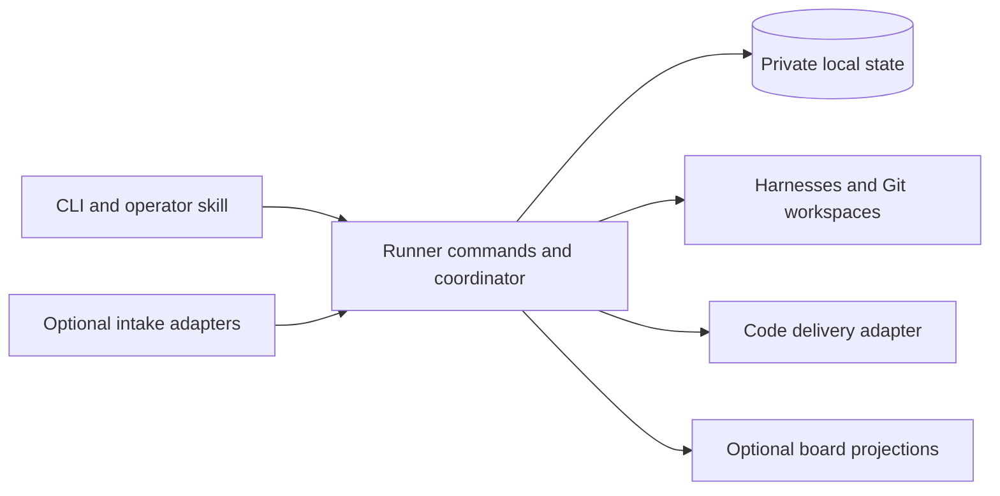

# Runner core redesign plan

Status: Accepted target and build plan. Date: 2026-10-14. Implementation has not started under this plan.

Runner should own its work, approvals, execution and recovery state locally.
GitHub Projects should become an optional view. External tools should connect
through small integration contracts for intake, progress publication or code
delivery.

The first priority is a reliable, understandable core process. A user should
always be able to see what Runner is doing, why work is waiting, what needs a
decision, and what will happen next. Configuring models, reasoning, escalation,
retry limits and parallelism should not require understanding the workflow
implementation or a board's field schema.

The direction is recorded in [ADR 0005](decisions/0005-local-runner-core.md).
This is the designated replacement specification and build sequence, under
[AGENTS.md](../AGENTS.md). The [architecture](architecture.md) and existing
operator guides describe the current runtime. The commands and configuration
below are build contracts, not available features. Implementation requires a
separate instruction to begin.

Start with [release scope](#first-release-scope), [core contracts](#core-contracts),
and the [first implementation slice](#first-implementation-slice).
The [coverage map](#requirement-coverage-map) connects important requirements to
their implementation phase and proof. Keep work status and evidence there as
slices land; do not create another plan or task registry.

## Accepted direction

1. Build a fresh core around one durable local source of truth and Runner-owned task IDs.
2. Preserve the event-and-action coordinator, the three execution contracts,
   dependency-aware concurrency, independent review and serialized integration.
3. Make the default journey complete and understandable before adding integrations.
4. Expose one execution policy with explicit retry and escalation semantics.
5. Introduce GitHub Projects as an optional projection, then prove the integration
   boundary with a second board provider. Defer externally loaded plugins.
6. Define test scope and strategy before implementation, and review test quality
   and consolidation as part of accepting every change.

Success means a user can set up Runner, submit and approve work, follow its
progress, resolve an interruption and reach a reviewed candidate without a
GitHub Project. GitHub code delivery can still require GitHub. The first
connected delivery milestone remains an accepted pull request and confirmed merge.

## First release scope

The first replacement release includes the complete local Plan/Ready process,
one repository/base per configured Runner instance, exact approval, independent
review, persisted recovery, configurable models/reasoning/escalation and
parallelism, an optional per-task harness-invocation ceiling, and readable local
status. It also includes GitHub PR/check/merge delivery, human merge by default,
explicit opt-in auto-merge, backup/restore, and a documented breaking cutover.
The existing [macOS/Linux amd64/arm64 builds](../scripts/build-release.sh)
remain the packaging target.

Use sandboxed Codex CLI as the first qualified harness. This selects a bounded
delivery scope, not a preferred model. The execution boundary remains capable
of other native harnesses; Claude and Pi qualification follow separately. Setup
must reject unqualified harness choices rather than silently substitute Codex.

Defer board views until after the core release. Also defer autonomous issue
intake, additional repository references, user-authored workflow composition,
time/token/cost admission ceilings, multi-host execution, a web dashboard and
externally loaded plugins. Preserve usage reporting, with unavailable usage
shown as unknown. These omissions are explicit release limits, not features
that agents may approximate. Add a deferred capability only with its own scoped
brief and acceptance evidence.

## Rebuild the core without inheriting its constraints

A fresh core is the recommended construction approach. The change in authority
from GitHub Projects to local state affects work identity, approval, scheduling,
recovery, configuration and tests. Extracting abstractions from the old design
first risks preserving those assumptions behind new interfaces. Build from the
accepted process and contracts, consulting the current code when a concrete
behavior, failure case or boundary needs investigation.

The old implementation remains valuable evidence. Carry forward required
invariants and known failure scenarios, then express them against the new
boundaries. Do not copy whole packages or the test suite merely to preserve
behavior parity. Evaluate a self-contained low-level component for reuse only
when its responsibility and contract fit directly and its complexity is justified.
Rewriting a sound subprocess or filesystem primitive brings no automatic benefit;
retaining one must not force the old work model into the new core.

Keep the rebuild incremental and runnable. Establish a complete local journey
early, then add the remaining required policies and integrations. A fresh start
does not require recreating every existing feature before anything works. It
does require maintaining authority, integrity and recovery boundaries in every
slice that can execute real work. Select the first release's capabilities
explicitly; omitted advanced features are documented, not silently approximated.

Backward compatibility is not a design requirement. New configuration, IDs,
state, commands and integration contracts may break compatibility. Provide an
upgrade utility only where conversion is small, deterministic and verifiable.
Otherwise publish a clearly breaking release with fresh setup and explicit
resubmission of remaining work. Do not build a compatibility layer, maintain two
active backends, or port historical approvals and recovery journals to avoid
that break. Retain old artifacts safely for inspection; breaking compatibility
does not authorize deleting existing work.

## Lessons and their disposition

The two assessments are [Assess source control article](codex://threads/01a13967-44ab-71f1-b689-ee91f0ea967d)
and [Review software-factory lessons](codex://threads/01a11fb1-f1c6-7a52-b8a2-f35fe00ece4f).
They provide design input, not evidence that either alternative has better
operational reliability than Runner. The software-factory references below use
the revision assessed in those chats.

| Learning and source | Decision for Runner |
| --- | --- |
| software-factory keeps its work locally and makes GitHub delivery optional. [Overview][factory] | Own work independently of external boards. Keep work management and code delivery separate. |
| Its quick start follows setup, specification, approval, execution and delivery. [Overview][factory] | Offer one recommended first-change journey. Preview and apply setup in one session. |
| Repository preparation establishes quality requirements and verification prerequisites. [Setup skill][factory-setup] | Agree authoritative checks and explicit baseline exceptions at setup; distinguish Runner readiness, repository readiness and integration availability. |
| Conversational operation explains running work, waits and escalations. [Dispatch skill][factory-dispatch-skill] | Add an operator skill over the same deterministic commands and local status. |
| Its status operation can also enforce worker limits. [Dispatcher][factory-dispatch] | Keep Runner inspection read-only; scheduling and recovery belong to explicit actions and the coordinator. |
| Plan review presents consequential decisions together. [Plan review][factory-plan] | Show outcome, scope, dependencies, assumptions and authorization in one approval preview. |
| The floor guard detects weakened checks, while behavioral cases test pressure to take shortcuts. [Guard][factory-guard], [cases][factory-cases] | First add paired evaluations for weakened tests and legitimate test refactors. Add narrow enforcement only if a demonstrated gap remains. |
| Visual QA produces evidence a fresh reviewer can inspect. [QA skill][factory-qa] | Retain suitable screenshots or recordings for interaction claims, bound to the candidate and checked for relevance. Avoid recording every task by default. |
| Carrying review through rebase based on an unchanged patch can miss interactions with the new base. [Dispatcher][factory-dispatch] | Preserve explicit base and candidate validation. An unchanged patch is insufficient authority to reuse acceptance. |
| Missing executable checks can remain gaps in the external check runner. [Check runner][factory-check] | Required missing proof blocks acceptance; process exit success alone does not establish completion. |
| Anthropic reports delivery infrastructure becoming the bottleneck as code production accelerates. [Article][anthropic] | Measure the complete Ready-to-merged path, integration waits and repeated review before changing scheduling. |
| Anthropic exposes metadata queries without requiring workspaces. [Article][anthropic] | Keep observation cheap; create a workspace only when an action needs files. Retain Git for Runner's workload. |
| Anthropic describes both excessive defensive agent review and useful simulations and fuzzing. [Article][anthropic] | Require concrete, reachable review findings. Invest in interruption, concurrency and publication tests instead of speculative machinery. |
| The earlier Runner assessment found competing recovery advice for moving a card to Ready and retrying its recorded stage. [Status rendering](../cmd/cortexium-runner/status.go) | Present the appropriate recovery first, including preserved work and the stage that repeats. |
| Runner already has candidate-bound evidence, focused follow-up review and private recurring-failure drafts. [Architecture](architecture.md), [evaluation guidance](model-profile-evaluation.md) | Preserve these contracts. Improve visibility and measure their effects rather than adding another review hierarchy or learning store. |

Keep Runner's continuous reconciliation, interchangeable harness boundary and
typed internal actions. Do not adopt file-overlap locks as a substitute for actual
resource conflicts, mandatory extra reviewer roles, or weaker pre-merge proof. Anthropic's
post-merge emphasis reflects its unusual scale and does not justify relaxing
Runner's integration contract. Worktrees also do not isolate ports, databases
or test fixtures: declare or allocate those resources when a repository needs them.

## Current constraints to replace

The [engine](../internal/engine/engine.go) owns a concrete `github.Project`;
work items, authorization and several process locks also belong to the GitHub
package. Each observation cycle loads Project lifecycle items. The
[configuration validator](../internal/config/project.go) requires a Project and
its lifecycle fields, while repository and merge settings sit under
`github_project`. This is deeper than an interchangeable board client.

The current design has useful protections for exact-content approval, complete
plan release, retained workspaces and interrupted publication. Some recovery
complexity compensates for multi-step remote writes. Local transactions can
remove those particular partial-write states. They cannot make Git operations,
model calls and remote publication atomic with a database transaction.

Configuration already supports role profiles, reasoning, an implementer ladder,
parallelism and budgets. However, QA limits live in workflow actions, the ladder
advances from Project QA failures, and provider retries use a fixed schedule
with in-memory state. [Roles](../internal/config/roles.go),
[workflow](../internal/config/workflow.go), [automatic retries](../internal/engine/automatic_retry.go).
The redesign should expose their meaning coherently and preserve limits across
restarts.

## The complete user journey

### Set up and prove readiness

Start with a local repository and one supported, authenticated harness. Guided
setup selects the repository and base, role profiles, parallelism, recovery
limits and delivery policy. It previews the resolved configuration once, then
applies it. External boards are optional subsequent connections.

Readiness has three separate results:

- Runner can invoke its configured profiles and protect the intended boundaries.
- The repository has known verification commands and the tools, services and
  inputs needed for the requested work.
- Each configured integration is available, unavailable or not configured.

Use existing repository commands and instructions. Missing requirements should
produce a concrete action; setup must not invent production credentials or
silently change the repository's quality requirements. Static inspection remains
non-billable. Live harness checks and repository commands have explicit scope.
One unavailable optional board does not make the whole setup unusable.

The guide ends with a small authorized change, its review evidence and, when
delivery is connected, its PR. It should not end at a successful configuration check.

### Repository quality agreement

Setup records the repository owner's definition of done and the instructions
and commands that establish it. Reuse existing repository policy; do not create
mandatory duplicate `DONE.md`, constraints files or a new testing framework.
Keep a versioned resolved agreement in private Runner state with references to
its authoritative repository sources. A task records the agreement revision
used for its verification brief.

For each required check, record its command, working directory, prerequisites
and permitted environment, plus the observed baseline revision and result.
Distinguish a passing check, a specific pre-existing failure and a check that
could not run. A missing tool or credential is a prerequisite gap, not a pass.
Static setup does not run arbitrary repository commands; preview the commands
and obtain authorization as part of setup before running the baseline.

The default is that required checks must pass. The owner may explicitly accept
a bounded, identified baseline exception with its scope and rationale. It cannot
cover a new or changed failure, excuse missing proof of the requested outcome,
or permit editing assertions until a gate turns green. Agents cannot grant or
broaden exceptions. Setup reports unresolved required gaps as blockers for work
that needs them, while unrelated inspection remains available.

Changes to authoritative commands, requirements or exceptions require an explicit
owner-applied agreement revision. Merely observing edited policy files cannot
relax a running task's contract. New tasks use the applied revision; existing
tasks keep their pinned agreement unless the owner explicitly selects them for
adoption. Adoption creates a new unapproved task version and revokes further
old-version actions. A weaker agreement cannot retroactively authorize a pass.
Test consolidation remains permitted when the same required guarantee is still
established.

### Submit and clarify work

Keep the two entry points:

- **Plan:** “I know the outcome; help me define the work.”
- **Ready:** “The task is sufficiently specified; implement it.”

A local Ready command is explicit authorization of the displayed task version.
Imported requests are untrusted input until an operator or configured trust
policy authorizes them. An external label or column name alone is not authority.
Retain the existing trusted issue-intake policy as an optional GitHub intake
capability; do not generalize private-repository trust to every external service.

The planner remains the ambiguity and decomposition boundary. It proposes
cohesive cards with acceptance criteria, proof obligations, non-goals and real
dependencies. No target number of cards, fixed file count or separate triage
agent is required. Open decisions remain questions on the request and prevent
release of an executable plan. Distinguish planning immediately from submitting
a planning request to the running coordinator.

### Approve the exact work

The preview leads with the intended outcome, proposed cards and dependencies,
material assumptions, expected verification and what approval permits. Full
task content remains inspectable. A complete batch is released atomically in
local state after its displayed version is revalidated.

Changing execution-defining requirements or dependencies invalidates the
affected authority and evidence. Presentation changes do not. A changed task
version must be approved before new execution; it cannot silently alter an
already running assignment. Revocation prevents subsequent privileged actions
and requests cancellation of affected active work while preserving its artifacts.
External completion already in progress is reconciled rather than assumed undone.

### Admit and execute safe actions

Keep one coordinator that observes state, derives safe actions and admits as
many as configuration allows. A poll is an observation boundary, not a batch.
Dependency outcomes and resource ownership determine safety; capacity and
budgets determine admission. Deterministic reconciliation does not consume
agent capacity or wait for unrelated agents.

Status and dispatch use the same eligibility calculation. A waiting task names
the dependency, occupied resource, capacity limit, budget, provider or decision
that prevents it from starting. Reserve capacity and record an attempt before
dispatch. Multiple CLI operations and the service share these bounds.

Implementation uses an isolated workspace and the exact authorized task.
Preserve useful work, feedback and valid saved results on recovery. Reports
identify commands, settings, outcomes and material limits; a model's claim that
a check passed is not independent proof that it did. The user sees the actual
role, model, reasoning, current stage, elapsed time and remaining recovery allowance.

### Review with sufficient evidence

Keep the independent reviewer and its existing evidence audit followed by
focused dynamic verification when necessary. Assess the approved outcome and
affected contracts as well as listed proof obligations. Review findings must
describe a concrete failure, its evidence and the relevant requirement.
Hypothetical improvements do not automatically become rejection criteria.

Distinguish accepted work, confirmed defects, a missing human decision and
incomplete evidence. A decision request takes priority over automatic repair.
An unavailable test environment is not a code defect. Preserve valid prior
findings and evidence; rerun checks for concrete gaps or invalidating changes.
Candidate bindings establish provenance, not the truth of every reported result.

Changing a base or candidate requires reassessing affected proof. Reuse exact
accepted results for interrupted deterministic publication only under the
existing integrity conditions. A missing required check cannot become a pass
because a review budget is exhausted.

### Publish and integrate

Store the reviewed candidate and evidence before remote publication. Publication
and integration use the code-host adapter, independently of any board adapter.
After a timeout or restart, inspect remote identity and outcome before repeating
a write. Recover an existing PR instead of creating a duplicate.

Serialize integration per repository and base. Refresh against the latest base,
resolve conflicts through bounded repair, and obtain the required verification
and review before merge. Preserve protection against base movement between
verification and the merge request. Human merge is the default; automatic merge
requires explicit policy and all the same correctness conditions.

Publication, CI, human review and integration waits remain distinguishable.
Missing remote observations never establish success. Closed-without-merge PRs
do not satisfy dependencies. A reviewed local candidate awaiting delivery is
useful progress, but it is not a merged implementation.

### Finish, stop and recover

A code task succeeds when its intended integration is confirmed. A planning
operation can finish while the original request remains incomplete; the request
finishes only after all required children succeed. Board updates, issue closure
and other housekeeping can retry independently of that recorded outcome.

Keep graceful drain: stop new admission and let admitted actions finish.
Immediate cancellation is a separate explicit operation. Restart reconciles
unfinished attempts and retained artifacts before admitting conflicting work;
it does not blindly rerun every stage marked active. Loss of the coordinator's
ownership must not allow a replacement to race surviving harness processes.

Every actionable failure presents its cause, preserved work, required action,
resume stage, expected repeated work and private evidence location. Recovery
does not require manually arranging board columns. The recommended action is
specific; alternatives explain their different effects.

## State and progress that users can understand

Separate the task's lifecycle stage from its waiting reason and current attempt.
“Waiting for provider” is not another workflow lane. “Needs your decision” is
different from “retry limit reached.” Board column names are display mappings.
The default display vocabulary is:

| Stage | Meaning |
| --- | --- |
| Draft | A request is captured but its planning or implementation is not yet authorized. |
| Planning | Runner is clarifying or decomposing the request. |
| Awaiting approval | A complete proposal needs authorization. |
| Ready | Work is authorized; a stated dependency or admission limit may still prevent starting. |
| Implementing | An implementation or repair attempt is active. |
| Reviewing | Independent assessment or required verification is active. |
| Awaiting delivery | A reviewed candidate needs publication, checks, human review or integration. |
| Completed | The intended successful outcome is confirmed. |
| Stopped | Work was cancelled or abandoned; this does not satisfy dependencies. |

Attention and wait reasons decorate those stages instead of creating a second
workflow graph. For example, an interrupted review remains Reviewing with a
specific recovery reason. Later user-authored workflows may name additional
states, but must provide the same stage, wait and next-action explanations.

The local status view leads with decisions and recovery actions, then active
work, ordinary waits and recent completions. Inspection is read-only. A
continuous display refreshes observations without granting execution authority.
Machine-readable status supports the operator skill and any future local UI.
Remote views show their last successful synchronization time and stale state.

Illustrative output, not an implemented CLI contract:

```text
Needs you
  R-42  Reviewing — browser capability unavailable
        Candidate and implementation evidence retained; no code rejection.
        Next: repair the browser capability, then resume review.

Working
  R-43  Implementing — repair 1 of 2
        Profile: implementer-careful; reasoning: high
        Reason: confirmed review defect; next: independent review

Waiting
  R-44  Ready — dependency R-43 has not merged
  R-45  Awaiting delivery — GitHub unavailable; reviewed candidate retained

Integrations
  GitHub Projects — stale; local work continues
```

The operator skill should answer “what needs me?”, explain a wait, preview a
policy change and perform an authorized recovery through these same commands.
It adds no alternative approval rules, direct database editing or scheduler.

## Core contracts

These are semantic contracts, not a requirement for one table or interface per
row. The engine decides transitions; the store atomically checks their expected
revisions and writes the resulting state. No transaction spans a model call,
Git operation or network request.

| Record | Required identity and meaning |
| --- | --- |
| Repository | Runner-owned identity bound to the validated local Git repository and configured base ref. A display path or remote board ID is not identity. |
| Task version | Stable local task ID plus monotonically increasing version and digest of execution-defining content: outcome, scope, constraints, acceptance/proof brief, dependencies, repository/base policy and quality-agreement revision. Store immutable versions; changing the title alone need not invalidate authority unless it changes the task's meaning. |
| Approval | Exact task ID/version/digest, authorization scope and recorded operator or explicit trusted-intake decision. Approval and revocation have a generation checked by every privileged action. A digest identifies content; possessing it is not authorization. |
| Attempt | Unique ID, task/version, approval generation, stage, pinned policy/profile, resolved base, owned resources, reserved allowances and invocation/result state. Preserve prior attempts; a retry is not an overwrite. |
| Candidate and review | Repository, task/version, base commit, candidate commit/tree, workspace identity, quality revision and evidence references. Review acceptance is valid only for this binding, after Runner validates the structured result and integrity checks. |
| External effect | Stable operation/object identity, authorized intent and observed outcome. Written before publication; ambiguous outcomes are reconciled, never assumed absent. This is needed from phase 3, not an empty framework in phase 1. |

Approval and admission use compare-and-set checks in short transactions. Repeating
approval of the same still-current version returns the existing approval; it does
not reset attempts or create another execution. A stale preview is rejected.
Requirements edits create an unapproved version and revoke future actions under
the old one. Display-only edits must not change the version's delegated content.

At admission, recheck authority, required dependencies, readiness, capacity and
resource ownership, then reserve the attempt and its allowances together. At
result commit, recheck the attempt, approval generation and candidate binding.
Results arriving after revocation are retained as historical evidence but cannot
advance work. A single task may have only one unfinished execution owner; a
resource cannot be released merely because a wall-clock lease expired.

| Transition | Guard and committed effect |
| --- | --- |
| Draft to Ready | Approve the exact complete task version. No harness is launched by approval itself. |
| Ready to Implementing | Reserve one eligible implementation attempt and its resources before launch. |
| Implementing to Reviewing | Validate and durably record the completed result, construct/validate its candidate, then make independent review eligible. A model's success string is insufficient. |
| Reviewing to Awaiting delivery | Required proof is sufficient, independent review accepts, and candidate/authority checks still match. No dependency is satisfied yet. |
| Reviewing to repair | A confirmed defect and remaining repair allowance permit another implementation attempt. Missing proof or a decision stays Reviewing with its own attention reason. |
| Awaiting delivery to Completed | Confirm the authorized integration outcome. Local acceptance or PR creation alone cannot complete a code task. |
| Any nonterminal stage to Stopped | Record revocation, prevent new actions, request cancellation and retain artifacts. Show cancellation pending until owned processes are known to have stopped. |

Plan adds a planning operation and an awaiting-approval proposal in phase 2.
Release all approved children and dependency edges in one transaction; reject
cycles, missing targets and stale proposal content. Planning success alone does
not complete the request. Failed, stopped or closed-unmerged dependencies do not
count as success.

Stage, waiting reason and attempt state remain separate. Recovery clears a
specific wait only after its prerequisite is satisfied; it cannot manufacture
approval, a passing review or unused allowance. Configured repository/base
identity changes require explicit setup and new task authority, not a hot switch
for retained work.

## Configuration and bounded recovery

### One visible execution policy

Keep named role profiles for harness, model, reasoning, timeout and supported
capabilities. An escalation step references a complete implementer profile; it
can change the model, reasoning, or both. Runner never infers capability or
price order from a model name. Offer supported choices for the installed harness
and reject unsupported combinations instead of silently substituting them.

The default workflow should be generated from one documented policy. Later
user-authored typed workflows must compile into the same coordinator and obey
the same limits. A setting must have one owner: do not retain competing
QA limits in workflow actions and recovery settings.

These are the first-release controls and pilot defaults. The first slice supports
the smaller explicit subset below; unsupported settings must fail validation.
Tune later revisions against observed rework, waiting and operator intervention:

| Control | Pilot default and meaning |
| --- | --- |
| Planner, implementer and reviewer profiles | Explicit profiles selected during setup; no new universal model default. Show resolved model, reasoning, timeout and access. |
| Implementer escalation | Disabled initially. An ordered list of approved profiles advances after a confirmed reviewer rejection, before the next permitted repair. |
| Automatic repair limit | Two additional implementation passes per approved task version. Includes QA repair, candidate correction, CI rework and conflict repair. Initial implementation is not a repair. |
| Transient retry limit | Three additional attempts for a recognized transient failure in the same stage recovery episode: 30 seconds before retry 1, two minutes before retry 2, then five minutes before each later retry up to the configured limit. Zero disables automatic retry. |
| Parallelism | One concurrent harness invocation initially; configurable from 1 to 16 in phase 2. Includes planning, implementation and review across service and CLI. |
| Role timeouts | Explicit per-profile values; use current generated values as initial tuning references and record setup choices. |
| Admission budget | Optional harness-invocation ceiling per approved task version; absent means no such ceiling. Reserve before launch and count planning preparation, audit, focused review, retries and repairs. A definitely unlaunched reservation may be released; uncertain launch counts until reconciled. Report time/tokens/cost where available; their admission ceilings are deferred. |
| Delivery | Human merge by default. Auto-merge is an explicit setting independent of board configuration. |
| Base freshness | Refresh before implementation by default. Optional use of an available recorded base during a code-host outage; latest-base verification remains mandatory for integration. |
| External views | None required. Each connection has its own destination and publication scope. |

Two repair passes preserve the default allowance of initial implementation plus
two QA-driven corrections, but deliberately also bound automatic paths that
currently do not count as QA rejections. Keep QA rejection counts as quality
evidence and the escalation trigger; stop using that count as the only general
repair bound. A candidate-correction call consumes a repair even when made inside
the same engine action. This prevents hidden extra model work.

A transient retry of a repair resumes that reserved repair pass; it does not
consume another repair allowance. All harness invocations still count toward
admission budgets and usage. Both repair and transient counters are reserved
before dispatch, so interruption cannot manufacture an extra attempt. A repair
limit of zero permits initial implementation and review but no automatic repair.

Example: profiles `implementer` and `implementer-careful`, with two repairs,
start on `implementer`. A confirmed rejected review permits repair 1 on
`implementer-careful`. A second rejection permits repair 2 on that final profile.
Another rejection stops for an operator decision. A provider outage repeats the
same stage/profile within its transient allowance and does not advance the ladder.
CI rework and conflicts consume repairs but do not imply a stronger model is needed.
Planner-selected starting profiles must come from the configured allowlist; show
the resulting reachable escalation sequence before release.

### Failure and retry rules

| Event | Automatic behavior | What the user sees |
| --- | --- | --- |
| Recognized transient provider or browser-startup failure | Retry the same stage/profile within its transient limit. | Cause, attempt count, next retry time and remaining allowance. |
| Confirmed reviewer defect | Repair within the task's repair allowance; advance the configured ladder. | Findings, selected next profile and repair count. |
| Candidate correction, terminal CI failure or integration conflict | Bounded repair with retained context; no automatic model escalation. | Concrete reason, retained branch/candidate and remaining repairs. |
| Required evidence unavailable, missing decision, invalid configuration or unknown harness failure | Stop for the specific operator action. | Exact missing input or capability and the stage that can resume. |
| Authority or integrity mismatch | Prevent further privileged work and retain evidence. | The changed binding and explicit recovery requirements. |
| Interrupted deterministic post-processing | Reconcile the existing effect; reuse an exact valid saved result. | Which operation resumes and whether any new harness call is needed. |
| Optional board unavailable | Retain pending synchronization and continue unrelated work. | Integration health and synchronization age, separate from task failure. |
| Admission limit reached | Wait without cancelling admitted work or weakening QA. | The limiting capacity or budget and when it can be reevaluated. |

Persist counters, reasons and retry deadlines. Restart and ordinary inspection
do not reset them. A successful stage ends its transient recovery episode;
changing error text does not. An explicit manual retry does not silently grant
a fresh repair budget. Additional allowance requires a visible operator choice
and records its scope. Changed requirements create a newly approved task version
while preserving prior attempts and outcomes.

Clean base refreshes can still cause repeated review without implementation.
Bound automatic refresh-and-review cycles separately, initially to two per
approved task version, then request operator intervention. Ordinary initial QA
does not consume this allowance; each base movement that requires another review
does. Returning through repair or restarting does not reset it. This advanced
integration limit prevents endless verification when the base keeps moving. Existing
bounded transport retries remain internal adapter behavior, with their total
calls visible; they must not multiply into independent unbounded retry loops.

### Make policy changes predictable

Provide an interactive editor, a non-interactive equivalent, validation and a
resolved-policy explanation. The preview says, for example, “two repairs remain;
the next confirmed rejection selects this model and reasoning.” Include warnings
for unreachable escalation steps and budgets that cannot admit the selected work.
Routine changes should not require editing nested workflow JSON.

Validate and atomically apply the whole change. Pin the effective configuration
revision to every attempt. Model, reasoning and recovery-policy edits affect the
next admitted attempt after operator application; active attempts retain their
recorded configuration. A pending transient retry retains its recorded profile
unless the change preview explicitly selects it for a profile change. Counters
carry forward. Lowering parallelism stops new
admission until active work fits; it does not cancel active agents. Lowering a
limit below consumed allowance stops the next automatic action.

Permission expansion, changed delivery authority and changed task scope require
their own explicit authorization. Escalation alone must not widen filesystem,
network or tool access. Switching reviewer profiles does not carry acceptance
across a changed candidate or base. Keep a compact history of applied policy
revisions so recovery and metrics can explain which settings governed each action.

### First slice configuration contract

Keep JSON and strict decoding. This is the minimal new configuration shape;
`SELECT_SUPPORTED_MODEL` and absolute paths are setup inputs, not working
defaults. The format marker deliberately distinguishes it from legacy v5.
There is no Project, workflow-lane or credential field.

```json
{
  "format": "runner-local-v1",
  "repository": {
    "path": "/absolute/repository",
    "base_ref": "refs/heads/main",
    "base_freshness": "recorded"
  },
  "state_dir": "/absolute/private-runner-state",
  "worktree_dir": "/absolute/runner-worktrees",
  "profiles": {
    "build": {
      "harness": "codex",
      "model": "SELECT_SUPPORTED_MODEL",
      "reasoning": "high",
      "timeout": "20m"
    },
    "review": {
      "harness": "codex",
      "model": "SELECT_SUPPORTED_MODEL",
      "reasoning": "high",
      "timeout": "20m"
    }
  },
  "roles": {"implementer": "build", "reviewer": "review"},
  "policy": {
    "max_parallelism": 1,
    "max_repairs": 0,
    "max_transient_retries": 0,
    "max_base_refreshes": 0,
    "implementation_ladder": []
  },
  "delivery": {"mode": "local"}
}
```

Validate unknown keys, missing role/profile references, unsupported harness or
model/reasoning combinations, nonpositive timeouts, unresolvable base refs and
unsafe/overlapping paths. State must be outside the repository and workspaces;
resolve symlinks and preserve the current configuration provenance protections.
Profiles do not grant access: the native sandbox and role permission ceilings
remain Runner-owned. The two profiles may use the same model; review still uses
a separate invocation and context.

Phase 1 accepts only the displayed policy values, local delivery and recorded
base mode. Its zero automatic allowances make unsupported repair/retry behavior
explicit. At approval, pin an available local base commit; that milestone never
fetches, pushes or merges. A later base movement does not alter that candidate's
recorded starting base or turn local review into current-base delivery proof.

Phase 2 enables the documented limits, a planner profile and
`max_invocations_per_task` (absent or positive integer). The implementation ladder
lists successor profile names after the configured starting implementer; empty
disables escalation. Exhausting the list keeps the last profile while repairs
remain. The same profile cannot recur in the ladder. Phase 3 adds GitHub delivery
configuration and requires refresh before implementation by default; `recorded`
remains explicit opt-in. All code delivery must verify the latest base.

Setup previews a complete resolved policy, then atomically applies it with a
revision. Phase 1 requires a drained coordinator before replacement of that
policy; phase 2 adds the live-change semantics above. No unsupported setting is
silently ignored. Model IDs and reasoning choices are validated against the
installed harness during implementation, not frozen to article examples.

## Architecture and ownership



### Package boundaries

Start with these responsibilities. Package names are illustrative; create a
separate package only where it owns a cohesive contract and has a clear reason
to change. Avoid generic `manager`, `service`, `common` or `utils` layers that
only forward calls.

| Boundary | Owns | Must not own |
| --- | --- | --- |
| `cmd` | CLI parsing, composition and presentation of application results. | Scheduling rules, provider-specific workflow or direct state edits. |
| `config` | Configuration decoding, validation and resolved execution policy. | Provider calls or duplicate workflow decisions. |
| `core` | Task/version identities, approvals, dependencies, outcomes and small invariant functions. | I/O, provider fields, database rows or a generic plugin framework. |
| `engine` | Application commands, transitions, admission, recovery and the one coordinator. Consumer-defined interfaces for required effects. | GitHub/Trello transport, SQL or harness command syntax. |
| `store` | Transactions, durable reservations, queries, history and local recovery records. | Deciding whether work is authorized or which action should run next. |
| `execution` | Role assignments, native harness adapters, structured results and invocation boundaries. | Work queue ownership, approval or merge policy. |
| `workspace` | Git workspaces, candidate construction and validated artifact handling. | Task lifecycle or external board state. |
| Integration adapters | Provider-specific intake, view or code-delivery operations. | Core scheduling, approvals or alternate completion semantics. |

The composition root wires concrete dependencies. Core types do not import the
engine or adapters; the engine depends on narrow contracts rather than concrete
integrations. Adapters can share core value types without importing each other.
Keep interfaces at actual substitution boundaries, defined by their consumer;
do not create an interface for every struct or a generic repository API that
leaks storage operations into workflow code. Telemetry, process execution and
filesystem protection remain focused support responsibilities where needed.

Design a board-view contract around publishing Runner progress. GitHub Projects
and Trello each translate that contract into their own representation. Separate
intake and code delivery are additional capabilities, not mandatory methods on
one universal plugin interface. Built-in adapters are enough to establish
interchangeability. A public plugin loader, SDK and permission system require
their own demonstrated need.

The practical architecture check is whether a core eligibility or retry test
can run without constructing a GitHub payload, launching Git or pretending to
be a harness process. Conversely, provider transport and workspace tests should
exercise their actual boundaries. If a small rule needs a simulation of the
whole application, revisit the production boundary before adding more helpers.

### Local authority

Use one transactional local SQLite store. Qualify the selected driver against
the existing no-CGO packaging targets in the first slice. Store task versions,
dependencies, approvals, plan releases, attempt reservations, recovery counters, integration
ownership and external-object mappings there. Keep evidence files and Git objects
outside the database when appropriate, with validated references and identities.

The store is private Runner state outside agent-writable workspaces. Editable
requirements and exported plans are inputs; importing them does not import
execution authority. Existing sandbox and trusted-host limitations still apply:
local file permissions do not contain deliberately unrestricted host execution.

Use the existing single-coordinator ownership model and short transactions for
CLI mutations and admission. Do not add a second scheduler, distributed queue or
full event-sourcing platform. Minimal transition history belongs alongside the
canonical state; telemetry remains diagnostic and is not reconstructed as authority.
Budget admission must continue to account for durable unfinished reservations.

Transactions cover local changes only. Record the stable identity and intent of
an external effect before issuing it, then reconcile the result. Where a provider
cannot establish whether creation succeeded, stop ambiguous replay rather than
promise exactly-once behavior. Missing or corrupt authoritative state stops new
work; a remote board cannot silently recreate approvals.

Provide consistent backup/export and tested restore. Restoring onto a host
requires exclusive ownership, reconciliation of external effects and validation
of retained workspace identities before execution. A copied database is not
permission to run a second coordinator. Several independently active Runner
hosts sharing work are outside the first release.

### Integration boundaries

Define work identity, task versions, authority, outcomes and resource keys in
the new provider-neutral core contract. The engine owns
process decisions; the store owns durable changes; GitHub transport owns API
requests. Repository/base/merge policy is independent of Project configuration.
Use the current execution, workspace and subprocess code as reference for
necessary guarantees; assess any reuse against the new boundaries.

Define integrations by the capability they actually supply:

- **Intake:** discover a request, provide its source identity and observed version,
  and return acknowledgement or questions. Core policy decides authorization.
- **View:** publish a bounded task summary, progress, attention reason and links.
  It has no permission to approve work or set successful outcomes.
- **Code delivery:** publish/inspect a candidate and PR, observe checks and merges,
  and perform an authorized merge under the core integration contract.

Start with built-in adapters. Each declares required credentials, operations,
stable identity, retry behavior and supported capabilities. A Trello view does
not implement GitHub merge methods. No adapter receives arbitrary authority to
change workflow rules or private approval records.

Initial views are one-way projections. Reconcile the newest committed task
version using durable external mappings; coalesce superseded presentation
updates. Prevent out-of-order writes from reverting a newer projection. Retry
only affected connections. Do not publish raw transcripts, private diagnostics,
credentials or unrestricted evidence merely because a board is connected.

Later editable integrations may submit versioned commands through the core.
Runner validates source authorization, rejects stale/conflicting edits and
acknowledges acceptance. An offline board edit is pending, including a requested
stop; it cannot promise immediate cancellation. Do not add bidirectional field
merging or infer completion from a moved card.

Externally loaded plugins, arbitrary scripts, workflow expressions, additional
role contracts and a full web dashboard remain deferred. A second actual
provider should validate the adapter boundary before a public plugin API is frozen.

## Outages and recovery boundaries

| Unavailable component | Work that can continue | Work that waits |
| --- | --- | --- |
| GitHub Projects or another board | Local intake, planning, implementation, review and available code delivery. | That board's synchronization and incoming requests. |
| GitHub code hosting | Local status and work with available repository objects under the selected base-freshness policy. | Remote fetches, publication, hosted checks and confirmed integration. |
| A harness provider | Other admissible profiles and deterministic reconciliation. | Affected model calls within the configured retry policy; no implicit cross-provider fallback. |
| Repository test service | Unrelated tasks and evidence checks that do not need it. | Acceptance requiring that service's proof. |
| Authoritative local store | Diagnostic access and preservation of retained artifacts where possible. | New claims, approval changes and privileged publication until state is safely restored. |

Removing Projects alone does not create code-host independence. The current
implementation [fetches the base before implementation](../internal/engine/engine.go).
The new core must make that dependency explicit and exercise the optional
recorded-base policy. Missing local objects remain a real blocker. A locally
reviewed candidate must refresh and regain required evidence before remote
integration; offline progress never means offline confirmation of a merge.

## Construction and release plan

Implement these slices only after an explicit instruction to begin implementation.
Build the new core directly; the existing application stays available as reference
and as the last supported release until replacement. There is no requirement to
refactor it into a transitional backend. Keep the new code isolated during work
and preserve unrelated local changes.

| Phase and dependency | Concrete scope | Completion evidence |
| --- | --- | --- |
| 0. Record the process and proof before construction | Accepted decision, release scope, contracts, quality agreement and first-slice brief. Extract essential invariants from current contracts and incidents. | This plan and ADR 0005 establish the build direction. Detail later slice briefs here before their implementation, using what preceding slices establish. |
| 1. Build one complete local journey after 0 | New core identities, private store, commands, coordinator and one harness path. Support local Ready intake, exact authorization, isolated implementation, independent review, retained results and local status. | One reviewed candidate without Projects; small core tests and actual store/workspace boundary tests establish the required safety. A controlled restart preserves authority and work. |
| 2. Complete the core process after 1 | Add Plan and atomic release, dependencies, bounded repairs/retries, configured escalation and reasoning, capacity, invocation budgets, configuration editing, full quality-agreement changes, attention-first progress and stage-specific recovery. | Both entry paths reach reviewed candidates for eligible work; dependencies wait honestly for integration. Core fixtures prove success/release rules; phase 3 proves the merged dependency journey. Policy previews, restart limits and test reuse hold without a board. |
| 3. Connect delivery after 2 | GitHub PR/check/merge adapter, serialized current-base integration, bounded refresh and ambiguous-write recovery. | A complete authorized change reaches confirmed merge. Outages, base movement, conflicts, closed PRs and interrupted publication have correct bounded outcomes. |
| 4. Qualify and release after 3 | Run selected live and operator journeys, backup/restore and package/platform checks. Decide whether a small upgrade utility is justified; otherwise document fresh setup for a breaking release. | Core reliability and usability gates pass. A selected installation can switch safely without dual ownership; difficult historical-state conversion is not a release prerequisite. |
| 5. Add optional board views after 4 | GitHub Projects projection, then Trello against the same capability contract. Include synchronization health, stable mapping and bounded publication. | Disconnect/reconnect and reordered updates do not affect work authority. The second provider needs no changes to core scheduling or approval. |

Phases 1 and 2 must produce useful complete journeys, not a collection of
unconnected packages. Configuration and user-facing progress are core work.
Do not postpone test design until a final testing phase. Optional integrations
must wait when core scenarios, test quality or the operator journey remain weak.

### First implementation slice

**Outcome:** on a local repository, a user configures Runner, supplies and
approves a Ready task, follows its implementation and independent review, and
inspects a retained reviewed candidate after restart. The final stage is
**Awaiting delivery — local review complete; delivery is not configured**.
This is a useful internal milestone, not the first public release or successful
integration. It must make no GitHub/board calls and require no `gh` installation.

The prerequisite is this accepted plan. The slice owns the new local command
path, minimal config/setup, identities, store, coordinator, one Codex harness
path, isolated Git workspaces, replacement implementer/reviewer instructions and
the evidence below. Use one invocation at a time, no automatic repairs/retries,
no planner, no dependencies and no remote delivery. Reject unsupported controls.
Require a supplied verification brief and a passing repository baseline; baseline
exceptions and changes to the quality agreement are phase 2 work.

#### Construction boundaries

Use a dedicated rebuild branch/worktree when implementation begins; preserve
the current checkout's unrelated work. Build an isolated `cmd/runner-next`
entry point with new responsibilities under `internal/runner/` following the
package map above. Keep the existing binary available until cutover. This is
build-time separation, not a runtime backend switch or compatibility layer.
At phase 4, retire the old entry point and promote the replacement to
`cortexium-runner`; do not retain a `next` alias or duplicate runtime.

Create only packages the working journey uses. In particular, do not scaffold
board adapters, a generic event bus, an empty plugin registry or every later
database table. Existing workspace/subprocess primitives may be reused after
checking their contracts. Do not import `internal/github` or the old coordinator
into the new core. Own replacement instructions separately from the currently
shipped `skills/runner-*` prompts until the old binary is retired.

Choose the SQLite Go driver as an ordinary implementation decision. First prove
transactions and reopen behavior with a real temporary database and compile the
new entry point with `CGO_ENABLED=0` for the four existing release targets. If
that fails, resolve the driver or packaging decision before building more on it;
do not quietly substitute a JSON journal. This is a bounded step inside the
slice, not a separate research project.

#### Command and task contract

The new entry point uses the explicit `--config PATH` selection. Commands below
are the first-slice surface; the current binary does not implement them.

| Command | Required behavior |
| --- | --- |
| `init` | Guide or consume the new configuration, preview paths/profiles/quality checks, then apply setup on explicit confirmation. Preserve unrelated files and prior applied revisions. Reconfigure a compatible setup only while drained; reject incompatible state rather than migrate it. Run only authorized, needed baseline checks. |
| `config explain` | Read and explain the applied revision, actual profiles, local base policy and zero automatic allowances. No writes or model calls. |
| `task add --file TASK.md` | Capture an unapproved draft. Require Outcome, Scope, Acceptance and Verification sections; Verification contains the behavior, expected results, boundary and reuse choice. No dependencies in this slice. Structural validation does not replace the author's responsibility for a complete task. |
| `task show ID [--json]` | Show exact content/version/digest, quality revision, observed local base, authority, attempts and evidence. Supply a separate approval-preview digest. |
| `task approve ID --version N --preview DIGEST` | Revalidate and approve only the displayed version and preview binding. Pin the local base commit. Return the existing still-valid approval for an exact repeat, without a new attempt. A changed preview requires inspection again. |
| `task replace ID --version N --file TASK.md` | Compare the expected version, create an unapproved replacement and revoke subsequent old-version actions. Request cancellation of old active work; retain its artifacts and pending cancellation status. |
| `run` / `drain` | Acquire exclusive coordinator ownership and reconcile/start eligible work; drain records a durable admission stop and waits for active work to settle before the owner exits. A later explicit `run` clears drain after recovery. |
| `status [--json]` | Read-only view of attention, active work, waits and retained results, including whether the coordinator is running or drained. Show actual model/reasoning, stage, cause and next action. Never launch, retry, migrate or repair state. |
| `task stop ID` | Revoke authority before requesting cancellation. Return promptly with cancellation pending if work has not stopped. Never delete retained branches or evidence. |
| `task resume ID --attempt ATTEMPT [--allow-new-invocation]` | Target the displayed interrupted attempt and preview its stage, preserved artifacts and repeated work. Request reconciliation of valid saved results without another model call. A new call requires the explicit flag and valid authority, profile and prerequisites; it cannot repair a rejected candidate in this slice. Repeating a request for the same attempt cannot queue another invocation. |

Keep the immutable task content digest distinct from the approval-preview digest.
The latter binds task ID/version/content digest, repository/base-policy identity,
displayed quality revision and observed base commit. An unchanged requirements
file is not enough when those inputs changed. An already committed exact preview
can return its approval while that authority remains valid; it grants nothing
new. Capture imported text once. Editing its source file later has no effect
until an explicit replacement. Init applies only the supported configuration
contract; it cannot install new tools or invent credentials.

Task commands commit state or recovery intent. Only the owning `run` process
performs mutating task Git operations and task harness calls; a CLI must not bypass admission
rules. If the coordinator is absent, show that the request is pending and give
the command to start it. Setup's separately authorized baseline checks run in a
disposable copy of the observed base, preserving the user's checkout. Preview
that uncommitted checkout changes are not part of the pinned base.

JSON status/show expose the same facts as human output: task ID/version, stage,
wait/attention reason, active attempt/profile, base/candidate identities,
preserved evidence, cancellation state and allowed next action. Report missing
values as absent/unknown, never as successful zero values. Inspection can explain
a damaged or missing store but must not create a replacement authoritative store.

#### Execution and recovery

1. Setup validates repository, private state and workspace locations, native
   harness capabilities and the quality agreement. Use safe native sandbox
   profiles; unrestricted host execution is not part of this slice.
2. Approval and admission follow the core contracts. Record the attempt and
   resources before launch. Keep subprocess work outside transactions and off
   the coordinator's reconciliation path. A second owner cannot run, and a
   second reservation cannot claim the same task/workspace.
3. The implementer receives the approved task, verification brief, quality
   revision and pinned base. Preserve the user's checkout. Runner records a
   validated completed harness result durably before candidate post-processing,
   with the workspace/content binding needed for safe reuse.
4. Construct an immutable candidate and launch independent evidence audit.
   When a concrete proof gap requires dynamic verification, use the existing
   focused-verification contract in a disposable candidate copy. The reviewer
   cannot edit canonical source or weaken the task's checks. Both calls use
   ordinary capacity and record their actual profile and result.
5. Commit acceptance only after required proof and authority/integrity checks
   pass. Confirmed defects, missing proof and missing decisions remain distinct
   attention reasons. With zero repairs, a confirmed defect waits for an
   operator decision; `resume` cannot secretly rerun implementation as repair.
6. Drain and restart reconcile reserved/running attempts before admitting more
   work. The following boundaries determine whether a model call may repeat.

| Interrupted boundary | Required recovery |
| --- | --- |
| Approval/admission transaction | Either the whole local change exists or none does. Repeated approval/admission cannot create duplicate ownership. |
| Reserved or launched attempt without a durable completed result | Reconcile the owned process group and process identity, not a PID or elapsed timeout alone. Do not release resources while a surviving process may mutate them. If launch/completion remains uncertain, retain the attempt and request explicit recovery; no automatic replay. |
| Valid completed result before candidate or transition commit | Verify task, authority, base and workspace/content binding; resume deterministic post-processing without another implementation call. |
| Valid review acceptance before transition commit | Revalidate the exact candidate/quality/authority binding and finish the transition without another reviewer call. A mismatch blocks reuse. |

If the runner cannot prove an orphan is stopped, it reports the unresolved
ownership instead of killing an unrelated process or reclaiming its workspace.
Stopped or superseded attempts may retain late output, but that output cannot
advance the task. Manual recovery is explicit and recorded; it is not a reset
of authority or attempt history.

#### Verification brief

The task author owns these expectations. The implementer selects local test
syntax; the independent reviewer checks sensitivity, missing coverage and setup
complexity. Use ordinary Go tests, actual temporary SQLite databases and Git
repositories, and small execution-adapter doubles controlled by explicit
signals. Do not simulate GitHub payloads or reproduce the engine in a fake.

| Case | Expected result and proof boundary |
| --- | --- |
| S1 Setup and happy journey | Through real commands, create/approve one task, implement, independently review and reach Awaiting delivery. Verify durable candidate/evidence after reopen, untouched original checkout, and no fetch/push/merge/board calls. Use controlled harness output here; qualify the real adapter separately. |
| S2 Stale approval and competing claims | Change version, base observation or quality revision after preview: approval fails without a launch. Exact repeat returns the same approval. Competing store connections cannot reserve two owners. Exercise real transactions, not only mocked return values. |
| S3 Responsive coordinator | Hold an implementation on a signal while status, stop/drain and unrelated deterministic reconciliation remain responsive. A second coordinator is rejected. No arbitrary sleeps or global harness lock around the loop. |
| S4 Interruption and saved results | Fault at each recovery-table boundary; reopen state. Valid implementation/review results avoid another call. Unknown or surviving execution blocks conflicting claims. Counters/history are not discarded. |
| S5 Authority and candidate integrity | Revoke or replace while a call is active; late output cannot advance. Change candidate bytes, base binding or repository/workspace identity; saved acceptance cannot be reused. Use real Git/filesystem fixtures for the integrity claims. |
| S6 Review sufficiency and isolation | Accepted complete evidence progresses; confirmed defect, missing proof, human decision and malformed result do not. Generated verification output is allowed only in the disposable copy; source/test/lockfile changes invalidate the result. Exercise core classification and actual copy boundaries separately. |
| S7 Honest configuration and recovery | Invalid paths/profiles, unknown keys and unsupported nonzero limits fail before launch. Missing/corrupt state blocks execution instead of creating a new store. Status/show leave control state unchanged. Resume explains reused versus repeated work, requires explicit authorization for a new invocation and cannot replay the same recovery request twice. Rejected review cannot obtain a hidden repair. |

Reuse knowledge from the following inspected tests. These are references, not
an instruction to port their Project scaffolding:

- [Engine recovery tests](../internal/engine/engine_test.go):
  `TestImplementationResumesCompletedHarnessAfterPostProcessingFailure` and
  `TestAgentQAResumesExactAcceptanceWithoutAnotherReviewerRun` establish S4's
  no-repeat requirement. Express it against the new store/engine boundary.
- [Continuous coordinator](../internal/engine/continuous_coordinator_test.go):
  `TestRunLoopReconcilesIndependentPullRequestWhileHarnessActionIsRunning`
  supplies the signal-based interleaving pattern for S3; substitute a local
  deterministic action, not a fake PR service.
- [Resource tests](../internal/engine/resources_test.go) establish task/workspace
  conflicts. Replace provider identities with core values for S2/S3.
- [Workspace publication tests](../internal/workspace/publication_test.go) and
  [reviewer verification tests](../internal/execution/reviewer_verification_test.go)
  establish candidate-bound acceptance and disposable-copy isolation. If the
  owning primitive is reused unchanged, reuse its coverage; extend it only for
  a distinct uncovered case. Otherwise replace the obsolete representation's
  tests with equivalent guarantees at the new owning boundary.

There is no new store suite to extend yet: create one focused owning suite for
transactions/reopen behavior. Keep command smoke tests few and reserve exhaustive
variations for their owning core/store/adapter tests. A test must name the
incorrect behavior it distinguishes; duplicate journey tests are not extra proof.

#### Completion and implementation order

Build in this order within the slice: storage/package feasibility and
version-bound commands; isolated implementation with durable result capture;
independent review; recovery/status; then the complete acceptance journey.
These are construction steps, not separately complete deliverables. Keep the
working path runnable as it grows; do not report a package skeleton as the slice.

Completion requires S1–S7, the configuration example validated by the new parser
with setup-selected paths/model inputs, `go test -race ./...`, `go vet ./...`, and the new entry point's four
no-CGO target builds. Then run one scoped live Codex journey on a disposable
repository with operator-selected model/reasoning, including drain/restart and
inspection of the reviewed result. Record actual calls and candidate-bound
evidence; unavailable credentials or capabilities leave that qualification open.
No remote publication or production data is part of this proof.

Review the complete diff for coupling to old Project types, unsupported settings,
hidden retries, generic infrastructure, duplicated tests and unrelated changes.
Update this slice with evidence and actual remaining limits. Before starting
phase 2, write its bounded brief here using the contracts and suites that now
exist; do not create a second test framework or parallel work plan.

### Simple upgrade or deliberate break

An upgrade utility may translate straightforward configuration and import
requirements as unapproved drafts. It must preview its result, validate the
new contract, be safe to repeat and leave original files intact. Unsupported
settings are reported, not guessed. Do not make historical workflow conversion,
retained approval signatures, partial plan release, or arbitrary in-flight
recovery state mandatory migration features.

Use this release procedure whether or not an upgrade utility exists:

1. Preserve a usable copy of the old release, configuration and private evidence.
   Inventory active work, retained branches/worktrees and open PRs.
2. Drain and stop the old service, including automatic restart. Quiesce its
   Runner-owned remote auto-merge requests and confirm their state before the
   new service may target the same repository/base. If this cannot be established,
   defer activation. Never run both authorities against the same work.
3. Finish existing work under the old release before switching, or park it with
   its artifacts retained. The operator explicitly chooses what remaining scope
   to resubmit to the new version. Do not automatically inherit old approval,
   QA acceptance, counters or integration ownership.
4. Run fresh setup or the bounded configuration/draft import. Approve resubmitted
   work under the new contract. An existing PR or candidate is evidence to
   inspect; adopting it requires fresh identity checks and required review, and
   is not a prerequisite for the first release. Avoid creating a competing PR
   for retained work without an explicit disposition of the old one.
5. Validate one real local and connected journey. Clearly mark the old board
   as historical until an optional view connects it. Keep old artifacts for
   inspection rather than deleting them as part of upgrade.

Do not restore the old service from a stale snapshot after the new version has
changed branches or remote state. Stop, reconcile actual effects and decide the
recovery path explicitly. This is an ownership requirement, not backward
compatibility. A breaking release can have a simpler installation transition
without pretending historical runtime state is portable.

### Documentation and retirement

AGENTS.md and ADR 0005 establish the replacement authority, package and testing
contracts. Earlier decisions identify their superseded assumptions. ADR 0003's
pinned-reference guarantees remain relevant when references are supported.
Current role skills remain with the current binary. Phase 1 supplies and
qualifies replacement implementer/reviewer instructions; phase 2 adds planner
and operator instructions under the same ownership and recovery policy.

The new release needs its own accurate architecture, setup guide, examples,
operator reference and help output. Resolve older contribution/intake wording.
Retire obsolete application paths and their tests from the active build; keep
history accessible in version control. Do not preserve Project field schemas,
old command aliases, old config versions or test helpers solely for compatibility.
Each retained behavior and test must earn its place through a current requirement.

## Testing policy and ownership

Testing is part of the process design, including how Runner creates tests in
other repositories. Repository owners define the quality policy; the planner
applies it to the task; the implementer writes the change within that policy;
the independent reviewer assesses both the change and its proof. Moving every
test decision from one agent to another would not itself solve overengineering.
The decisions need an explicit contract and independent review.

The current [planner skill](../skills/runner-planner/SKILL.md) deliberately leaves
verification technique to the implementer, and the
[reviewer skill](../skills/runner-reviewer/SKILL.md) repeats that ownership.
The [implementer skill](../skills/runner-implementer/SKILL.md) already asks for
minimal tests and reuse. The new policy therefore needs more than another
instruction to “write simple tests”: it must change what the assignment defines
and what the reviewer checks.

There is also an architecture cost. Some current
[engine tests](../internal/engine/engine_test.go) intercept GitHub/Git/harness
commands, while their [support code](../internal/engine/github_contract_test.go)
constructs Project fields and approval payloads. These are useful references for
failure scenarios, but should not be the new engine's default testing boundary.
Large files alone do not establish redundant coverage. Keep concrete guarantees,
then test each at the boundary that actually owns it.

### Decide the test scope before coding

Every task's existing verification brief should identify:

- The observable behavior or invariant, its requirement source, and a credible
  incorrect behavior that the evidence must distinguish.
- Representative inputs and expected outcomes derived from that contract.
- The appropriate boundary and evidence method: existing test, new test,
  source inspection, rendered interaction or another justified observation.
- The existing suite or test to extend, the distinct uncovered case, and the
  needed real/fake dependencies. Explain a new suite or shared helper if required.

Keep this in the ordinary task description and proof obligations. Do not add a
separate test-planning service, coverage registry or mandatory tester role.
The planner must inspect relevant tests before naming their reuse; it must not
invent filenames or leave every method as “the implementer will decide.”
Direct Ready work can supply this brief with the task. If it is missing, the
existing planner contract prepares only the verification brief before coding;
it does not decompose or reapprove the task. Existing repository policy and
supplied evidence may already settle the brief without another model call.
Any required planning call uses ordinary capacity and budget and is visible as
preparation. It adds no product requirements or new human approval gate.

The implementer can choose syntax and small local mechanics, and can adapt a
stale placement choice after inspecting the code. It cannot independently replace
the agreed boundary with a large custom harness, weaken expected behavior, or
expand the test scope without a concrete reason. Record material changes to the
brief in the existing result. A missing product decision returns to the human;
a routine change of test location does not.

### Ownership and timing

| Responsibility | Owner and time |
| --- | --- |
| Define supported behavior, quality rules and required gates | Repository owner, before work is delegated; reuse the target repository's established policy. |
| Choose scenarios, expected results, test boundary and existing coverage to extend | Planner during planning, or the task author for Ready work; the same planner fills a missing Ready brief. Approval binds the required behavior. |
| Write or extend tests and implementation | Implementer within the approved task. For a bug, establish the smallest reliable failing reproduction before the fix when practical; for new behavior, settle its cases before implementation. |
| Verify adequacy, independence and economy of tests | Existing independent reviewer before acceptance. Check missing behavior, weakened assertions, redundant scenarios and unjustified fixture complexity. |
| Consolidate or remove superseded tests | Implementer in the same scoped change, with the reviewer checking that each distinct contract remains protected. |
| Run final integration gates | Runner's deterministic verification/delivery path and repository CI according to policy; agents do not waive those gates. |

Tests and production changes should land together. Existing sufficient coverage
can mean no new test. Documentation or a mechanical change does not automatically
need an executable regression test. A reproduction that adds lasting protection
belongs in the existing suite; a temporary diagnostic does not automatically
become permanent infrastructure. Timing a test before implementation helps with
independence, but does not prove its expectation is correct.

### Replacement role instructions

These instructions supplement the preserved isolation, honesty and evidence
contracts. Put them in the replacement assignments before their first model
invocation; do not send a new verification brief with an old prompt saying that
the implementer alone chooses the proof method.

| Instruction owner | Required assignment behavior |
| --- | --- |
| Planner or Ready task author | Inspect the repository's quality agreement and relevant tests. State supported scenarios, expected results, appropriate boundary and inspected coverage to extend. Do not prescribe internal implementation or invent requirements. A missing Ready brief is preparation, not a new task decomposition or approval gate. |
| Implementer | Follow the supplied verification brief. Choose local syntax and mechanics; extend/consolidate the owning suite. Explain a materially different evidence method and its concrete reason. Do not weaken expected results or invent a broad test harness. Return actual commands/observations, failures, reuse rationale and remaining limits. |
| Reviewer | Independently check the requested behavior and whether its proof can detect a credible defect. Inspect coverage reuse, redundant cases and disproportionate helpers. Require a concrete requirement or reachable failure for a rejection; zero findings is valid. Remain read-only and request only missing or invalidated evidence. |
| Operator skill | Explain setup, resolved policy, waits and recovery through the same commands and status. Preview consequential changes; never bypass approval, reset counters or edit the store directly. This is an interface, not a fourth execution role. |

Phase 1 supplies the Ready brief directly and qualifies implementation/review.
Phase 2 qualifies planning, missing-brief preparation and the operator interface.
Pair seeded bad behavior with legitimate controls: a weakened assertion should
fail review; a simpler equivalent test should not. Use the existing behavioral
evaluation approach, not a new evaluator service or mandatory reviewer group.

### What makes a good test

A good test protects a supported behavior or important invariant, fails for a
credible wrong implementation, and makes the cause of failure clear. Its expected
result comes from the contract, not from duplicating the implementation's formula
or recording whatever output the new code currently produces. It exercises enough
real behavior to support its claim and remains valid through internal refactoring
that preserves that behavior.

Use the smallest readable arrangement and representative fixture that establish
the claim. Control time, randomness and synchronization when they are not the
subject of the test. Clean up owned resources. Assertions should identify the
broken guarantee; checking only that a command returned success is insufficient
when the guarantee concerns persisted state or an external effect. Exact command
flags, ordering or private structure are appropriate assertions only when they
are themselves a required adapter, security or protocol contract.

Before accepting a test, the reviewer should be able to answer: what requirement
justifies it, what plausible defect makes it fail, why existing coverage is not
enough, and why its setup is the simplest reliable choice. For a bug fix, the
original defect is usually that demonstration. Targeted mutation can resolve
uncertain test sensitivity; a universal mutation gate is unnecessary. Test count,
line coverage, line count and an elaborate fixture do not establish quality by themselves.

### Extend and consolidate existing tests

Search for the behavior's owning suite before adding a file or helper. Prefer
extending the existing scenario or adding a named case when setup and assertions
are genuinely shared. Use table-driven tests for a coherent invariant with
meaningful input variations; do not combine unrelated behaviors into a table
with many flags and branches merely to reduce the number of functions.

When two tests establish the same outcome through the same boundary, keep the
clearer one or merge their distinct cases. When a refactor replaces a contract,
replace its obsolete tests in the same change. Preserve tests at different
boundaries when they catch different failures: a pure eligibility test and a
store-transaction test are not duplicates merely because both mention approval.
Deleting coverage requires identifying where the still-required guarantee lives.

Helpers may remove repeated mechanical setup. Keep important scenario inputs,
expected results and assertions visible. Do not build a configurable fake of
all Runner behavior or an assertion DSL to hide difficult production boundaries.
A little repeated setup is preferable to a helper that requires understanding
another state machine. Consolidation concerns the touched behavior; it does not
authorize unrelated repository-wide test cleanup on every card.

### Test the correct boundary

| Claim | Preferred evidence for Runner |
| --- | --- |
| Eligibility, retry/escalation rules, dependency outcomes and resource conflicts | Small core tests with explicit inputs and expected decisions. No GitHub JSON or subprocess simulation. |
| Atomic release, counters, restart recovery and competing claims | Integration tests against the real temporary local store. An in-memory fake cannot establish transaction or durability semantics. |
| Provider request mapping, capability handling and ambiguous responses | Adapter tests at the actual protocol/CLI boundary with narrowly controlled responses. |
| Interchangeable board or harness behavior | A small shared contract suite for genuinely common guarantees, plus provider-specific tests. Do not force Trello to mimic GitHub details. |
| Git candidates, workspace isolation and publication integrity | Focused tests with temporary real repositories and the relevant filesystem/process boundaries. |
| Coordinator interleaving and interruption | Explicit completion signals and fault injection at owned operation boundaries, with the real store where state recovery matters. |
| A complete user journey | A small number of scenarios through real application commands, actual store/workspaces and controlled external adapters. |
| Agent judgment, adherence and evidence quality | Separate behavioral evaluations with seeded defects and correct controls; live model runs only when that behavior needs qualification. |

For software Runner builds, apply the same ownership and quality rules using
that repository's stack and conventions. Do not prescribe Go tests, SQLite,
browsers or a particular framework to unrelated projects. Existing test commands
remain the source of execution truth. Run focused tests during development and
repair; run broader gates at their required boundary. The reviewer reuses valid
evidence and does not create a second competing suite.

## Proof that the redesign is ready

Use deterministic scenarios to protect state transitions and failure boundaries,
then selected live harness and operator journeys. Reuse existing fixtures where
they prove the same contract. Test faults at operation boundaries rather than
adding arbitrary waits or broad mock-only coverage.

### Requirement coverage map

Phase 0 is documented. All runtime evidence below is still pending; describing
a scenario is not proof that it passes. As a slice lands, record its verified
commit and focused evidence in the owning brief and link it from this table.
Each later brief must cover its assigned rows or explicitly revise the scope.

| Requirement | Owning phase | Acceptance evidence |
| --- | --- | --- |
| Local Ready authorization and preserved scope | 1 | S1/S2/S5: exact approval, stale preview rejection, idempotent approval, revocation and retained artifacts. |
| Durable admission, candidate binding and no blind replay | 1; extend in 3 | S2/S4/S5: real-store interruption and saved-result tests; later ambiguous remote publication with no duplicate PR. |
| Readiness and repository quality | 1; extend in 2 | S1/S7: authorized passing baseline and concrete missing prerequisites. Phase 2 proves scoped baseline exceptions, policy revision changes and rejection of newly weakened proof. |
| Plan and dependency success | 2 | Atomic complete release, missing/cyclic dependency rejection, stale plan rejection and completion only after required children succeed. Closed-unmerged is exercised in phase 3. |
| Continuous reconciliation and resource safety | 1; extend in 2/3 | S2/S3: exclusive ownership and responsive reconciliation; phase 2 proves capacities across CLI/service and allocated ports/data; phase 3 proves serialized integration. |
| Bounded recovery and understandable configuration | 1; extend in 2/3 | S7 validates the limited policy. Phase 2 proves shared repair allowance, persistent backoff, rejection-only escalation, invocation budgets and live policy changes without counter resets. Phase 3 proves bounded refresh/review cycles. |
| Independent, sufficient, economical verification | 1; extend in 2 | S6 plus live candidate review. Phase 2 paired behavioral cases cover fabricated proof, weakened checks, legitimate consolidation and false-positive review; no infrastructure error becomes a code rejection. |
| Provider-neutral architecture and optional views | 1/3/5 | S1 runs without `gh`/Projects. Phase 3 delivery requires no board. Phase 5 disconnect/reconnect and reordered updates converge safely; Trello needs no core scheduling/approval change and exposes no private evidence. |
| Current-base delivery and confirmed completion | 3 | Base movement before merge, conflicts, CI failure, interrupted creation, human/automatic merge and closed-unmerged PRs produce correct bounded outcomes. Missing proof or remote observations never produce success. |
| Comprehensible progress and recovery | 1/2/4 | S1/S7 and the operator journey below: user understands the actual profile, wait, retained work and exact next action; settings are editable without nested workflow JSON. |
| Packaging, restore and breaking cutover | 1/4 | Phase 1 qualifies the driver and new entry point's target builds. Phase 4 proves platform/runtime checks, consistent backup/restore, no old/new ownership overlap and explicit resubmission. No historical-state converter is required. |
| Honest operational learning | 1/2/4 | Phase 1 records all actual calls and results; phase 2 adds the measures below; phase 4 reports observed journeys and unresolved limits. Guidance drafts require human review. No inferred cost or unsupported performance claim. |

Required repository gates for implementation remain `go test -race ./...` and
`go vet ./...`, plus the relevant existing platform/release checks before release.
Paid behavioral and harness tests are selected deliberately; they are separate
from deterministic evidence and must record provider failures separately from
review or implementation failures.

The operator acceptance journey uses a fresh setup: configure one profile and
an escalation option, submit Plan and Ready work, understand a dependency wait,
answer a question, resume a failed review, change parallelism, drain/restart,
and inspect a delivered result without a board. Record where the user needs
undocumented help. Settings are not considered usable merely because JSON validates.

Measure time to the first reviewed candidate and first accepted PR, Ready-to-merged
elapsed time, time waiting for integration, repeated verification and its cause,
manual interventions, recovery success, and all harness attempts including failed
or stopped work. Keep missing cost/usage unknown. Compare with the existing
[evaluation method](model-profile-evaluation.md), holding model/reasoning and
acceptance requirements fixed when evaluating process changes. Do not claim a
throughput or cost improvement from shorter prompts or a different task mix.

Recurring failures should feed the existing private guidance drafts. A person
reviews the actual incidents before changing skills or repository instructions.
Do not automatically turn repeated model text into execution policy.

## Build readiness

[ADR 0005](decisions/0005-local-runner-core.md), the first-release scope and the
first-slice brief settle the product decisions needed to begin. The implementer
still chooses routine code layout, SQLite driver and local test mechanics within
these contracts. Driver/platform feasibility is the first bounded implementation
check; it is not an unrecorded assumption of successful qualification.

The first useful milestone is phase 1's complete Ready journey; phase 2 completes
the local process and configuration. Release requires phase 3's connected delivery
and phase 4's reliability and operator evidence. Optional integrations must not
displace unresolved core reliability, test quality or usability work.

[factory]: https://github.com/imran-sayed-pro/software-factory/blob/d7034f9d17bbad296dc3b3fcea09792551c70173/README.md
[factory-setup]: https://github.com/imran-sayed-pro/software-factory/blob/d7034f9d17bbad296dc3b3fcea09792551c70173/skills/factory-init/SKILL.md
[factory-dispatch-skill]: https://github.com/imran-sayed-pro/software-factory/blob/d7034f9d17bbad296dc3b3fcea09792551c70173/skills/dispatch/SKILL.md
[factory-plan]: https://github.com/imran-sayed-pro/software-factory/blob/d7034f9d17bbad296dc3b3fcea09792551c70173/skills/plan-review/SKILL.md
[factory-guard]: https://github.com/imran-sayed-pro/software-factory/blob/d7034f9d17bbad296dc3b3fcea09792551c70173/scripts/floor-guard.mjs
[factory-cases]: https://github.com/imran-sayed-pro/software-factory/blob/d7034f9d17bbad296dc3b3fcea09792551c70173/evals/cases/build.json
[factory-qa]: https://github.com/imran-sayed-pro/software-factory/blob/d7034f9d17bbad296dc3b3fcea09792551c70173/skills/qa-verify/SKILL.md
[factory-dispatch]: https://github.com/imran-sayed-pro/software-factory/blob/d7034f9d17bbad296dc3b3fcea09792551c70173/scripts/dispatch.mjs
[factory-check]: https://github.com/imran-sayed-pro/software-factory/blob/d7034f9d17bbad296dc3b3fcea09792551c70173/scripts/check.mjs
[anthropic]: https://www.anthropic.com/engineering/redesigning-source-control
