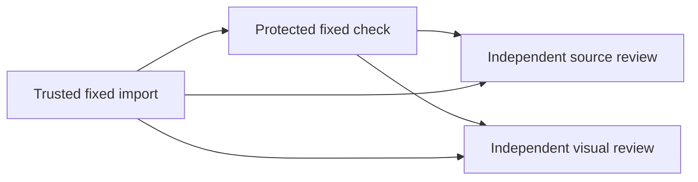

# Audited Sudoku preview continuation

This example prepares the exact retained Sudoku candidate for the new general
role/task Runner. It creates configuration and an owner continuation request;
it does not submit work, launch a service/model/browser, restore source or run
product checks.

The owning Core/store must retain
`run_FNR3X224USDKLFCMAKXCGD754R`, its exact source attempt
`attempt_W5RH764QVM43P33C4F7F7QKFOU` and passing check
`attempt_6GJSYCYUNLWGAKZA4IAI5UVJNY`. `ContinueTask` atomically freezes spending
by the entire old family and charges its authoritative historical debit against
the unchanged 64-attempt ceiling. The observed handoff has spent 36, leaving at
most 28 new attempts. The old Failed status, records, original process, source
and passing evidence remain preserved. Do not use `runner_start` or an unlinked
new state directory for this handoff.

Run the builder with an empty, externally owned private root and absolute paths
to the existing JSON instance, read-only `runner_inspect` result, original complete
agreement JSON and already installed runtimes:

```sh
node examples/sudoku-continuation/configure.mjs \
  --root /absolute/new/sudoku-continuation \
  --instance /absolute/existing/instance.json \
  --inspect /absolute/read-only/retained-root-inspect.json \
  --data /absolute/existing/state \
  --agreement /absolute/original/sudoku-agreement.json \
  --source-helper /absolute/qualified/runner-source-handoff \
  --checker /absolute/qualified/runner-sudoku-check \
  --codex /absolute/selected/codex \
  --go /absolute/compatible/go \
  --node /absolute/selected/node \
  --modules /absolute/qualified/frontend/node_modules \
  --playwright /absolute/qualified/playwright/index.mjs \
  --chromium /absolute/qualified/chrome-for-testing \
  --webkit /absolute/qualified/playwright-webkit
```

`--frontend-helper` defaults to the exact saved fixed-check executable and its
SHA256 must match the serial owner grant. `--maintenance-locks` defaults to the
existing user-cache `codex-maintenance` directory. `--puzzle-skill`,
`--product-skill` and `--interaction-skill` can select other existing absolute
skill files; defaults are their standard personal Codex skill locations. The
builder reads and fingerprints these files, without enabling an inherited skill
catalog. It does not create caches, copy authentication, read `owner.token`, copy
Runner state or duplicate old project/config files.

The new instance references every original project file by absolute path and
adds `sudoku-preview` with one empty `source/` workspace and a separate `preview/`
directory. Existing instance policy is preserved with one explicit machine
admission choice: `max_active_attempts: 2`. Legacy `concurrency: 1` remains one;
the new family can run its two eligible reviews concurrently. This changes no
stored run definition or allowance. Relative instance runtime paths are resolved
against the original instance directory so relocating the wrapper changes no
underlying reference. No original project file is rewritten.

The builder verifies the exact retained patch/check hashes and serial 393-pass
proof and records setup paths, hashes, selected profiles and original agreement
bytes in `runtime.json`. The complete agreement JSON is passed verbatim as the
root's `request:text`, preserving every agreed Duo and other requirement. Every
child automatically inherits that exact authoritative `TaskContext.Goal`; child
roles have no request/feedback text input. Briefs stay below 400 characters with
two compact observable acceptance conditions. Actual feedback flows through
declared dependencies and canonical reports, without copying the agreement or
reports into every retained task specification. Core performs
the authoritative full-family, capture/pin, evidence, revision and budget checks
again during the atomic continuation. A setup fingerprint is not execution proof.

The single native lead delegates this initial DAG in one action:



The fixed importer first authenticates the complete original base-plus-patch tree.
It materializes the bounded source projection, retaining four unchanged historical
directories at their canonical origin while including eighteen exact JSON files
imported by runtime source. Its protected `handoff.json` records the full and
materialized trees. It refuses exclusions that would discard retained changes.
Every nondeleted accepted change is retained automatically, including documents
inside historical directories; these derived exceptions appear in the protected
handoff receipt. The new workspace is created empty by the builder; only Runner's configured
import task materializes it. A ready importer replay preserves later edits.

The checker has only a declared `checks:artifact` input. Its immutable command
resolves `--handoff {dependency.import.artifact}` from the actual completed
declared import dependency; `--prior-check {artifact.checks}` resolves the
authenticated original report. Models cannot choose either path or mint another
artifact. Reviewers also depend on import and receive its protected proof through
their task context. Every native role returns text only.

If actual evidence requires a correction, the lead admits at most four cycles
within actual remaining task/attempt capacity:
`repair-N → check-N → source-(N+1)/visual-(N+1)`. Rechecks also depend on the
original import; import is never repeated. Developer claims are only
`frontend/src` and `docs/sudoku-interface.md`. Generated files, dependencies,
configuration, other puzzles and existing proof are protected. Fixed checks own
all product testing/build/browser work; source and visual reviewers perform
independent assessment without repeating tests. The original 393-pass proof is
reused for the unchanged imported candidate; changed source gets fresh relevant
frontend proof. The documented interface-note exception stays included in the
whole-candidate source identity. Twenty child slots and the ordinary parent
returns permit twenty-six new executions, leaving two of the original twenty-eight
for transport/protocol retries. Repeating the same failure twice calls for
reassessing the cause and approach within the agreement, not asking a human or
layering on case patches. Actual resource limits still govern every admission.

All model roles use `gpt-6.1-sol`, lean context, native built-in tools and
`skills:none`; lead reasoning is medium and developer/source/visual reasoning is
high. The visual reviewer reads its three fixed skills directly and personally
views the retained full viewport captures in owned scratch, then removes its
extraction files. `runtime.json` records setup; Runner's retained provenance
records actual harness/tool/skill exposure and use, usage and cleanup.

The prepared owner wire request is `requests/continue.json`, with stable
`request_id: sudoku-native-preview-handoff-20261115-v1`. Main integration must
validate the complete generated configuration and installed build, then send that
exact object to owner-only `runner_continue_task` on the existing Core/store.
The equivalent CLI operation is `continue-task` with exact `--run`, `--revision`,
`--project`, `--process`, `--source-attempt`, `--patch-sha256`, `--check-attempt`,
`--check-sha256`, `--request-id`, `--inputs` and `--artifacts` from that object.
It supports no command, profile, approval or extra-allowance override. Reuse the
same request ID and arguments after an uncertain response; inspect the linked
new run through normal result/status controls.

Roles read compact protected `summary.json` first and select relevant browser
metadata. Full `report.json` remains available for reproduction and specific
fingerprint questions, without repeatedly injecting its large source inventory
into model context.

Completion requires protected passing current-source evidence, clean browser/
server/database/build scratch settlement and matching independent source and
personally viewed visual approval. `Completed` on a checker means evidence was
collected, even when `report.status` is failed or blocked. It is not acceptance.
The command uses only its `domain.json` result. It has no exit-code success
mapping: a true collector failure must fail. The latest browser summary must
also show exactly three shared-component neighbors and zero failures, with
Suguru, Nonogram and Shikaku smoke results passed; these remain separate from
the Sudoku geometry and journey counts.
The accepted deliverable is a verified **preview**, with a content-addressed
stopped executable and manifest. It does not claim a running server, native
Safari/physical-device proof, completion of the old release flow, merge or
deployment authority. Those gaps remain explicit.

Configuration-only checks, with no product execution:

```sh
node --check examples/sudoku-continuation/configure.mjs
node --test examples/sudoku-continuation/configure.test.mjs
make check PACKAGES='./examples/sudoku-continuation'
```
